# Глава 1. Тригонометрические функции

> Конспект главы I учебника «Алгебра и начала математического анализа»
> (А. Н. Колмогоров и др., 10–11 кл.). Структура следует пособию (§1–§3,
> пункты 1–11). Формулы восстановлены в LaTeX по стандартному изложению;
> примеры и определения — по тексту учебника.

---

## §1. Тригонометрические функции числового аргумента

### 1. Синус, косинус, тангенс и котангенс (повторение)

> **Рисунки из учебника** (нумерация по пособию):

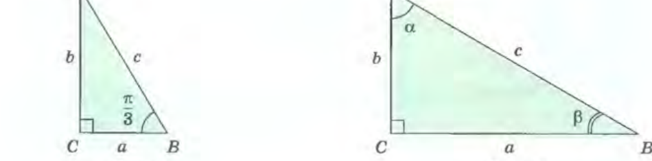

#### Радианная мера

Угол в 1 радиан — центральный угол, длина дуги которого равна радиусу
окружности. Связь градусной и радианной мер:

$$180^\circ = \pi\ \text{радиан}, \qquad \alpha^\circ = \frac{\pi}{180}\alpha\ \text{радиан}.$$

При радианной мере упрощается ряд формул. Для окружности радиуса $r$ длина
дуги, отвечающей углу $\alpha$ радиан:

$$l = \alpha r,$$

площадь сектора:

$$S = \frac{1}{2}\alpha r^2.$$

**Пример.** Длина дуги окружности радиуса 1 см, отвечающей углу 2 рад,
равна $l = 2 \cdot 1 = 2$ см.

#### Определение тригонометрических функций

Повороту точки $P_0(1;0)$ единичной окружности на угол $\alpha$ радиан
отвечает точка $P_\alpha(x; y)$. Тогда

$$\sin\alpha = y,\qquad \cos\alpha = x,$$

$$\tan\alpha = \frac{y}{x} = \frac{\sin\alpha}{\cos\alpha} \quad (\cos\alpha \ne 0),\qquad
\cot\alpha = \frac{x}{y} = \frac{\cos\alpha}{\sin\alpha} \quad (\sin\alpha \ne 0).$$

Значения для «табличных» углов (например, $\sin 30^\circ = \dfrac12$,
$\cos 30^\circ = \dfrac{\sqrt3}{2}$, $\tan 30^\circ = \dfrac{1}{\sqrt3}$).

#### Основные тригонометрические тождества

$$\sin^2\alpha + \cos^2\alpha = 1;$$

$$\tan\alpha = \frac{\sin\alpha}{\cos\alpha}, \qquad \cot\alpha = \frac{\cos\alpha}{\sin\alpha};$$

$$1 + \tan^2\alpha = \frac{1}{\cos^2\alpha}, \qquad 1 + \cot^2\alpha = \frac{1}{\sin^2\alpha};$$

$$\tan\alpha \cdot \cot\alpha = 1.$$

#### Формулы сложения

$$\cos(\alpha - \beta) = \cos\alpha\cos\beta + \sin\alpha\sin\beta;$$
$$\cos(\alpha + \beta) = \cos\alpha\cos\beta - \sin\alpha\sin\beta;$$
$$\sin(\alpha - \beta) = \sin\alpha\cos\beta - \cos\alpha\sin\beta;$$
$$\sin(\alpha + \beta) = \sin\alpha\cos\beta + \cos\alpha\sin\beta;$$
$$\tan(\alpha + \beta) = \frac{\tan\alpha + \tan\beta}{1 - \tan\alpha\tan\beta}, \qquad
\tan(\alpha - \beta) = \frac{\tan\alpha - \tan\beta}{1 + \tan\alpha\tan\beta}.$$

#### Формулы приведения

Из формул сложения при $\beta = \tfrac{\pi}{2}n$ получаются формулы приведения
для выражений вида $\sin(n\tfrac{\pi}{2}\pm\alpha)$, $\cos(n\tfrac{\pi}{2}\pm\alpha)$,
$\tan(n\tfrac{\pi}{2}\pm\alpha)$, $\cot(n\tfrac{\pi}{2}\pm\alpha)$, $n\in\mathbb Z$.

Мнемоническое правило:

- перед приведённой функцией ставится знак исходной функции (если
  $0<\alpha<\tfrac{\pi}{2}$);
- функция меняется на кофункцию при нечётном $n$ и не меняется при чётном $n$.

(Кофункции: синус ↔ косинус, тангенс ↔ котангенс.)

**Примеры:**
$$\sin\Big(\tfrac{\pi}{2}-\alpha\Big)=\cos\alpha,\quad
\cos\Big(\tfrac{\pi}{2}-\alpha\Big)=\sin\alpha;$$
$$\sin\Big(\tfrac{\pi}{2}+\alpha\Big)=\cos\alpha,\quad
\cos\Big(\tfrac{\pi}{2}+\alpha\Big)=-\sin\alpha;$$
$$\sin(\pi-\alpha)=\sin\alpha,\quad \sin(\pi+\alpha)=-\sin\alpha.$$

#### Суммы и разности синусов и косинусов

$$\sin\alpha + \sin\beta = 2\sin\frac{\alpha+\beta}{2}\cos\frac{\alpha-\beta}{2};$$
$$\sin\alpha - \sin\beta = 2\sin\frac{\alpha-\beta}{2}\cos\frac{\alpha+\beta}{2};$$
$$\cos\alpha + \cos\beta = 2\cos\frac{\alpha+\beta}{2}\cos\frac{\alpha-\beta}{2};$$
$$\cos\alpha - \cos\beta = -2\sin\frac{\alpha+\beta}{2}\sin\frac{\alpha-\beta}{2}.$$

#### Формулы двойного аргумента

Подстановка $\beta = \alpha$ в формулы сложения даёт:

$$\sin 2\alpha = 2\sin\alpha\cos\alpha;$$
$$\cos 2\alpha = \cos^2\alpha - \sin^2\alpha = 1 - 2\sin^2\alpha = 2\cos^2\alpha - 1;$$
$$\tan 2\alpha = \frac{2\tan\alpha}{1 - \tan^2\alpha}.$$

#### Формулы половинного аргумента

Полагая в формулах $\cos 2x = 1 - 2\sin^2 x$ и $\cos 2x = 2\cos^2 x - 1$
значение $x = \tfrac{\alpha}{2}$, получаем:

$$\sin^2\frac{\alpha}{2} = \frac{1 - \cos\alpha}{2}, \qquad
\cos^2\frac{\alpha}{2} = \frac{1 + \cos\alpha}{2};$$

$$\tan\frac{\alpha}{2} = \frac{\sin\alpha}{1 + \cos\alpha} = \frac{1 - \cos\alpha}{\sin\alpha}.$$

**Пример.** $\sin 15^\circ$:

$$\sin^2 15^\circ = \frac{1 - \cos 30^\circ}{2}
= \frac{1 - \frac{\sqrt3}{2}}{2} = \frac{2-\sqrt3}{4},$$

откуда $\sin 15^\circ = \dfrac{\sqrt{2-\sqrt3}}{2} = \dfrac{\sqrt6-\sqrt2}{4}$.

**Пример.** $\tan\dfrac{\pi}{8}$:

$$\tan\frac{\pi}{8} = \frac{\sin\frac{\pi}{4}}{1 + \cos\frac{\pi}{4}}
= \frac{\sqrt2/2}{1 + \sqrt2/2} = \sqrt2 - 1.$$

---

### 2. Тригонометрические функции и их графики

> **Рисунки из учебника** (нумерация по пособию):

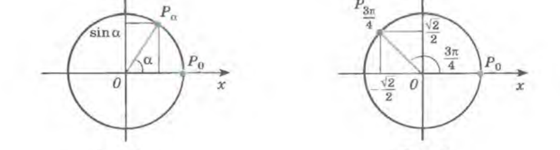

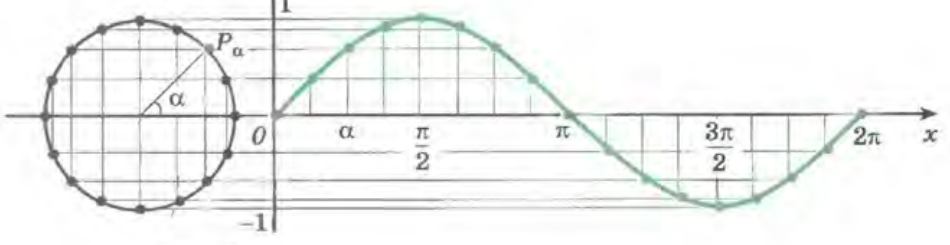

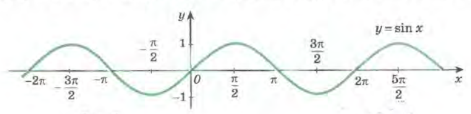

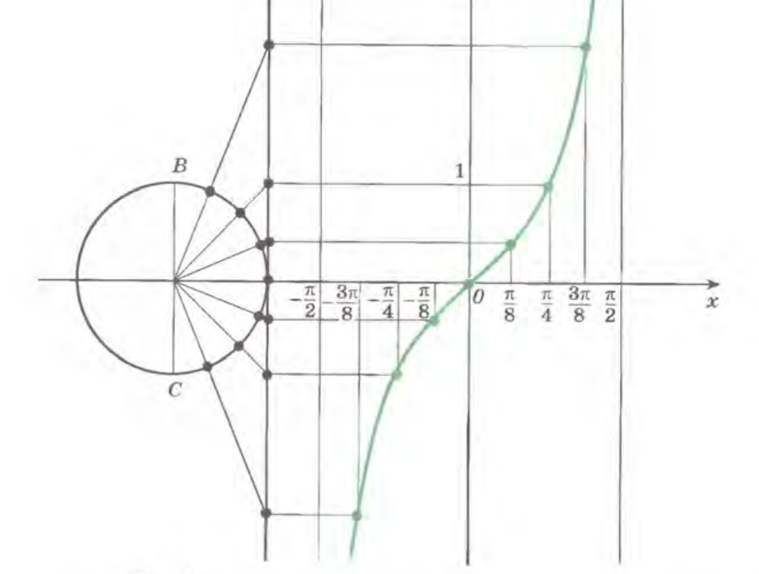

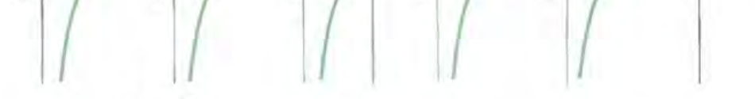

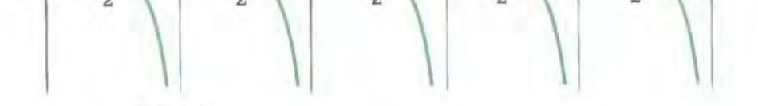

#### Функции синус и косинус

> **Определение.** Числовые функции $y=\sin x$ и $y=\cos x$ называют
> синусом и косинусом (это координаты точки $P_x$ единичной окружности).

Область определения и область значений:

$$D(\sin) = D(\cos) = \mathbb R, \qquad E(\sin) = E(\cos) = [-1; 1].$$

Свойства:

$$\sin(-x) = -\sin x, \qquad \cos(-x) = \cos x;$$
$$\sin(x + 2\pi n) = \sin x, \qquad \cos(x + 2\pi n) = \cos x, \quad n \in \mathbb Z.$$

#### Синусоида

График синуса — синусоида. Так как $\cos x = \sin\big(x + \tfrac{\pi}{2}\big)$,
график косинуса получается из синусоиды переносом на $\tfrac{\pi}{2}$ влево
вдоль оси $Ox$ и тоже является синусоидой.

#### Функции тангенс и котангенс

> **Определение.** Числовые функции $y = \tan x$ и $y = \cot x$ называют
> тангенсом и котангенсом.

Области определения:

$$D(\tan) = \Big\{ x : x \ne \tfrac{\pi}{2} + \pi n,\ n \in \mathbb Z \Big\},$$
$$D(\cot) = \Big\{ x : x \ne \pi n,\ n \in \mathbb Z \Big\}.$$

Область значений обеих функций — вся числовая прямая: $E(\tan)=E(\cot)=\mathbb R$.

Свойства:

$$\tan(-x) = -\tan x, \qquad \cot(-x) = -\cot x;$$
$$\tan(x + \pi n) = \tan x, \qquad \cot(x + \pi n) = \cot x, \quad n \in \mathbb Z.$$

График тангенса — тангенсоида. Касательную к единичной окружности в точке
$P_0$ называют линией тангенсов (ордината точки пересечения $OP_\alpha$ с ней
равна $\tan\alpha$); аналогично определяется линия котангенсов.

> **Примечание.** Кроме четырёх основных функций рассматривают также секанс
> $\sec\alpha = 1/\cos\alpha$ и косеканс $\operatorname{cosec}\alpha = 1/\sin\alpha$.

---

## §2. Основные свойства функций

### 3. Функции и их графики

> **Рисунки из учебника** (нумерация по пособию):

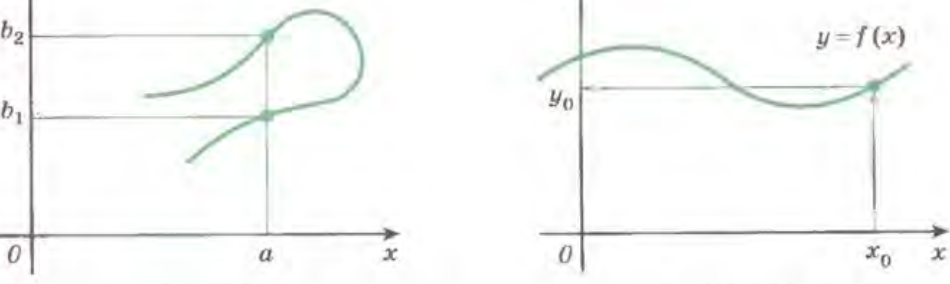

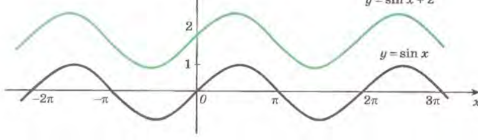

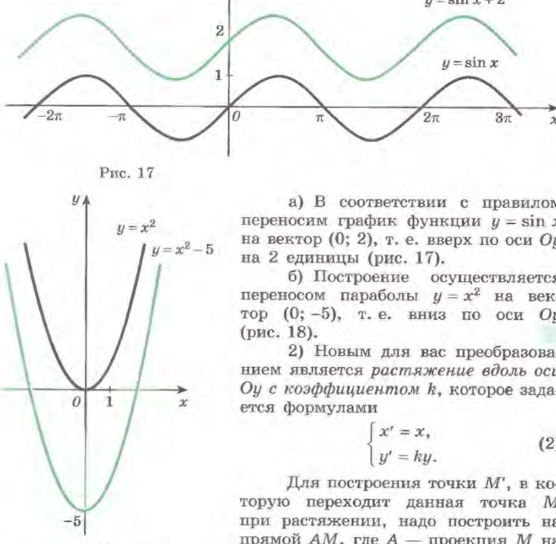

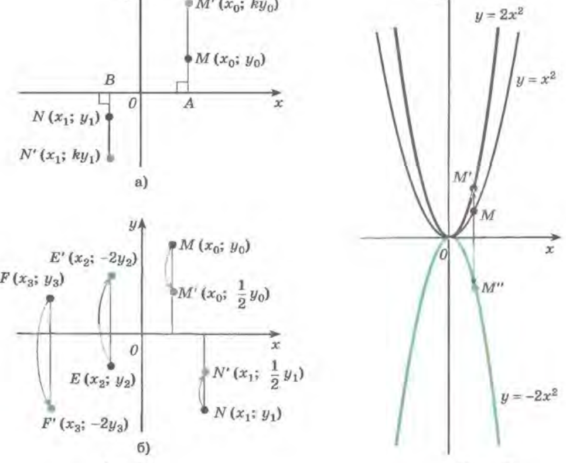

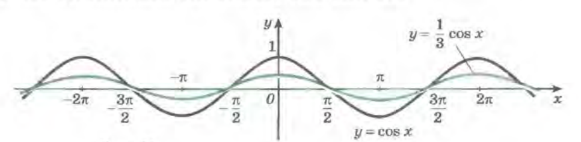

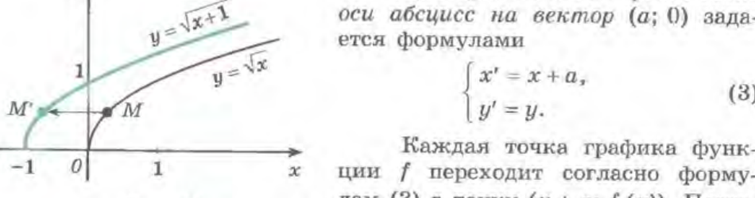

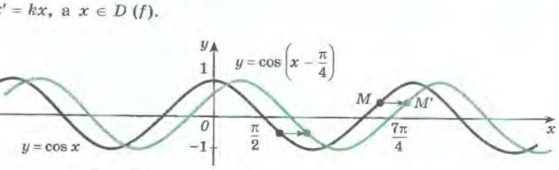

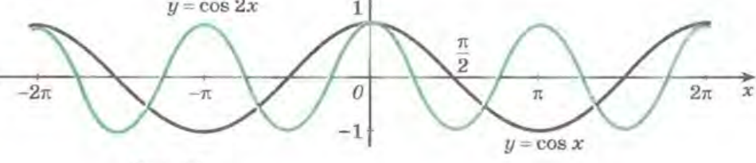

> **Определение.** Числовой функцией с областью определения $D$ называется
> соответствие, сопоставляющее каждому числу $x\in D$ по некоторому правилу
> единственное число $y$, зависящее от $x$.

- $x$ — аргумент, $y = f(x)$ — значение функции в точке $x$.
- $D(f)$ — область определения, $E(f)$ — область значений.
- Объединение множеств $A$ и $B$: $A \cup B$.

Функции вида $f(x)=p(x)$ (многочлен) — целые рациональные; вида
$f(x)=\dfrac{p(x)}{q(x)}$ — дробно-рациональные (область определения —
все $x$, кроме корней знаменателя $q(x)$).

График функции — множество точек $(x; y)$, где $y=f(x)$. Подмножество плоскости
является графиком функции, если любая вертикальная прямая имеет с ним не более
одной общей точки.

#### Преобразования графиков

1. `y = f(x) + b` — перенос графика на вектор $(0; b)$ вдоль оси $Oy$.
2. `y = k·f(x)` — растяжение в $k$ раз вдоль оси $Oy$ (при $|k|<1$ — сжатие,
   при $k<0$ добавляется отражение относительно $Ox$).
3. `y = f(x − a)` — перенос на вектор $(a; 0)$ вдоль оси $Ox$.
4. `y = f(x/k)` — растяжение с коэффициентом $k$ вдоль оси $Ox$.

Понятие функции совпадает с понятием отображения: $D\to E$, при котором каждому
элементу $D$ соответствует ровно один элемент $E$.

---

### 4. Чётные и нечётные функции. Периодичность

> **Рисунки из учебника** (нумерация по пособию):

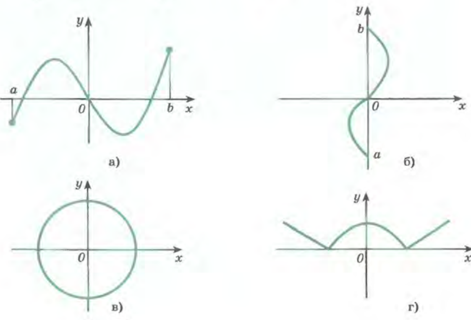

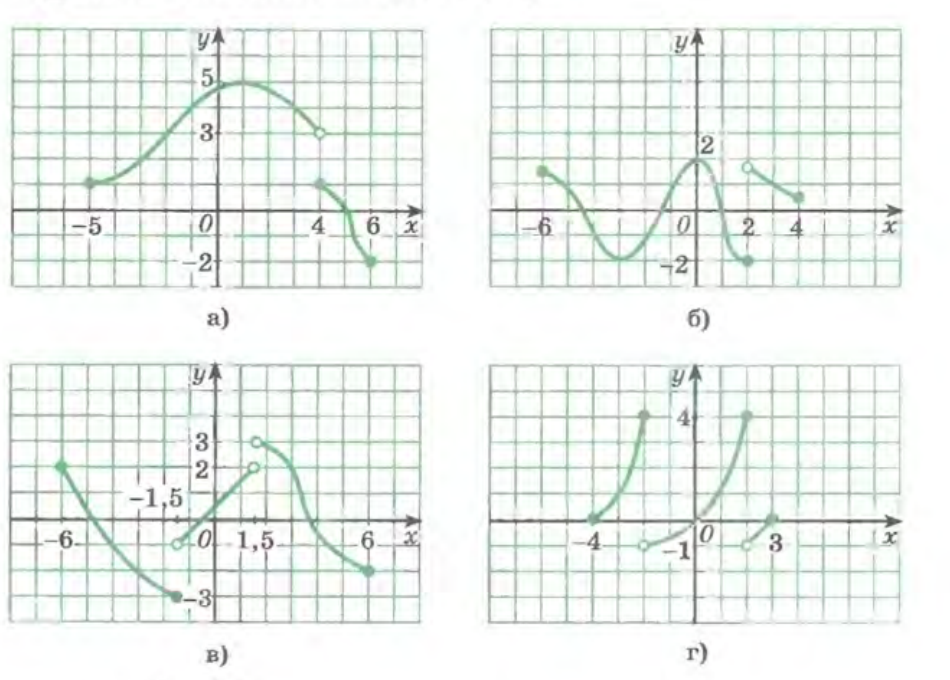

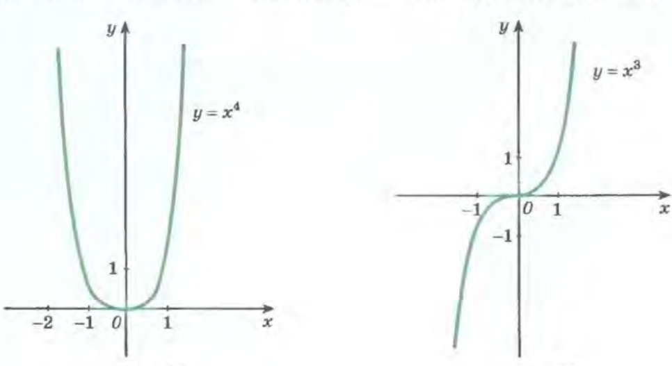

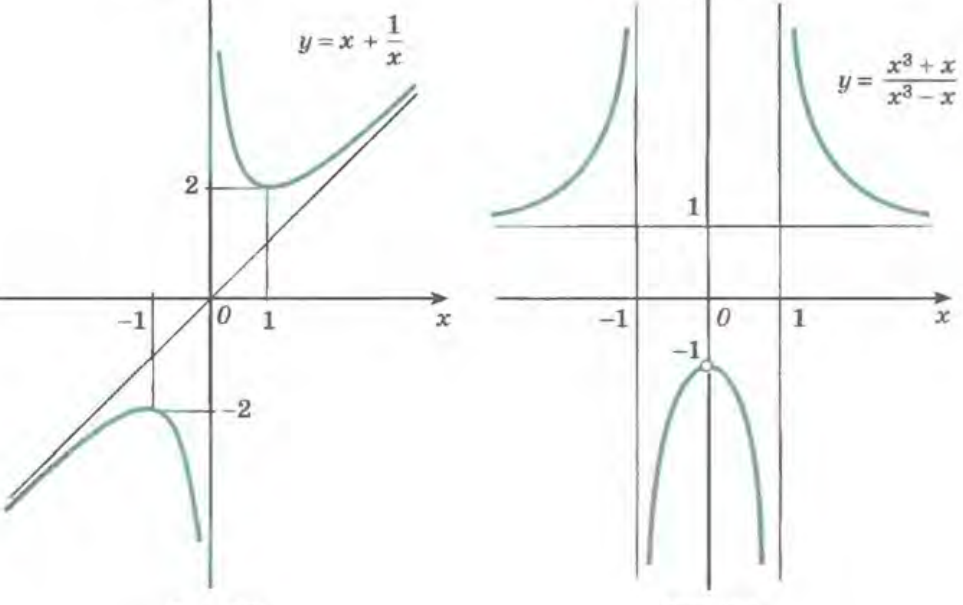

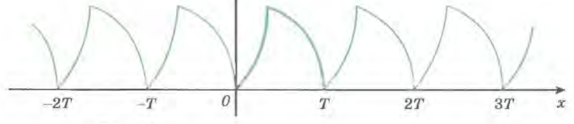

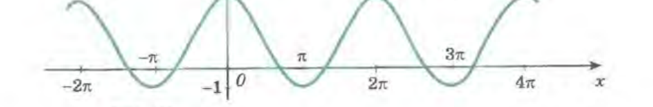

#### Чётные и нечётные функции

Пусть область определения функции симметрична относительно нуля.

> **Определение.** $f$ **чётная**, если $f(-x)=f(x)$ для всех $x\in D(f)$;
> **нечётная**, если $f(-x)=-f(x)$.

- График чётной функции симметричен относительно оси $Oy$.
- График нечётной — относительно начала координат.

Синус, тангенс и котангенс — нечётные; косинус — чётная функция.

#### Периодичность

> **Определение.** Функция $f$ периодична с периодом $T\ne 0$, если
> $f(x+T)=f(x)=f(x-T)$ для всех $x\in D(f)$.

- Период синуса и косинуса — $2\pi$ (наименьший положительный).
- Период тангенса и котангенса — $\pi$.
- Если $T$ — период, то $nT$ ($n\in\mathbb Z$) — тоже период.

> **Теорема.** Если $f$ имеет наименьший положительный период $T$, то функция
> $A\,f(kx+b)$ ($A,k,b$ постоянные, $k\ne 0$) периодична с наименьшим
> положительным периодом $\dfrac{T}{|k|}$.

**Пример.** Период функции $\tan 2x$ равен $\dfrac{\pi}{2}$; период
$\cos\dfrac{x}{2}$ равен $4\pi$.

---

### 5. Возрастание и убывание функций. Экстремумы

> **Рисунки из учебника** (нумерация по пособию):

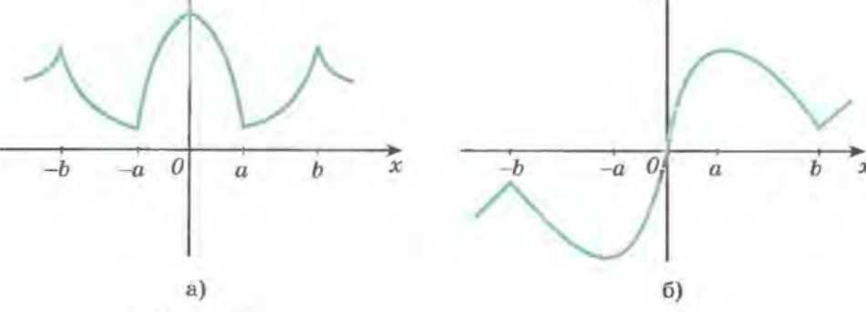

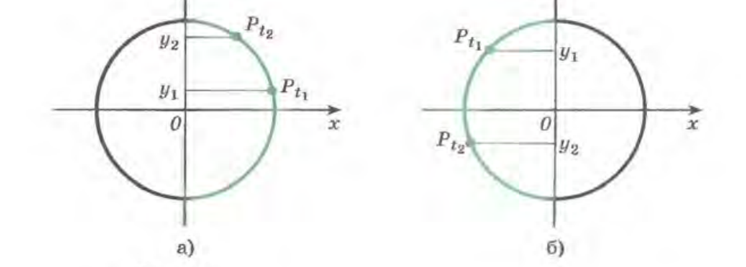

> **Определение.** $f$ возрастает на множестве $P$, если из $x_2 > x_1$
> следует $f(x_2) > f(x_1)$; убывает, если $f(x_2) < f(x_1)$.

#### Монотонность тригонометрических функций

- $\sin x$ возрастает на $\big[-\tfrac{\pi}{2}+2\pi n;\ \tfrac{\pi}{2}+2\pi n\big]$
  и убывает на $\big[\tfrac{\pi}{2}+2\pi n;\ \tfrac{3\pi}{2}+2\pi n\big]$, $n\in\mathbb Z$.
- $\cos x$ возрастает на $[-\pi+2\pi n;\ 2\pi n]$ и убывает на
  $[2\pi n;\ \pi+2\pi n]$.
- $\tan x$ возрастает на $\big(-\tfrac{\pi}{2}+\pi n;\ \tfrac{\pi}{2}+\pi n\big)$.
- $\cot x$ убывает на $\big(\pi n;\ \pi+\pi n\big)$.

#### Точки экстремума

Окрестность точки $a$ — любой интервал, содержащий $a$.

> **Определение.** Точка $x_0$ — точка **минимума** функции $f$, если
> $f(x)\ge f(x_0)$ для всех $x$ из некоторой окрестности $x_0$; точка
> **максимума**, если $f(x)\le f(x_0)$.

Точки максимума синуса — $x = \tfrac{\pi}{2}+2\pi n$ (максимум $=1$), минимума —
$x = -\tfrac{\pi}{2}+2\pi n$ (минимум $=-1$). Точки максимума косинуса —
$x=2\pi n$ (максимум $=1$), минимума — $x=\pi+2\pi n$ (минимум $=-1$).

---

### 6. Исследование функций

> **Рисунки из учебника** (нумерация по пособию):

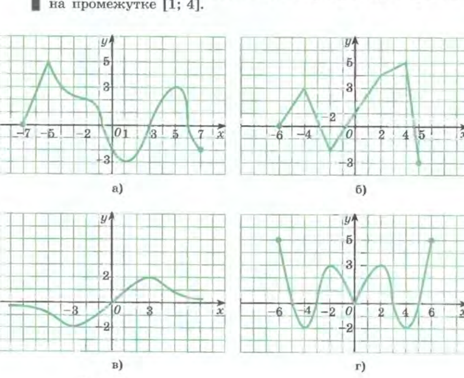

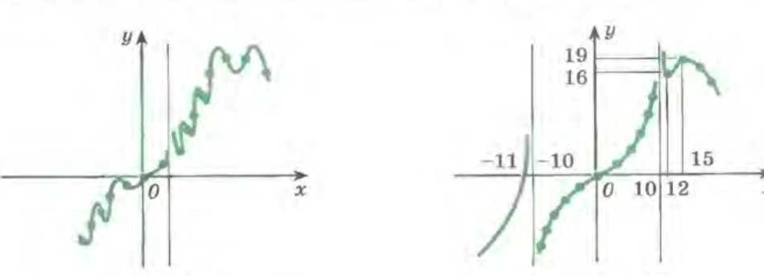

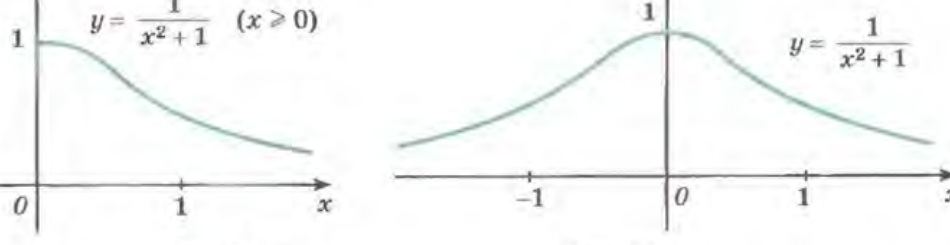

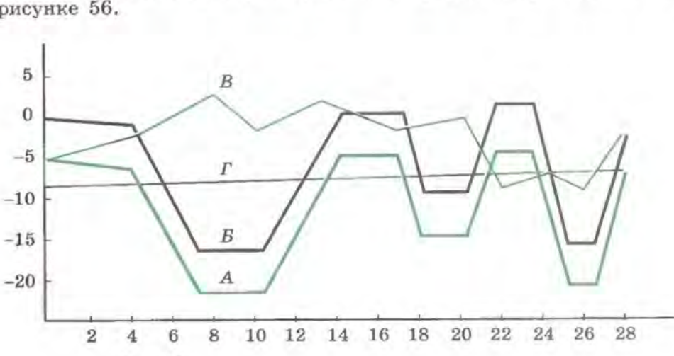

Общая схема исследования функции:

1. Область определения $D(f)$ и область значений $E(f)$.
2. Особенности: чётность/нечётность, периодичность.
3. Точки пересечения графика с осями координат (нули функции — корни $f(x)=0$).
4. Промежутки знакопостоянства ($f(x)>0$, $f(x)<0$).
5. Промежутки возрастания и убывания.
6. Точки экстремума и значения в них.
7. Поведение вблизи точек разрыва и при $|x|\to\infty$.

**Пример.** $f(x)=\dfrac{1}{x^2+1}$: функция чётная; $E(f)=(0;1]$; график
пересекает $Oy$ в точке $(0;1)$; $f(x)>0$ на всей прямой; возрастает на
$(-\infty;0]$, убывает на $[0;\infty)$; $x=0$ — точка максимума, $f(0)=1$.

#### Асимптоты

- Вертикальная $\ x=a$ — график неограниченно приближается к ней
  (например, $x=0$ у $f(x)=1/x$; $x=\tfrac{\pi}{2}+\pi n$ у $f(x)=\tan x$).
- Горизонтальная $\ y=b$ — при $|x|\to\infty$ (например, $y=0$ у $f(x)=1/(x^2+1)$).
- Наклонная $\ y=kx+b$.

---

### 7. Свойства тригонометрических функций. Гармонические колебания

> **Рисунки из учебника** (нумерация по пособию):

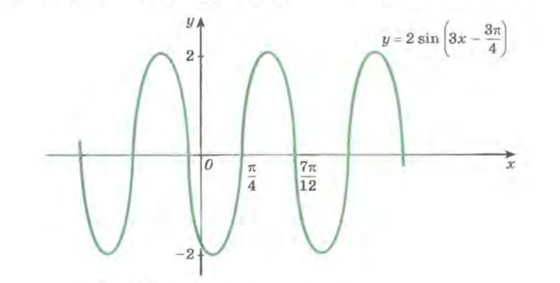

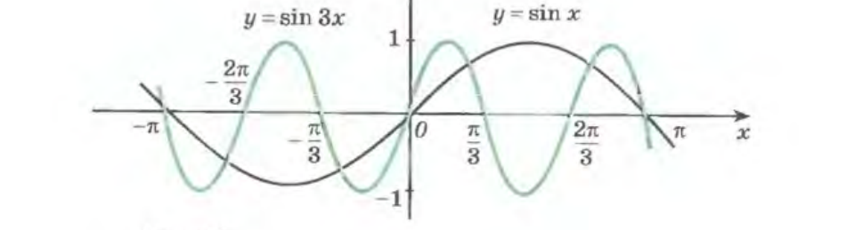

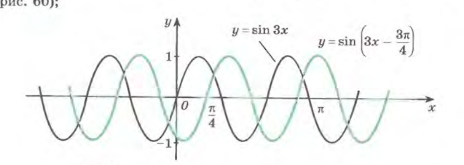

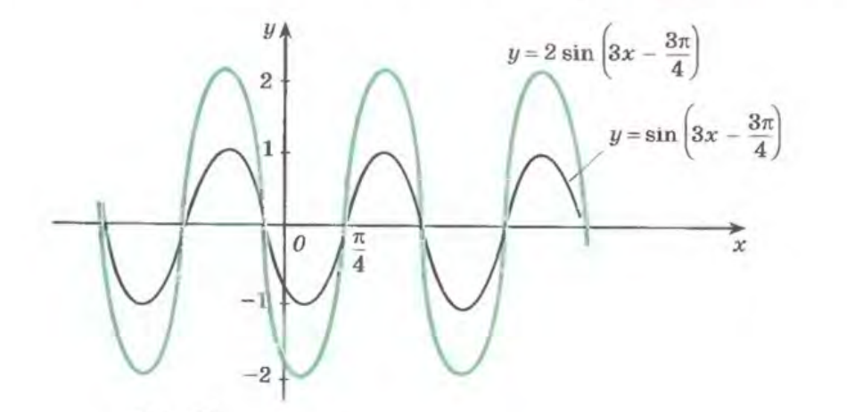

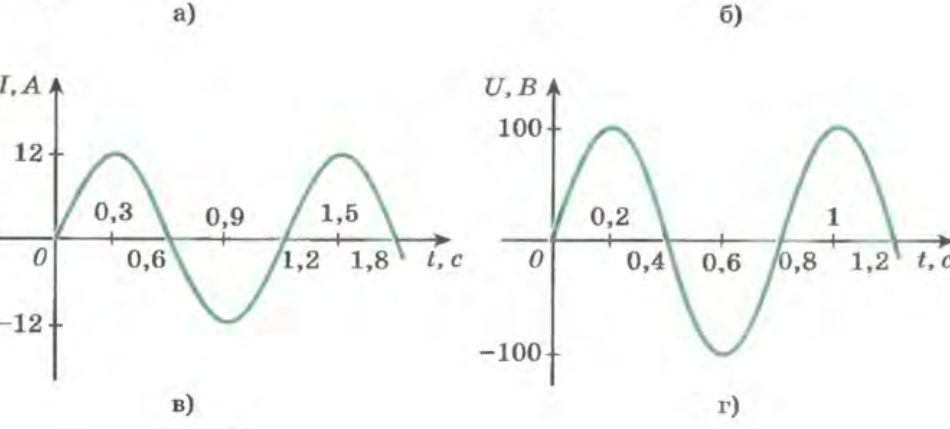

Сводка свойств (всюду $n\in\mathbb Z$):

| | $\sin x$ | $\cos x$ | $\tan x$ | $\cot x$ |
|---|---|---|---|---|
| $D(f)$ | $\mathbb R$ | $\mathbb R$ | $x\ne\tfrac\pi2+\pi n$ | $x\ne\pi n$ |
| $E(f)$ | $[-1;1]$ | $[-1;1]$ | $\mathbb R$ | $\mathbb R$ |
| Чётность | нечёт. | чёт. | нечёт. | нечёт. |
| Период | $2\pi$ | $2\pi$ | $\pi$ | $\pi$ |
| Нули | $\pi n$ | $\tfrac\pi2+\pi n$ | $\pi n$ | $\tfrac\pi2+\pi n$ |
| Возрастание | $\big[-\tfrac\pi2+2\pi n;\tfrac\pi2+2\pi n\big]$ | $[-\pi+2\pi n;2\pi n]$ | $\big(-\tfrac\pi2+\pi n;\tfrac\pi2+\pi n\big)$ | — |
| Убывание | $\big[\tfrac\pi2+2\pi n;\tfrac{3\pi}2+2\pi n\big]$ | $[2\pi n;\pi+2\pi n]$ | — | $(\pi n;\pi+\pi n)$ |
| Максимум | $1$, $x=\tfrac\pi2+2\pi n$ | $1$, $x=2\pi n$ | — | — |
| Минимум | $-1$, $x=-\tfrac\pi2+2\pi n$ | $-1$, $x=\pi+2\pi n$ | — | — |

#### Гармонические колебания

Величина, меняющаяся по закону

$$x(t) = A\cos(\omega t + \varphi) \quad \text{или} \quad x(t) = A\sin(\omega t + \varphi),$$

называется гармоническим колебанием. Здесь

- $A$ — амплитуда,
- $\omega$ — циклическая (круговая) частота,
- $\omega t + \varphi$ — фаза, $\varphi$ — начальная фаза,
- $T = \dfrac{2\pi}{\omega}$ — период колебания.

Кинематическая интерпретация: проекция точки, равномерно движущейся по
окружности радиуса $A$ с угловой скоростью $\omega$, на координатную ось.

---

## §3. Решение тригонометрических уравнений и неравенств

### 8. Арксинус, арккосинус и арктангенс

> **Рисунки из учебника** (нумерация по пособию):

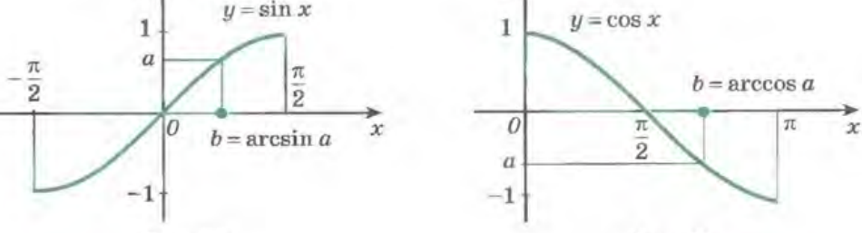

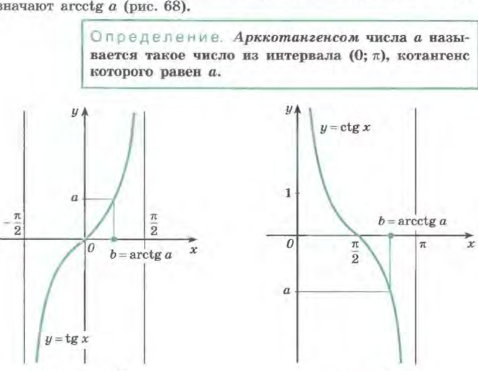

> **Теорема (о корне).** Если функция $f$ монотонна на промежутке $I$ и $a$ —
> её значение на $I$, то уравнение $f(x)=a$ имеет на $I$ единственный корень.

#### Арксинус

Синус возрастает на $\big[-\tfrac{\pi}{2}; \tfrac{\pi}{2}\big]$ и принимает все
значения из $[-1;1]$. Поэтому для $|a|\le 1$ существует единственное число
$b\in\big[-\tfrac{\pi}{2};\tfrac{\pi}{2}\big]$ с $\sin b = a$.

> **Определение.** $\arcsin a$ — число из $\big[-\tfrac{\pi}{2};\tfrac{\pi}{2}\big]$,
> синус которого равен $a$.

**Примеры:** $\arcsin\dfrac{\sqrt2}{2}=\dfrac{\pi}{4}$; $\arcsin\Big(-\dfrac12\Big)=-\dfrac{\pi}{6}$.

#### Арккосинус

> **Определение.** $\arccos a$ — число из $[0;\pi]$, косинус которого равен $a$ ($|a|\le 1$).

**Примеры:** $\arccos\dfrac{\sqrt3}{2}=\dfrac{\pi}{6}$; $\arccos\Big(-\dfrac{\sqrt2}{2}\Big)=\dfrac{3\pi}{4}$.

#### Арктангенс и арккотангенс

> **Определение.** $\arctan a$ — число из $\big(-\tfrac{\pi}{2};\tfrac{\pi}{2}\big)$,
> тангенс которого равен $a$; $\operatorname{arcctg} a$ — число из $(0;\pi)$,
> котангенс которого равен $a$.

**Примеры:** $\arctan 1=\dfrac{\pi}{4}$; $\arctan(-\sqrt3)=-\dfrac{\pi}{3}$;
$\operatorname{arcctg} 1=\dfrac{\pi}{4}$.

Основные связи: $\arcsin a + \arccos a = \dfrac{\pi}{2}$, $\arctan a + \operatorname{arcctg} a = \dfrac{\pi}{2}$.

---

### 9. Простейшие тригонометрические уравнения

> **Рисунки из учебника** (нумерация по пособию):

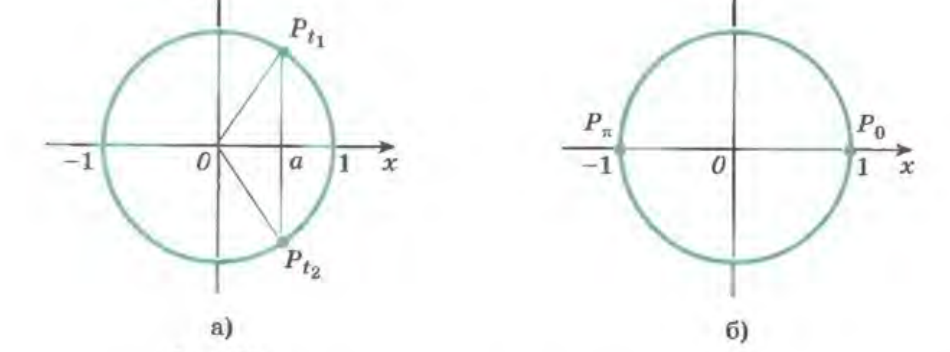

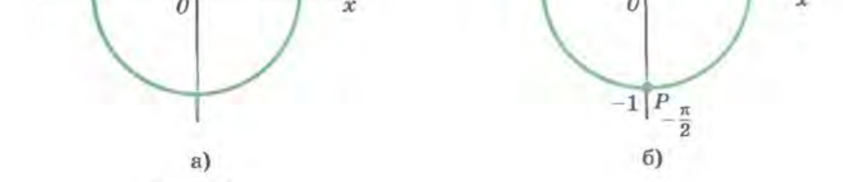

#### Уравнение $\cos t = a$

При $|a|>1$ решений нет. При $|a|\le 1$:

$$t = \pm\arccos a + 2\pi n, \quad n\in\mathbb Z.$$

Частные случаи:

$$\cos t = 1 \ \Rightarrow\ t = 2\pi n; \qquad \cos t = -1 \ \Rightarrow\ t = \pi + 2\pi n; \qquad \cos t = 0 \ \Rightarrow\ t = \frac{\pi}{2} + \pi n.$$

#### Уравнение $\sin t = a$

При $|a|>1$ решений нет. При $|a|\le 1$:

$$t = (-1)^k \arcsin a + \pi k, \quad k\in\mathbb Z.$$

Частные случаи:

$$\sin t = 1 \ \Rightarrow\ t = \frac{\pi}{2} + 2\pi n; \qquad \sin t = -1 \ \Rightarrow\ t = -\frac{\pi}{2} + 2\pi n; \qquad \sin t = 0 \ \Rightarrow\ t = \pi n.$$

#### Уравнения $\tan t = a$ и $\cot t = a$

$$\tan t = a \ \Rightarrow\ t = \arctan a + \pi n, \quad n\in\mathbb Z;$$
$$\cot t = a \ \Rightarrow\ t = \operatorname{arcctg} a + \pi n, \quad n\in\mathbb Z.$$

**Пример.** $\cos x = \dfrac12$: $x = \pm\dfrac{\pi}{3} + 2\pi n$.

**Пример.** $\sin x = \dfrac{\sqrt2}{2}$: $x = (-1)^k\dfrac{\pi}{4} + \pi k$.

**Пример.** $\tan x = \sqrt3$: $x = \dfrac{\pi}{3} + \pi n$.

---

### 10. Простейшие тригонометрические неравенства

> **Рисунки из учебника** (нумерация по пособию):

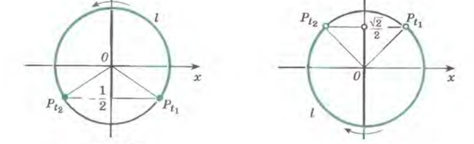

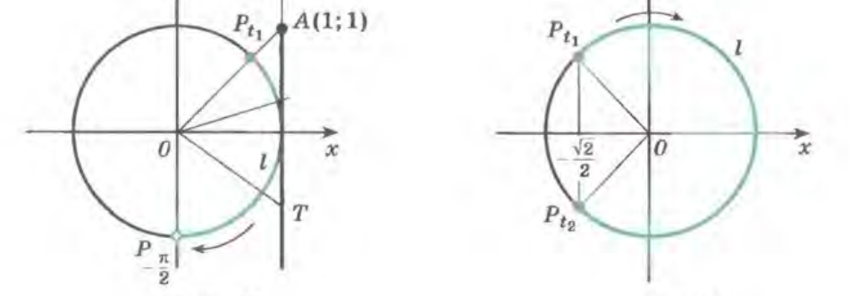

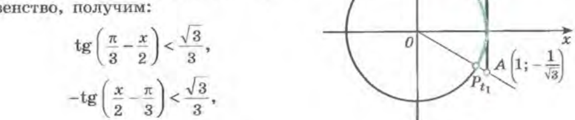

Неравенства решают на единичной окружности: выделяют дугу точек $P_t$,
удовлетворяющих условию, затем учитывают периодичность.

**Пример.** $\sin t \ge \dfrac12$. Точки с ординатой $\ge \tfrac12$ образуют
дугу от $t_1=\arcsin\tfrac12=\tfrac{\pi}{6}$ до $t_2=\pi-\tfrac{\pi}{6}=\tfrac{5\pi}{6}$:

$$\frac{\pi}{6} + 2\pi n \le t \le \frac{5\pi}{6} + 2\pi n, \quad n\in\mathbb Z.$$

**Пример.** $\cos t < \dfrac12$:

$$\frac{\pi}{3} + 2\pi n < t < \frac{5\pi}{3} + 2\pi n, \quad n\in\mathbb Z.$$

**Пример.** $\tan t \le 1$:

$$-\frac{\pi}{2} + \pi n < t \le \frac{\pi}{4} + \pi n, \quad n\in\mathbb Z.$$

**Пример.** $\cos 2x \ge -\dfrac{\sqrt2}{2}$. Подстановка $t=2x$ даёт
$-\dfrac{3\pi}{4}+2\pi n \le 2x \le \dfrac{3\pi}{4}+2\pi n$, откуда

$$-\frac{3\pi}{8} + \pi n \le x \le \frac{3\pi}{8} + \pi n, \quad n\in\mathbb Z.$$

---

### 11. Примеры решения уравнений и систем

**1. Замена переменной (сводится к квадратному).**
$2\sin^2 x + \sin x - 1 = 0$. Полагая $y=\sin x$, получаем $2y^2+y-1=0$,
корни $y_1=\tfrac12$, $y_2=-1$. Тогда $\sin x=\tfrac12$ даёт
$x=(-1)^k\dfrac{\pi}{6}+\pi k$, а $\sin x=-1$ — $x=-\dfrac{\pi}{2}+2\pi n$.

**2. Сведение к одной функции.** $6\sin^2 x+5\cos x-2=0$. Замена $\sin^2x=1-\cos^2x$
приводит к $6\cos^2x-5\cos x-4=0$; $\cos x = -\tfrac12$, откуда
$x=\pm\dfrac{2\pi}{3}+2\pi k$.

**3. Однородные уравнения.** $3\sin^2x-4\sin x\cos x+\cos^2x=0$. Так как
$\cos x\ne 0$, делим на $\cos^2x$: $3\tan^2x-4\tan x+1=0\Rightarrow \tan x=1$
или $\tan x=\tfrac13$; $x=\tfrac{\pi}{4}+\pi n$ или $x=\arctan\tfrac13+\pi k$.

**4. Разложение на множители.** $\sin^2x-\sin 2x=0\Rightarrow \sin x(\sin x-2\cos x)=0$;
$\sin x=0$ даёт $x=\pi n$; $\tan x=2$ даёт $x=\arctan 2+\pi n$.

**5. Преобразование суммы в произведение.** $\cos 6x+\cos 2x=0\Rightarrow
2\cos 4x\cos 2x=0$; $\cos 4x=0\Rightarrow x=\tfrac{\pi}{8}+\tfrac{\pi k}{4}$;
$\cos 2x=0\Rightarrow x=\tfrac{\pi}{4}+\tfrac{\pi n}{2}$.

**6. Системы уравнений.** Например,

$$
\begin{cases}
x+y=\pi,\\[4pt]
\cos x - \cos y = 1.
\end{cases}
$$

Из первого уравнения $y = \pi - x$, поэтому $\cos y = \cos(\pi-x) = -\cos x$.
Второе уравнение даёт $\cos x - (-\cos x) = 1$, т.е. $2\cos x = 1$,
откуда $\cos x = \dfrac12$ и $x = \pm\dfrac{\pi}{3} + 2\pi n$. Тогда
$y = \pi - x$.

---

## Сведения из истории (кратко)

> **Рисунки из учебника** (нумерация по пособию):

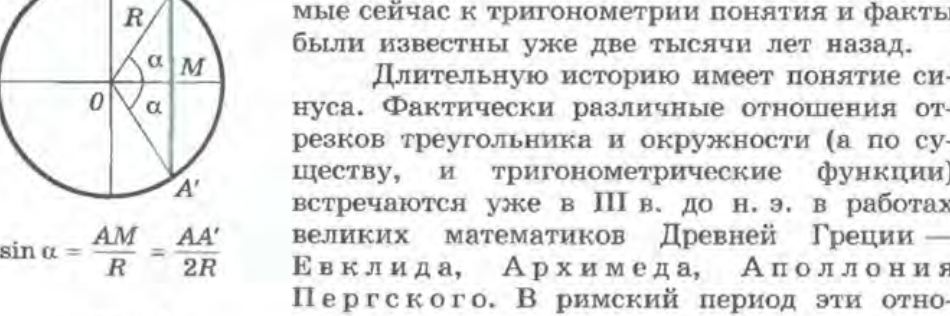

- Градусная мера углов возникла в Древнем Вавилоне (шестидесятеричная система);
  слово «градус» — от лат. *gradus* (шаг), «минута» — «уменьшенная», «секунда» — «вторая».
- Термин «радиан» появился в 1813 г. в Англии (от лат. *radius* — спица, луч).
- Слово «тригонометрия» впервые встречается в 1505 г. (Питискус); греч. —
  «измерение треугольников».
- Синус исторически был полухордой центрального угла (греки); название —
  от индийского «ардхаджива» → «джива» → араб. «джайб» → лат. *sinus*.
- Косинус — от *complementi sinus* («синус дополнительной дуги»).
- Тангенс, котангенс, секанс и косеканс ввёл в X в. Абу-л-Вафа; названия
  «тангенс» (касающийся) — с 1583 г.
- Обозначения $\arcsin$, $\arctan$ ввёл в 1772 г. Шерфер и Лагранж; «арк» — от
  лат. *arcus* (дуга).
- Современную аналитическую форму тригонометрии придал Л. Эйлер (1707–1783),
  введя определения функций произвольного угла и формулы приведения.
- Понятие функции оформилось в XVII в. (аналитическая геометрия Ферма и Декарта;
  работы Ньютона и Лейбница).