# Глава 2. Молекулярная физика и термодинамика / Molecular physics and thermodynamics

> Основные понятия и законы школьного курса физики. Определения переформулированы
> (EN — по-английски в духе учебной литературы, RU — русский перевод), формулы
> соответствуют пособию, к каждому закону указан автор и его работа.
> Формулы и определения физики не охраняются авторским правом; текст пересказан.

---

## 2.1. Основные положения МКТ / Basic postulates of the molecular kinetic theory

Молекулярно-кинетическая теория (МКТ) описывает строение вещества тремя положениями:

1. любое вещество состоит из мельчайших частиц — молекул и атомов, расположенных
   дискретно, на некоторых расстояниях друг от друга;
2. эти частицы находятся в состоянии беспорядочного (теплового) движения, которое
   никогда не прекращается;
3. частицы взаимодействуют друг с другом силами притяжения и отталкивания, зависящими
   от расстояния между ними.

> **EN** All matter consists of tiny particles (molecules and atoms) arranged discretely;
> these particles perform unceasing disordered (thermal) motion; and they interact with
> forces of attraction and repulsion that depend on the distance between them.
>
> **RU** Всё вещество состоит из мельчайших частиц (молекул и атомов), расположенных
> дискретно; эти частицы находятся в беспрерывном беспорядочном (тепловом) движении и
> взаимодействуют силами притяжения и отталкивания, зависящими от расстояния.

### Атомы и молекулы / Atoms and molecules

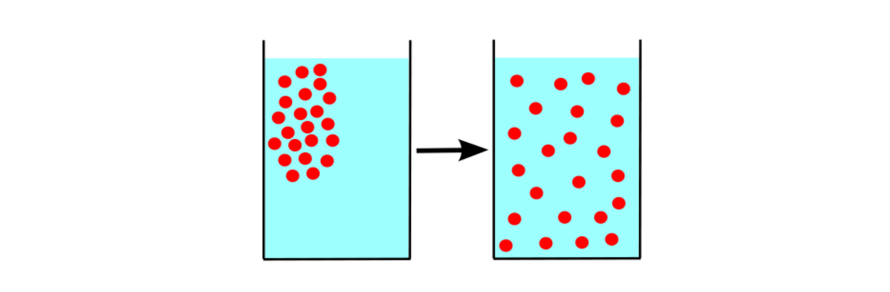

Вещество не делится до бесконечности: на некотором этапе деления мы доходим до
«последнего рубежа» — мельчайших частиц данного вещества.

> **EN** An atom is the smallest particle of a chemical element that retains all its
> chemical properties. A molecule is the smallest particle of a (non-element) substance
> that retains all its chemical properties; it consists of two or more atoms.
>
> **RU** Атом — наименьшая частица химического элемента, сохраняющая все его химические
> свойства. Молекула — наименьшая частица вещества (не являющегося элементом),
> сохраняющая все его химические свойства; она состоит из двух или более атомов.

**Пример.** Молекула воды `H₂O` состоит из двух атомов водорода и одного кислорода.
Разделив её на атомы, мы перестаём иметь дело с веществом «вода»; расщепив сами атомы
на протоны, нейтроны и электроны, потеряем вообще всякую информацию, что это были
водород и кислород.

Размер атома (или молекулы из небольшого числа атомов) — порядка `10⁻⁸ см`: разглядеть
атом нельзя ни в один оптический микроскоп. Частицы вещества не заполняют пространство
непрерывно — между ними есть промежутки, которые могут меняться.

В пользу первого положения МКТ говорят тепловое расширение тел (при нагревании
расстояния между частицами растут — тело увеличивается) и диффузия — взаимное
проникновение соприкасающихся веществ друг в друга.

> **EN** Diffusion is the mutual penetration of adjoining substances into each other;
> particles migrate from regions of high concentration to regions of low concentration
> until the concentration becomes uniform.
>
> **RU** Диффузия — взаимное проникновение соприкасающихся веществ друг в друга:
> частицы перемещаются из области высокой концентрации в область низкой, пока
> концентрация не станет всюду одинаковой.

### Тепловое движение атомов и молекул / Thermal motion of atoms and molecules

Второе положение МКТ: частицы вещества совершают беспорядочное (тепловое) движение,
которое никогда не прекращается. Оно подтверждается той же диффузией — взаимное
проникновение частиц возможно лишь при их непрерывном движении.

> **EN** Thermal motion is the unceasing disordered (chaotic) motion of the particles of
> matter. It is directly demonstrated by diffusion and, most vividly, by Brownian motion.
>
> **RU** Тепловое движение — непрекращающееся беспорядочное движение частиц вещества.
> Оно непосредственно подтверждается диффузией и наиболее наглядно — броуновским
> движением.

**Броуновское движение** — непрерывное беспорядочное движение взвешенных в жидкости
или газе пылинок (крупинок размером `10⁻⁵–10⁻⁴` см). Причина — нескомпенсированные
удары молекул жидкости (газа) о частицу: из-за хаотичности движения молекул величина и
направление результирующего толчка непредсказуемы, и частица описывает зигзагообразную
траекторию. Броуновские частицы в 1000–10000 раз больше атома: они достаточно малы,
чтобы «чувствовать» разницу числа ударов с разных сторон, и достаточно велики, чтобы их
можно было разглядеть в микроскоп.

- **Автор явления:** Роберт Броун (Robert Brown), шотландский ботаник, наблюдал движение
  частиц цветочной пыльцы в микроскоп.

### Взаимодействие частиц вещества / Interaction of the particles of matter

Третье положение МКТ: атомы и молекулы взаимодействуют силами притяжения и
отталкивания, зависящими от расстояния — при увеличении расстояния преобладает
притяжение, при уменьшении — отталкивание.

> **EN** The particles of matter attract one another at large separations and repel one
> another at small separations; the strength of the interaction depends on the distance.
>
> **RU** Частицы вещества притягиваются на больших расстояниях и отталкиваются на
> малых; сила взаимодействия зависит от расстояния между ними.

Подтверждение — силы упругости при деформации: при растяжении расстояния растут и
преобладает притяжение, при сжатии расстояния уменьшаются и преобладает отталкивание;
в обоих случаях упругая сила направлена против деформации. Другое подтверждение —
существование трёх агрегатных состояний вещества (переход между ними есть результат
изменения сил взаимодействия частиц, сами частицы при этом не меняются).

---

## 2.2. Газы, жидкости и твёрдые тела / Gases, liquids and solids

Краткое описание молекулярного строения трёх агрегатных состояний последующим разделам.

### Газы / Gases

Средние расстояния между частицами газа намного превышают их размеры (в воздухе при
нормальных условиях — примерно в 1000 раз), длина свободного пробега молекулы порядка
`10⁻⁵` см — втрое больше самого размера молекулы. Поэтому межмолекулярное
взаимодействие газов на расстоянии обычно пренебрежимо мало, и учитывают лишь
соударения частиц.

> **EN** In gases the particles are far apart, so intermolecular forces are weak; a gas
> therefore has neither a fixed shape nor a fixed volume and occupies the entire volume
> offered to it.
>
> **RU** В газах частицы находятся далеко друг от друга, поэтому межмолекулярные силы
> слабы; газ не имеет ни определённой формы, ни определённого объёма и занимает весь
> предоставленный ему объём.

Способность газа менять объём лежит в основе тепловых двигателей: расширяясь, газ
двигает поршень и совершает работу.

### Твёрдые тела / Solids

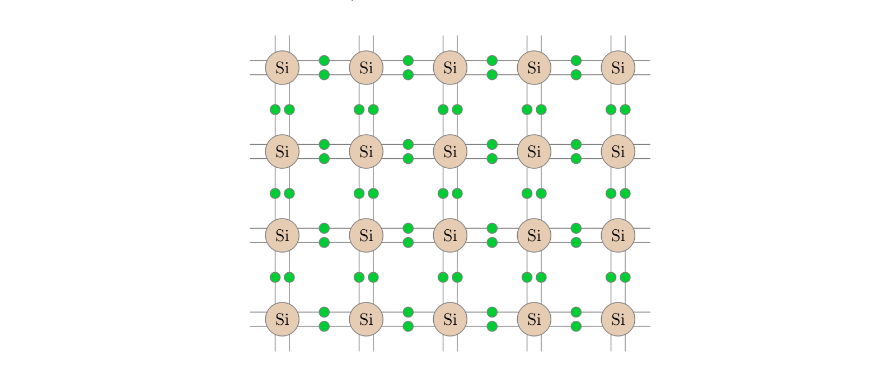

В твёрдых телах частицы расположены вплотную — на расстояниях порядка их собственных
размеров, силы взаимодействия велики, а расположение частиц периодично и образует
кристаллическую решётку.

> **EN** The points at which the particles of a solid are located are called the nodes of
> the crystal lattice. The particles oscillate about these fixed equilibrium positions,
> so a solid keeps both its shape and its volume.
>
> **RU** Точки, в которых находятся частицы твёрдого тела, называются узлами
> кристаллической решётки. Частицы колеблются около этих фиксированных положений
> равновесия, поэтому твёрдое тело сохраняет и форму, и объём.

Узел решётки — это положение равновесия частицы, около которого она постоянно
колеблется; чтобы «выскочить» из узла, нужна очень большая энергия.

### Жидкости / Liquids

Жидкости занимают промежуточное положение: сохраняют объём, но не форму.

> **EN** As in solids, the particles of a liquid are packed densely and oscillate about
> equilibrium positions, which makes liquids almost incompressible; but, unlike solids,
> a particle does not stay at one position forever — it jumps from time to time to a new
> position, which gives liquids their fluidity.
>
> **RU** Как и в твёрдых телах, частицы жидкости упакованы плотно и колеблются около
> положений равновесия — поэтому жидкости почти несжимаемы; но, в отличие от твёрдых
> тел, частица не навсегда привязана к своему положению: время от времени она скачком
> переходит на новое место, что и придаёт жидкостям текучесть.

За время «осёдлой жизни» молекула совершает десятки–сотни колебаний, затем перескакивает
на новое место. Скачки равновероятны по всем направлениям; наклоняя стакан, мы задаём
силой тяжести преимущественное направление скачков — и форма жидкости меняется.

---

## 2.3. Основные формулы молекулярной физики / Basic formulas of molecular physics

Введём основные величины и связывающие их соотношения.

$$\rho = \frac{m}{V}$$

> **EN** The density of a substance is its mass per unit volume; hence `m = ρV`, where `m`
> is the mass and `V` the volume.
>
> **RU** Плотность вещества — масса единицы объёма; отсюда `m = ρV`, где `m` — масса,
> `V` — объём.

Масса вещества складывается из масс его частиц (атомов или молекул):

$$m = m_0 N$$

где `m₀` — масса одной частицы, `N` — число частиц вещества.

$$n = \frac{N}{V}$$

> **EN** The concentration of a substance is the number of particles per unit volume:
> `n = N/V`; it is measured in `м⁻³`. Hence `N = nV`.
>
> **RU** Концентрация вещества — число частиц в единице объёма: `n = N/V`; измеряется
> в `м⁻³`. Отсюда `N = nV`.

Произведение массы частицы на концентрацию даёт массу единицы объёма, то есть плотность:

$$\rho = m_0 n$$

Введём единицу количества вещества — моль.

> **EN** One mole is the amount of substance containing as many particles as there are
> atoms in 12 grams of carbon, i.e. `6.02·10²³` particles. This number is Avogadro's
> constant: `N_A = 6.02·10²³ моль⁻¹`.
>
> **RU** Один моль — количество вещества, содержащее столько же частиц, сколько атомов
> содержится в 12 граммах углерода, то есть `6,02·10²³` частиц. Это число называется
> постоянной Авогадро: `N_A = 6,02·10²³ моль⁻¹`.

- **Автор:** Амедео Авогадро (Amedeo Avogadro); число названо в его честь (уточнено позднее).

Количество вещества `ν` — число молей. Умножая его на число частиц в моле, получаем общее
число частиц:

$$N = \nu N_A$$

Масса одного моля — молярная масса вещества `μ`, измеряемая в `кг/моль`:

$$m = \mu\nu$$

$$\mu = m_0 N_A$$

Молярную массу химического элемента находят по таблице Менделеева: берут атомную массу
`A` (число нуклонов) — это и есть молярная масса в `г/моль`. Для алюминия `A = 27`, значит
`μ = 27 г/моль = 0,027 кг/моль`. Молярная масса вещества с молекулой из нескольких атомов
есть сумма молярных масс: у `CO₂` она равна `12 + 16·2 = 44 г/моль`. Важно: у газов
водород, азот, кислород существуют в виде молекул `H₂`, `N₂`, `O₂` (молярные массы
соответственно 2, 28 и 32 г/моль), а гелий `He` одноатомен (4 г/моль). При расчётах молярную
массу переводят в `кг/моль` — ошибка в три порядка обычно вызвана именно этим.

---

## 2.4. Температура / Temperature

### Термодинамическая система / Thermodynamic system

> **EN** A thermodynamic system is a macroscopic body or a system of bodies that can
> interact with one another and with surrounding bodies. Its state is described by a
> small number of macroscopic parameters (pressure, volume, temperature, density, ...).
>
> **RU** Термодинамическая система — макроскопическое тело или система тел, способная
> взаимодействовать друг с другом и с окружающими телами. Её состояние описывается
> небольшим числом макроскопических параметров (давление, объём, температура,
> плотность и др.).

Состояние, при котором все макроскопические параметры неизменны во времени, называется
тепловым равновесием; в нём прекращаются макроскопические процессы — диффузия,
теплопередача, фазовые переходы. Систему, не обменивающуюся энергией с окружением,
называют изолированной (чай в термосе).

### Тепловое равновесие / Thermal equilibrium

Фундаментальный постулат: какова бы ни была начальная картина тел изолированной системы,
со временем в ней самопроизвольно устанавливается тепловое равновесие. Температура и есть
величина, характеризующая состояние теплового равновесия.

> **EN** Temperature is a macroscopic parameter whose value is the same for all parts of
> a system in thermal equilibrium. Simply put, temperature is what is equal for any two
> bodies in thermal equilibrium with each other.
>
> **RU** Температура — макроскопический параметр, значение которого одинаково для всех
> частей системы, находящейся в тепловом равновесии. Проще говоря, температура — это то,
> что одинаково у любых двух тел в тепловом равновесии друг с другом.

При тепловом контакте тел с разными температурами начинается теплообмен: тело, отдающее
энергию, имеет более высокую температуру, получающее — более низкую. Температура задаёт
направление теплообмена. Особенность: температура не аддитивна — температура тела не равна
сумме температур его частей, поэтому её нельзя измерить сравнением с эталоном.

Температуру измеряют термометром: берут термометрическое вещество и зависящую от
температуры характеристику (термометрическую величину). В жидкостных термометрах это
длина столбика ртути или спирта (объём линейно зависит от температуры), в
идеально-газовых — давление разреженного газа, в электрических — сопротивление металлов и
полупроводников. После наступления теплового равновесия термометр показывает свою
собственную температуру — равную температуре тела.

### Температурная шкала. Абсолютная температура / Temperature scale. Absolute temperature

Шкала Цельсия строится по двум реперным точкам — температуре таяния льда (0) и кипения
воды (100) при нормальном давлении — с делением интервала на 100 градусов (°C).

> **EN** The absolute temperature scale has its zero at absolute zero — the lowest
> possible temperature at which the pressure of an ideal gas at constant volume vanishes.
> Its unit is the kelvin (K); `T = 0` corresponds to `t = −273.15 °C`.
>
> **RU** Абсолютная температурная шкала имеет начало отсчёта при абсолютном нуле —
> предельно низкой температуре, при которой давление идеального газа постоянного объёма
> обращается в нуль. Единица — кельвин (K); `T = 0` соответствует `t = −273,15 °C`.

Недостаток жидкостных термометров: разные жидкости расширяются по-разному и дают
разные показания. Идеально-газовый термометр этого лишён, и для него существует
естественное начало отсчёта — абсолютный нуль.

$$T = t + 273{,}15$$

Абсолютная температура связана с температурой по шкале Цельсия точной формулой
`T = t + 273,15`. В задачах используют приближённую:

$$T = t + 273$$

> **EN** The absolute temperature `T` (in kelvins) equals the Celsius temperature `t` plus
> 273: `T = t + 273`.
>
> **RU** Абсолютная температура `T` (в кельвинах) равна температуре `t` по шкале Цельсия
> плюс 273: `T = t + 273`.

---

## 2.5. Уравнение состояния идеального газа / The ideal gas equation of state

Модель идеального газа делает три допущения: молекулы считают материальными точками
(размерами пренебрегают), взаимодействием на расстоянии пренебрегают, соударения молекул
друг с другом и со стенками считают абсолютно упругими.

> **EN** An ideal gas is a gas whose particles are non-interacting (at a distance) point
> masses undergoing perfectly elastic collisions with one another and with the walls.
>
> **RU** Идеальный газ — газ, частицы которого являются не взаимодействующими на
> расстоянии материальными точками и испытывают абсолютно упругие соударения друг с
> другом и со стенками сосуда.

### Средняя кинетическая энергия частиц газа / Mean kinetic energy of the gas particles

Частицы газа движутся с разными скоростями `v₁, v₂, …, v_N`; средняя кинетическая
энергия частицы есть среднее арифметическое их кинетических энергий:

$$E = \frac{m_0 v^2}{2}$$

где `v²` — средний квадрат скорости (среднее арифметическое квадратов скоростей частиц).

> **EN** The mean kinetic energy of a gas particle is `E = m₀v²/2`, where `v²` is the root
> of the mean square of the velocities.
>
> **RU** Средняя кинетическая энергия частицы газа равна `E = m₀v²/2`, где `v²` —
> средний квадрат скорости частиц.

Корень из среднего квадрата скорости называют средней квадратической скоростью:

$$v = \sqrt{\frac{v_1^2 + v_2^2 + \ldots + v_N^2}{N}}$$

### Основное уравнение МКТ идеального газа / The fundamental MKT equation for an ideal gas

Связь давления газа со средней кинетической энергией частиц выводится из законов механики:

$$p = \frac{2}{3}nE$$

С учётом `E = m₀v²/2` и того, что `m₀n = ρ`, получают эквивалентные формы:

$$p = \frac{1}{3}m_0 n v^2$$

$$p = \frac{1}{3}\rho v^2$$

> **EN** The pressure of an ideal gas is proportional to the concentration and to the mean
> kinetic energy of its particles: `p = (2/3)nE`, or `p = (1/3)ρv²`.
>
> **RU** Давление идеального газа пропорционально концентрации и средней кинетической
> энергии частиц: `p = (2/3)nE`, или `p = (1/3)ρv²`.

### Энергия частиц и температура газа / Particle energy and the temperature of the gas

При тепловом равновесии двух газов выравниваются как температуры, так и средние
кинетические энергии их частиц. Следовательно, температура — мера средней кинетической
энергии частиц. Связь задаёт постоянная Больцмана:

$$E = \frac{3}{2}kT$$

$$k = 1{,}38\cdot 10^{-23}\ \text{Дж}/\text{К}$$

> **EN** The mean kinetic energy of a gas particle is proportional to the absolute
> temperature: `E = (3/2)kT`, where `k = 1.38·10⁻²³ Дж/К` is Boltzmann's constant.
>
> **RU** Средняя кинетическая энергия частицы газа пропорциональна абсолютной
> температуре: `E = (3/2)kT`, где `k = 1,38·10⁻²³ Дж/К` — постоянная Больцмана.

- **Автор постоянной:** Людвиг Больцман (Ludwig Boltzmann).

Отсюда — средняя квадратическая скорость частиц:

$$v = \sqrt{\frac{3kT}{m_0}}$$

Домножая числитель и знаменатель под корнем на `N_A`, получают удобную форму. Произведение
двух констант — универсальная газовая постоянная:

$$R = kN_A = 8{,}31\ \text{Дж}/(\text{моль}\cdot\text{К})$$

$$v = \sqrt{\frac{3RT}{\mu}}$$

> **EN** The root-mean-square speed of a gas particle is `v = √(3kT/m₀) = √(3RT/μ)`, where
> `R = kN_A = 8.31 Дж/(моль·К)` is the universal gas constant and `μ` the molar mass.
>
> **RU** Средняя квадратическая скорость частицы: `v = √(3kT/m₀) = √(3RT/μ)`, где
> `R = kN_A = 8,31 Дж/(моль·К)` — универсальная газовая постоянная, `μ` — молярная масса.

### Уравнение Менделеева — Клапейрона / The Mendeleev–Clapeyron equation

Подставляя `E = (3/2)kT` в `p = (2/3)nE`, получают `p = nkT`; с учётом `n = N/V` и
`N = νN_A` приходят к уравнению состояния идеального газа:

$$pV = \nu RT$$

> **EN** The Mendeleev–Clapeyron (ideal gas) equation relates the three macroscopic
> parameters of state — pressure, volume and temperature: `pV = νRT`, where `ν` is the
> number of moles.
>
> **RU** Уравнение Менделеева — Клапейрона связывает три макроскопических параметра
> состояния идеального газа — давление, объём и температуру: `pV = νRT`, где `ν` — число
> молей.

Полезны ещё две формы — через массу газа (`ν = m/μ`) и через плотность (`m/V = ρ`):

$$pV = \frac{m}{\mu}RT$$

$$p = \frac{\rho}{\mu}RT$$

- **Авторы:** Дмитрий Иванович Менделеев (Dmitri Mendeleev), Бенуа Поль Эмиль Клапейрон
  (Benoît Paul Émile Clapeyron).

---

## 2.6. Изопроцессы / Isoprocesses

Далее считаем, что масса и химический состав газа неизменны: `m = const` (нет утечки или
притока газа) и `μ = const` (нет диссоциации молекул).

### Термодинамический процесс / Thermodynamic process

> **EN** A thermodynamic process is a change of the state of a gas in time. A process in
> which one of the macroscopic parameters (pressure, volume or temperature) stays constant
> is called an isoprocess.
>
> **RU** Термодинамический процесс — изменение состояния газа во времени. Процесс, при
> котором один из макроскопических параметров (давление, объём или температура) остаётся
> неизменным, называется изопроцессом.

Три вида изопроцессов: изотермический (`T = const`), изобарный (`p = const`) и изохорный
(`V = const`). Их описывают газовые законы Бойля — Мариотта, Гей-Люссака и Шарля.

### Изотермический процесс / Isothermal process

При изотермическом процессе температура газа постоянна; меняются лишь давление и объём.
Из уравнения Менделеева — Клапейрона для двух произвольных состояний `(p₁,V₁)` и `(p₂,V₂)`
при одной и той же температуре следует:

$$p_1 V_1 = p_2 V_2$$

откуда — закон Бойля — Мариотта:

$$pV = \text{const}$$

> **EN** In an isothermal process the product of the pressure and the volume of a gas is
> constant (`pV = const`): pressure is inversely proportional to volume.
>
> **RU** В изотермическом процессе произведение давления газа на его объём постоянно
> (`pV = const`): давление обратно пропорционально объёму.

**Пояснение.** При постоянной температуре не меняется средняя кинетическая энергия
молекул (сила их ударов о стенки), но при увеличении объёма падает концентрация — ударов
в единицу времени становится меньше, и давление убывает.

**Авторы и труды:** Роберт Бойль (Robert Boyle), «Новые физико-механические опыты…»
(1662); Эдм Мариотт (Edme Mariotte), «Рассуждение о природе воздуха» (1676).

### Графики изотермического процесса / Isotherm graphs

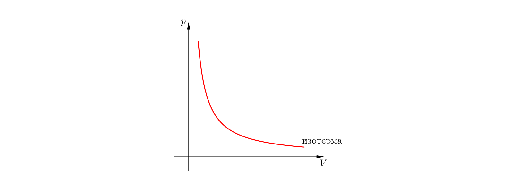

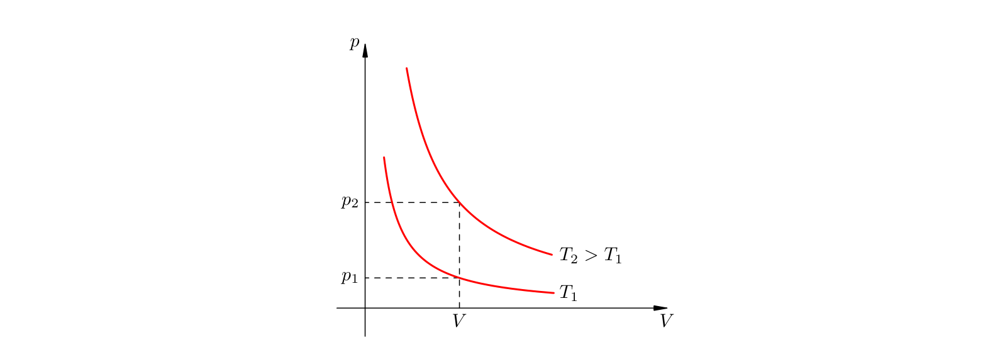

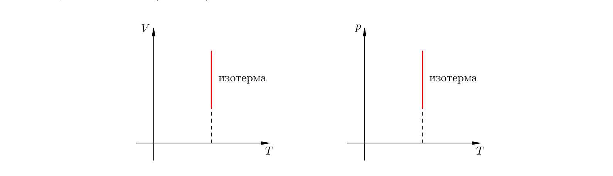

Графики термодинамических процессов изображают в трёх системах координат: `pV`-диаграмме
(абсцисса `V`, ордината `p`), `VT`-диаграмме и `pT`-диаграмме. График изотермического
процесса называется изотермой.

> **EN** On the `pV`-diagram an isotherm is a hyperbola `p = const/V`; the higher the
> temperature, the higher the isotherm lies. On the `VT`- and `pT`-diagrams an isotherm
> is a straight line perpendicular to the `T`-axis.
>
> **RU** На `pV`-диаграмме изотерма — гипербола `p = const/V`; чем выше температура, тем
> выше лежит изотерма. На `VT`- и `pT`-диаграммах изотерма — прямая, перпендикулярная
> оси `T`.

### Изобарный процесс / Isobaric process

Изобарный процесс идёт при постоянном давлении; меняются объём и температура. Типичный
пример — газ под свободно перемещающимся массивным поршнем массы `M` с сечением `S`,
тогда всё время `p = p₀ + Mg/S` (где `p₀` — атмосферное давление). Для двух состояний
`(V₁,T₁)` и `(V₂,T₂)`:

$$\frac{V_1}{V_2} = \frac{T_1}{T_2}$$

Разнося индексы, получают закон Гей-Люссака:

$$\frac{V}{T} = \text{const}$$

> **EN** At constant pressure the volume of a gas is directly proportional to its absolute
> temperature (`V/T = const`). This is Gay-Lussac's law.
>
> **RU** При постоянном давлении объём газа прямо пропорционален его абсолютной
> температуре (`V/T = const`). Это закон Гей-Люссака.

**Пояснение.** При нагревании молекулы бьют сильнее и поднимают поршень; концентрация
падает, удары редеют — давление сохраняет прежнее значение.

- **Автор:** Жозеф Луи Гей-Люссак (Joseph Louis Gay-Lussac), 1802 г.

### Графики изобарного процесса / Isobar graphs

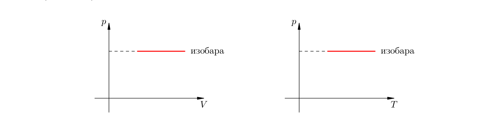

График изобарного процесса называется изобарой.

> **EN** On the `VT`-diagram an isobar is a straight line `V = const·T`; the higher the
> pressure, the lower the isobar lies. On the `pV`- and `pT`-diagrams an isobar is a
> straight line perpendicular to the `p`-axis.
>
> **RU** На `VT`-диаграмме изобара — прямая `V = const·T`; чем больше давление, тем ниже
> идёт изобара. На `pV`- и `pT`-диаграммах изобара — прямая, перпендикулярная оси `p`.

Пунктирный участок напоминает, что при достаточно низких температурах модель идеального
газа перестаёт работать: частицы замедляются, межмолекулярные силы становятся существенными,
и газы превращаются в жидкости.

### Изохорный процесс / Isochoric process

Изохорный процесс идёт при постоянном объёме (жёсткий сосуд или закреплённый поршень);
меняются давление и температура. Для двух состояний `(p₁,T₁)` и `(p₂,T₂)`:

$$\frac{p_1}{p_2} = \frac{T_1}{T_2}$$

откуда — закон Шарля:

$$\frac{p}{T} = \text{const}$$

> **EN** At constant volume the pressure of a gas is directly proportional to its absolute
> temperature (`p/T = const`). This is Charles's law.
>
> **RU** При постоянном объёме давление газа прямо пропорционально его абсолютной
> температуре (`p/T = const`). Это закон Шарля.

- **Автор:** Жак Шарль (Jacques Charles), 1787 г. (опубликован Гей-Люссаком в 1802 г.).

### Графики изохорного процесса / Isochore graphs

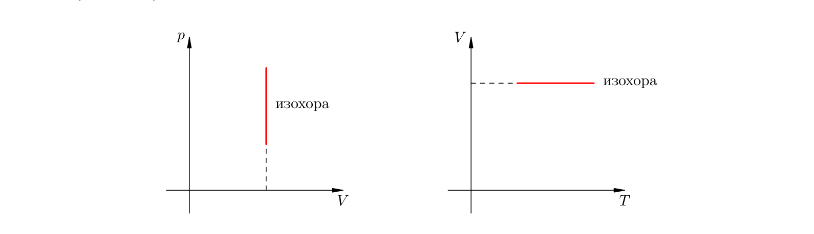

График изохорного процесса называется изохорой.

> **EN** On the `pT`-diagram an isochore is a straight line `p = const·T`; the larger the
> volume, the lower the isochore lies. On the `pV`- and `VT`-diagrams an isochore is a
> straight line perpendicular to the `V`-axis.
>
> **RU** На `pT`-диаграмме изохора — прямая `p = const·T`; чем больше объём, тем ниже
> идёт изохора. На `pV`- и `VT`-диаграммах изохора — прямая, перпендикулярная оси `V`.

Газовые законы Бойля — Мариотта, Гей-Люссака и Шарля были установлены экспериментально
задолго до уравнения состояния; уравнение Менделеева — Клапейрона появилось как их
обобщение.

---

## 2.7. Насыщенный пар / Saturated vapour

### Испарение и конденсация / Evaporation and condensation

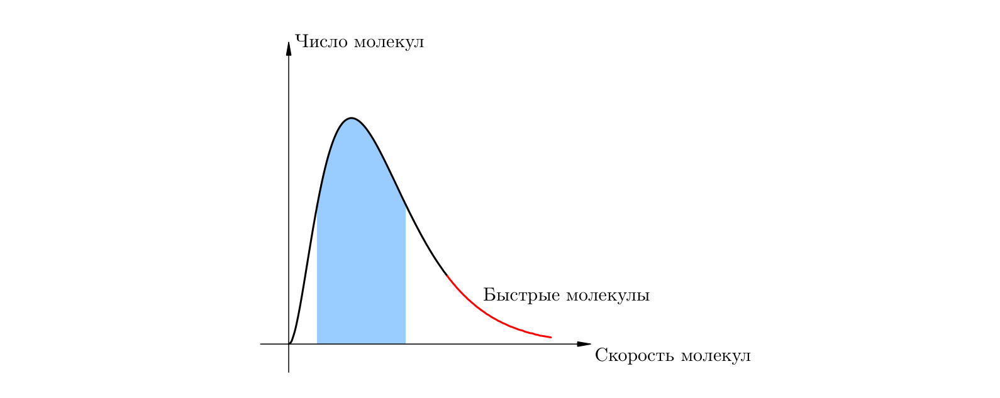

Скорости молекул жидкости распределены около среднего значения, но есть «быстрые»
молекулы, скорости которых заметно выше средних.

> **EN** Evaporation is the transformation of a liquid into vapour at its free surface;
> fast molecules whose kinetic energy suffices to overcome the attraction of the
> neighbours leave the liquid. Condensation is the reverse transition of vapour molecules
> back into the liquid.
>
> **RU** Испарение — превращение жидкости в пар, происходящее со свободной поверхности
> жидкости: её покидают быстрые молекулы, кинетической энергии которых хватает, чтобы
> преодолеть притяжение соседей. Конденсация — обратный переход молекул пара в жидкость.

### Динамическое равновесие / Dynamic equilibrium

В закрытом сосуде плотность пара над жидкостью растёт, испарение замедляется, а конденсация
ускоряется; в итоге их скорости сравниваются — наступает динамическое равновесие.

> **EN** Saturated vapour is vapour in a state of dynamic equilibrium with its liquid: the
> same number of molecules leave the liquid per unit time as return to it. Vapour that has
> not reached this equilibrium is called unsaturated.
>
> **RU** Насыщенный пар — пар, находящийся в состоянии динамического равновесия со своей
> жидкостью: в единицу времени из жидкости вылетает столько же молекул, сколько
> возвращается в неё. Пар, не достигший этого равновесия, называется ненасыщенным.

Давление `pн` и плотность `ρн` насыщенного пара — максимальные значения, которые пар может
иметь при данной температуре.

### Свойства насыщенного пара / Properties of saturated vapour

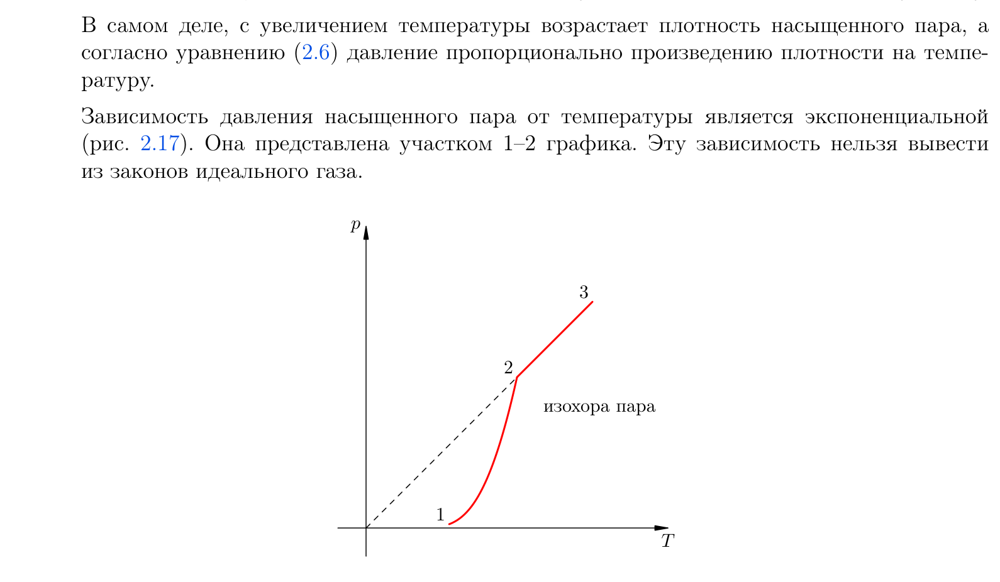

Насыщенный (и ненасыщенный) пар приближённо описывается уравнением Менделеева —
Клапейрона:

$$p_{\text{н}} = \frac{\rho_{\text{н}}}{\mu}RT$$

Однако насыщенный пар заметно отличается от идеального газа.

> **EN** At a fixed temperature the density and pressure of saturated vapour do not depend
> on its volume: compression condenses part of the vapour and expansion evaporates more
> liquid, restoring the equilibrium. Its pressure grows with temperature faster than
> linearly (exponentially).
>
> **RU** При постоянной температуре плотность и давление насыщенного пара не зависят от
> его объёма: сжатие конденсирует часть пара, расширение же вызывает дополнительное
> испарение, восстанавливающее равновесие. Давление насыщенного пара растёт с
> температурой быстрее, чем по линейному закону (экспоненциально).

Закон Бойля — Мариотта для насыщенного пара не выполняется (масса пара меняется), закон
Шарля — тоже (при нагревании пара становится больше). После того как вся жидкость
испарилась, пар становится ненасыщенным и растёт линейно по закону Шарля.

### Влажность воздуха / Air humidity

> **EN** Absolute humidity is the partial pressure of the water vapour in the air (or its
> density). Relative humidity `φ` is the ratio of the partial pressure of water vapour to
> the pressure of saturated vapour at the same temperature, usually in percent.
>
> **RU** Абсолютная влажность — парциальное давление водяного пара в воздухе (или его
> плотность). Относительная влажность `φ` — отношение парциального давления водяного пара
> к давлению насыщенного пара при той же температуре, обычно в процентах.

$$\varphi = \frac{p}{p_{\text{н}}} \cdot 100\%$$

Поскольку отношение давлений приблизительно равно отношению плотностей:

$$\varphi = \frac{\rho}{\rho_{\text{н}}} \cdot 100\%$$

Влажность измеряют психрометром — парой термометров, у одного из которых резервуар
обёрнут мокрой тканью: чем суше воздух, тем сильнее испарение, тем сильнее охлаждается
«мокрый» термометр и тем больше разность показаний.

---

## 2.8. Внутренняя энергия / Internal energy

Частицы тела движутся (кинетическая энергия) и взаимодействуют (потенциальная энергия).
Их сумма образует новый вид энергии, не сводимый к механической энергии тела.

> **EN** Internal energy is the sum of the kinetic energy of the disordered thermal motion
> of the particles of a body and the potential energy of their mutual interaction.
>
> **RU** Внутренняя энергия тела — суммарная кинетическая энергия теплового движения его
> частиц и потенциальная энергия их взаимодействия друг с другом.

В неё входят: кинетическая энергия хаотического движения частиц (но не движения тела как
целого), потенциальная энергия взаимодействия частиц, энергия электронов в атомах и
внутриядерная энергия.

### Внутренняя энергия одноатомного идеального газа / Internal energy of a monatomic ideal gas

У идеального газа взаимодействие частиц на расстоянии отсутствует, поэтому потенциальная
энергия равна нулю и внутренняя энергия сводится к суммарной кинетической энергии атомов:

$$U = \frac{3}{2}\nu RT$$

$$U = \frac{3}{2}\frac{m}{\mu}RT$$

> **EN** The internal energy of a monatomic ideal gas depends only on its absolute
> temperature: `U = (3/2)νRT`.
>
> **RU** Внутренняя энергия одноатомного идеального газа зависит только от его абсолютной
> температуры: `U = (3/2)νRT`.

У реальных газов, жидкостей и твёрдых тел внутренняя энергия зависит ещё и от объёма —
через потенциальную энергию взаимодействия частиц.

### Функция состояния / Function of state

> **EN** Internal energy is a function of state: it is determined by the macroscopic
> parameters of the system and does not depend on its history. The change of internal
> energy between two states depends only on the initial and final states, not on the path.
>
> **RU** Внутренняя энергия — функция состояния: она однозначно определяется
> макроскопическими параметрами системы и не зависит от её «предыстории». Изменение
> внутренней энергии определяется только начальным и конечным состояниями, а не путём
> перехода.

Опыт показывает лишь два способа изменения внутренней энергии: совершение механической
работы и теплопередача.

### Изменение внутренней энергии: совершение работы / Change of internal energy: doing work

> **EN** If work is done on a body, its internal energy increases; if the body itself does
> work, its internal energy decreases.
>
> **RU** Если работа совершается над телом, его внутренняя энергия возрастает; если
> работу совершает само тело, его внутренняя энергия уменьшается.

**Пример.** Гвоздь после удара молотком нагревается и деформируется: частицы разгоняются
(растёт кинетическая энергия) и сближаются (растёт потенциальная энергия). Сжатый газ в
теплоизолированном сосуде, расширяясь и поднимая груз, охлаждается — работу он совершает
за счёт собственной внутренней энергии.

### Изменение внутренней энергии: теплопередача / Heat transfer

> **EN** Heat transfer is the transition of internal energy from a hotter body to a colder
> one unaccompanied by mechanical work; it can occur through direct contact, through an
> intermediate medium, or through a vacuum. It is also called heat exchange.
>
> **RU** Теплопередача — процесс перехода внутренней энергии от более горячего тела к
> более холодному, не связанный с совершением механической работы; она идёт либо при
> непосредственном контакте, либо через промежуточную среду (и даже вакуум). Теплопередачу
> называют также теплообменом.

Различают три вида теплопередачи: теплопроводность, конвекцию и тепловое излучение.

### Теплопроводность / Thermal conduction

> **EN** Thermal conduction is the transfer of internal energy from hotter parts of a body
> to colder ones due to the thermal motion and interaction of its particles.
>
> **RU** Теплопроводность — перенос внутренней энергии от более нагретых участков тела к
> менее нагретым за счёт теплового движения и взаимодействия частиц тела.

**Пример.** В сунутом в огонь железном стержне атомы у горячего конца колеблются
интенсивнее, передают энергию соседям — и тепло постепенно распространяется к руке.
Металлы (серебро, медь, золото) проводят тепло отлично; жидкости — хуже; газы — настолько
плохо, что служат теплоизоляторами (двойные рамы). Пористые тела (кирпич, вата, мех)
содержат воздух в порах и потому плохо проводят тепло.

### Конвекция / Convection

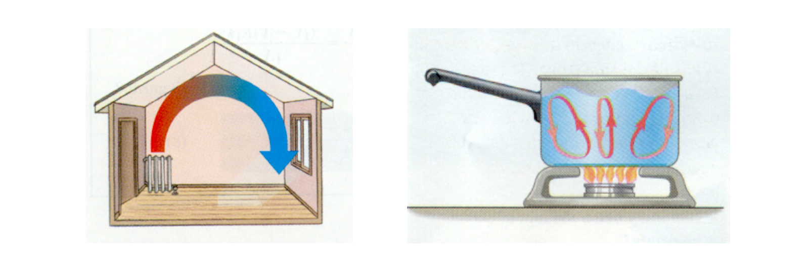

> **EN** Convection is the transfer of internal energy in liquids and gases by circulating
> flows and mixing of the substance.
>
> **RU** Конвекция — перенос внутренней энергии в жидкостях и газах в результате
> циркуляции потоков и перемешивания вещества.

**Пример.** Воздух у батареи нагревается, расширяется и всплывает к потолку (его
выталкивающая сила растёт при той же силе тяжести); на его место приходит холодный —
возникает циркуляция. Поэтому радиаторы ставят внизу, а кондиционеры — вверху. В
твёрдых телах конвекции нет: частицы привязаны к узлам решётки.

### Тепловое излучение / Thermal radiation

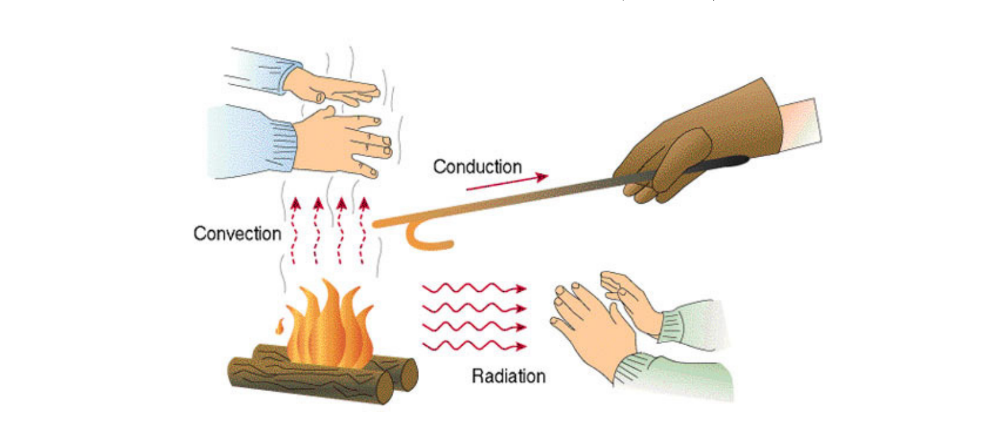

Теплопроводность и конвекция не объясняют, как Земля получает энергию Солнца — их
разделяет вакуум. Здесь работает тепловое излучение — электромагнитные волны.

> **EN** Thermal radiation is electromagnetic radiation emitted by the charged particles
> of a body in their thermal motion; unlike conduction and convection, it can propagate
> through a vacuum.
>
> **RU** Тепловое излучение — электромагнитное излучение, испускаемое заряжёнными
> частицами тела при их тепловом движении; в отличие от теплопроводности и конвекции, оно
> может распространяться в вакууме.

Переменное электрическое поле порождает переменное магнитное, то — снова электрическое,
и т. д.; так распространяется электромагнитная волна (видимый свет — её частный случай) со
скоростью `300000 км/с` в вакууме. Излучает любое тело; при обычных температурах это
инфракрасный диапазон (не виден глазу), при нагревании — видимый свет (раскалённый
докрасна гвоздь) и ультрафиолет (Солнце, `6000 °C`).

---

## 2.9. Количество теплоты / Heat

Если тело участвует в теплообмене без совершения работы, а его внутренняя энергия
изменилась на `ΔU`, то говорят, что тело получило количество теплоты `Q = ΔU`. Если `ΔU`
отрицательно, тело отдаёт тепло.

### Удельная теплоёмкость вещества / Specific heat capacity

Пусть при теплообмене агрегатное состояние вещества не меняется; начальная температура `t₁`,
конечная — `t₂`. Опыт показывает, что полученное тепло пропорционально массе и разности
температур:

$$Q = cm(t_2 - t_1)$$

$$Q = cm\Delta t$$

> **EN** The specific heat capacity `c` is the amount of heat needed to raise the
> temperature of 1 kg of a substance by 1 °C (1 K); it is measured in `Дж/(кг·°C)` or
> `Дж/(кг·К)`.
>
> **RU** Удельная теплоёмкость `c` — количество теплоты, необходимое для нагревания 1 кг
> вещества на 1 °C (1 K); измеряется в `Дж/(кг·°C)` или `Дж/(кг·К)`.

Из формулы `c = Q/(mΔт)`. Часто нужны значения: для воды `c = 4200 Дж/(кг·°C)`, для льда
`c = 2100 Дж/(кг·°C)`.

Произведение удельной теплоёмкости на массу тела называется теплоёмкостью тела `C = cm`;
тогда `Q = C(t₂ − t₁)`.

### Уравнение теплового баланса / The heat-balance equation

Для замкнутой системы тел, обменивающихся энергией только друг с другом (без совершения
работы), выполняется закон сохранения энергии: суммарная внутренняя энергия постоянна,
`ΔU₁ + ΔU₂ = 0`. Так как `ΔU₁ = Q₁`, `ΔU₂ = Q₂`, получаем уравнение теплового баланса:

$$Q_1 + Q_2 = 0$$

для `n` тел:

$$Q_1 + Q_2 + \ldots + Q_n = 0$$

> **EN** The heat-balance equation states that the sum of the amounts of heat received by
> the bodies of a closed system is zero: what one body gives up, the others receive.
>
> **RU** Уравнение теплового баланса: сумма количеств теплоты, полученных телами
> замкнутой системы, равна нулю — сколько тепла отдало одно тело, столько получили другие.

**Пример.** Смешали 200 г воды при 100 °C и 300 г при 20 °C. Из уравнения
`cm₁(θ − t₁) + cm₂(θ − t₂) = 0` находим установившуюся температуру
`θ = (m₁t₁ + m₂t₂)/(m₁ + m₂) = 52 °C`.

---

## 2.10. Фазовые переходы / Phase transitions

> **EN** A phase transition is a change of the aggregate state of a substance. We consider
> melting (solid → liquid), crystallisation (liquid → solid), vaporisation (liquid →
> vapour) and condensation (vapour → liquid).
>
> **RU** Фазовый переход — изменение агрегатного состояния вещества. Рассматриваются
> плавление (твёрдое тело → жидкость), кристаллизация (жидкость → твёрдое тело),
> парообразование (жидкость → пар) и конденсация (пар → жидкость).

### Плавление и кристаллизация / Melting and crystallisation

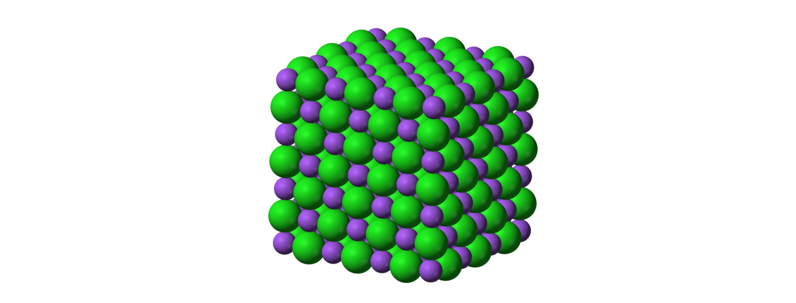

Большинство твёрдых тел кристаллические: их частицы колеблются в узлах кристаллической
решётки.

> **EN** Melting is the transformation of a crystalline solid into a liquid, reached by
> heating to the melting temperature (which depends only on the substance).
> Crystallisation (solidification) is the reverse transformation of a liquid into a solid.
>
> **RU** Плавление — превращение кристаллического твёрдого тела в жидкость при нагревании
> до температуры плавления (зависящей только от вещества). Кристаллизация (отвердевание) —
> обратное превращение жидкости в твёрдое тело.

Температура кристаллизации равна температуре плавления: при 0 °C лёд плавится, а вода
кристаллизуется — что именно идёт, зависит от внешних условий (подводится тепло или
отводится).

### График плавления / The melting graph

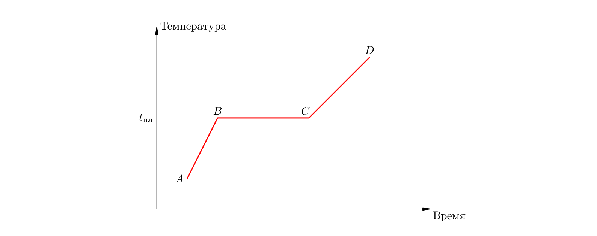

На графике зависимости температуры от времени: на участке `AB` твёрдое тело нагревается до
температуры плавления `tпл` (получая `Q = cm(tпл − t_A)`); на участке `BC` идёт плавление,
и температура не меняется, несмотря на подвод тепла; на участке `CD` нагревается уже
жидкость.

> **EN** During melting, all the heat supplied goes into breaking the bonds of the crystal
> lattice (increasing the potential energy of the particles), so the temperature stays
> constant until the solid has fully melted.
>
> **RU** При плавлении всё подводимое тепло идёт на разрыв связей кристаллической
> решётки (увеличение потенциальной энергии частиц), поэтому температура остаётся
> неизменной, пока твёрдое тело полностью не расплавится.

### Удельная теплота плавления / Specific heat of fusion

Чтобы расплавить тело, уже доведённое до температуры плавления, ему нужно дополнительно
сообщить тепло, пропорциональное массе:

$$Q = \lambda m$$

> **EN** The specific heat of fusion `λ` is the amount of heat needed to melt 1 kg of a
> crystalline substance already at its melting temperature.
>
> **RU** Удельная теплота плавления `λ` — количество теплоты, необходимое для превращения
> в жидкость 1 кг кристаллического вещества, доведённого до температуры плавления.

Для льда `λ = 340 кДж/кг`, для свинца — 25 кДж/кг; большая теплота плавления льда
замедляет его весеннее таяние.

### График кристаллизации / The crystallisation graph

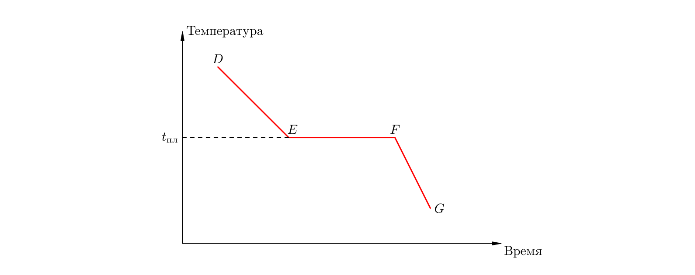

Процесс кристаллизации симметричен плавлению: жидкость остывает (участок `DE`) до
температуры кристаллизации (равной `tпл`), на участке `EF` кристаллизуется при неизменной
температуре, затем остывает твёрдое тело (`FG`).

> **EN** During crystallisation heat is released: as the particles settle into the lattice
> nodes their potential energy drops, so the temperature stays constant while the liquid
> freezes; the released heat equals that absorbed in melting (`Q = λm`).
>
> **RU** При кристаллизации тепло выделяется: оседая в узлы решётки, частицы теряют
> потенциальную энергию, поэтому температура не меняется, пока жидкость замерзает;
> выделившееся тепло равно поглощённому при плавлении (`Q = λm`).

### Парообразование и конденсация / Vaporisation and condensation

> **EN** Vaporisation is the transition of a liquid into a gaseous state; it occurs either
> as evaporation (from the free surface, at any temperature) or as boiling (throughout
> the whole volume). Condensation is the reverse transition of vapour into liquid.
>
> **RU** Парообразование — переход жидкости в газообразное состояние; оно идёт либо как
> испарение (со свободной поверхности, при любой температуре), либо как кипение (по всему
> объёму). Конденсация — обратный переход пара в жидкость.

Скорость испарения растёт с температурой и площадью поверхности; чем сильнее притяжение
молекул, тем медленнее жидкость испаряется (быстро испаряются эфир, ацетон, спирт;
медленно — вода; совсем медленно — масло и ртуть). Уходят самые быстрые молекулы, поэтому
жидкость при испарении остывает; при конденсации, наоборот, нагревается. Испарение и
конденсация обеспечивают круговорот воды в природе (облака, дождь, роса).

### Кипение / Boiling

> **EN** Boiling is vaporisation occurring throughout the whole volume of the liquid, made
> possible by growing bubbles of dissolved air; it begins when the pressure of the
> saturated vapour inside the bubbles becomes equal to the external pressure on the liquid.
>
> **RU** Кипение — парообразование, происходящее по всему объёму жидкости благодаря
> растущим пузырькам растворённого воздуха; оно начинается, когда давление насыщенного
> пара в пузырьках становится равным внешнему давлению на жидкость.

При нагревании пузырьки воздуха расширяются (внутри них насыщенный пар), всплывают под
действием архимедовой силы, в холодных слоях пар конденсируется — пузырьки схлопываются
(шум перед закипанием); когда жидкость прогрелась, пузырьки доходят до поверхности и
лопаются — жидкость кипит.

Температура кипения растёт с внешним давлением: при нормальном давлении (`10⁵ Па`) вода
кипит при 100 °C, на вершине Эльбруса (0,5 атм) — при 82 °C, под давлением 15 атм — при
200 °C. Спирт кипит при 78 °C, эфир — при 35 °C, ртуть — при 357 °C, кислород — при
−183 °C (поэтому при обычных температурах кислород — газ). Кипение требует непрерывного
подвода тепла, идущего на увеличение потенциальной энергии молекул (температура при этом
не меняется).

### График кипения / The boiling graph

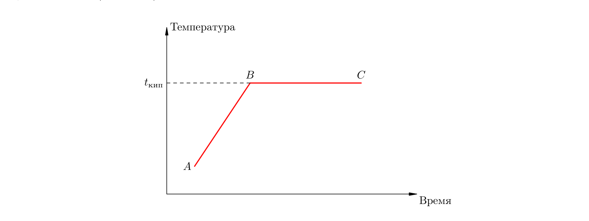

На участке `AB` жидкость нагревается до температуры кипения `tкип`; на участке `BC` идёт
кипение (масса жидкости убывает) при неизменной температуре; в точке `C` жидкость выкипела.
Чтобы целиком провести участок `BC`, жидкости, уже доведённой до кипения, надо сообщить
тепло, пропорциональное массе:

$$Q = Lm$$

> **EN** The specific heat of vaporisation `L` is the amount of heat needed to turn 1 kg
> of a liquid already at its boiling temperature entirely into vapour. For water at
> 100 °C it is 2300 кДж/кг — about seven times the specific heat of fusion of ice.
>
> **RU** Удельная теплота парообразования `L` — количество теплоты, которое нужно
> подвести к 1 кг жидкости при температуре кипения, чтобы полностью превратить её в пар.
> Для воды при 100 °C она равна 2300 кДж/кг — почти в семь раз больше теплоты плавления
> льда.

**Альтернативные записи / Alternative notations:**

$$Q = rm$$

удельная теплота парообразования обозначается буквой `r`; А. В. Перышкин, «Физика. 8 класс»,
и другие школьные учебники.

$$Q_{\text{пар}} = Lm$$

буква `L`; пособие И. В. Яковлева.

### График конденсации / The condensation graph

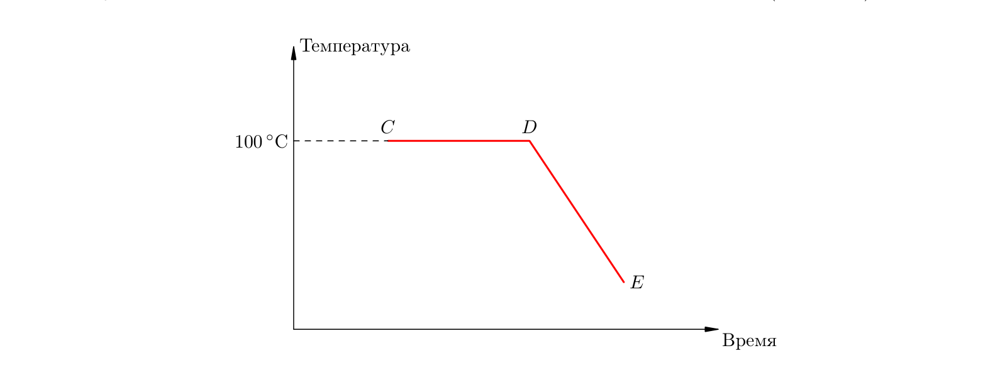

Процесс симметричен кипению: в точке `C` имеем пар при 100 °C, на участке `CD` идёт
конденсация (смесь пара и воды при 100 °C), в точке `D` остаётся вода, участок `DE` — её
остывание. При конденсации выделяется ровно то же тепло `Q = Lm`.

**Пояснение.** Ожог паром страшнее ожога кипятком: при конденсации 1 г пара выделяется
`Q₁ = Lm = 2 300 000·0,001 = 2300 Дж`, тогда как остывание получившейся стоградусной воды
до 20 °C даёт лишь `Q₂ = cmΔt = 4200·0,001·80 = 336 Дж`.

---

## 2.11. Первый закон термодинамики / The first law of thermodynamics

Газ под поршнем действует на него с силой `F = pS` (где `S` — площадь поршня); при
перемещении поршня газ совершает работу. При расширении работа положительна, при
сжатии — отрицательна.

### Работа газа в изобарном процессе / Work of a gas in an isobaric process

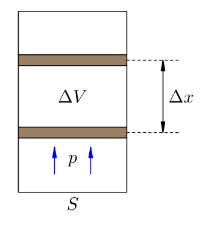

При постоянном давлении сила постоянна, и работа газа при перемещении поршня на `Δx`:

$$A = p\Delta V$$

$$A = p(V_2 - V_1)$$

> **EN** The work done by a gas in an isobaric process is `A = pΔV`; it equals the area of
> the rectangle under the process graph on the `pV`-diagram.
>
> **RU** Работа газа в изобарном процессе равна `A = pΔV`; она равна площади
> прямоугольника под графиком процесса на `pV`-диаграмме.

При сжатии та же формула даёт отрицательную работу.

### Работа газа в произвольном процессе / Work of a gas in an arbitrary process

В общем случае процесс разбивают на малые участки `dV`, на каждом `dA = p dV`, и суммируют:

$$A = \int_{V_1}^{V_2} p\,dV$$

> **EN** The work of a gas in any process equals the area of the curvilinear trapezoid
> under the `pV`-graph of the process.
>
> **RU** Работа газа в любом процессе равна площади криволинейной трапеции под графиком
> процесса на `pV`-диаграмме.

### Работа, совершаемая над газом / Work done on the gas

Наряду с работой `A`, совершаемой газом, рассматривают работу `A′`, которую внешние тела
(поршень) совершают над газом. По третьему закону Ньютона эти силы равны и противоположны,
поэтому:

$$A' = -A$$

> **EN** The work `A′` done on the gas is equal in magnitude and opposite in sign to the
> work `A` done by the gas: `A′ = −A`. During expansion `A > 0`, `A′ < 0`; during
> compression `A < 0`, `A′ > 0`.
>
> **RU** Работа `A′`, совершаемая над газом, равна по модулю и противоположна по знаку
> работе газа `A`: `A′ = −A`. При расширении `A > 0`, `A′ < 0`; при сжатии `A < 0`,
> `A′ > 0`.

### Первый закон термодинамики / The first law of thermodynamics

Если телу передано тепло `Q` и одновременно над ним совершена работа `A′`, то изменение
внутренней энергии складывается из обеих величин; для газа (`A′ = −A`) закон принимает вид:

$$Q = \Delta U + A$$

> **EN** The first law of thermodynamics: the heat `Q` transferred to a gas goes into
> changing its internal energy `ΔU` and into the work `A` done by the gas: `Q = ΔU + A`.
>
> **RU** Первый закон термодинамики: количество теплоты `Q`, переданное газу, идёт на
> изменение его внутренней энергии `ΔU` и на совершение газом работы `A`: `Q = ΔU + A`.

**Альтернативные записи / Alternative notations:**

$$\Delta U = Q + A'$$

через работу `A′` внешних сил над телом; форма `ΔU = Q + A′` эквивалентна `Q = ΔU + A`
(поскольку `A′ = −A`), её используют многие учебники (Г. Я. Мякишев).

$$\Delta U = Q - A$$

форма, где `A` — работа самого газа; пособие И. В. Яковлева записывает закон как
`Q = ΔU + A`.

### Применение первого закона термодинамики к изопроцессам / Applying the first law to isoprocesses

- **Изотермический процесс** (`T = const`): `ΔU = 0`, значит `Q = A` — всё подведённое тепло
  идёт на совершение работы.
- **Изохорный процесс** (`V = const`): `A = 0`, значит `Q = ΔU` — всё тепло идёт на
  изменение внутренней энергии.
- **Изобарный процесс** (`p = const`): `Q = ΔU + pΔV` — тепло идёт и на изменение
  внутренней энергии, и на работу.

### Адиабатный процесс / The adiabatic process

> **EN** An adiabatic process is one that proceeds without heat exchange with surrounding
> bodies (`Q = 0`); from the first law `A = −ΔU`. A gas cools during adiabatic expansion
> and heats up during adiabatic compression.
>
> **RU** Адиабатный процесс — процесс без теплообмена с окружающими телами (`Q = 0`);
> из первого закона `A = −ΔU`. При адиабатном расширении газ охлаждается, при сжатии —
> нагревается.

Адиабатный процесс идёт в теплоизолированном сосуде (термос) либо достаточно быстро.
На этом основаны сжижение газов (охлаждение при расширении) и воспламенение топлива в
дизельных двигателях (нагрев при сжатии). Кривую процесса называют адиабатой; на
`pV`-диаграмме она убывает с ростом объёма быстрее изотермы, потому что при адиабатном
расширении падают и концентрация, и температура (удары частиц о стенки становятся не
только реже, но и слабее).

---

## 2.12. Тепловые машины / Heat engines

Тепловые машины превращают теплоту в работу или наоборот. По направлению процессов
различают два вида: тепловые двигатели (теплота → работа) и холодильные машины (передают
тепло от холодного тела к горячему за счёт внешней работы).

### Тепловые двигатели / Heat engines

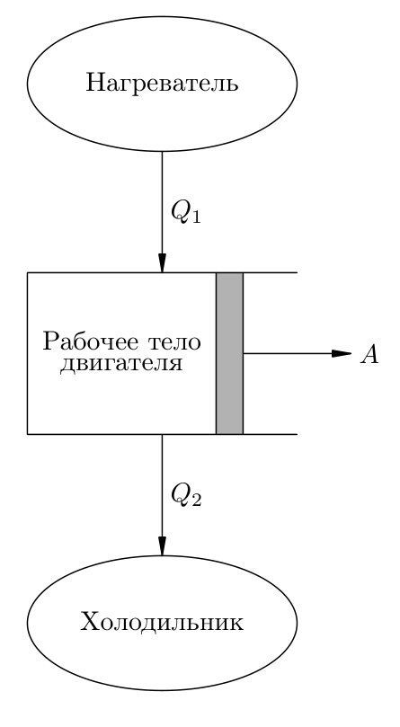

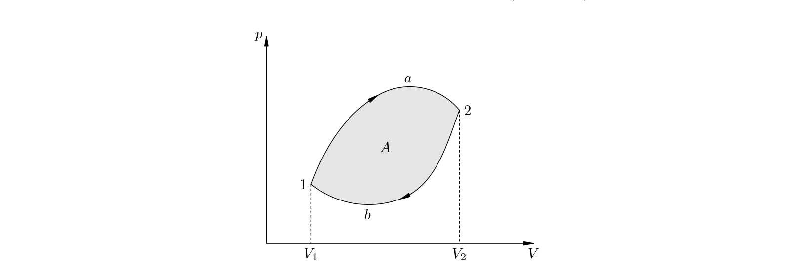

Рабочее тело двигателя — газ: расширяясь от нагревателя, он совершает полезную работу.
Газ получает от нагревателя тепло `Q₁`, часть тепла `Q₂` отдаёт холодильнику (чтобы цикл
замкнулся), а полезная работа за цикл:

$$A = Q_1 - Q_2$$

> **EN** In one cycle a heat engine receives heat `Q₁` from the heater, converts part of it
> into work `A`, and rejects the remaining heat `Q₂` to the cooler: `A = Q₁ − Q₂`. The
> cooler is needed to return the gas to its initial state through a lower-pressure branch.
>
> **RU** За цикл тепловой двигатель получает от нагревателя тепло `Q₁`, часть его
> превращает в работу `A`, а остаток `Q₂` отдаёт холодильнику: `A = Q₁ − Q₂`. Холодильник
> нужен, чтобы возвращать газ в исходное состояние по ветви меньшего давления (цикл
> проходится по часовой стрелке).

Полностью превратить тепло нагревателя в работу невозможно — иначе цикл не замкнётся.
Коэффициент полезного действия:

$$\eta = \frac{A}{Q_1} = \frac{Q_1 - Q_2}{Q_1}$$

> **EN** The efficiency of a heat engine is the ratio of the useful work `A` to the heat
> `Q₁` received from the heater: `η = A/Q₁ = (Q₁ − Q₂)/Q₁`. It is always less than 1.
>
> **RU** КПД теплового двигателя — отношение полезной работы `A` к количеству теплоты
> `Q₁`, полученному от нагревателя: `η = A/Q₁ = (Q₁ − Q₂)/Q₁`. Он всегда меньше единицы.

**Пример.** КПД паровых турбин ~25 %, двигателей внутреннего сгорания ~40 %.

### Холодильные машины / Refrigerating machines

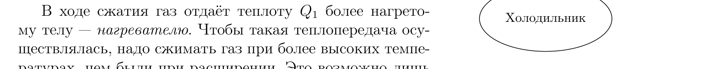

Самопроизвольно тепло передаётся от горячего тела к холодному; с помощью внешнего
источника работы возможен и обратный процесс — передача тепла от холодного тела к
горячему. Рабочее тело холодильной машины (хладагент) поглощает тепло при расширении и
отдаёт при сжатии:

$$Q_1 = Q_2 + A'$$

где `A′` — работа внешнего источника (электродвигателя). На `pV`-диаграмме цикл холодильной
машины идёт против часовой стрелки.

> **EN** A refrigerating machine removes heat `Q₂` from the cold body and transfers heat
> `Q₁ = Q₂ + A′` to the hot one at the expense of external work `A′`.
>
> **RU** Холодильная машина отводит от холодного тела тепло `Q₂` и передаёт горячему телу
> тепло `Q₁ = Q₂ + A′` за счёт работы `A′` внешнего источника.

Эффективность холодильной машины характеризует холодильный коэффициент:

$$\alpha = \frac{Q_2}{A'}$$

(в реальных холодильниках от 1 до 3). Если холодильную машину используют для обогрева
(тепловой насос), то отопительный коэффициент равен `β = Q₁/A′` (обычно 3–5).

### Тепловая машина Карно / The Carnot heat engine

Максимальный КПД теплового двигателя с фиксированными температурами нагревателя `T₁` и
холодильника `T₂` нашёл Сади Карно (1824 г.): это КПД цикла Карно, состоящего из двух
изотерм и двух адиабат.

> **EN** The Carnot cycle consists of two isotherms (heat exchange with the heater and
> cooler at constant temperatures `T₁` and `T₂`) and two adiabats (change of temperature
> without heat exchange). Its efficiency is the maximum possible:
> `η = (T₁ − T₂)/T₁`.
>
> **RU** Цикл Карно состоит из двух изотерм (теплообмен с нагревателем и холодильником
> при постоянных температурах `T₁` и `T₂`) и двух адиабат (изменение температуры без
> теплообмена). Его КПД — максимально возможный: `η = (T₁ − T₂)/T₁`.

$$\eta = \frac{T_1 - T_2}{T_1}$$

**Пример.** При `T₁ = 1000 K` и `T₂ = 300 K` `η_max = (1000 − 300)/1000 = 0,7` (70 %).
Изотермы и адиабаты делают машину Карно обратимой: её можно запустить по обратному
циклу между теми же нагревателем и холодильником, тогда она работает как холодильная
машина.

- **Автор:** Никола Леонар Сади Карно (Nicolas Léonard Sadi Carno)
- **Труд:** «Размышления о движущей силе огня и о машинах, способных развивать эту силу»
  (Réflexions sur la puissance motrice du feu et sur les machines propres à développer
  cette puissance, 1824).

### Тепловые двигатели и охрана окружающей среды / Heat engines and the environment

Повсеместное использование тепловых двигателей вредит среде: рассеяние тепла в атмосферу
повышает температуру планеты (таяние ледников), накопление углекислого газа даёт
парниковый эффект, продукты сгорания ухудшают экологию. Меры: повышать КПД, снижать
выбросы, развивать новые виды топлива и беречь энергию.

---

## 2.13. Второй закон термодинамики / The second law of thermodynamics

Не все вообразимые процессы осуществимы. Попытки создать вечный двигатель первого рода
(производящий работу без внешнего источника энергии) привели к закону сохранения энергии;
в термодинамике его выражает первый закон. Но есть и другие ограничения, не связанные с
сохранением энергии.

### Необратимость процессов в природе / Irreversibility of natural processes

> **EN** Real processes are irreversible: they can proceed spontaneously only in one
> direction. The reverse processes, though not violating energy conservation, never occur
> by themselves.
>
> **RU** Реальные процессы необратимы: самопроизвольно они идут лишь в одном
> определённом направлении. Обратные процессы, не нарушающие закон сохранения энергии,
> сами по себе никогда не протекают.

**Примеры.** Тепло самопроизвольно передаётся от горячего тела к холодному, но не наоборот.
Упавшая ложка не запрыгивает обратно на стол — переход механической энергии во внутреннюю
необратим (хотя энергетически возможен и обратный: молекулы пола могли бы синхронно
толкнуть ложку).

### Постулаты Клаузиуса и Кельвина / The postulates of Clausius and Kelvin

Второй закон термодинамики формулируется двумя эквивалентными постулатами.

> **EN** Clausius's postulate: a process whose only result is the transfer of heat from a
> colder body to a hotter one is impossible. Kelvin's postulate: a cyclic process whose
> only result is obtaining work by cooling a single heat reservoir is impossible.
>
> **RU** Постулат Клаузиуса: невозможен процесс, единственным результатом которого
> является передача тепла от менее нагретого тела к более нагретому. Постулат Кельвина:
> невозможен циклический процесс, единственным результатом которого является получение
> работы за счёт охлаждения одного теплового резервуара.

В холодильной машине перенос тепла от холодного тела к горячему — не единственный
результат (работает внешний источник). В тепловом двигателе получение работы — тоже не
единственный результат: часть тепла `Q₂` отдаётся холодильнику. Постулат Кельвина фактически
запрещает двигатель с КПД, равным единице; такой гипотетический двигатель называют вечным
двигателем второго рода (он не нарушал бы сохранения энергии).

- **Автор постулата Клаузиуса:** Рудольф Клаузиус (Rudolf Clausius)
- **Автор постулата Кельвина:** Уильям Томсон, лорд Кельвин (William Thomson, 1st Baron
  Kelvin)

### Эквивалентность постулатов Клаузиуса и Кельвина / Equivalence of the Clausius and Kelvin postulates

Постулаты логически следуют друг из друга. Если неверен постулат Клаузиуса, то (совместив
процесс «противо-самопроизвольной» теплопередачи с циклом двигателя) можно получить работу
за счёт одного резервуара — нарушив постулат Кельвина. Наоборот, из нарушения постулата
Кельвина (превратив полученную работу в тепло трения горячего тела) следует
самопроизвольная передача тепла от холодного тела к горячему — нарушение постулата
Клаузиуса.

### Обратимые процессы / Reversible processes

> **EN** An equilibrium state is one of thermal equilibrium, representable by a point on a
> state diagram; an equilibrium (quasistatic) process is a chain of close equilibrium
> states, representable by a continuous line. If the parameters change slowly enough for
> equilibrium to be established at every moment, the process is reversible.
>
> **RU** Равновесное состояние — состояние теплового равновесия, изображаемое точкой на
> диаграмме состояния; равновесный (квазистатический) процесс — цепочка близких
> равновесных состояний, изображаемая непрерывной линией. Если параметры меняются
> достаточно медленно, так что равновесие успевает устанавливаться, процесс обратим.

**Пример.** Песчинки кладут на поршень по одной — очень медленное сжатие есть череда
равновесных состояний; снимая песчинки обратно, получим прохождение тех же состояний в
обратном порядке. Быстрое сжатие тяжёлой гирькой неравновесно и необратимо. Процессы,
идущие бесконечно медленно, обратимы — это идеализация; реальные процессы необратимы.

### Обратимость машины Карно / Reversibility of the Carnot engine

Чтобы цикл между нагревателем `T₁` и холодильником `T₂` был обратимым, все его процессы
должны быть квазистатическими, а теплообмен с резервуарами — изотермическим (иначе при
разности температур передача тепла необратима в силу постулата Клаузиуса). Изменение же
температуры газа должно идти без теплообмена — по адиабатам.

> **EN** The Carnot cycle is the only cycle that can be carried out reversibly between a
> heater and a cooler at fixed temperatures: heat exchange occurs on isotherms and
> temperature change on adiabats. It is an idealisation, called the ideal heat machine.
>
> **RU** Цикл Карно — единственный цикл, который можно провести обратимо между
> нагревателем и холодильником с фиксированными температурами: теплообмен идёт на
> изотермах, изменение температуры — на адиабатах. Это идеализация (бесконечно медленные
> процессы), поэтому машину Карно называют идеальной тепловой машиной.

---

## Авторы и труды (сводка) / Authors and works (summary)

| Закон / величина | Автор | Труд |
|---|---|---|
| Основные положения МКТ | (обобщение опыта многих учёных) | — |
| Броуновское движение | Роберт Броун | наблюдения в микроскоп (1827) |
| Постоянная Авогадро | Амедео Авогадро | гипотеза о молекулах (1811) |
| Закон Бойля — Мариотта | Роберт Бойль; Эдм Мариотт | Boyle 1662; Mariotte 1676 |
| Закон Гей-Люссака | Жозеф Луи Гей-Люссак | 1802 |
| Закон Шарля | Жак Шарль (опубл. Гей-Люссаком) | 1787 (публ. 1802) |
| Постоянная Больцмана | Людвиг Больцман | статистическая механика |
| Уравнение Менделеева — Клапейрона | Бенуа Клапейрон; Д. И. Менделеев | Clapeyron 1834; Менделеев 1874 |
| Универсальная газовая постоянная | (введена как произведение `kN_A`) | — |
| Первый закон термодинамики | Юлиус Роберт фон Майер; Джеймс Джоуль | опыты об эквивалентности теплоты и работы (Джоуль, 1840-е) |
| Цикл Карно, максимальный КПД | Сади Карно | Réflexions sur la puissance motrice du feu (1824) |
| Постулат Клаузиуса | Рудольф Клаузиус | «О движущей силе теплоты» (1850) |
| Постулат Кельвина | Уильям Томсон, лорд Кельвин | 1851 |

> **Примечание.** Формулы, определения физических величин и законы природы не
> являются объектами авторского права и могут свободно излагаться. Текст выше
> пересказан по учебной литературе (в том числе по пособию И. В. Яковлева,
> MathUs.ru) в ознакомительных целях.

