# Глава 3. Электродинамика / Electrodynamics

> Основные понятия и законы школьного курса физики. Определения переформулированы
> (EN — по-английски в духе учебной литературы, RU — русский перевод), формулы
> соответствуют пособию, к каждому закону указан автор и его работа.
> Формулы и определения физики не охраняются авторским правом; текст пересказан.

---

## 3.1. Электрический заряд / Electric charge

Электромагнитные взаимодействия — одни из самых фундаментальных в природе. Силы упругости
и трения, давление жидкостей и газов сводятся к электромагнитным силам между частицами
вещества. От тяготения они отличаются тремя существенными чертами: участвуют только
заряженные тела; взаимодействие может быть как притяжением, так и отталкиванием; наконец,
электромагнитное взаимодействие во много раз интенсивнее гравитационного (отталкивание двух
электронов в `10⁴²` раз сильнее их взаимного тяготения).

> **EN** Electric charge `q` is the physical quantity that determines the strength of the
> electromagnetic interaction between objects. It is measured in coulombs (C).
>
> **RU** Электрический заряд `q` — физическая величина, определяющая силу электромагнитного
> взаимодействия между объектами природы. Единица заряда — кулон (Кл).

### Два вида заряда / Two kinds of charge

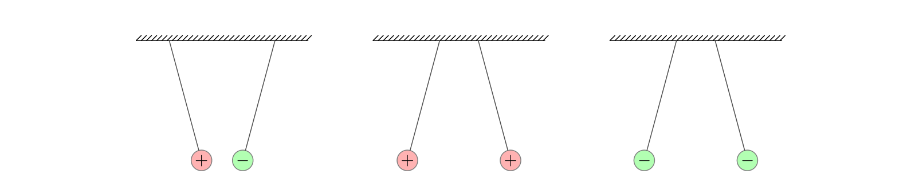

Гравитация всегда притяжение, поэтому массы тел неотрицательны. Заряды же могут быть двух
знаков. Заряды одного знака отталкиваются, разных — притягиваются.

Атом нейтрален: в ядре — положительные протоны, вокруг — столько же отрицательных
электронов. Заряд протона `e = 1,6·10⁻¹⁹ Кл`, заряд электрона `−e`. Величина

$$e = 1{,}6\cdot 10^{-19}\ \text{Кл}$$

называется элементарным зарядом — это минимальный возможный заряд свободной частицы. Заряд
любого тела складывается из целого числа элементарных зарядов:

$$q = \pm Ne$$

Если `q < 0`, у тела избыток `N` электронов, если `q > 0` — недостаток.

### Электризация тел / Electrification of bodies

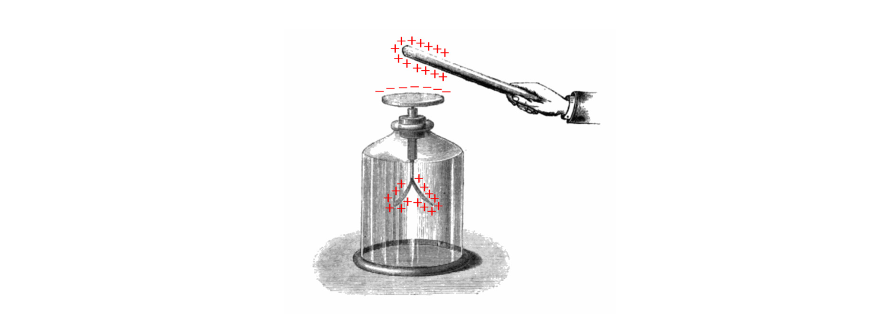

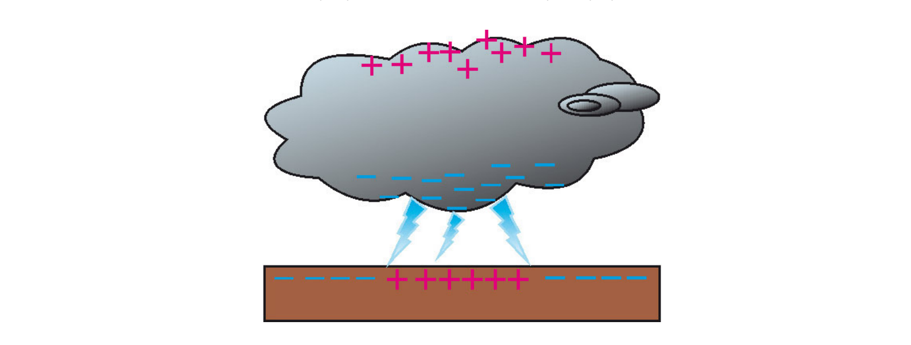

> **EN** Electrification is the violation of the electrical neutrality of a body (or its
> parts), which makes the body capable of electromagnetic interaction.
>
> **RU** Электризация — нарушение электрической нейтральности тела или его частей, в
> результате которого тело становится способным к электромагнитным взаимодействиям.

**Электризация трением.** При натирании шёлком стеклянной палочки часть её электронов
уходит на шёлк: палочка заряжается положительно, шёлк — отрицательно. При натирании
шерстью эбонитовой палочки электроны переходят с шерсти на палочку — она заряжается
отрицательно.

**Электростатическая индукция** (электризация через влияние): суммарный заряд тела
остаётся нулевым, но заряды перераспределяются — на ближних к внешнему заряду участках
скапливаются заряды противоположного знака, на дальних — одноимённого.

### Закон сохранения заряда / Conservation of charge

> **EN** In a closed system of bodies the algebraic sum of charges remains constant under
> any processes that occur with these bodies.
>
> **RU** В замкнутой системе тел алгебраическая сумма зарядов остаётся неизменной при любых
> процессах, происходящих с этими телами.

$$q_1 + q_2 + \ldots + q_n = \text{const}$$

**Пример.** При трении палочка и ткань получают равные по модулю и противоположные по
знаку заряды. Закон выполнен и в процессах рождения частиц: фотон (заряд нуль) может
превратиться в пару электрон–позитрон с нулевым суммарным зарядом.

---

## 3.2. Закон Кулона / Coulomb's law

Взаимодействие неподвижных зарядов называется электростатическим; раздел электродинамики,
изучающий его, — электростатика. Основной закон электростатики — закон Кулона.

**Точечный заряд** — заряженное тело, размеры которого много меньше характерных для задачи
расстояний (идеализация, аналогичная материальной точке).

> **EN** Coulomb's law: the force of interaction of two stationary point charges in vacuum
> is proportional to the product of the magnitudes of the charges and inversely
> proportional to the square of the distance between them.
>
> **RU** Закон Кулона: сила взаимодействия двух неподвижных точечных зарядов в вакууме
> прямо пропорциональна произведению модулей зарядов и обратно пропорциональна квадрату
> расстояния между ними.

$$F = k\frac{q_1 q_2}{r^2}$$

Здесь `q₁` и `q₂` — модули зарядов, `r` — расстояние между ними:

$$k = 9\cdot 10^9\ \frac{\text{Н}\cdot\text{м}^2}{\text{Кл}^2}$$

Кулоновская сила лежит на прямой, соединяющей заряды; она может быть притяжением или
отталкиванием (в отличие от тяготения, которое всегда притяжение). Наряду с `k` вводят
электрическую постоянную `ε₀`, связанную с `k` соотношением `k = 1/(4πε₀)`:

$$\varepsilon_0 = \frac{1}{4\pi k} = 8{,}85\cdot 10^{-12}\ \frac{\text{Кл}^2}{\text{Н}\cdot\text{м}^2}$$

$$F = \frac{1}{4\pi\varepsilon_0}\frac{q_1 q_2}{r^2}$$

- **Автор:** Шарль Кулон (Charles-Augustin de Coulomb)
- **Труд:** мемуары о крутильных весах и электричестве (1785).

### Принцип суперпозиции / Principle of superposition

Опыт показывает, что выполнены два утверждения:

1. Сила взаимодействия двух зарядов не зависит от присутствия прочих заряженных тел.
2. Сила, действующая на заряд `q` со стороны системы зарядов, равна векторной сумме сил со
   стороны каждого заряда по отдельности:

$$\vec{F} = \vec{F}_1 + \vec{F}_2 + \ldots + \vec{F}_n$$

Из суперпозиции и формы закона Кулона следует, что два заряженных шара взаимодействуют по
закону Кулона (при сферически-симметричном распределении заряда), где `r` — расстояние между
центрами. У металлических сближающихся шаров симметрия нарушается взаимным отталкиванием
зарядов — это надо учитывать.

### Закон Кулона в диэлектрике / Coulomb's law in a dielectric

> **EN** A dielectric (insulator) weakens the force between charges compared with vacuum,
> always by the same factor `ε` — the permittivity of the dielectric, which depends only
> on the material.
>
> **RU** Диэлектрик ослабляет силу взаимодействия зарядов по сравнению с вакуумом всегда в
> одно и то же число `ε` — диэлектрическую проницаемость, зависящую только от вещества.

$$F = k\frac{q_1 q_2}{\varepsilon r^2}, \qquad F = \frac{1}{4\pi\varepsilon_0}\frac{q_1 q_2}{\varepsilon r^2}$$

Для вакуума `ε = 1`, для остальных сред `ε > 1`. Проницаемость воздуха близка к единице, и в
воздухе пользуются формулами для вакуума.

---

## 3.3. Напряжённость электрического поля / Electric field strength

### Дальнодействие и близкодействие / Action at a distance and local action

Заряды действуют друг на друга даже в вакууме. Долгое время господствовала теория
**дальнодействия**: заряд действует на другой непосредственно, без промежуточного агента, а
изменение расположения зарядов меняет силу мгновенно. Ей противостояла теория
**близкодействия**: взаимодействие передаёт промежуточный физический объект, и конечная
скорость передачи означает, что один заряд «чувствует» изменение положения другого не сразу.
Победила теория близкодействия — благодаря трудам Фарадея и Максвелла и открытию
электромагнитных волн.

### Электрическое поле / Electric field

> **EN** An electric charge creates an electric field around itself, and this field acts
> with a force on other charges. The field needs no material medium — it exists in
> matter and in vacuum alike.
>
> **RU** Электрический заряд создаёт вокруг себя электрическое поле, которое действует с
> некоторой силой на другие заряды. Поле не нуждается в специальной среде и существует как
> в веществе, так и в вакууме.

Для обнаружения и изучения поля служит точечный **пробный заряд**. Опыт показывает: сила,
действующая на пробный заряд, пропорциональна его величине, поэтому отношение силы к заряду
от величины пробного заряда уже не зависит и характеризует само поле. Это отношение — вектор
напряжённости:

$$\vec{E} = \frac{\vec{F}}{q}$$

> **EN** The electric field strength `E⃗` is the ratio of the force acting on a test charge
> to that charge.
>
> **RU** Напряжённость электрического поля — отношение вектора силы, с которой поле
> действует на пробный заряд, к самому пробному заряду.

Из определения: `F⃗ = qE⃗`. Для положительного заряда сила сонаправлена с `E⃗`, для
отрицательного — противоположна. Единица напряжённости — Н/Кл, что равно В/м.

### Напряжённость поля точечного заряда / Field of a point charge

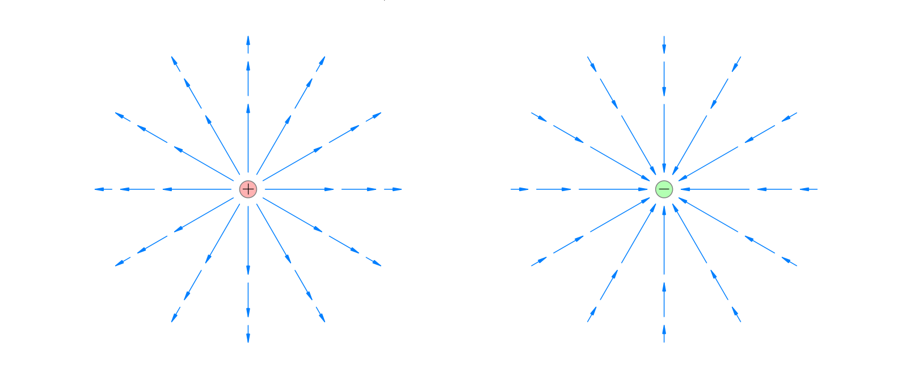

Поле положительного заряда направлено от него, отрицательного — к нему. Модуль напряжённости
на расстоянии `r`:

$$E = k\frac{q}{r^2}$$

в диэлектрике с проницаемостью `ε`:

$$E = k\frac{q}{\varepsilon r^2}$$

Напряжённость убывает обратно пропорционально квадрату расстояния.

### Принцип суперпозиции электрических полей / Superposition of fields

> **EN** The field of a system of charges is the vector sum of the fields of each charge
> taken separately. In other words, field strengths add as vectors.
>
> **RU** Поле системы зарядов равно векторной сумме полей каждого заряда по отдельности.
> Напряжённости полей складываются векторно.

$$\vec{E} = \vec{E}_1 + \vec{E}_2 + \ldots + \vec{E}_n$$

### Поле равномерно заряженной плоскости / Field of a uniformly charged plane

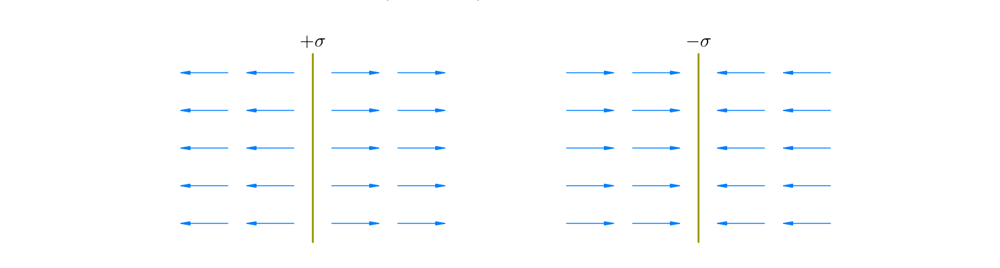

Плоскую пластину можно считать бесконечной плоскостью, если расстояние до точки наблюдения
много меньше размеров пластины. Поверхностная плотность заряда:

$$\sigma = \frac{q}{S}$$

Если `σ = const`, плоскость заряжена равномерно. Её поле перпендикулярно плоскости, а по
величине **не зависит от расстояния** до неё:

$$E = \frac{\sigma}{2\varepsilon_0}$$

в среде:

$$E = \frac{\sigma}{2\varepsilon_0\varepsilon}$$

> **EN** A field is uniform (homogeneous) if its strength vector is the same at every
> point of the region. A uniformly charged plane creates a uniform field in each of the
> half-spaces.
>
> **RU** Поле называется однородным, если вектор напряжённости одинаков в каждой точке
> области. Равномерно заряженная плоскость создаёт однородное поле в каждом из полупространств.

### Линии напряжённости электрического поля / Field lines

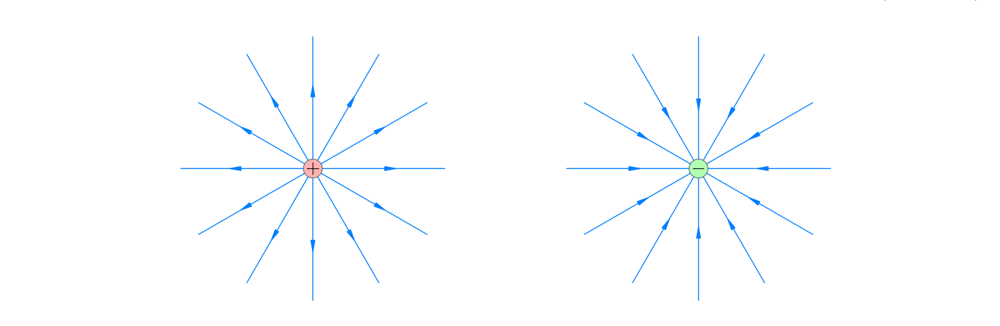

Линии напряжённости идут вдоль векторов `E⃗`; в каждой точке `E⃗` направлен по касательной к
линии. Чем гуще линии — тем больше напряжённость. Линии всегда начинаются на положительных
зарядах и оканчиваются на отрицательных. Линии однородного поля — параллельные прямые.

---

## 3.4. Потенциал электрического поля / Electric potential

### Консервативные силы / Conservative forces

> **EN** A force is conservative (potential) if its work does not depend on the shape of
> the trajectory but only on the initial and final positions. The work along any closed
> path is zero.
>
> **RU** Сила консервативна (потенциальна), если её работа не зависит от формы траектории,
> а определяется только начальным и конечным положением тела. Работа по замкнутому пути
> равна нулю.

Только для консервативных сил можно ввести потенциальную энергию: работа равна убыли
потенциальной энергии.

$$A = -\Delta W = W_1 - W_2$$

Сила тяжести и сила упругости консервативны; сила трения — нет.

### Потенциальность электростатического поля / Potential character of the field

Сила, с которой электростатическое поле действует на заряд, тоже консервативна: её работа не
зависит от траектории, а определяется начальным и конечным положениями; работа по замкнутому
пути нулевая. Если бы это было не так, можно было бы построить вечный двигатель, черпая
энергию «из ничего», — что противоречит закону сохранения энергии.

### Потенциальная энергия заряда в однородном поле / Energy in a uniform field

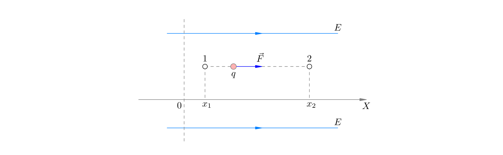

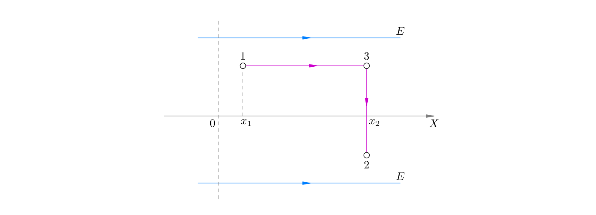

В однородном поле `E`, направленном вдоль оси X, работа поля над зарядом `q` равна
`A = qE(x₂ − x₁)` независимо от пути. Отсюда потенциальная энергия:

$$W = -qEx$$

(нулевой уровень выбран при `x = 0`). Здесь `q` — алгебраическая величина заряда (с учётом
знака). При движении положительного заряда вдоль поля его потенциальная энергия убывает,
отрицательного — возрастает.

### Потенциальная энергия взаимодействия точечных зарядов / Energy of point charges

Два точечных заряда `q₁`, `q₂` на расстоянии `r` в вакууме обладают энергией взаимодействия

$$W = k\frac{q_1 q_2}{r}$$

За нулевой уровень принята бесконечность (`W → 0` при `r → ∞`). Для одноимённых зарядов
`W > 0`, для разноимённых `W < 0`. Энергия системы нескольких зарядов равна сумме энергий
всех пар.

### Потенциал / Potential

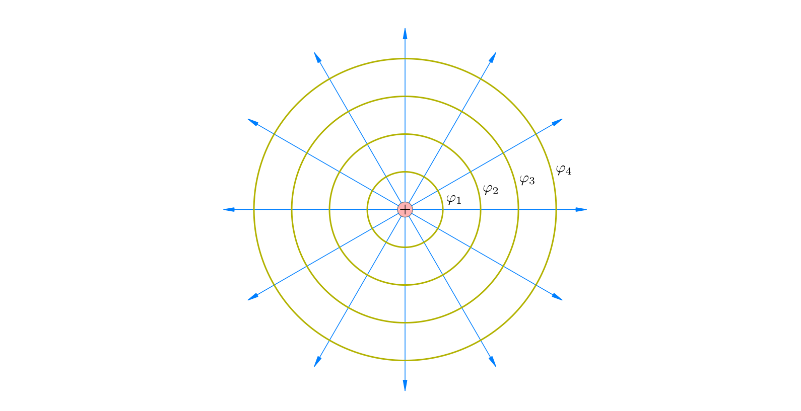

Потенциальная энергия заряда `q` в любом электростатическом поле пропорциональна `q`:
`W = qφ`. Величина `φ` от заряда не зависит, характеризует само поле и называется потенциалом:

$$\varphi = \frac{W}{q}$$

Потенциал однородного поля: `φ = −Ex`; потенциал убывает в направлении напряжённости.
Потенциал поля точечного заряда:

$$\varphi = k\frac{q}{r}$$

Единица потенциала — вольт: В = Дж/Кл. Напряжённость — силовая характеристика поля,
потенциал — энергетическая.

### Разность потенциалов / Potential difference

При перемещении заряда из точки 1 в точку 2 работа поля равна `A = q(φ₁ − φ₂)`. Разность
потенциалов называется также напряжением `U`:

$$U = \varphi_1 - \varphi_2$$

$$A = qU$$

> **EN** The voltage (potential difference) between two points is the work done by the
> field in moving a unit charge from the initial to the final point.
>
> **RU** Напряжение (разность потенциалов) между точками — работа поля по перемещению
> единичного заряда из начальной точки в конечную.

Потенциал определён с точностью до постоянной; физический смысл имеет разность потенциалов.
Потенциал поля в точке — работа поля по переносу единичного заряда из этой точки в точку
нулевого потенциала: `φ = A₀/q`.

### Принцип суперпозиции для потенциалов / Superposition of potentials

$$\varphi = \varphi_1 + \varphi_2 + \ldots + \varphi_n$$

Потенциал результирующего поля равен **алгебраической** сумме потенциалов полей отдельных
тел (в отличие от напряжённостей, которые складываются векторно).

### Однородное поле: связь напряжения и напряжённости / Voltage and field strength

В однородном поле, при перемещении вдоль силовой линии на расстояние `d`:

$$U = Ed, \qquad E = \frac{U}{d}$$

Отсюда единица напряжённости — В/м (это то же, что Н/Кл).

### Эквипотенциальные поверхности / Equipotential surfaces

> **EN** An equipotential surface is a surface at every point of which the potential has
> the same value. Equipotential surfaces are always perpendicular to the field lines.
>
> **RU** Эквипотенциальная поверхность — поверхность, во всех точках которой потенциал
> одинаков. Эквипотенциальные поверхности всегда перпендикулярны линиям напряжённости.

В однородном поле это плоскости `x = const`, у точечного заряда — сферы `r = const`.
Перемещение заряда по эквипотенциальной поверхности не требует работы.

---

## 3.5. Проводники в электрическом поле / Conductors in an electric field

Проводники отличаются от диэлектриков наличием свободных зарядов, способных перемещаться по
всему объёму. В металлах это свободные электроны (слабо связанные валентные электроны), в
электролитах — положительные и отрицательные ионы, возникающие при диссоциации.

### Поле внутри проводника / Field inside a conductor

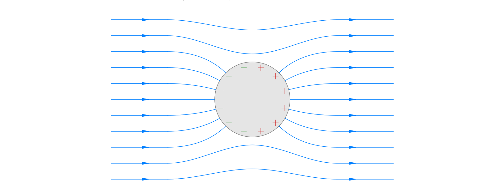

> **EN** The field strength inside a conductor is zero everywhere. The induced charges
> rearrange until they fully cancel the external field within the conductor.
>
> **RU** Напряжённость поля внутри проводника всюду равна нулю. Индуцированные заряды
> перестраиваются до тех пор, пока не скомпенсируют внешнее поле внутри проводника.

Внешнее поле сдвигает свободные электроны; возникающие индуцированные заряды создают встречное
поле `Eᵢ = E`, полностью гасящее внешнее поле внутри проводника. Снаружи поле искажается
тем сильнее, чем ближе к проводнику. Утверждение верно и для заряженного проводника.

### Заряд внутри проводника / Charge inside a conductor

> **EN** The net charge inside a conductor is zero: any uncompensated charges reside
> entirely on its surface. Consequently, the field in a cavity inside a conductor is
> zero (electrostatic shielding).
>
> **RU** Суммарный заряд внутри проводника равен нулю: нескомпенсированные заряды
> располагаются целиком на поверхности. Поэтому поле в полости внутри проводника равно нулю
> (электростатическая защита).

### Поле вне проводника / Field outside a conductor

Линии напряжённости входят в проводник и выходят из него перпендикулярно его поверхности.
Иначе касательная составляющая поля вызывала бы ток, что в электростатике невозможно.

### Потенциал проводника / Potential of a conductor

> **EN** All points of a conductor have the same potential; the conductor is an
> equipotential volume, and its surface is an equipotential surface.
>
> **RU** Все точки проводника имеют одинаковый потенциал; проводник представляет собой
> «эквипотенциальный объём», а его поверхность — эквипотенциальную поверхность.

### Напряжённость и потенциал поля проводящей сферы / Field of a charged sphere

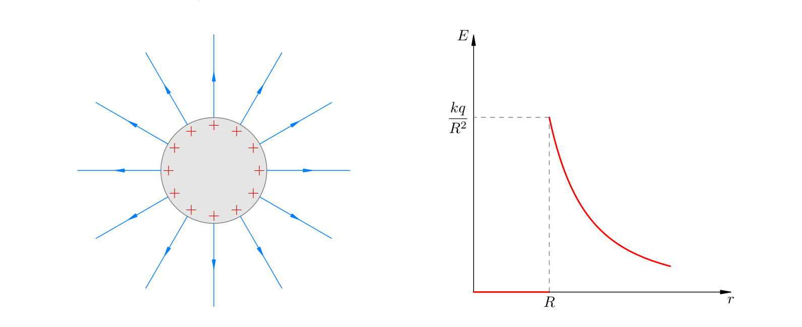

Сфера радиуса `R` с зарядом `q` создаёт вне себя поле точечного заряда, сосредоточенного в
центре; внутри поле нулевое:

$$E = \begin{cases} k\dfrac{q}{r^2}, & r \geqslant R \\ 0, & r < R \end{cases}$$

$$\varphi = \begin{cases} k\dfrac{q}{r}, & r \geqslant R \\ k\dfrac{q}{R}, & r < R \end{cases}$$

Потенциал внутри сферы постоянен и равен потенциалу её поверхности.

---

## 3.6. Диэлектрики в электрическом поле / Dielectrics in an electric field

В диэлектриках свободных зарядов нет (электроны связаны с атомами, ионы колеблются в узлах
решётки). Поэтому на диэлектрики не переносятся свойства проводников: поле внутри может быть
ненулевым, объёмный заряд — отличным от нуля, линии поля — не перпендикулярны поверхности, а
«потенциал диэлектрика» не определён.

### Диэлектрическая проницаемость / Permittivity

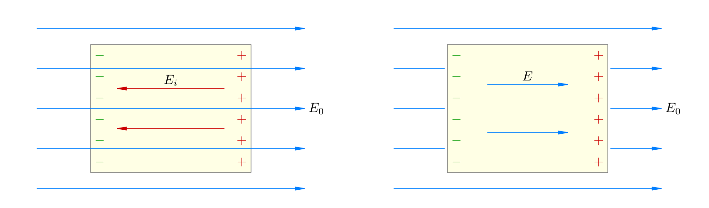

В диэлектрике поле ослабляется в `ε` раз по сравнению с вакуумом. Во внешнем поле `E₀` на
поверхностях диэлектрика появляются индуцированные заряды, создающие встречное поле `Eᵢ`,
частично (но не полностью, как в проводнике) гасящее внешнее:

$$E = E_0 - E_i, \qquad E = \frac{E_0}{\varepsilon}$$

### Полярные диэлектрики / Polar dielectrics

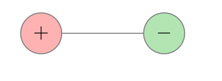

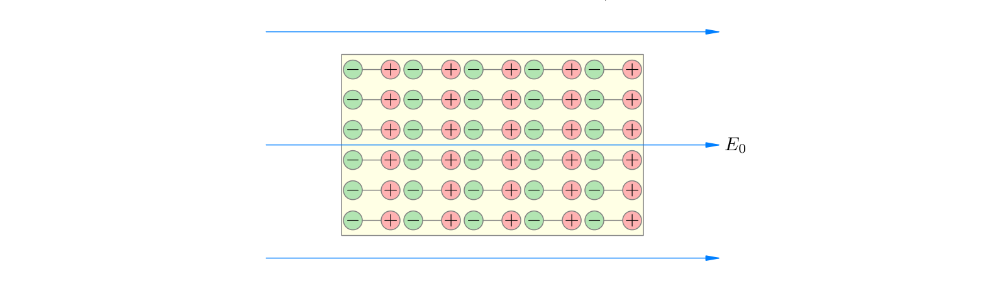

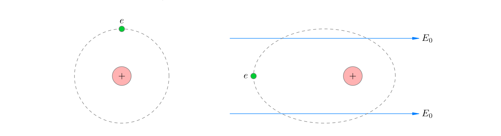

**Диполь** — система двух равных по модулю и противоположных по знаку зарядов на небольшом
расстоянии. Молекулы полярных диэлектриков (вода, соль NaCl, низшие спирты) — диполи. Во
внешнем поле диполи поворачиваются вдоль линий напряжённости — это **ориентационная
поляризация**; на поверхностях появляются нескомпенсированные заряды.

### Неполярные диэлектрики / Non-polar dielectrics

У неполярных диэлектриков (керосин, масло, воздух, инертные газы) молекулы имеют симметричное
распределение зарядов. Во внешнем поле электронные оболочки деформируются: электрон смещается
к «плюсам» внешнего поля, центры зарядов расходятся, и атомы ведут себя как диполи. Это
**электронная поляризация**.

---

## 3.7. Конденсатор. Энергия электрического поля / Capacitor. Electric field energy

### Ёмкость уединённого проводника / Capacitance of an isolated conductor

Потенциал уединённого проводника пропорционален его заряду: `φ = q/C`. Величина `C` —
электрическая ёмкость:

$$C = \frac{q}{\varphi}$$

Ёмкость показывает, какой заряд надо сообщить проводнику, чтобы повысить его потенциал на
1 В. Единица — фарад (Ф) = Кл/В. Ёмкость уединённого шара:

$$C = 4\pi\varepsilon_0 R \qquad\text{(в среде: } C = 4\pi\varepsilon_0\varepsilon R\text{)}$$

Ёмкость зависит только от размеров, формы проводника и свойств среды, но не от его заряда.
Ёмкость земного шара ≈ 712 мкФ — так что 1 Ф очень большая величина.

### Ёмкость плоского конденсатора / Capacitance of a parallel-plate capacitor

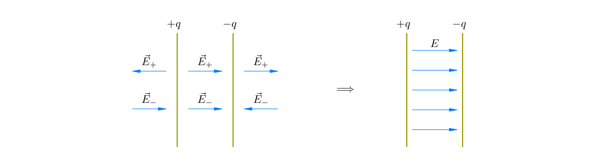

Плоский конденсатор — две параллельные металлические пластины (обкладки), разделённые
тонким диэлектриком. Заряды обкладок `+q` и `−q`; зарядом конденсатора называют `q`. Внутри
поле обкладок складывается и становится однородным, снаружи — гасится:

$$E = \frac{q}{\varepsilon_0 S}$$

Напряжение между обкладками `U = Ed`. Ёмкость конденсатора — отношение заряда к напряжению:

$$C = \frac{q}{U}$$

Для воздушного конденсатора:

$$C = \frac{\varepsilon_0 S}{d}$$

с диэлектриком:

$$C = \frac{\varepsilon_0\varepsilon S}{d}$$

Ёмкость зависит от площади обкладок `S`, расстояния `d` и проницаемости `ε`. Заполнение
диэлектриком увеличивает ёмкость.

### Энергия заряженного конденсатора / Energy of a charged capacitor

Заряженный конденсатор (замкнутый на лампочку) запасает энергию взаимодействия притягива
ющихся обкладок:

$$W = \frac{q^2}{2C} = \frac{qU}{2} = \frac{CU^2}{2}$$

### Энергия электрического поля / Electric field energy

Преобразуя энергию воздушного конденсатора, получаем `W = ε₀E²V/2`, где `V` — объём. Энергия
конденсатора — это энергия заключённого между обкладками электрического поля. Объёмная
плотность энергии поля:

$$w = \frac{\varepsilon_0 E^2}{2}\qquad\text{(с диэлектриком: } w = \frac{\varepsilon_0\varepsilon E^2}{2}\text{)}$$

Эти формулы выходят за пределы электростатики и справедливы для переменных полей.

---

## 3.8. Постоянный электрический ток / Direct electric current

> **EN** Electric current is the directed motion of charged particles that transfers
> charge from one region of space to another.
>
> **RU** Электрический ток — направленное движение заряженных частиц, при котором
> происходит перенос заряда из одних областей пространства в другие.

Ток может идти в металлах (свободные электроны), в электролитах (ионы), в газах (разряд), а
ток проводимости внутри тела дополняется **конвекционным** током — движением макроскопического
заряженного тела. Хаотическое тепловое движение зарядов током не является.

### Направление электрического тока / Direction of current

> **EN** By convention the direction of the current is the direction of motion of positive
> charges — from the positive terminal to the negative terminal.
>
> **RU** Направлением тока принято считать направление движения положительных зарядов —
> от «плюса» к «минусу».

В металлах реально движутся электроны (от «минуса» к «плюсу»), так что условное направление
тока противоположно движению электронов. Соглашение предложено Ампером задолго до открытия
электрона.

### Действие электрического тока / Effects of electric current

1. **Тепловое** — нагревание проводника (спирали, лампы накаливания).
2. **Магнитное** — ток создаёт магнитное поле (стрелка компаса отклоняется).
3. **Химическое** — в электролитах меняется состав вещества (осаждение меди).

### Сила и плотность тока / Current and current density

Ток постоянен, если за равные промежутки через сечение проходит одинаковый заряд. Сила тока —
отношение заряда ко времени:

$$I = \frac{q}{t}$$

Единица — ампер (А): 1 А — 1 Кл за 1 с. Сила тока может иметь знак (зависящий от выбора
направления обхода цепи). Плотность тока:

$$j = \frac{I}{S}$$

Плотность тока — заряд, проходящий за единицу времени через единицу площади сечения
(измеряется в А/м²).

### Скорость направленного движения зарядов / Drift velocity

Скорость распространения тока близка к скорости света (~300 000 км/с), но скорость самих
свободных зарядов — доли мм/с. Сила тока выражается через дрейфовую скорость `v`:

$$I = envS,\qquad j = env$$

где `n` — концентрация свободных зарядов, `e` — заряд одного носителя, `S` — сечение. Для
медного провода при токе 1 А дрейфовая скорость электронов ≈ 0,1 мм/с.

### Стационарное электрическое поле / Stationary electric field

Чтобы поддерживать постоянный ток, нужна постоянная разность потенциалов на концах
проводника. Просто заряженные тела не годятся: после их соединения ток быстро исчерпывается.
Постоянную разность поддерживает **источник тока**, внутри которого неэлектрические по
природе процессы непрерывно разделяют заряды.

Поле движущихся зарядов называется **стационарным электрическим полем**. Оно, как и
электростатическое, потенциально (можно говорить о напряжении на участке), но, в отличие от
него, проникает внутрь проводника; линии напряжённости внутри проводника параллельны его
поверхности, так что `U = El`.

---

## 3.9. Закон Ома / Ohm's law

### Закон Ома для участка цепи / Ohm's law for a circuit section

Меняя напряжение на элементе и измеряя ток, получают **вольт-амперную характеристику**
`I = I(U)`. Для металлического проводника опыт (Г. Ом) даёт прямую пропорциональность тока и
напряжения:

$$I = \frac{U}{R}$$

> **EN** Ohm's law: the current in a homogeneous section of a circuit is proportional to
> the voltage across it and inversely proportional to its resistance.
>
> **RU** Закон Ома для участка цепи: сила тока прямо пропорциональна напряжению на участке
> и обратно пропорциональна его сопротивлению.

`R` — сопротивление, измеряется в омах (Ом = В/А). Закон справедлив для металлов и растворов
электролитов на однородных участках (без источников тока). Вольт-амперная характеристика —
прямая, поэтому такие элементы называют линейными.

- **Автор:** Георг Ом (Georg Simon Ohm)
- **Труд:** «Гальваническая цепь, разработанная математически» (1827).

### Электрическое сопротивление / Electric resistance

Под постоянным напряжением заряды разгонялись бы полем и ток рос бы безгранично. Но
стационарному полю противодействует «сила сопротивления» — при столкновениях свободных
электронов с ионами решётки скорость дрейфа в среднем остаётся постоянной, а ток — неизменным.
Величина `R` показывает, насколько проводник «сопротивляется» току.

### Удельное сопротивление / Resistivity

Сопротивление проводника пропорционально длине и обратно пропорционально площади сечения:

$$R = \rho \frac{l}{S}$$

Коэффициент `ρ` — удельное сопротивление вещества (не зависит от геометрии). Единица —
Ом·м (практическая — Ом·мм²/м).

---

## 3.10. Соединения проводников / Connections of conductors

### Резисторы и подводящие провода / Resistors and connecting wires

Проводник с сопротивлением `R` называют резистором. Напряжение на нём — разность потенциалов
в направлении тока: `U = φ_a − φ_b`. Потенциал стационарного поля убывает вдоль направления
тока. Сопротивление подводящих проводов считается нулевым, поэтому вдоль провода потенциал не
меняется; потенциал изменяется лишь при переходе через элементы цепи.

### Последовательное соединение / Series connection

При последовательном соединении конец одного проводника соединён с началом следующего.

1. Сила тока во всех проводниках одинакова.
2. Напряжение на участке равно сумме напряжений: `U = U₁ + U₂`.
3. Сопротивление участка равно сумме сопротивлений:

$$R = R_1 + R_2$$

### Параллельное соединение / Parallel connection

Начала проводников подсоединены к одной точке (узлу), концы — к другой.

1. Напряжение на каждой ветви одинаково (проявление потенциальности стационарного поля).
2. Сила тока в неразветвлённой части равна сумме токов в ветвях: `I = I₁ + I₂`.
3. Величина, обратная сопротивлению участка, равна сумме обратных величин:

$$\frac{1}{R} = \frac{1}{R_1} + \frac{1}{R_2}, \qquad R = \frac{R_1 R_2}{R_1 + R_2}$$

Для `n` одинаковых проводников `R = R₁/n`.

### Смешанное соединение / Mixed connection

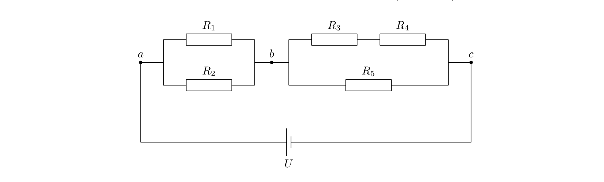

Смешанное соединение — произвольная комбинация последовательных и параллельных участков.
Расчёт сводится к последовательному разбиению схемы на простые участки и применению правил
сложения сопротивлений.

---

## 3.11. Работа и мощность тока / Work and power of current

### Работа тока / Work of current

За время `t` по участку с напряжением `U` проходит заряд `q = It`; стационарное поле совершает
работу

$$A = UIt$$

За счёт этой работы на участке выделяется тепло, совершается механическая работа или идут
химические реакции. Для однородного участка (где `U = IR`) получаем ещё две формы:

$$A = I^2 R t, \qquad A = \frac{U^2}{R}t$$

### Мощность тока / Power of current

Мощность — отношение работы ко времени:

$$P = UI, \qquad P = I^2 R, \qquad P = \frac{U^2}{R}$$

### Закон Джоуля–Ленца / Joule–Lenz law

Если работа поля целиком идёт в тепло (`A = Q`), то количество выделившейся теплоты:

$$Q = UIt = I^2 Rt = \frac{U^2}{R}t$$

Даже когда часть работы идёт в механическую работу или химическую энергию (электродвигатель,
аккумулятор), справедлива формула `Q = I²Rt` — это экспериментально установленный закон
Джоуля–Ленца.

- **Авторы:** Джеймс Джоуль (James Prescott Joule) и Эмилий Ленц (Heinrich Friedrich Emil Lenz)
- **Труд:** независимые экспериментальные работы (Джоуль, 1841; Ленц, 1842).

---

## 3.12. ЭДС. Закон Ома для полной цепи / EMF. Ohm's law for the complete circuit

Положительный заряд, пройдя внешнюю цепь, должен вернуться на положительную клемму, двигаясь
внутри источника **против** электрического поля клемм. Протаскивает его сила неэлектрического
происхождения.

### Сторонняя сила / External (non-electrostatic) force

> **EN** The external force is the force of non-electrostatic origin that moves charges
> through the current source against the electric field of its terminals (chemical in a
> battery, etc.).
>
> **RU** Сторонняя сила — сила неэлектрического происхождения, перемещающая заряды внутри
> источника тока против электрического поля клемм (в батарейке она возникает в химических
> реакциях).

Работа сторонней силы `A_ст` по перемещению заряда внутри источника (и по всей цепи)
пропорциональна заряду. Отношение `A_ст/q` — электродвижущая сила (ЭДС):

$$\mathcal{E} = \frac{A_{\text{ст}}}{q}$$

ЭДС измеряется в вольтах. Надпись «1,5 В» на батарейке — это ЭДС, а не напряжение во внешней
цепи.

### Закон Ома для полной цепи / Ohm's law for the complete circuit

Источник характеризуется ЭДС `E` и внутренним сопротивлением `r`. Подключив к нему внешнюю
нагрузку `R`, получаем полную цепь. Работа источника `A = EIt` целиком превращается в тепло на
`R` и `r`:

$$\mathcal{E} = I(R + r), \qquad I = \frac{\mathcal{E}}{R + r}$$

При коротком замыкании (`R = 0`) ток максимален: `I_кз = E/r`. Напряжение на клеммах:

$$U = IR = \frac{\mathcal{E}R}{R + r}$$

В реальной цепи `U < E`; равенство достигается для идеального источника (`r = 0`) и при
разомкнутой цепи (`R = ∞`) — идеальный вольтметр на клеммах показывает ЭДС.

### КПД электрической цепи / Efficiency of a circuit

Полезное тепло выделяется на нагрузке, паразитное — на источнике:

$$\eta = \frac{Q_{\text{полезн}}}{Q_{\text{полн}}} = \frac{R}{R + r}$$

КПД равен единице лишь для идеального источника.

### Закон Ома для неоднородного участка / Ohm's law for a non-uniform section

Неоднородный участок содержит источник с ЭДС. `φ_a − φ_b ± E = IR`; знак «+», если источник
«помогает» току (ток совпадает с направлением сторонних сил), «−» — если «мешает» (ток течёт
против сторонних сил, как при зарядке аккумулятора):

$$\varphi_a - \varphi_b \pm \mathcal{E} = IR$$

При `E = 0` получаем закон Ома для однородного участка; при замыкании участка (`φ_a = φ_b`) —
закон Ома для полной цепи.

---

## 3.13. Электрический ток в металлах / Electric current in metals

### Свободные электроны / Free electrons

Металлы имеют кристаллическую решётку, в узлах которой — положительные ионы; между ними
«газ» свободных электронов (валентные электроны, покинувшие атомы). Электронный газ играет
роль «клея», удерживающего решётку. При включении поля на хаотическое тепловое движение
накладывается упорядоченный дрейф — ток в металле (скорость дрейфа ≈ 0,1 мм/с).

### Опыт Рикке / Riecke's experiment

Чтобы решить, не переносят ли ток положительные ионы, Э. Рикке (1901) год пропускал ток через
три сжатых цилиндра Cu–Al–Cu. Сквозь них прошло более трёх миллионов кулон, что при переносе
ионами дало бы ~2 кг перенесённой меди. Обнаружена лишь обычная диффузия: ток в металлах не
переносит вещество, ионы в нём не участвуют.

### Опыт Стюарта–Толмена / Stuart–Tolman experiment

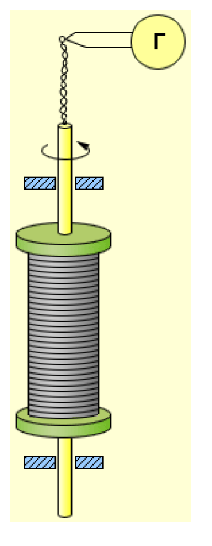

Качественно электроинерционный эффект (импульс тока при резком торможении проводника)
наблюдали Л. И. Мандельштам и Н. Д. Папалекси (1912). Количественный опыт поставили
Т. Стюарт и Р. Толмен (1916): резко тормозя быстро вращающуюся катушку, подключённую к
баллистическому гальванометру, они по заряду импульса тока получили отношение `q/m`, совпавшее
с `e/m` электрона. Так доказано, что носители тока в металлах — свободные электроны.

### Зависимость сопротивления от температуры / Temperature dependence

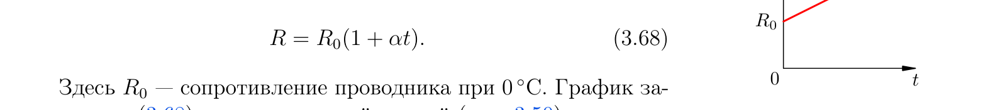

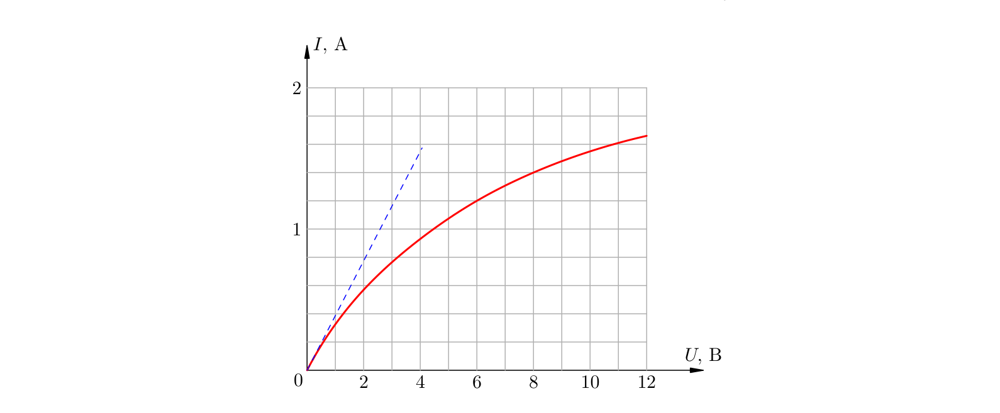

При нагревании сопротивление металла растёт: усиливаются тепловые колебания ионов, чаще
столкновения электронов с решёткой. Зависимость линейна:

$$R = R_0 (1 + \alpha t), \qquad \rho = \rho_0 (1 + \alpha t)$$

`α` — температурный коэффициент сопротивления (для меди `α = 0,0043`). Для ламп накаливания
(раскалённая вольфрамовая спираль) вольт-амперная характеристика заметно нелинейна.

---

## 3.14. Электрический ток в электролитах / Electric current in electrolytes

Электролит — раствор (или расплав) вещества, проводящий ток, тогда как само вещество
проводником не является. Электролиты — растворы солей, кислот, оснований.

### Электролитическая диссоциация / Electrolytic dissociation

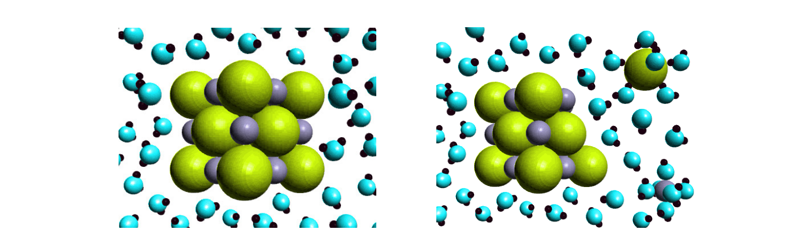

> **EN** Electrolytic dissociation is the breaking of molecules into positive and negative
> ions under the action of the electric forces of the polar water molecules.
>
> **RU** Электролитическая диссоциация — распад молекул растворяемого вещества на
> положительные и отрицательные ионы под действием электрических сил полярных молекул воды.

Молекула воды — диполь (со стороны кислорода — «минус», водорода — «плюс»). Диполи воды
«растаскивают» полярную молекулу NaCl на ионы Na⁺ и Cl⁻:

$$\text{NaCl} \rightleftarrows \text{Na}^+ + \text{Cl}^-$$

Наряду с диссоциацией идёт рекомбинация; в растворе устанавливается динамическое равновесие.
Степень диссоциации — доля распавшихся молекул.

### Ионная проводимость / Ionic conduction

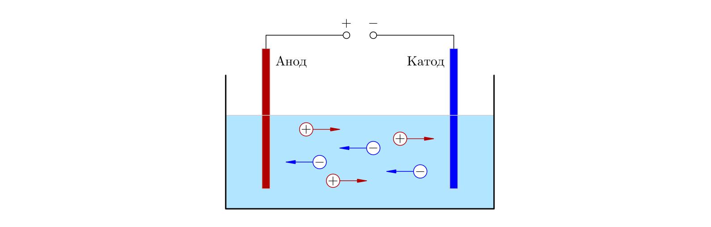

В электролите два типа носителей и один заряд иона может быть равен целому числу элементарных
зарядов `ze` (валентность `z`). Положительный электрод — анод, отрицательный — катод.
Положительные ионы движутся к катоду, отрицательные — к аноду; проводимость электролитов
называют ионной. В металлической части цепи циркулируют электроны, в растворе цепь замыкается
встречным движением ионов.

### Электролиз / Electrolysis

Ток в электролите переносит вещество — это явление называется электролизом. Законы изучены
Фарадеем. Масса выделившегося на электроде вещества:

$$m = kIt$$

`k = m₁/q₁` — электрохимический эквивалент. Первый закон Фарадея: масса пропорциональна току
и времени. Выразив `k` через молярную массу, получаем второй закон Фарадея:

$$m = \frac{\mu}{zeN_A} It = \frac{\mu}{zF} It$$

где `F = eN_A = 96 485 Кл/моль` — постоянная Фарадея.

- **Автор:** Майкл Фарадей (Michael Faraday)
- **Труд:** «Экспериментальные исследования по электричеству» (законы электролиза, 1833–34).

---

## 3.15. Электрический ток в газах / Electric current in gases

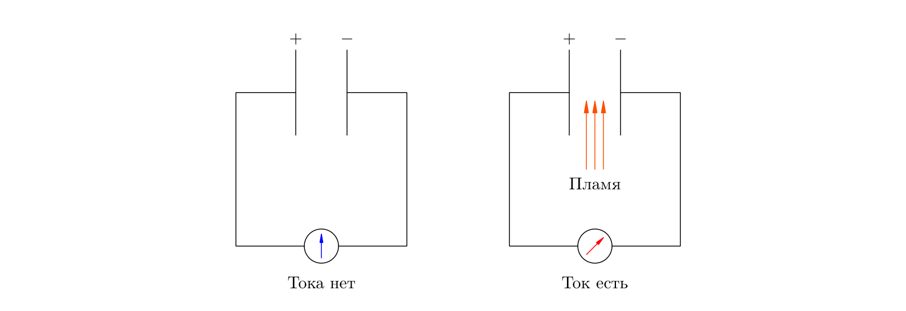

Газы состоят из нейтральных частиц, поэтому в обычных условиях они — диэлектрики (на этом
работают выключатели). Небольшое «естественное» количество свободных зарядов создаётся
радиоактивным, ультрафиолетовым и космическим излучением.

### Свободные заряды в газе / Free charges in a gas

Ток в газе создают заряды трёх видов: электроны, положительные и отрицательные ионы.
При нагревании растёт **ионизация** (распад нейтральных частиц на электрон и положительный
ион). Всякий фактор, вызывающий ионизацию, — **ионизатор** (высокая температура, излучения).
Одновременно идёт **рекомбинация**; при неизменном ионизаторе наступает динамическое
равновесие. Отрицательные ионы возникают при «прилипании» электрона к нейтральному атому.
Полностью или частично ионизированный газ — плазма.

### Несамостоятельный разряд / Non-self-sustained discharge

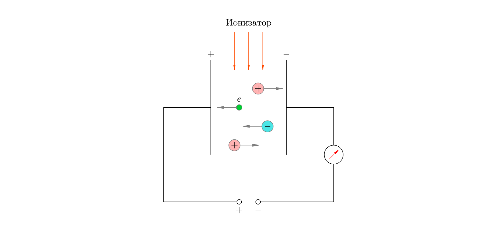

При наложении поля положительные ионы идут к катоду, электроны и отрицательные ионы — к
аноду. Разряд называется несамостоятельным, пока для поддержания тока нужен ионизатор: убрали
ионизатор — ток прекратился.

### Вольт-амперная характеристика газового разряда / Current–voltage characteristic

С ростом напряжения ток сначала растёт (часть частиц успевает рекомбинировать, часть — дошла
до электродов), затем достигает **насыщения** (все рождённые ионизатором частицы достигают
электродов, ток перестаёт зависеть от напряжения; участок AB).

### Самостоятельный разряд / Self-sustained discharge

При достаточно большом напряжении электроны за свободный пробег набирают энергию, достаточную
для **ионизации электронным ударом**. Возникает электронная лавина, ток резко растёт, внешний
ионизатор становится не нужен — разряд становится самостоятельным; происходит **пробой**.
Напряжённость пробоя сухого воздуха ≈ 30 кВ/см; молния — пробой многих километров воздуха.

---

## 3.16. Полупроводники / Semiconductors

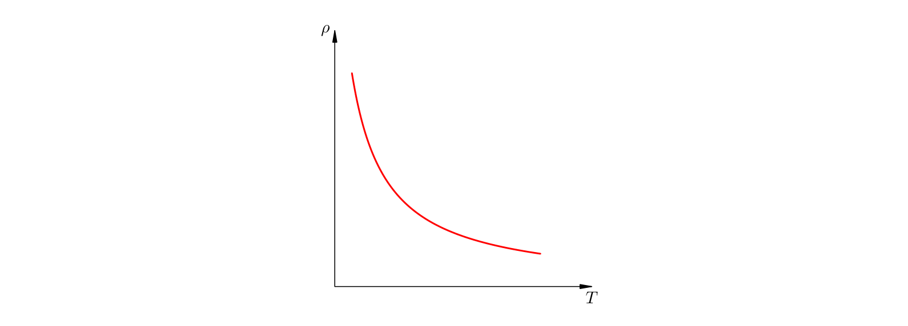

Полупроводники занимают промежуточное положение по проводимости: их удельное сопротивление
(10⁻³—10⁷ Ом·м) при нагревании **падает** (в отличие от металлов). К ним относятся кремний,
германий, селен. Проводимость растёт также при освещении и при введении малых примесей. Ток
в полупроводнике не переносит вещества, значит, его создают электроны.

### Ковалентная связь / Covalent bond

> **EN** A covalent bond is a bond between atoms by shared electron pairs: each of two
> atoms contributes one valence electron, which then belongs to both atoms.
>
> **RU** Ковалентная связь — связь между атомами за счёт общих электронных пар: каждый из
> двух атомов отдаёт по одному валентному электрону, обобществляемому обоими атомами.

### Кристаллическая структура кремния / Crystal structure of silicon

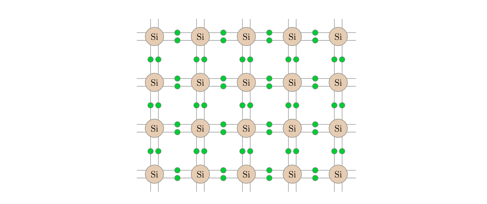

Кремний четырёхвалентен: каждый атом связан ковалентными связями с четырьмя соседями, вокруг
каждого атома по восемь электронов. Валентные электроны принадлежат всему кристаллу, но при
низких температурах не свободны — ковалентные связи не рвутся, и полупроводник близок к
диэлектрику.

### Собственная проводимость / Intrinsic conduction

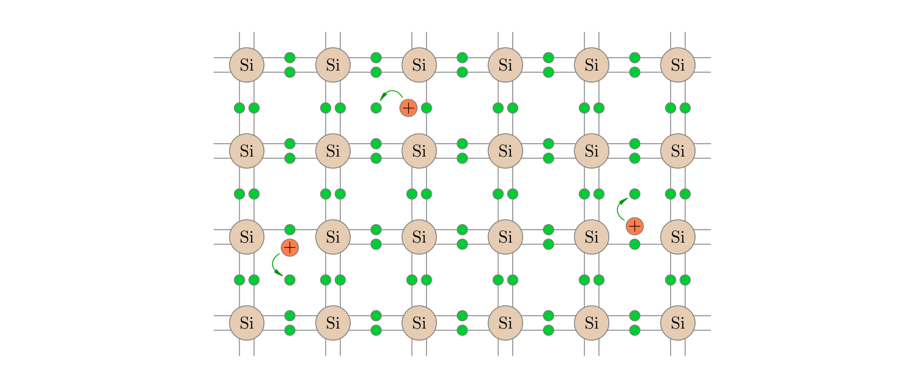

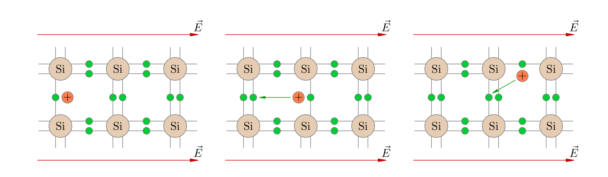

При нагревании ковалентные связи рвутся: электрон покидает атом, а на месте разрыва остаётся
**дырка** — вакансия с положительным зарядом. Дырка блуждает за счёт перескоков соседних
электронов. Носителей два: свободные электроны (электронная, n-проводимость) и дырки
(дырочная, p-проводимость) — вместе собственная проводимость. В чистом полупроводнике
концентрации электронов и дырок равны; идёт динамическое равновесие разрыв–рекомбинация.

### Примесная проводимость / Extrinsic (impurity) conduction

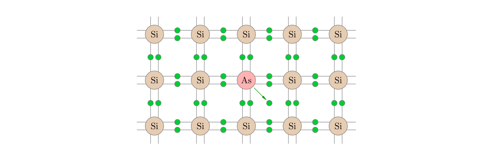

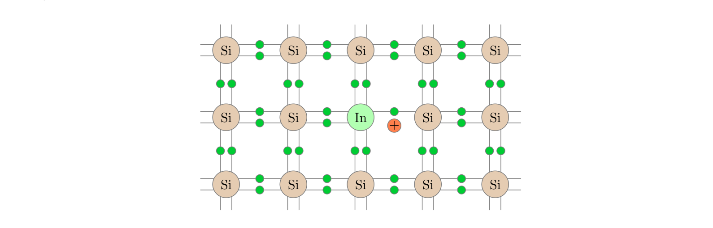

- **Донорная примесь** (пятивалентный мышьяк As): пятый электрон легко уходит, создавая
  свободный электрон **без** дырки. Основные носители — электроны (полупроводник n-типа).
- **Акцепторная примесь** (трёхвалентный индий In): не хватает электрона — образуется
  **дырка** без свободного электрона. Основные носители — дырки (полупроводник p-типа).

Даже 0,1 % примеси повышает концентрацию основных носителей на девять порядков.

### p–n-переход / The p–n junction

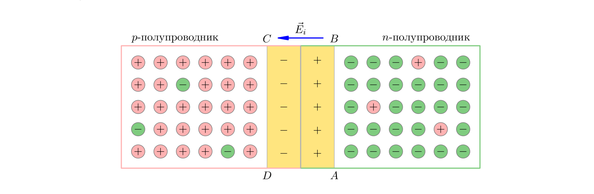

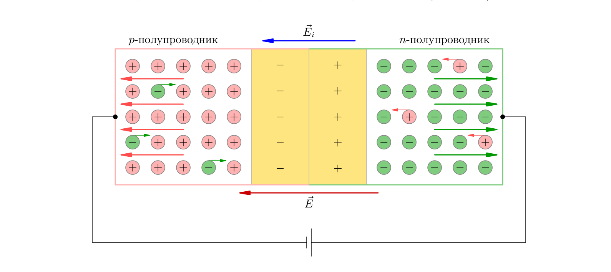

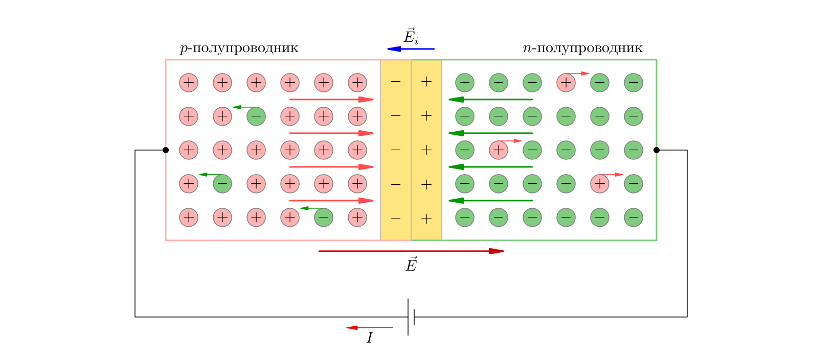

Контакт p- и n-полупроводников. Электроны диффундируют в p-область, дырки — в n-область и там
рекомбинируют; вблизи границы образуется **запирающий слой** с внутренним полем `Eᵢ`,
препятствующим дальнейшей диффузии. Возникает односторонняя проводимость: при включении в
прямом направлении («плюс» на p) поле сужает запирающий слой — идёт ток основных носителей;
в обратном — слой расширяется, течёт лишь ничтожный ток неосновных носителей. На этом
основаны полупроводниковые диоды.

---

## 3.17. Магнитное поле. Линии / Magnetic field. Field lines

### Взаимодействие магнитов / Interaction of magnets

У магнита два полюса — северный и южный; одноимённые отталкиваются, разноимённые
притягиваются, даже сквозь вакуум. В отличие от зарядов, полюса магнита разделить нельзя:
разрезанный магнит даёт два магнита (изолированных «магнитных зарядов», монополей, в природе
не найдено). Магнит действует только на **движущийся** заряд, электрическое поле — на любой.
Магнитное взаимодействие ослабевает при нагревании и тряске. По теории близкодействия магниты
взаимодействуют посредством магнитного поля. Земля — гигантский магнит; вблизи северного
географического полюса расположен южный магнитный полюс.

### Линии магнитного поля / Magnetic field lines

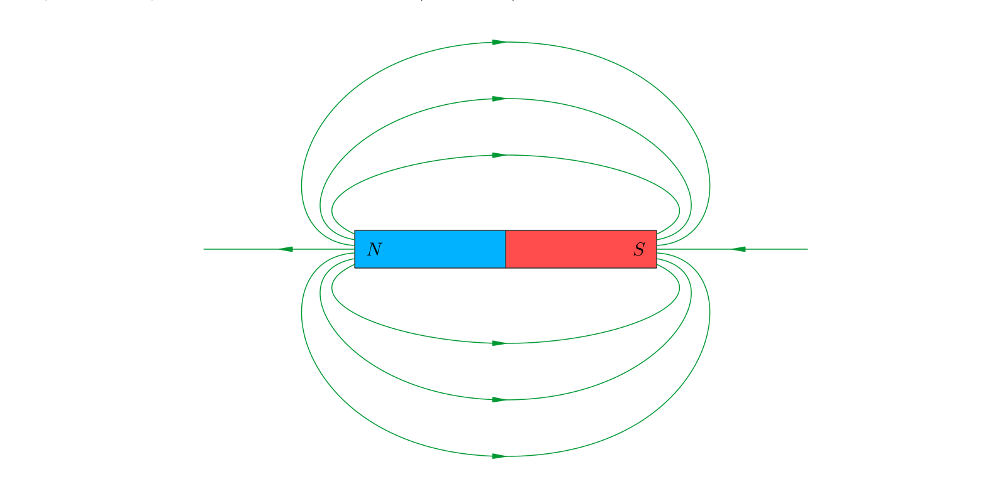

Линии магнитного поля — направленные линии, по касательной к которым ориентируется магнитная
стрелка; направление линии задают северные концы стрелок; чем гуще линии, тем сильнее поле.
Снаружи магнита линии выходят из северного полюса и входят в южный.

### Опыт Эрстеда / Oersted's experiment

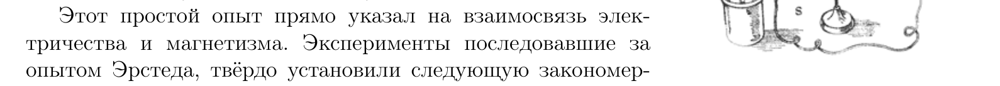

В 1820 г. Эрстед обнаружил: при замыкании цепи провод над магнитной стрелкой поворачивает её
перпендикулярно проводу. Это указало на связь электричества и магнетизма: магнитное поле
порождается токами и действует на токи.

- **Автор:** Ханс Кристиан Эрстед (Hans Christian Ørsted)
- **Труд:** эксперимент 1820 г. («Experimenta circa effectum conflictus electrici in acum magneticam»).

### Магнитное поле прямого провода с током / Field of a straight current-carrying wire

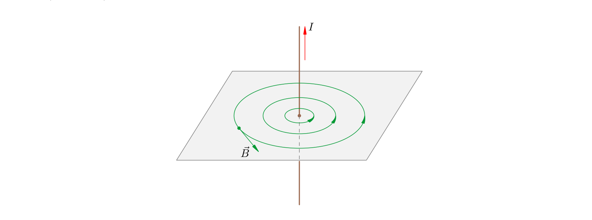

Линии поля — концентрические окружности в плоскостях, перпендикулярных проводу. Направление
определяется правилом часовой стрелки (ток течёт на нас — линии против часовой стрелки) или
правилом винта. Силовая характеристика поля — вектор магнитной индукции `B⃗`, измеряемый в
теслах (Тл); он направлен по касательной к линии поля. Для индукции также справедлив принцип
суперпозиции: `B⃗ = B⃗₁ + B⃗₂ + … + B⃗ₙ`.

### Магнитное поле витка с током / Field of a current loop

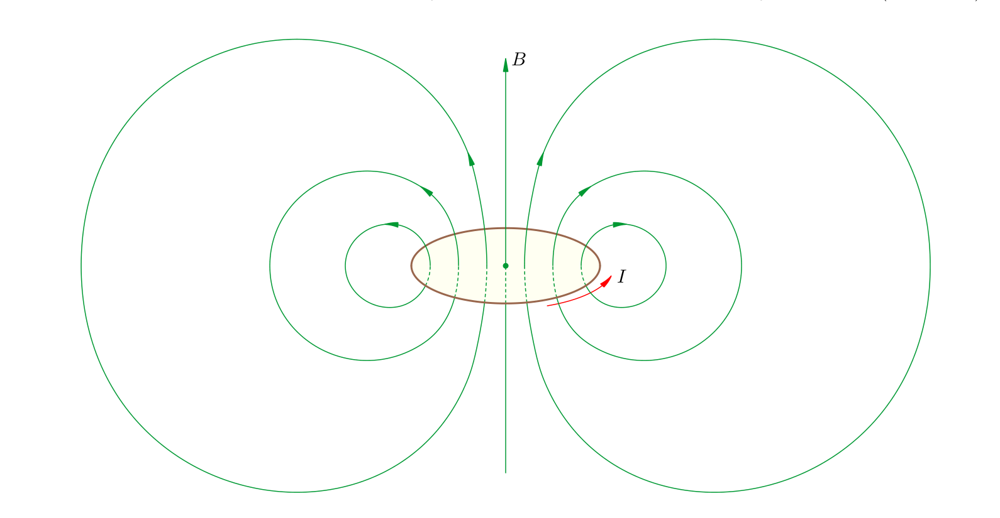

Поле витка направлено в то полупространство, глядя откуда ток виден циркулирующим против
часовой стрелки (правило винта: куда пойдёт винт при вращении по току).

### Магнитное поле катушки с током / Field of a solenoid

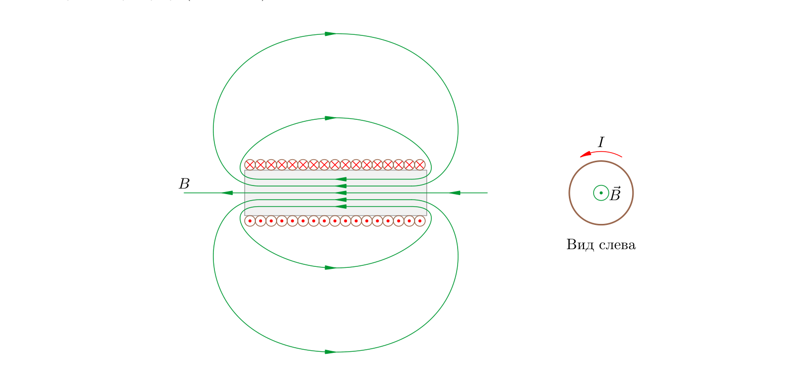

Катушка (соленоид) — плотно намотанная спираль. Внутри длинной катушки поле однородно,
снаружи — близко к нулю: катушка — «магнитный» аналог конденсатора. Поле катушки совпадает с
полем магнита, что ставит вопрос об источнике магнетизма постоянных магнитов.

### Гипотеза Ампера. Элементарные токи / Ampère's hypothesis. Elementary currents

> **EN** There are no magnetic charges: the action of a magnet is explained by closed
> elementary currents circulating inside its atoms and molecules (associated with the
> orbital motion of electrons).
>
> **RU** Магнитных зарядов нет: действие магнита объясняется замкнутыми элементарными
> токами, циркулирующими внутри атомов и молекул и связанными с движением электронов по
> орбитам.

Согласованно ориентированные элементарные токи дают магнит; нагрев и тряска разрушают порядок
— магнитные свойства ослабевают. Гипотеза объяснила неразделимость полюсов и подтвердилась
теорией атома. Автор гипотезы — Андре-Мари Ампер.

- **Автор:** Андре-Мари Ампер (André-Marie Ampère)
- **Труд:** «Теория электродинамических явлений» (1826).

---

## 3.18. Магнитное поле. Силы / Magnetic field. Forces

Магнитное поле действует только на **движущиеся** заряды, и сила зависит от направления
скорости.

### Сила Лоренца / Lorentz force

Сила, с которой магнитное поле действует на заряд `q`, движущийся со скоростью `v`:

$$F = qvB\sin\alpha$$

где `α` — угол между `v⃗` и `B⃗`. Сила перпендикулярна плоскости векторов `v⃗` и `B⃗`; её
направление для положительного заряда находят по правилу левой руки (четыре пальца — по
скорости, линии поля входят в ладонь, большой палец — сила) или по правилу часовой стрелки.
Для отрицательного заряда направление меняется на противоположное.

Из формулы получается размерность индукции: Тл = Н·с/(Кл·м) = В·с/м².

- **Автор:** Хендрик Лоренц (Hendrik Antoon Lorentz)
- **Труд:** теория электронов (сила Лоренца, конец XIX в.).

### Сила Ампера / Ampère force

На проводник с током в магнитном поле действует сила Ампера — сумма сил Лоренца, действующих
на все свободные электроны. Для проводника длины `l`:

$$F = IBl\sin\alpha$$

Направление — по правилу левой руки (пальцы по току) или часовой стрелки. Два параллельных
провода притягиваются при одинаковых направлениях токов и отталкиваются при противоположных.

- **Автор:** Андре-Мари Ампер (André-Marie Ampère)
- **Труд:** опыты по взаимодействию проводников с током (1820-е).

### Рамка с током в магнитном поле / A current loop in a magnetic field

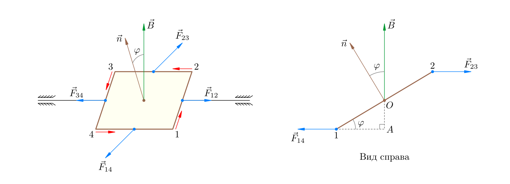

На рамку с током действует вращающий момент; для рамки площади `S` (вектор нормали `n⃗`
сонаправлен с полем тока в рамке, угол между `n⃗` и `B⃗` равен φ):

$$M = IBS\sin\varphi$$

Положение `φ = 0` (нормаль вдоль поля) — устойчивое равновесие, `φ = π` — неустойчивое.
Меняя направление тока в нужные моменты (коллектор и щётки), получают электродвигатель.

---

## 3.19. Электромагнитная индукция / Electromagnetic induction

Если ток порождает магнитное поле (Эрстед), то, как установил Фарадей (1831), есть и обратный
эффект: переменное магнитное поле порождает ток. В его опытах при замыкании и размыкании
первой катушки во второй, лишённой контакта с первой, возникал кратковременный импульс тока;
постоянному току в первой катушке не соответствовал никакой ток. Индукционный ток возникал и
при взаимном перемещении катушек, и при вдвигании магнита: важна лишь скорость изменения
«количества линий», пронизывающих контур.

> **EN** Electromagnetic induction is the emergence of a current in a closed conducting
> loop when the magnetic flux through it changes.
>
> **RU** Электромагнитная индукция — явление возникновения тока в замкнутом проводящем
> контуре при изменении магнитного потока, пронизывающего контур.

- **Автор:** Майкл Фарадей (Michael Faraday)
- **Труд:** «Экспериментальные исследования по электричеству» (открытие индукции, 1831).

### Магнитный поток / Magnetic flux

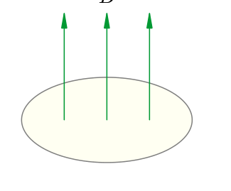

Магнитный поток характеризует «количество линий», пронизывающих контур. Для однородного поля
и контура площади `S`:

$$\Phi = BS\cos\alpha$$

где `α` — угол между `B⃗` и нормалью к плоскости контура (`B⊥ = B cos α`). Единица — вебер:
Вб = Тл·м² = В·с.

### ЭДС индукции / Induced EMF

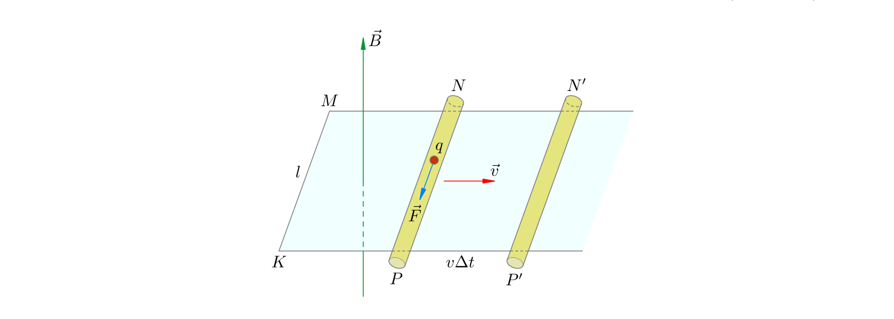

Сторонние силы, возникающие при изменении потока, перемещают единичный положительный заряд
вокруг контура, совершая работу — ЭДС индукции `Eᵢ`.

### Закон электромагнитной индукции Фарадея / Faraday's law of induction

Сила индукционного тока (и ЭДС) пропорциональна скорости изменения магнитного потока:

$$\mathcal{E}_i = \left|\frac{\Delta\Phi}{\Delta t}\right| = |\dot{\Phi}|$$

> **EN** Faraday's law: the induced EMF in a loop equals the magnitude of the rate of
> change of the magnetic flux through it.
>
> **RU** Закон Фарадея: ЭДС индукции в контуре равна модулю скорости изменения магнитного
> потока, пронизывающего контур.

### Правило Ленца / Lenz's rule

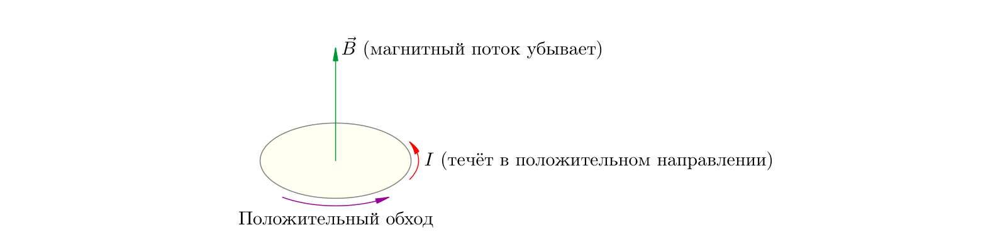

Индукционный ток создаёт собственное магнитное поле, складывающееся с внешним.

> **EN** Lenz's rule: the induced current always has such a direction that its own
> magnetic flux opposes the change of the external flux.
>
> **RU** Правило Ленца: индукционный ток всегда направлен так, что собственный магнитный
> поток препятствует изменению внешнего магнитного потока.

При возрастании внешнего поля индукционный ток создаёт поле против внешнего, при убывании —
по внешнему.

- **Автор:** Эмилий Ленц (Heinrich Friedrich Emil Lenz)
- **Труд:** «О законах электродинамической индукции» (1833).

### Взаимодействие магнита с контуром / Interaction of magnet and loop

Приближаемый магнит отталкивает контур, удаляемый — притягивает: контур «следует» за
магнитом. Это следует из закона сохранения энергии: механическая работа по перемещению магнита
преобразуется в работу сторонних сил, создающих индукционный ток.

### Закон Фарадея + Правило Ленца = Снятие модуля / Removing the modulus

Задав положительное направление обхода и согласовав знак потока (поток положителен, если с
конца `B⃗` положительный обход виден против часовой стрелки), правило Ленца приводит к знаку:

$$\mathcal{E}_i = -\frac{\Delta\Phi}{\Delta t} = -\dot{\Phi}$$

Знак ЭДС индукции противоположен знаку скорости изменения потока.

### Вихревое электрическое поле / Vortex (induced) electric field

Максвелл установил: переменное магнитное поле порождает электрическое поле, которое и двигает
заряды в неподвижном контуре. Его линии замкнуты, поэтому оно названо вихревым. При росте
магнитного поля линии вихревого поля идут по часовой стрелке (с конца `B⃗`), при убывании —
против. Вихревое поле непотенциально — только это позволяет ему поддерживать ток (работа по
замкнутому контуру не равна нулю). Для кольца радиуса `r` ЭДС индукции `Eᵢ = 2πrE`.

- **Автор:** Джеймс Клерк Максвелл (James Clerk Maxwell)

### ЭДС индукции в движущемся проводнике / Motional EMF

В проводнике, движущемся в постоянном магнитном поле, роль сторонней силы играет сила
Лоренца. Для стержня длины `l`, движущегося со скоростью `v` перпендикулярно полю `B`:

$$\mathcal{E}_i = vBl \qquad(\text{то же: } Blv)$$

Тот же результат даёт закон Фарадея: `ΔΦ = B·lvΔt`. Стержень работает как источник, а сила
тока находится по закону Ома для полной цепи `I = vBl/(R + r)`.

---

## 3.20. Самоиндукция / Self-induction

Ток, меняющийся со временем, воздействует сам на себя. Ток создаёт магнитное поле; поле меняется
вместе с током и порождает вихревое электрическое поле. При возрастании тока вихревое поле
тормозит его (ток устанавливается не мгновенно), при убывании — поддерживает.

> **EN** Self-induction is the emergence of an induced EMF in a loop when the current in
> this very loop changes.
>
> **RU** Самоиндукция — возникновение ЭДС индукции в контуре при изменении силы тока в этом
> же самом контуре.

### Индуктивность / Inductance

Магнитный поток, создаваемый током в собственном контуре, пропорционален силе тока:

$$\Phi = LI$$

Коэффициент `L` — индуктивность; зависит от геометрии контура и магнитных свойств среды,
измеряется в генри (Гн). При постоянной `L` закон Фарадея даёт:

$$\mathcal{E}_i = -L\frac{\Delta I}{\Delta t} = -L\dot{I}$$

При замыкании цепи с катушкой лампа разгорается постепенно (ЭДС препятствует росту тока), при
размыкании — ярко вспыхивает (большая ЭДС поддерживает убывающий ток).

- **Автор:** Джозеф Генри (Joseph Henry)
- **Труд:** открытие самоиндукции (1832); в его честь названа единица индуктивности.

### Электромеханическая аналогия / Electromechanical analogy

Индуктивность `L` — электрический аналог массы `m`: как массу нельзя разогнать мгновенно, так
и ток в катушке нарастает постепенно; как удар массивного тела о стену, так и размыкание цепи
с большой индуктивностью даёт мощный «удар» в виде большой ЭДС.

### Энергия магнитного поля / Magnetic field energy

Энергия, запасённая в катушке с током (аналог кинетической энергии `mv²/2`):

$$W = \frac{LI^2}{2}$$

Она и выделяется в лампе при размыкании цепи.

---

## 3.21. Электромагнитные колебания / Electromagnetic oscillations

> **EN** Electromagnetic oscillations are periodic changes of charge, current and voltage
> in a circuit, and of the electric and magnetic fields in space.
>
> **RU** Электромагнитные колебания — периодические изменения заряда, силы тока и напряжения
> в цепи, а также напряжённости электрического и индукции магнитного полей.

### Колебательный контур / Oscillatory circuit

Колебательный контур — последовательно соединённые конденсатор и катушка. В замыкании
заряженного конденсатора на катушку возникают свободные колебания: конденсатор периодически
разряжается и перезаряжается, ток периодически нарастает и убывает. При нулевом сопротивлении
колебания незатухающие (аналог маятника без трения; в реальности они затухают на сопротивлении).

### Энергетические превращения в колебательном контуре / Energy transformations

Энергия лишь перераспределяется между конденсатором и катушкой. В произвольный момент:

$$\frac{q^2}{2C} + \frac{LI^2}{2} = \frac{q_0^2}{2C} = \frac{LI_0^2}{2}$$

### Электромеханические аналогии / Electromechanical analogies

Сопоставляя с пружинным маятником (`kx²/2 + mv²/2 = const`), получаем соответствия:

$$q \leftrightarrow x, \qquad I \leftrightarrow v, \qquad L \leftrightarrow m, \qquad \frac{1}{C} \leftrightarrow k$$

### Гармонический закон колебаний в контуре / Harmonic law of oscillations

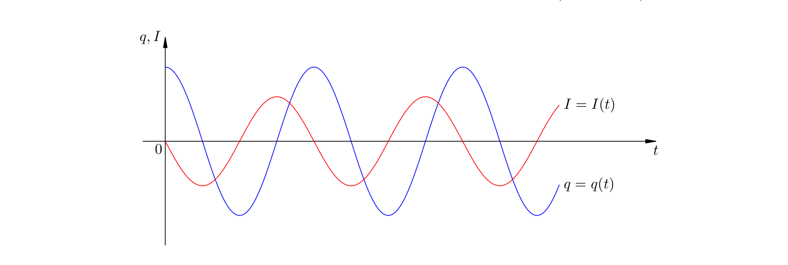

Заменяя в формуле периода пружинного маятника `T = 2π√(m/k)` массу на `L`, а жёсткость на
`1/C`, получаем формулу Томсона:

$$T = 2\pi\sqrt{LC}, \qquad \omega_0 = \frac{1}{\sqrt{LC}}$$

Дифференцируя закон сохранения энергии, получаем уравнение гармонических колебаний
`q̈ + (1/LC)q = 0`; заряд колеблется по закону косинуса, ток — по закону синуса (ток опережает
заряд по фазе на π/2):

$$q = q_0\cos\omega_0 t, \qquad I = -I_0\sin\omega_0 t, \qquad I_0 = q_0\omega_0$$

- **Автор:** Уильям Томсон (лорд Кельвин, William Thomson, Lord Kelvin)
- **Труд:** формула периода электрических колебаний (1853).

### Вынужденные электромагнитные колебания / Forced electromagnetic oscillations

Контур, подключённый к источнику синусоидального напряжения `U = U₀ sin ωt`, совершает
вынужденные колебания с частотой источника `ω`. Амплитуда тем больше, чем ближе `ω` к
собственной частоте `ω₀`; при `ω = ω₀` наступает резонанс.

---

## 3.22. Переменный ток. 1 / Alternating current. 1

> **EN** Alternating current is the forced electromagnetic oscillation produced in a
> circuit by a source of alternating (usually sinusoidal) voltage `U = U₀ sin ωt`.
>
> **RU** Переменный ток — вынужденные электромагнитные колебания, вызываемые в цепи
> источником переменного (синусоидального) напряжения `U = U₀ sin ωt`.

### Условие квазистационарности / Quasi-stationarity condition

Если длина цепи много меньше пути, который взаимодействие проходит за период (`l ≪ cT`), время
распространения взаимодействия можно игнорировать и считать ток одинаковым во всех элементах
цепи. Например, при 50 Гц `cT = 6000 км`. Такой ток называется квазистационарным.

### Резистор в цепи переменного тока / Resistor in an AC circuit

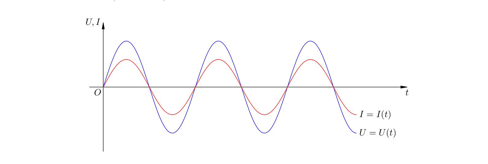

Мгновенные значения подчиняются закону Ома: `I = U/R = I₀ sin ωt`, где

$$I_0 = \frac{U_0}{R}$$

Ток и напряжение на резисторе синфазны (сдвиг фаз равен нулю).

### Конденсатор в цепи переменного тока / Capacitor in an AC circuit

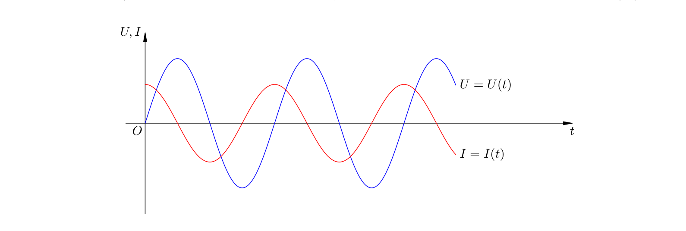

Для постоянного тока конденсатор — разрыв, но переменному он не помеха. Дифференцируя
`q = CU₀ sin ωt`, находим:

$$I = CU_0\omega\cos\omega t = I_0\sin\left(\omega t + \frac{\pi}{2}\right)$$

Ток через конденсатор **опережает** напряжение по фазе на π/2. Амплитуды связаны законом Ома:

$$I_0 = \frac{U_0}{X_C}, \qquad X_C = \frac{1}{\omega C}$$

`X_C` — ёмкостное сопротивление (тем меньше, чем больше частота и ёмкость).

### Катушка в цепи переменного тока / Inductor in an AC circuit

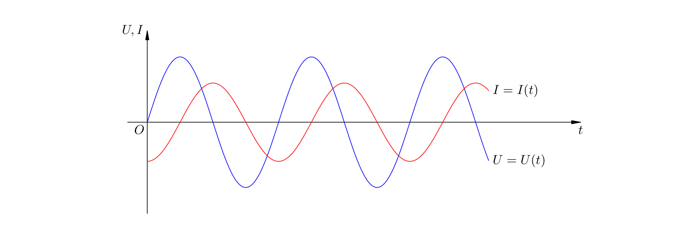

Вихревое поле катушки точно уравновешивает кулоновское поле зарядов (`U + Eᵢ = 0`). Отсюда:

$$I = -\frac{U_0}{\omega L}\cos\omega t = I_0\sin\left(\omega t - \frac{\pi}{2}\right)$$

Ток через катушку **отстаёт** от напряжения по фазе на π/2. Амплитуды:

$$I_0 = \frac{U_0}{X_L}, \qquad X_L = \omega L$$

`X_L` — индуктивное сопротивление (тем больше, чем больше частота и индуктивность). Для
постоянного тока (ω = 0) катушка — короткое замыкание. Мгновенные значения (в отличие от
амплитудных) из-за сдвига фаз закону Ома не подчиняются.

---

## 3.23. Переменный ток. 2 / Alternating current. 2

### Метод вспомогательного угла / The auxiliary-angle method

Тригонометрическое преобразование:

$$a\sin\phi + b\cos\phi = \sqrt{a^2 + b^2}\,\sin(\phi + \alpha), \qquad \mathrm{tg}\, \alpha = \frac{b}{a}$$

### Колебательный контур с резистором / Oscillatory circuit with a resistor

В RLC-контуре (последовательные `R`, `L`, `C`) напряжения складываются: напряжение на
резисторе в фазе с током, на конденсаторе отстаёт на π/2, на катушке опережает на π/2. Метод
вспомогательного угла даёт полное сопротивление:

$$X = \sqrt{R^2 + \left(\omega L - \frac{1}{\omega C}\right)^2}$$

и амплитуду тока (закон Ома для амплитуд):

$$I_0 = \frac{U_0}{X}$$

Сдвиг фаз между напряжением и током:

$$\mathrm{tg}\,\alpha = \frac{\omega L - \frac{1}{\omega C}}{R}$$

### Резонанс в колебательном контуре / Resonance in the oscillatory circuit

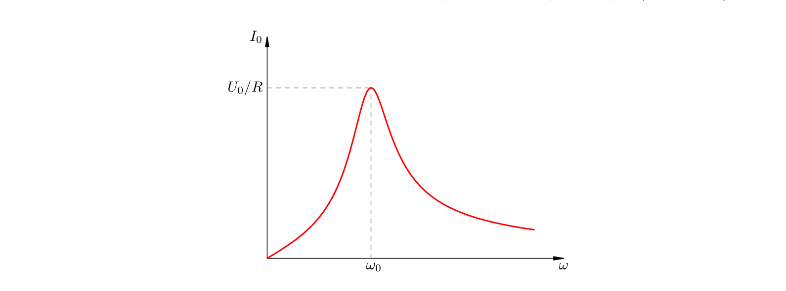

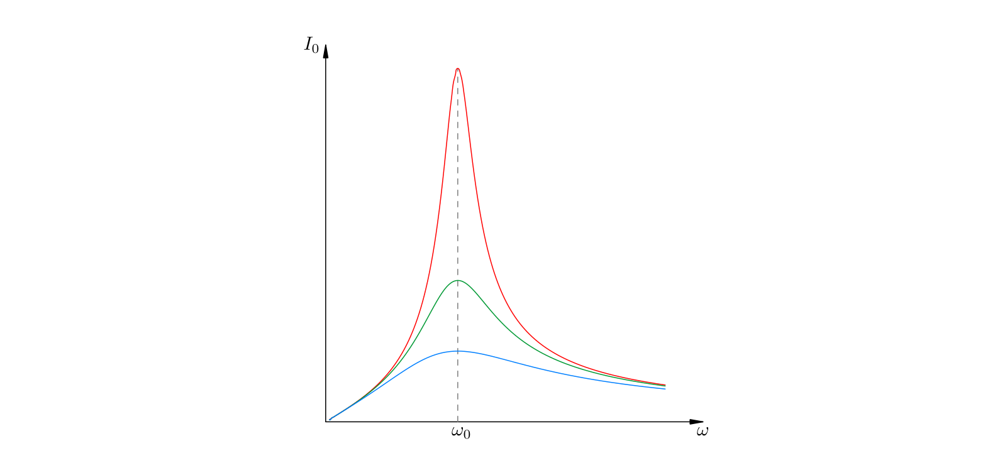

Амплитуда тока максимальна при `ωL = 1/(ωC)`, то есть на собственной частоте:

$$\omega_0 = \frac{1}{\sqrt{LC}}, \qquad I_{0\text{max}} = \frac{U_0}{R}$$

Резонансный пик тем острее, чем меньше `R`. При резонансе напряжения на `L` и `C` равны по
амплитуде (могут во много раз превышать входное напряжение, но колеблются в противофазе и в
сумме дают нуль), а ток и напряжение источника синфазны. Резонанс — основа настройки
радиоприёмника.

---

## 3.24. Мощность переменного тока / Power of alternating current

Мгновенная мощность — произведение мгновенных значений `P = UI`; из-за сдвига фаз она может
быть и отрицательной (участок отдаёт энергию — например, разряжающийся конденсатор).

### Мощность тока через резистор / Power in a resistor

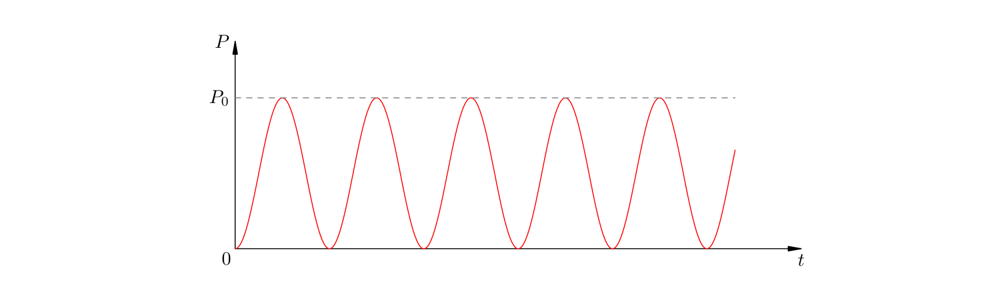

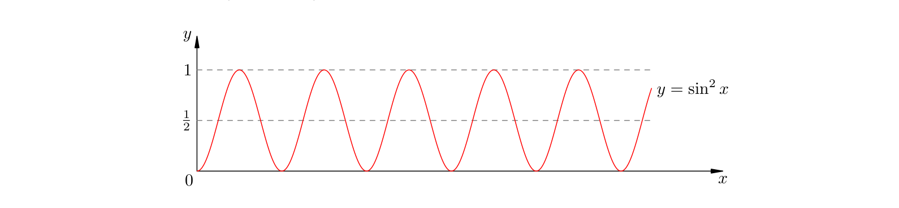

$$P = P_0\sin^2\omega t, \qquad P_0 = U_0 I_0 = I_0^2 R = \frac{U_0^2}{R}$$

Среднее значение квадрата синуса за период равно 1/2; средняя мощность:

$$\bar{P} = \frac{P_0}{2} = \frac{U_0 I_0}{2}$$

Вводят действующие (эффективные) значения — средние квадратические:

$$U = \frac{U_0}{\sqrt{2}}, \qquad I = \frac{I_0}{\sqrt{2}}$$

Тогда `P̄ = UI = I²R = U²/R`, как для постоянного тока. Приборы переменного тока показывают
именно действующие значения; 220 В розетки — действующее напряжение.

### Мощность тока через конденсатор / Power in a capacitor

$$P = P_0\sin 2\omega t, \qquad P_0 = \frac{U_0 I_0}{2}$$

Средняя мощность равна нулю: за четверть периода конденсатор запасает энергию, за следующую
— полностью возвращает в цепь.

### Мощность тока через катушку / Power in an inductor

$$P = -P_0\sin 2\omega t$$

Средняя мощность также нулевая по той же причине: катушка то запасает энергию магнитного
поля, то возвращает её.

### Мощность тока на произвольном участке / Power in an arbitrary section

При сдвиге фаз `α` (`I = I₀ sin(ωt − α)`) средняя мощность:

$$\bar{P} = \frac{U_0 I_0}{2}\cos\alpha = UI\cos\alpha$$

Для резистора `α = 0`; для конденсатора и катушки `α = π/2` (мощность нуль). Коэффициент
`cos α` (коэффициент мощности) важно держать близким к единице: иначе энергия без пользы
циркулирует по сети, нагревая провода (для компенсации сдвига применяют конденсаторы).

---

## 3.25. Электроэнергия / Electric power industry

Электроэнергию отличают простота производства, передача на большие расстояния, лёгкое
преобразование в другие виды энергии и удобное распределение между потребителями.

### Производство электроэнергии / Generation of electric energy

Электромеханический генератор преобразует механическую энергию вращения ротора в энергию
индукционного тока. Рамка (якорь), вращающаяся с угловой скоростью `ω` в поле `B`, создаёт
синусоидальную ЭДС. При `Φ = BS cos ωt` (площадь `S`):

$$e = BS\omega\sin\omega t, \qquad i = \frac{BS\omega}{R}\sin\omega t$$

Многовитковая рамка (`N` витков) умножает ЭДС на `N`, железный сердечник многократно усиливает
поток.

### Передача электроэнергии / Transmission of electric energy

Электростанции (ТЭС, ГЭС, АЭС) удалены от потребителей. Потери на нагрев проводов двухпроводной
линии длиной `l` с удельным сопротивлением `ρ` и сечением `S` (сопротивление `R = 2ρl/S`) при
передаче мощности `P = UI cos α`:

$$\Delta P = I^2 R = \frac{2\rho l P^2}{S U^2 \cos^2\alpha}$$

Потери обратно пропорциональны квадрату напряжения — поэтому линии электропередач
высоковольтные.

### Трансформатор / Transformer

Трансформатор — две обмотки (`N₁` и `N₂` витков) на общем замкнутом стальном сердечнике. В
режиме холостого хода отношение напряжений равно отношению витков:

$$\frac{U_1}{U_2} = \frac{N_1}{N_2} = k$$

где `k` — коэффициент трансформации (`k > 1` — понижающий трансформатор, `k < 1` — повышающий).
Под нагрузкой, при близком к единице КПД, токи обратно пропорциональны напряжениям:
`I₂/I₁ ≈ k`. Потери складываются из «потерь в меди» (нагрев обмоток) и «потерь в стали»
(перемагничивание и токи Фуко).

---

## 3.26. Электромагнитное поле / The electromagnetic field

### Гипотеза Максвелла / Maxwell's hypothesis

Максвелл объяснил индукцию тем, что переменное магнитное поле порождает вихревое электрическое
поле, и высказал **симметричную гипотезу**: переменное электрическое поле порождает магнитное
поле. При зарядке конденсатора переменное электрическое поле между обкладками создаёт
магнитное поле, как если бы ток протекал сквозь конденсатор. Гипотеза была чисто умозрительной
и подтвердилась опытами Герца уже после смерти Максвелла.

- **Автор:** Джеймс Клерк Максвелл (James Clerk Maxwell)
- **Труд:** «Трактат об электричестве и магнетизме» (1873).

### Понятие электромагнитного поля / The concept of the electromagnetic field

Электрическое и магнитное поля — проявления одного объекта, электромагнитного поля: поле,
электрическое в одной системе отсчёта, порождает магнитное в движущейся относительно неё.
Действие поля на заряд `q`, движущийся со скоростью `v⃗`, равно сумме электрической и магнитной
сил:

$$\vec{F} = \vec{F}_{\text{эл}} + \vec{F}_{\text{магн}} = q\vec{E} + qvB\sin\alpha$$

### Об уравнениях Максвелла / On Maxwell's equations

Максвелл построил систему дифференциальных уравнений, позволяющую найти `E⃗` и `B⃗` по
известным источникам. Среди их решений обнаружились электромагнитные волны, скорость которых
в вакууме совпала со скоростью света `c = 3·10⁸ м/с` — само предсказание сделано «на кончике
пера», до всякого эксперимента.

---

## 3.27. Электромагнитные волны / Electromagnetic waves

Электромагнитные взаимодействия передаются с конечной скоростью. При смещении заряда его
переменное поле порождает магнитное, то — снова электрическое и т. д.: в пространстве бежит
электромагнитная волна. Другой заряд «почувствует» смещение не мгновенно, а с запаздыванием.

### Открытый колебательный контур / Open oscillatory circuit

Интенсивность излучения растёт с частотой и с размерами области, занятой переменным полем.
Герц превратил обычный контур в открытый — стержень (вибратор) с разрядным промежутком:
малые ёмкость и индуктивность дают высокую частоту

$$\nu = \frac{1}{2\pi\sqrt{LC}}$$

а поле занимает большую область. Искра в разрядном промежутке замыкала цепь и возбуждала
колебания; в приёмном вибраторе при резонансе проскакивала искра, доказывая существование
волн.

- **Автор:** Генрих Герц (Heinrich Hertz)
- **Труд:** опыты по обнаружению электромагнитных волн (1888).

### Свойства электромагнитных волн / Properties of electromagnetic waves

Источник волн — **любой ускоренно движущийся заряд**. В волне векторы `E⃗` и `B⃗` перпендикулярны
друг другу и направлению распространения (волна поперечна); они колеблются синфазно. Связь
частоты, длины волны и скорости:

$$c = \lambda\nu$$

Волнам присущи общие свойства: отражение, поглощение, преломление, интерференция и дифракция.
Герц, наблюдая интерференцию, измерил длину волны и получил `c ≈ 3·10⁸ м/с` в согласии с
теорией Максвелла.

### Плотность потока излучения / Radiation flux density

Энергия переносится вдоль лучей. Плотность потока излучения — энергия через единичную площадку
в единицу времени:

$$I = \frac{W}{St}$$

Она связана с плотностью энергии `w` и скоростью волны:

$$I = wc$$

Интенсивность излучения пропорциональна четвёртой степени частоты (`I ∼ ω⁴`), а для точечного
источника (Звезда!) убывает обратно пропорционально квадрату расстояния:

$$I = \frac{P}{4\pi r^2}$$

### Виды электромагнитных излучений / Kinds of electromagnetic radiation

Спектр делят на диапазоны (в порядке убывания длины волны):

1. **Радиоволны** (λ > 1 мм): сверхдлинные, длинные, средние, короткие, метровые,
   дециметровые (мобильная связь, Wi-Fi), сантиметровые, миллиметровые.
2. **Инфракрасное** (780 нм < λ < 1 мм): излучение нагретых тел, «тепловое».
3. **Видимый свет** (380—780 нм): от красного к фиолетовому.
4. **Ультрафиолетовое** (10—380 нм): загар, бактерицидное действие.
5. **Рентгеновское** (5 пм—10 нм): тормозное и характеристическое излучение; томпография,
   рентгеноструктурный анализ.
6. **Гамма-излучение** (λ < 5 пм): ядерные переходы, наибольшая проникающая способность.

---

## Авторы и труды (сводка) / Authors and works (summary)

| Закон / явление | Автор | Труд |
|---|---|---|
| Закон Кулона | Шарль Кулон | мемуары о крутильных весах (1785) |
| Закон Ома | Георг Ом | «Гальваническая цепь…» (1827) |
| Закон Джоуля–Ленца | Джеймс Джоуль; Эмилий Ленц | независимые опыты (1841; 1842) |
| Правило Ленца | Эмилий Ленц | работа об индукции (1833) |
| Электролиз (законы Фарадея) | Майкл Фарадей | «Экспериментальные исследования» (1833–34) |
| Электромагнитная индукция | Майкл Фарадей | «Экспериментальные исследования» (1831) |
| Опыт Эрстеда | Ханс Кристиан Эрстед | опыт 1820 г. |
| Гипотеза Ампера | Андре-Мари Ампер | «Теория электродинамических явлений» (1826) |
| Сила Ампера | Андре-Мари Ампер | опыты по взаимодействию токов |
| Сила Лоренца | Хендрик Лоренц | теория электронов (кон. XIX в.) |
| Самоиндукция | Джозеф Генри | открытие самоиндукции (1832) |
| Формула Томсона | Уильям Томсон (лорд Кельвин) | формула периода колебаний (1853) |
| Гипотеза и уравнения Максвелла | Джеймс Клерк Максвелл | «Трактат об электричестве и магнетизме» (1873) |
| Электромагнитные волны (опыт) | Генрих Герц | опыты 1888 г. |
| Электронная природа тока в металлах | Стюарт и Толмен | опыт 1916 г. |

> **Примечание.** Формулы, определения физических величин и законы природы не
> являются объектами авторского права и могут свободно излагаться. Текст выше
> пересказан по учебной литературе; иллюстрации извлечены из пособия И. В. Яковлева
> (MathUs.ru) в ознакомительных целях.

