# Глава 4. Оптика / Optics

> Оптика — раздел физики о природе и распространении света. Определения
> переформулированы (EN — по-английски в духе учебной литературы, RU — русский
> перевод), формулы соответствуют пособию, к каждому закону указан автор и его работа.
> Формулы и определения физики не охраняются авторским правом; текст пересказан.

Оптика изучает видимый свет — узкий участок шкалы электромагнитных волн с длинами
волн примерно от 380 нм (фиолетовый край) до 780 нм (красный). По электродинамике
Максвелла распространение света ничем не отличается от распространения других
электромагнитных волн, однако исторически оптика оформилась в самостоятельный раздел.
Геометрическая оптика устанавливает закономерности хода световых лучей и является
предельным случаем волновой оптики при `λ → 0`; волновая (физическая) оптика
рассматривает свет как электромагнитные волны и объясняет интерференцию, дифракцию и
дисперсию.

---

## 4.1. Световые лучи / Light rays

Световой луч — геометрическая линия, в каждой точке перпендикулярная волновому фронту,
проходящему через эту точку. На первых порах луч можно представлять просто как узкий
пучок света наподобие солнечных лучей.

### Законы геометрической оптики / Laws of geometrical optics

В основе геометрической оптики лежат четыре закона: независимости световых лучей,
прямолинейного распространения света, отражения и преломления. Эти законы — обобщения
опытных фактов, сформулированные на языке геометрии; волновая природа света в них не
затрагивается. Впоследствии оказалось, что они следуют из законов волновой оптики.

Геометрическая оптика работает тем лучше, чем меньше длина волны `λ` по сравнению с
размерами препятствий.

> **EN** The law of independence of light rays: intersecting rays do not influence each
> other; each ray illuminates space as if the other rays were absent.
>
> **RU** Закон независимости световых лучей: пересекаясь, лучи не влияют друг на
> друга; каждый луч освещает пространство так, как если бы других лучей не было.

> **EN** The law of rectilinear propagation of light: in a transparent homogeneous
> medium light rays are straight lines.
>
> **RU** Закон прямолинейного распространения света: в прозрачной однородной среде
> световые лучи — прямые линии.

Среда прозрачна, если в ней может распространяться свет; однородна, если её свойства
не меняются от точки к точке. При нарушении однородности (например на границе двух
сред или в неравномерно нагретом воздухе) ход лучей искривляется — этим объясняются
миражи.

### Геометрическая тень / Geometric shadow

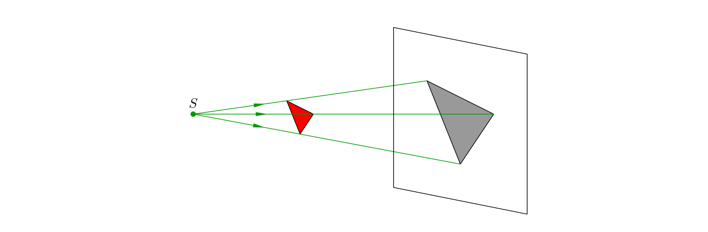

> **EN** A geometric shadow is the dark region behind an opaque body formed because
> rectilinearly propagating rays are cut off by the body. Its shape is similar to the
> contour of the body.
>
> **RU** Геометрическая тень — тёмная область за непрозрачным телом, возникающая
> потому, что прямолинейно распространяющиеся лучи «обрываются» на теле. Форма
> геометрической тени подобна контуру предмета.

**Пояснение.** Луч, идущий мимо предмета, продолжает путь как ни в чём не бывало; луч,
попавший на предмет, дальше не проходит. Из-за прямолинейности света края тени чётко
очерчены. Реальная граница тени размыта из-за дифракции — отклонения света на краях
препятствия, описываемого волновой оптикой.

---

## 4.2. Отражение света / Reflection of light

На границе раздела двух сред световой луч меняет направление и возвращается в исходную
среду — это отражение света.

### Закон отражения / Law of reflection

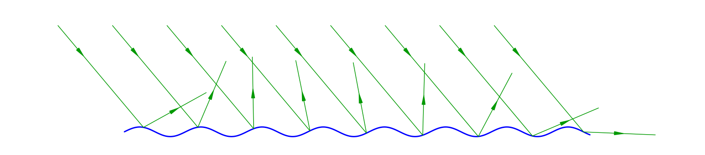

Угол падения и угол отражения отсчитываются от нормали (перпендикуляра) к отражающей
поверхности, а не от самой поверхности.

$$\alpha = \beta$$

> **EN** The incident ray, the reflected ray and the normal to the reflecting surface
> at the point of incidence lie in one plane, and the angle of reflection equals the
> angle of incidence: `α = β`.
>
> **RU** Падающий луч, отражённый луч и перпендикуляр к отражающей поверхности,
> проведённый в точке падения, лежат в одной плоскости; угол отражения равен углу
> падения: `α = β`.

- **Автор:** один из древнейших законов; известен грекам в античности (Евклид, Герон
  Александрийский).

**Следствие.** Отражённый луч идёт так, будто выходит из точки, симметричной источнику
относительно отражающей поверхности.

По характеру отражения поверхности делят на зеркальные и матовые. Если неровности
поверхности меньше длины световой волны, отражение зеркальное (параллельный пучок
остаётся параллельным). Если неровности соизмеримы с длиной волны, поверхность матовая
и даёт рассеянное (диффузное) отражение — именно благодаря ему мы видим окружающие
предметы с любого ракурса.

### Плоское зеркало / Plane mirror

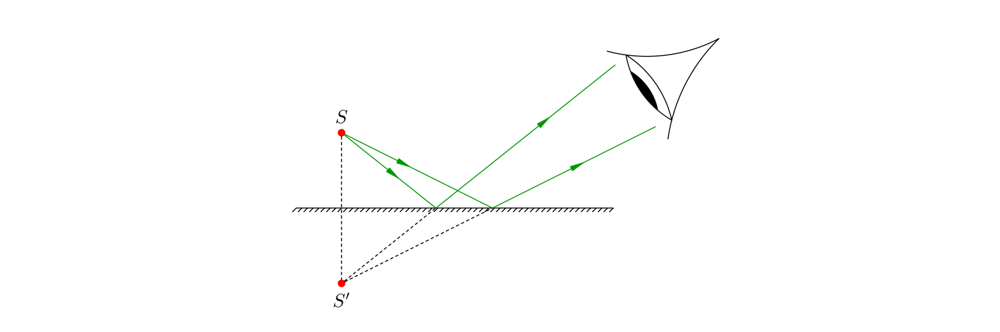

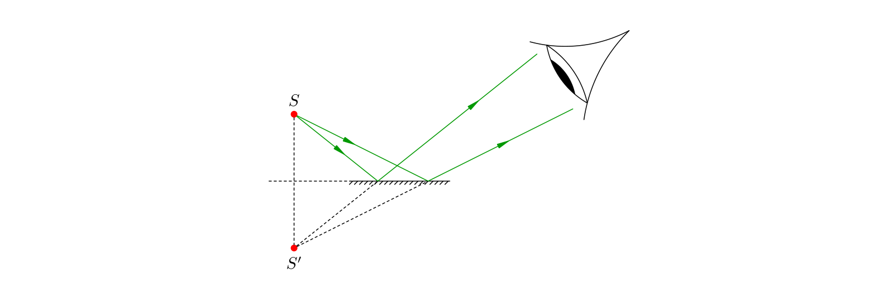

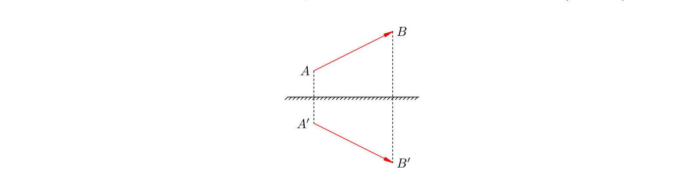

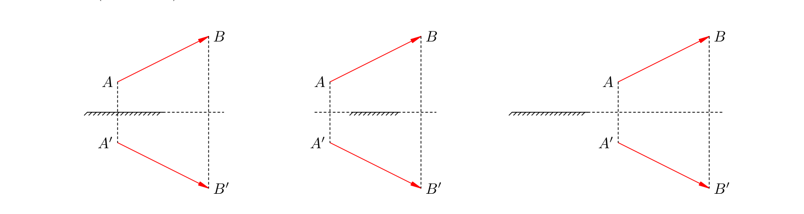

> **EN** A plane mirror is a part of a plane that reflects light specularly. The image
> of a point source is a virtual point symmetric to the source with respect to the
> mirror plane.
>
> **RU** Плоское зеркало — часть плоскости, зеркально отражающая свет. Изображение
> точечного источника — мнимая точка, симметричная источнику относительно плоскости
> зеркала.

**Пояснение.** Мозг достраивает расходящиеся отражённые лучи до их «пересечения» за
зеркалом, поэтому нам кажется, что свет исходит из точки за зеркалом. Сами лучи там не
пересекаются — изображение мнимое, никакая энергия за зеркалом не сосредоточена.

Изображение предмета в плоском зеркале симметрично предмету относительно плоскости
зеркала и не зависит от его расположения относительно зеркала. От расположения источника
и размеров зеркала зависит лишь область видения — область пространства, из которой
изображение видно.

---

## 4.3. Преломление света / Refraction of light

На границе раздела двух прозрачных сред наряду с отражением наблюдается преломление —
луч, переходя в другую среду, меняет направление. При падении строго по нормали
преломления нет.

### Закон преломления (частный случай) / Law of refraction (special case)

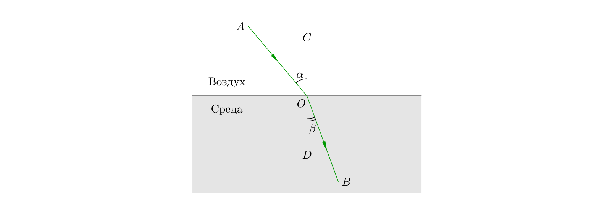

Рассмотрим переход «воздух–среда». Среда характеризуется показателем преломления `n`
(для стекла `n = 1,6`, для воды `n = 1,33`; у любой среды `n > 1`, лишь у вакуума `n = 1`,
у воздуха `n ≈ 1,0003`, в задачах полагают `n = 1`).

$$\frac{\sin\alpha}{\sin\beta} = n$$

> **EN** When light passes from air into a medium, the ratio of the sine of the angle
> of incidence to the sine of the angle of refraction equals the refractive index of
> the medium: `sin α / sin β = n`.
>
> **RU** При переходе из воздуха в среду отношение синуса угла падения к синусу угла
> преломления равно показателю преломления среды: `sin α / sin β = n`.

Так как `n > 1`, то `α > β`: переходя из воздуха в среду, преломлённый луч идёт ближе
к нормали.

Показатель преломления связан со скоростью света в среде:

$$n = \frac{c}{v}, \qquad \frac{\sin\alpha}{\sin\beta} = \frac{c}{v}$$

Скорость света в среде всегда меньше, чем в вакууме: `v < c`.

### Обратимость световых лучей / Reversibility of light rays

> **EN** The trajectory of a ray does not depend on whether it travels in the forward
> or reverse direction: moving back, the ray follows exactly the same path.
>
> **RU** Траектория луча не зависит от того, в прямом или обратном направлении он
> распространяется: идя в обратном направлении, луч пройдёт точно по прежнему пути.

**Пояснение.** При переходе из среды в воздух отношение синуса большего угла к синусу
меньшего по-прежнему равно `n`; угол падения и угол преломления просто меняются ролями.

### Закон преломления (общий случай) / Law of refraction (general case)

Среда с большим показателем преломления называется оптически более плотной. При переходе
в более плотную среду луч идёт ближе к нормали (`α > β`), при переходе в менее плотную —
дальше от нормали (`α < β`).

$$\frac{\sin\alpha}{\sin\beta} = \frac{n_2}{n_1} = n_{21}$$

> **EN** The ratio of the sine of the angle of incidence to the sine of the angle of
> refraction equals the ratio of the refractive index of the second medium to that of
> the first: the relative refractive index `n₂₁ = n₂/n₁`.
>
> **RU** Отношение синуса угла падения к синусу угла преломления равно отношению
> показателя преломления второй среды к показателю преломления первой — относительному
> показателю преломления `n₂₁ = n₂/n₁`.

Полагая `n₁ = 1`, `n₂ = n`, получаем частный случай «воздух–среда». Так как `n₁ = c/v₁`,
`n₂ = c/v₂`, приходим и к соотношению скоростей:

$$\frac{\sin\alpha}{\sin\beta} = \frac{v_1}{v_2}$$

- **Автор:** Виллеброрд Снеллиус (Willebrord Snellius), 1621 г.; независимо опубликован
  Рене Декартом в «Диоптрике» (1637).

### Полное внутреннее отражение / Total internal reflection

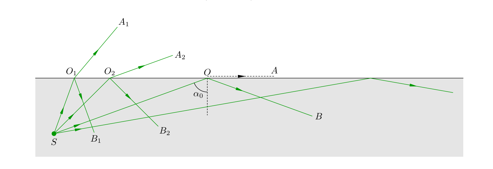

При переходе из оптически более плотной среды в менее плотную с ростом угла падения
преломлённый луч слабеет, а отражённый усиливается. При некотором угле `α₀` преломлённый
луч исчезает, и вся энергия возвращается в исходную среду.

$$\sin\alpha_{0} = \frac{1}{n}, \qquad \alpha_0 = \arcsin\frac{1}{n}$$

> **EN** Total internal reflection occurs when light passes into an optically less
> dense medium at an angle of incidence exceeding the critical angle `α₀` given by
> `sin α₀ = 1/n`. The light is then entirely reflected back.
>
> **RU** Полное внутреннее отражение возникает, когда свет переходит в оптически менее
> плотную среду под углом падения, превышающим предельный угол `α₀`, определяемый из
> `sin α₀ = 1/n`. Свет тогда целиком отражается обратно.

**Пример.** Для воды `n = 1,33`, поэтому `α₀ = arcsin(1/1,33) ≈ 48,8°`. Применение —
волоконная оптика: лучи внутри световода многократно отражаются без потерь и переносят
свет на значительные расстояния.

---

## 4.4. Линзы. Ход лучей / Lenses. Path of rays

> **EN** A lens is an optically transparent homogeneous body bounded by two spherical
> surfaces (or one spherical and one plane surface).
>
> **RU** Линза — оптически прозрачное однородное тело, ограниченное с двух сторон двумя
> сферическими (или одной сферической и одной плоской) поверхностями.

### Двояковыпуклая линза / Biconvex (double-convex) lens

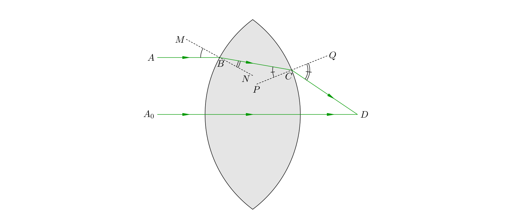

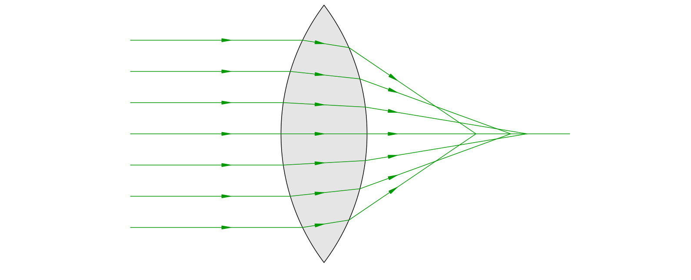

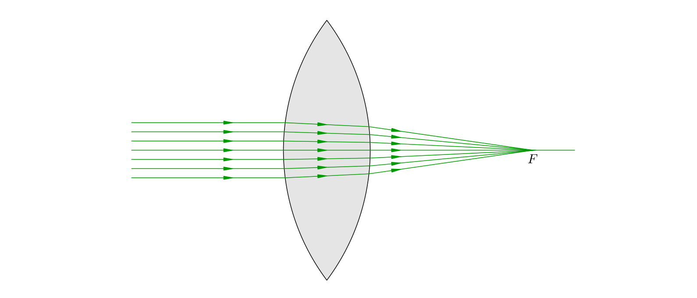

Двояковыпуклая линза ограничена двумя выпуклыми сферическими поверхностями.

**Пояснение.** Луч, идущий вдоль главной оптической оси (оси симметрии линзы),
перпендикулярен обеим сферическим поверхностям и потому не преломляется. Луч,
параллельный оси, преломляется на обеих границах к оси и пересекает её: линза собирает
свет.

**Сферическая аберрация.** Широкий пучок линза не фокусирует точно: чем дальше от оси
падающий луч, тем ближе к линзе он пересекает ось. Лишь узкий приосевой пучок собирается
приблизительно в одной точке — фокусе `F`. Такая линза называется собирающей.

### Двояковогнутая линза / Biconcave (double-concave) lens

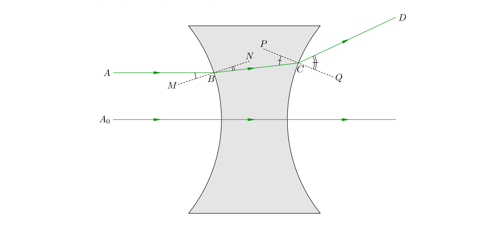

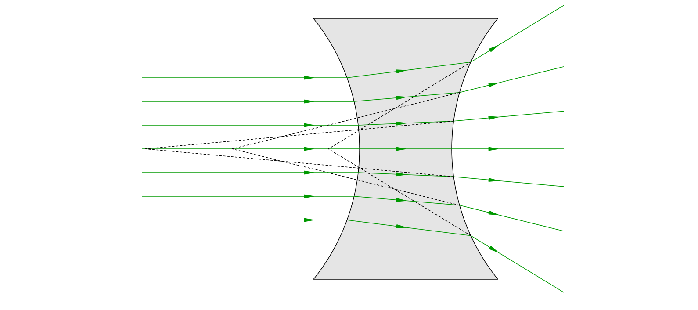

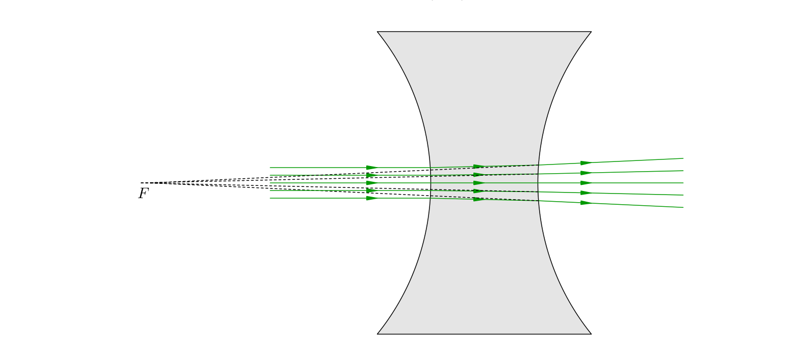

Двояковогнутая линза ограничена двумя вогнутыми сферическими поверхностями.

**Пояснение.** Параллельный оси луч дважды преломляется от оси: линза превращает
параллельный пучок в расходящийся и называется рассеивающей. Здесь также есть сферическая
аберрация; продолжения лучей узкого приосевого пучка пересекаются в фокусе, где глаз
«видит» мнимое изображение.

### Виды собирающих и рассеивающих линз / Kinds of converging and diverging lenses

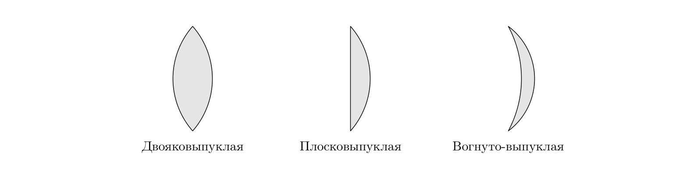

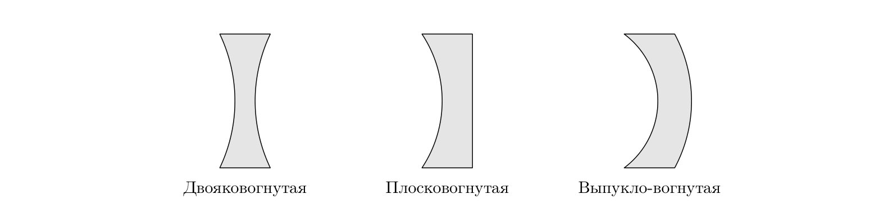

- **Собирающие:** двояковыпуклая, плосковыпуклая, вогнуто-выпуклая.
- **Рассеивающие:** двояковогнутая, плосковогнутая, выпукло-вогнутая.

**Пояснение.** У вогнуто-выпуклой линзы выпуклая поверхность искривлена сильнее, поэтому
её собирающее действие перевешивает — линза в целом собирающая. У выпукло-вогнутой,
наоборот, преобладает рассеивающее действие вогнутой границы.

---

## 4.5. Тонкие линзы. Ход лучей / Thin lenses. Path of rays

### Понятие тонкой линзы / The thin lens concept

> **EN** A lens is thin if its thickness is much smaller than the radii of curvature
> of its spherical surfaces and the distance from the lens to the object.
>
> **RU** Линза тонкая, если её толщина много меньше радиусов кривизны её сферических
> границ и расстояния от линзы до предмета.

Для тонкой линзы можно говорить о «расстоянии до линзы», не уточняя, до какой её точки.
Оба фокуса тонкой линзы расположены симметрично относительно линзы.

### Оптический центр и фокальная плоскость / Optical centre and focal plane

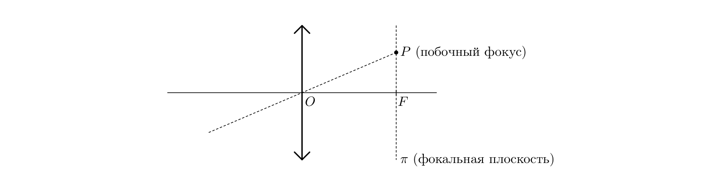

Точки пересечения линзы с главной оптической осью сливаются в одну точку — оптический
центр `O`. Расстояние `OF` от оптического центра до фокуса — фокусное расстояние `f`.
Величина, обратная фокусному расстоянию, — оптическая сила линзы:

$$D = \frac{1}{f}$$

> **EN** The optical power `D` is the reciprocal of the focal length: `D = 1/f`. It is
> measured in dioptres (D); a lens with focal length 25 cm has optical power 4 dioptres.
>
> **RU** Оптическая сила `D` — величина, обратная фокусному расстоянию: `D = 1/f`.
> Измеряется в диоптриях (дптр); линза с фокусным расстоянием 25 см имеет оптическую
> силу 4 дптр.

Всякая прямая, проходящая через оптический центр и отличная от главной оси, называется
побочной оптической осью. Плоскость, проходящая через фокус перпендикулярно главной оси, —
фокальная плоскость. Точка пересечения побочной оси с фокальной плоскостью — побочный
фокус. В дальнейшем рассматриваются параксиальные (приосевые) лучи, образующие малые
углы с осью, — только для них построения дают чёткие изображения.

### Ход луча через оптический центр / Ray through the optical centre

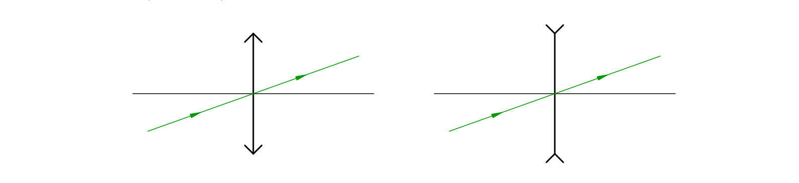

> **EN** A ray passing through the optical centre of a thin lens is not refracted.
>
> **RU** Луч, идущий через оптический центр тонкой линзы, не преломляется.

**Пояснение.** Вблизи оптического центра поверхности линзы почти параллельны, и луч идёт
как бы сквозь плоскопараллельную пластинку нулевой толщины — она лишь незначительно
смещает луч, не меняя направления. Это единственное общее свойство собирающих и
рассеивающих линз.

### Ход лучей в собирающей линзе / Rays in a converging lens

1. Луч через оптический центр не преломляется.
2. Луч, параллельный главной оптической оси, после преломления идёт через главный фокус
   (и обратно: луч из фокуса выходит параллельно оси).
3. Пучок, падающий наклонно, собирается в побочном фокусе, отвечающем параллельной ему
   побочной оси.

### Ход лучей в рассеивающей линзе / Rays in a diverging lens

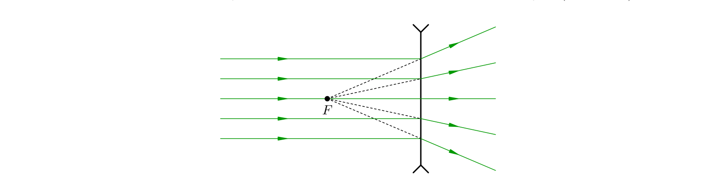

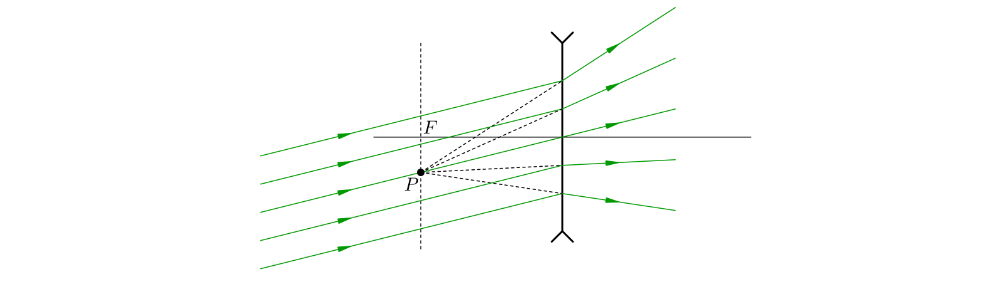

1. Луч через оптический центр не преломляется.
2. Луч, параллельный главной оси, после преломления удаляется от неё, причём его
   продолжение проходит через главный фокус.
3. Наклонный пучок расходится так, будто продолжения лучей выходят из побочного фокуса.

---

## 4.6. Тонкие линзы. Построение изображений / Thin lenses. Image construction

**Теорема об изображении.** Если перед линзой находится светящаяся точка, то после
преломления все (параксиальные) лучи или их продолжения пересекаются в одной точке —
изображении.

> **EN** A real image is formed by the refracted rays themselves and can be cast on a
> screen; a virtual image is formed by their extensions, carries no concentrated energy
> and exists only in our perception.
>
> **RU** Действительное изображение образовано самими преломлёнными лучами и может быть
> получено на экране; мнимое образовано их продолжениями, не сосредоточивает энергии и
> существует лишь в нашем восприятии.

### Собирающая линза: действительное изображение точки / Converging lens: real image of a point

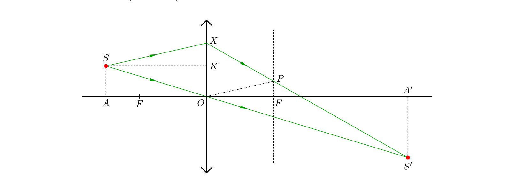

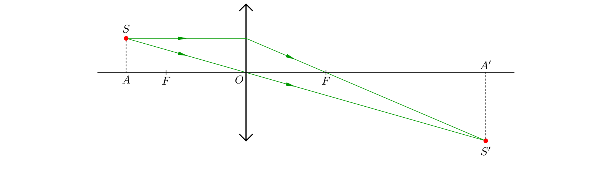

Пусть `a` — расстояние от источника до линзы, `f` — фокусное расстояние. Случай `a > f`:
все лучи источника собираются в действительной точке, находящейся на расстоянии

$$b = \frac{af}{a - f}$$

от линзы. Отсюда и выводится формула тонкой линзы:

$$\frac{1}{a} + \frac{1}{b} = \frac{1}{f}$$

> **EN** The thin lens formula relates the object distance, the image distance and the
> focal length: `1/a + 1/b = 1/f`.
>
> **RU** Формула тонкой линзы связывает расстояние от предмета до линзы, расстояние от
> линзы до изображения и фокусное расстояние: `1/a + 1/b = 1/f`.

**Альтернативные записи / Alternative notations:**

$$\frac{1}{d} + \frac{1}{f} = \frac{1}{F}$$
в школьных учебниках расстояния обозначают `d` (до предмета) и `f` (до изображения), а
фокусное — `F`; А. В. Перышкин, «Физика. 8 класс» и др.

$$\frac{1}{a} + \frac{1}{b} = \frac{1}{f}$$
форма пособия И. В. Яковлева; здесь `f` — фокусное расстояние.

Для построения изображения точки, не лежащей на оси, удобны два луча: через оптический
центр (не преломляется) и параллельный оси (идёт через фокус).

### Собирающая линза: действительное изображение предмета / Converging lens: real image of an object

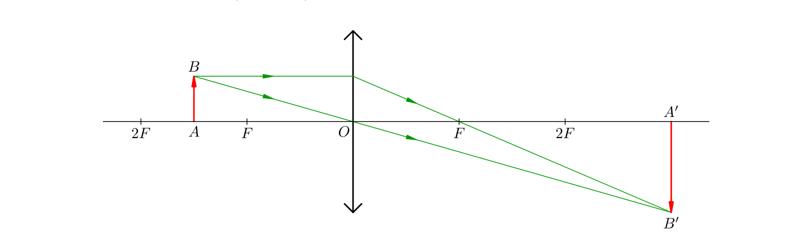

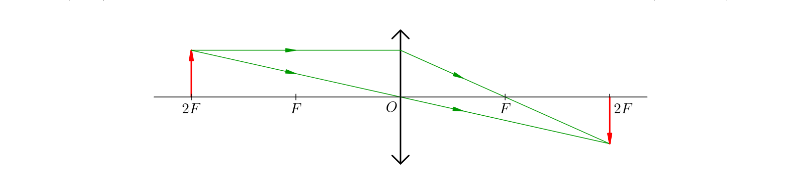

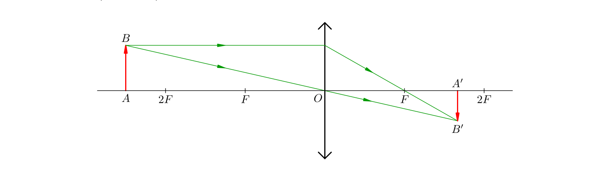

Для предмета `a > f` возможны три случая:

1. `f < a < 2f` — изображение действительное, перевёрнутое, **увеличенное** (`b > 2f`); так
   работают диапроекторы и киноаппараты (слайд вставляется перевёрнутым).
2. `a = 2f` — `b = 2f`, размер изображения равен размеру предмета.
3. `a > 2f` — изображение действительное, перевёрнутое, **уменьшенное** (`b < 2f`);
   обычная ситуация для фотоаппаратов, биноклей, телескопов.

Линейное увеличение линзы:

$$\Gamma = \frac{h'}{h} = \frac{b}{a}$$

> **EN** The linear magnification is the ratio of the image size to the object size:
> `Γ = h′/h = b/a`.
>
> **RU** Линейное увеличение линзы — отношение размера изображения к размеру предмета:
> `Γ = h′/h = b/a`.

**Альтернативные записи / Alternative notations:**

$$\Gamma = \frac{h'}{h} = \frac{f}{d}$$
в обозначениях `d` (предмет), `f` (изображение); то же отношение размера изображения к
размеру предмета.

### Собирающая линза: мнимое изображение точки / Converging lens: virtual image of a point

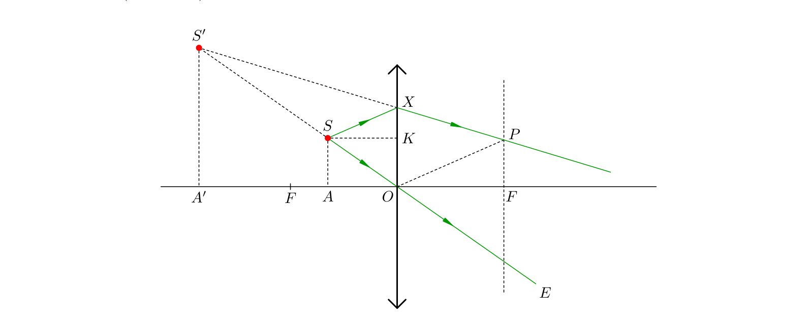

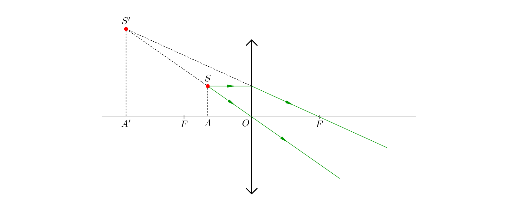

Случай `a < f`: источник между линзой и фокусом. Преломлённые лучи расходятся, их
продолжения пересекаются в мнимом изображении на расстоянии

$$b = \frac{af}{f - a}$$

Формула линзы принимает вид (знак «минус» перед `1/b` — изображение мнимое):

$$\frac{1}{a} - \frac{1}{b} = \frac{1}{f}$$

### Собирающая линза: мнимое изображение предмета / Converging lens: virtual image of an object

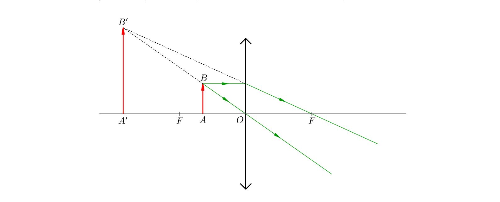

Для предмета между линзой и фокусом изображение мнимое, прямое и увеличенное.

**Пример.** Так работает лупа (увеличительное стекло), когда предмет помещают ближе
фокуса.

### Собирающая линза: предмет в фокальной плоскости / Converging lens: object in the focal plane

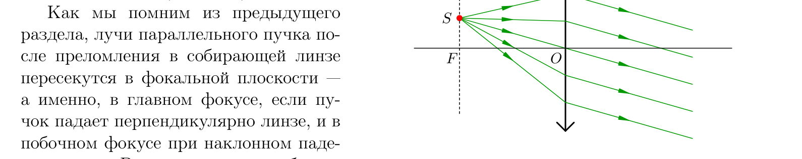

При `a = f` лучи источника после линзы идут параллельно друг другу: изображения нет —
оно находится на бесконечности. Этот случай разграничивает качественно разные ситуации
`a > f` (действительное) и `a < f` (мнимое).

### Рассеивающая линза: мнимое изображение точки / Diverging lens: virtual image of a point

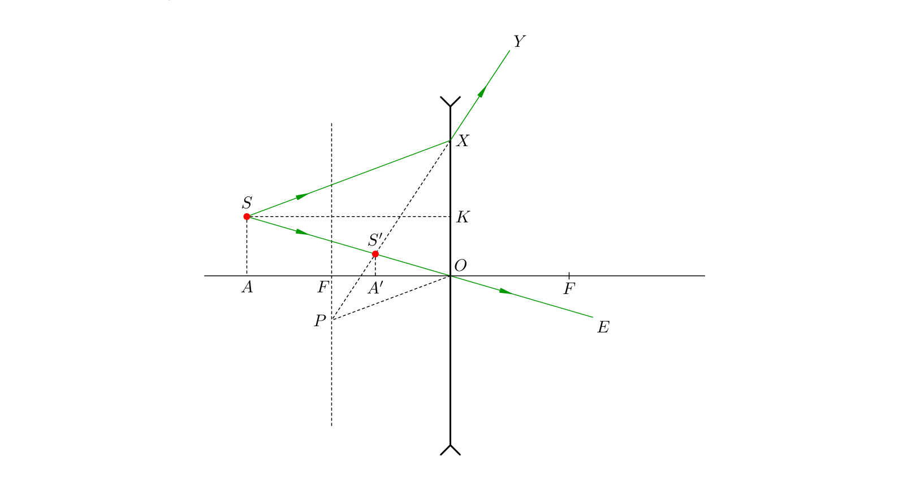

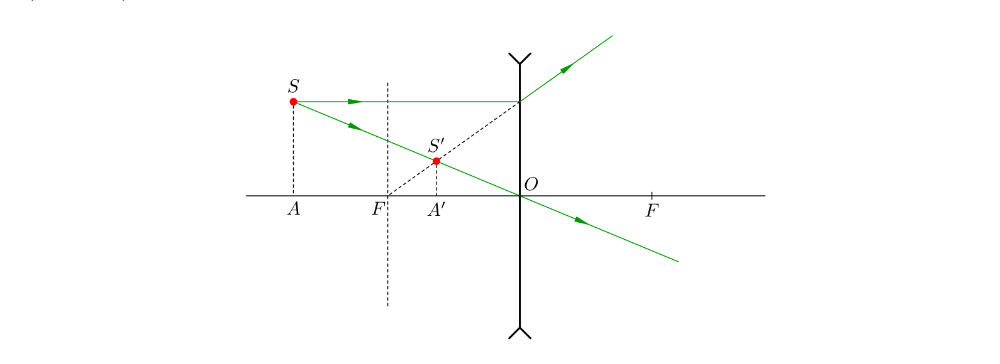

Для рассеивающей линзы другие случаи невозможны: продолжения расходящихся лучей всегда
пересекаются в мнимом изображении на расстоянии

$$b = \frac{af}{a + f}$$

Формула линзы:

$$\frac{1}{a} - \frac{1}{b} = -\frac{1}{f}$$

**Знаковое правило.** Все три формулы линзы объединяются в одну

$$\frac{1}{a} + \frac{1}{b} = \frac{1}{f}$$

если для мнимого изображения считать `b < 0`, а для рассеивающей линзы — `f < 0`.

### Рассеивающая линза: мнимое изображение предмета / Diverging lens: virtual image of an object

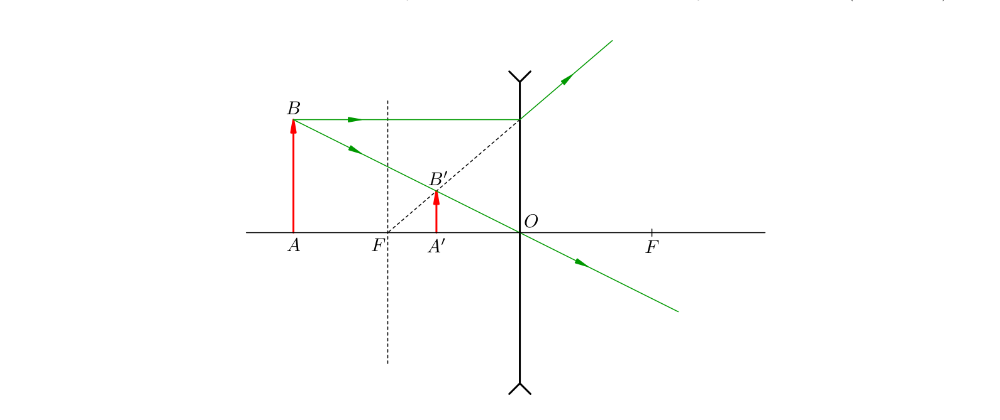

Изображение предмета в рассеивающей линзе всегда мнимое, прямое и уменьшенное.

---

## 4.7. Глаз человека / The human eye

### Строение глаза / Structure of the eye

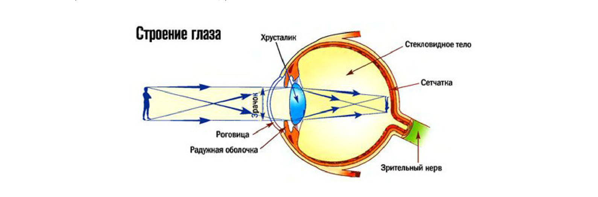

Основные элементы глаза: роговица (передняя прозрачная оболочка), зрачок, хрусталик
(собирающая линза с переменным фокусным расстоянием), сетчатка (светочувствительные
палочки и колбочки). Система «роговица + хрусталик» строит на сетчатке действительное,
перевёрнутое и уменьшенное изображение; мозг переворачивает его обратно.

### Аккомодация / Accommodation

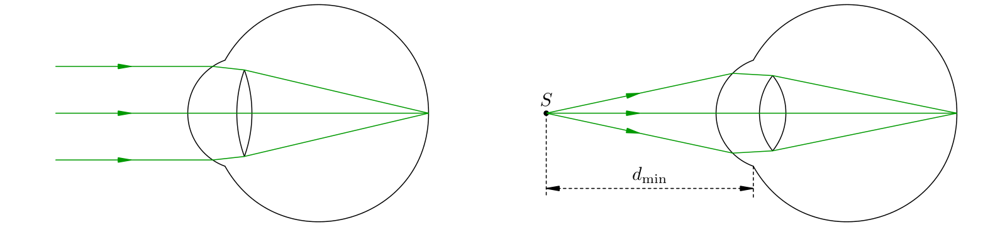

> **EN** Accommodation is the ability of the eye to see objects clearly at different
> distances by changing the curvature (and hence the focal length) of the lens so that
> the image always falls on the retina.
>
> **RU** Аккомодация — способность глаза отчётливо видеть предметы на разных расстояниях
> за счёт изменения кривизны (и фокусного расстояния) хрусталика, так что изображение
> всегда оказывается на сетчатке.

Из формулы линзы при постоянном расстоянии до сетчатки `b` фокусное расстояние `f` должно
меняться вместе с расстоянием `a` до предмета. Дальняя точка аккомодации нормального глаза
находится на бесконечности; ближняя — на расстоянии `d_min`, которое с возрастом растёт
(у 10-летнего ребёнка `≈ 7 см`, к 30 годам `≈ 15 см`, к 45 годам `20–25 см`).

### Угол зрения / Visual angle

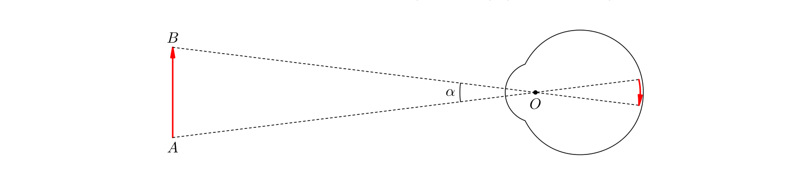

> **EN** The visual angle is the angle under which the object is seen by the eye. The
> larger the visual angle, the larger the image on the retina and the more detail is
> perceived.
>
> **RU** Угол зрения — угол, под которым предмет виден глазу. Чем больше угол зрения,
> тем крупнее изображение на сетчатке и тем больше различаемых деталей.

**Пояснение.** Чем ближе предмет, тем больше угол зрения и крупнее изображение на сетчатке.
При угле зрения меньше одной угловой минуты (`1/60` градуса) раздражается лишь одно
нервное окончание — объект воспринимается как точка.

### Расстояние наилучшего зрения / Distance of best vision

$$d_0 = 25\ \text{см}$$

> **EN** The distance of best vision for a normal eye is `d₀ = 25 cm`: the visual angle
> is already large, yet the eye does not tire because the lens is not deformed too
> strongly.
>
> **RU** Расстояние наилучшего зрения нормального глаза `d₀ = 25 см`: угол зрения уже
> достаточно велик, но глаз не утомляется, поскольку хрусталик деформирован не слишком
> сильно.

### Близорукость / Short-sightedness (myopia)

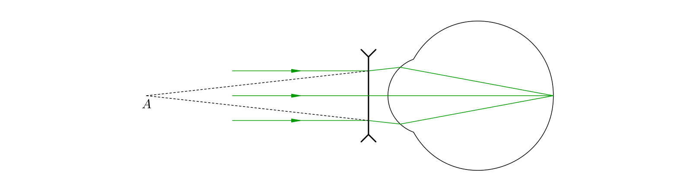

> **EN** In myopia the focal length of the relaxed eye is smaller than the distance to
> the retina, so parallel rays are focused in front of the retina and distant objects
> are blurred. It is corrected with diverging lenses.
>
> **RU** При близорукости фокусное расстояние расслабленного глаза меньше расстояния до
> сетчатки, поэтому параллельные лучи фокусируются перед сетчаткой, и удалённые объекты
> размыты. Корректируется очками с рассеивающими линзами.

**Пояснение.** Дальняя точка аккомодации близорукого глаза находится на конечном
расстоянии; расстояние наилучшего зрения меньше 25 см. Рассеивающая линза превращает
параллельный пучок в расходящийся, отодвигая изображение на сетчатку; её фокусное
расстояние равно расстоянию до дальней точки аккомодации.

### Дальнозоркость / Long-sightedness (hyperopia)

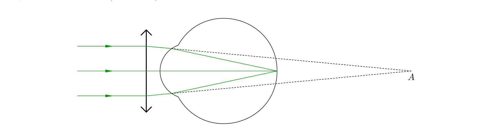

> **EN** In hyperopia the focal length of the relaxed eye is greater than the distance
> to the retina, so parallel rays are focused behind the retina. It is corrected with
> converging lenses.
>
> **RU** При дальнозоркости фокусное расстояние расслабленного глаза больше расстояния
> до сетчатки, поэтому параллельные лучи фокусируются за сетчаткой. Корректируется
> очками с собирающими линзами.

**Пояснение.** Дальняя точка аккомодации дальнозоркого глаза мнимая; расстояние наилучшего
зрения больше 25 см. Собирающая линза делает параллельный пучок сходящимся, фокусируя
его на сетчатке.

---

## 4.8. Оптические приборы / Optical instruments

Оптические приборы увеличивают угол зрения. Для малых объектов — лупа и микроскоп, для
далёких — зрительные трубы (бинокли, телескопы).

### Невооружённый глаз / The unaided eye

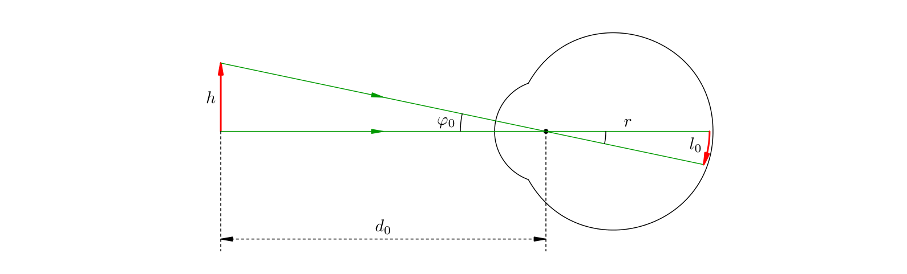

Предмет размера `h` на расстоянии наилучшего зрения `d₀` виден под малым углом:

$$\varphi_0 = \frac{h}{d_0}$$

Размер изображения на сетчатке `l₀ = rφ₀`, где `r` — расстояние от оптического центра до
сетчатки. Так как диаметр глаза `≈ 2,5 см`, то `r/d₀ ≈ 0,1`: изображение примерно в 10 раз
меньше самого предмета.

### Лупа / Magnifying glass

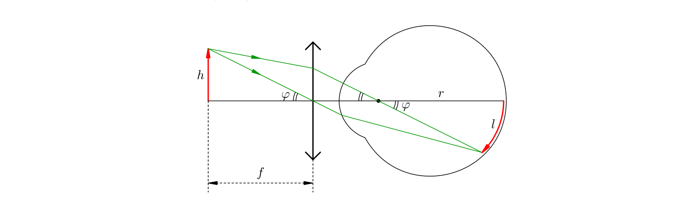

Лупа — собирающая линза (фокусное расстояние `5–125 мм`); предмет помещают в её
фокальной плоскости, и лучи выходят параллельными — глаз не напрягается.

$$\varphi = \frac{h}{f}, \qquad \Gamma = \frac{l}{l_0} = \frac{\varphi}{\varphi_0} = \frac{d_0}{f}$$

> **EN** The magnification of a magnifying glass is the ratio of the visual angle with
> the glass to that without: `Γ = d₀/f`. It is an angular magnification.
>
> **RU** Увеличение лупы — отношение угла зрения при рассматривании через лупу к углу
> зрения невооружённым глазом: `Γ = d₀/f`. Это угловое увеличение.

**Пример.** При `f = 5 см` увеличение `Γ = 25/5 = 5`. Увеличение тем больше, чем меньше
фокусное расстояние; практически `Γ ≈ 50` — верхняя граница увеличения лупы.

### Микроскоп / Microscope

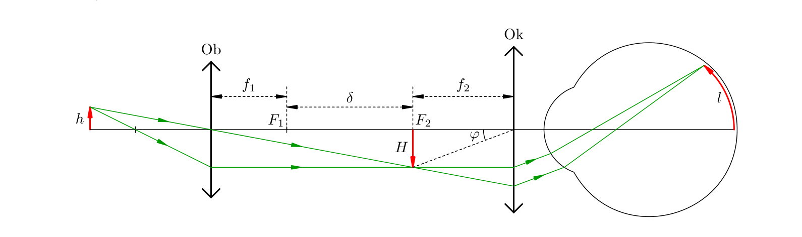

Микроскоп содержит две собирающие линзы: объектив (к предмету) и окуляр (к глазу).
Объектив даёт увеличенное действительное изображение предмета, помещённого между фокусом
и двойным фокусом; это изображение попадает в фокальную плоскость окуляра и рассматривается
в него как в лупу. Увеличение:

$$\Gamma = \frac{\delta d_0}{f_1 f_2}$$

где `f₁`, `f₂` — фокусные расстояния объектива и окуляра, `δ` — оптическая длина тубуса
(расстояние между их фокальными плоскостями).

**Пример.** При `f₁ = 1 см`, `f₂ = 2 см`, `δ = 25 см` увеличение `Γ = 20·25/(1·2) = 250`.

### Труба Кеплера / Keplerian telescope

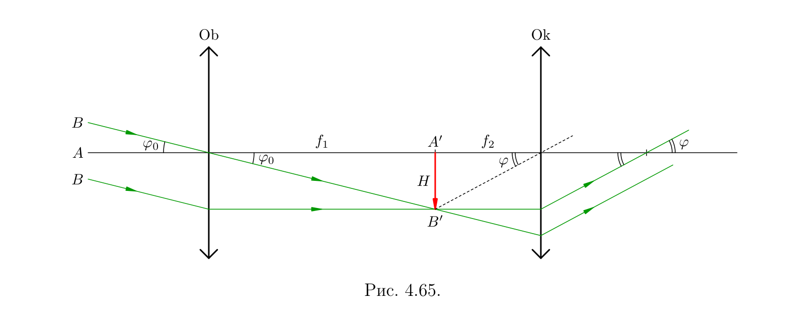

Объектив даёт действительное изображение удалённого объекта в своей фокальной плоскости,
которое рассматривается в окуляр как в лупу. Окуляр — собирающая линза. Отсюда:

$$\Gamma = \frac{f_1}{f_2}$$

Изображение в трубе Кеплера перевёрнутое; для исправления ставят оборачивающие системы.

### Труба Галилея / Galilean telescope

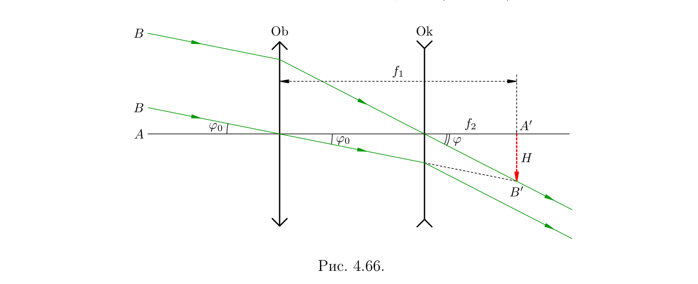

Окуляр — рассеивающая линза. Увеличение то же:

$$\Gamma = \frac{f_1}{f_2}$$

**Пояснение.** При том же увеличении труба Галилея короче трубы Кеплера (применение —
театральные бинокли), а изображение получается неперевёрнутым. Галилей изобрёл телескоп
в 1609 г. и открыл спутники Юпитера, фазы Венеры, лунный рельеф, пятна на Солнце.

---

## 4.9. Принцип Гюйгенса / Huygens' principle

Принцип Гюйгенса — базовое утверждение волновой оптики; из него как следствия
получаются законы отражения и преломления.

### Волновые поверхности и лучи / Wave surfaces and rays

Фаза колебаний — аргумент гармонической функции, например `φ = ωt + φ₀` в законе
`x = A cos(ωt + φ₀)`.

> **EN** A wave surface is the set of all points where the oscillation phase has the
> same value at a given instant; it is a surface of constant phase. The wave front is
> the boundary separating the region reached by the wave from the still undisturbed
> region.
>
> **RU** Волновая поверхность — множество точек, в которых фаза колебаний в данный
> момент одинакова; это поверхность постоянной фазы. Волновой фронт — граница,
> отделяющая область, охваченную волновым процессом, от ещё невозмущённой области.

> **EN** A ray is a line perpendicular at every point to the wave surface passing
> through that point; along the rays the wave energy is transported.
>
> **RU** Луч — линия, в каждой точке перпендикулярная волновой поверхности, проходящей
> через эту точку; вдоль лучей переносится энергия волны.

### Сферическая волна / Spherical wave

> **EN** A wave is spherical if its wave surfaces are spheres; a point source in a
> homogeneous medium emits spherical waves.
>
> **RU** Волна сферическая, если её волновые поверхности — сферы; точечный источник в
> однородной среде излучает сферические волны.

Протяжённый источник можно считать совокупностью точечных, а наложение их сферических
волн даёт общую волну.

### Плоская волна / Plane wave

> **EN** A wave is plane if its wave surfaces are planes. Far from the source the
> curvature of a spherical surface can be neglected and the wave is approximately
> plane.
>
> **RU** Волна плоская, если её волновые поверхности — плоскости. Вдали от источника
> кривизной сферической поверхности можно пренебречь, и волна приближённо плоская.

### Вторичные волны / Secondary waves

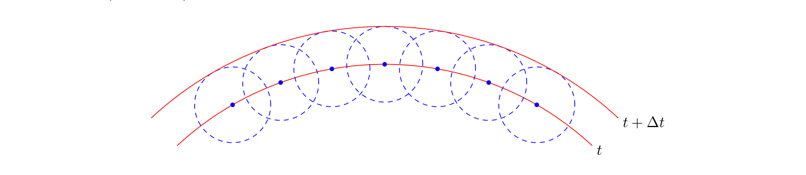

> **EN** Huygens' principle: every point reached by a wave becomes the source of
> spherical secondary waves; the new wave surface is the envelope of all these
> secondary waves.
>
> **RU** Принцип Гюйгенса: каждая точка, вовлечённая в волновой процесс, сама
> становится источником сферических вторичных волн; новая волновая поверхность —
> огибающая всех этих вторичных волн.

**Геометрический рецепт.** Каждая точка исходной волновой поверхности испускает вторичную
волну; за время `Δt` они проходят расстояние `cΔt`, и новая волновая поверхность —
касательная к сферам радиуса `cΔt`. Гюйгенс сформулировал принцип в 1678 г.; объяснить
прямолинейное распространение и дифракцию ему не удалось (для этого нужен принцип
Гюйгенса–Френеля), но законы отражения и преломления он выводит.

- **Автор:** Христиан Гюйгенс (Christiaan Huygens)
- **Труд:** «Трактат о свете» (Traité de la Lumière, 1690; принцип сформулирован в 1678 г.).

### Вывод закона отражения / Derivation of the law of reflection

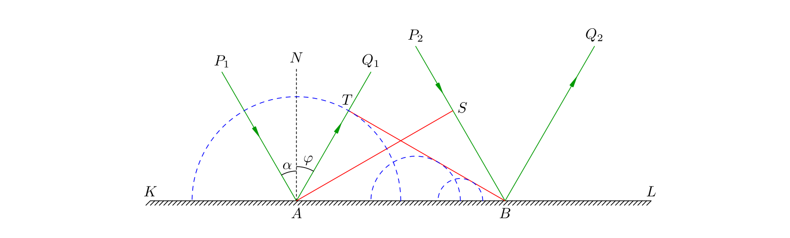

Плоская волна падает на отражающую поверхность. Точки отрезка между двумя падающими
лучами последовательно становятся источниками вторичных волн; огибающая этих сфер — фронт
отражённой волны. Так как падающая и отражённая волны распространяются в одной среде с
одинаковой скоростью, расстояния `AT` и `SB` равны; из равенства прямоугольных
треугольников следует равенство углов: угол отражения равен углу падения `α = β`.

### Вывод закона преломления / Derivation of the law of refraction

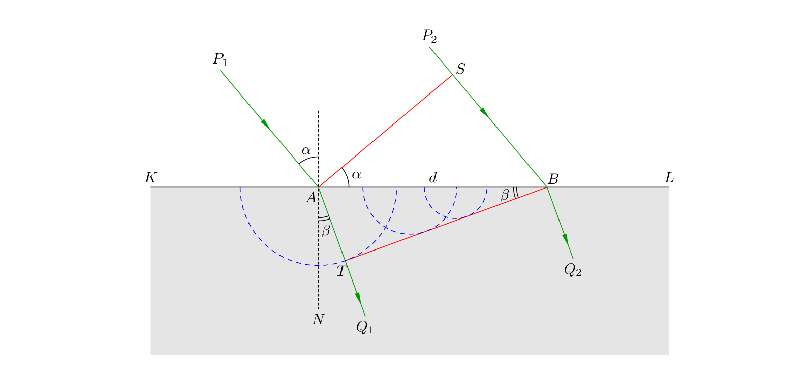

За время, пока падающая волна проходит `SB = ct`, вторичная волна в среде проходит
`AT = vt`. Так как `v < c`, фронт преломлённой волны поворачивается. Из треугольников
`SB = d sin α`, `AT = d sin β`, откуда

$$\frac{\sin\alpha}{\sin\beta} = \frac{c}{v} = n$$

Преломление объясняется волновой природой света: скорость вторичных волн в среде меньше,
чем в воздухе, что и поворачивает волновую поверхность. Здесь проясняется физический смысл
показателя преломления: `n = c/v`.

---

## 4.10. Интерференция волн / Interference of waves

### Сложение колебаний / Superposition of oscillations

> **EN** Superposition principle: when two waves overlap, the oscillating quantity at
> any point equals the sum of the quantities created by each wave separately.
>
> **RU** Принцип суперпозиции: при наложении волн колеблющаяся величина в каждой точке
> равна сумме величин, создаваемых каждой волной по отдельности.

**Пояснение.** Волны одинаковой амплитуды и частоты в фазе усиливают друг друга (амплитуда
удваивается), а в противофазе (сдвиг фаз `π`) полностью гасят друг друга.

### Интенсивность волны / Wave intensity

$$I = \frac{W}{St}$$

> **EN** Intensity is the energy transported by the wave through unit area per unit
> time. It is proportional to the square of the amplitude: `I ∼ A²`.
>
> **RU** Интенсивность — энергия, переносимая волной через единицу площади за единицу
> времени. Она пропорциональна квадрату амплитуды колебаний: `I ∼ A²`.

**Пояснение.** Интенсивность сферической волны `I = W/(4πr²t)` обратно пропорциональна
квадрату расстояния до источника; соответственно амплитуда сферической волны обратно
пропорциональна расстоянию.

### Когерентные источники / Coherent sources

> **EN** Two sources are coherent if they have the same frequency and a constant
> (time-independent) phase difference; the waves they emit are also called coherent.
>
> **RU** Два источника когерентны, если они имеют одинаковую частоту и постоянную, не
> зависящую от времени разность фаз; испускаемые ими волны также называются
> когерентными.

**Пояснение.** В оптике идентичные источники получают как два изображения одного и того
же источника (например в зеркалах Френеля). В точке, удалённой от источников, амплитуды
приходящих волн можно считать равными.

### Условие максимума и минимума / Condition for maximum and minimum

Разность хода `Δ = |S₁P − S₂P|` определяет результат сложения волн в точке `P`.

$$\Delta = m\lambda \quad (m = 0, 1, 2, \ldots)$$

> **EN** Maximum: coherent waves reinforce each other when the path difference equals
> an integer number of wavelengths. The resultant amplitude doubles and the intensity
> quadruples.
>
> **RU** Максимум: когерентные волны усиливают друг друга, когда разность хода равна
> целому числу длин волн. Результирующая амплитуда удваивается, интенсивность — вчетверо.

$$\Delta = \left(m + \frac{1}{2}\right)\lambda$$

> **EN** Minimum: coherent waves cancel each other when the path difference equals a
> half-integer number of wavelengths, i.e. an odd number of half-wavelengths.
>
> **RU** Минимум: когерентные волны гасят друг друга, когда разность хода равна
> полуцелому числу длин волн, то есть нечётному числу полуволн.

### Интерференционная картина / Interference pattern

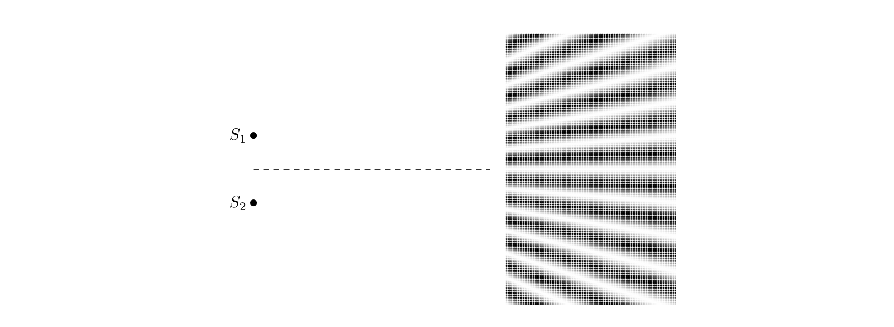

> **EN** Interference is the interaction of waves that produces a stable, time-
> independent pattern — a fixed distribution of the resultant amplitudes. Only coherent
> waves interfere.
>
> **RU** Интерференция — взаимодействие волн, при котором возникает устойчивая,
> не зависящая от времени картина — фиксированное распределение амплитуд результирующих
> колебаний. Интерферировать могут только когерентные волны.

**Пояснение.** В промежуточных точках амплитуда меняется от нуля до удвоенного значения,
интенсивность — от нуля до `4I₁`. Гашение волн не нарушает закон сохранения энергии:
энергия перераспределяется между максимумами и минимумами картины.

### Схема Юнга / Young's scheme

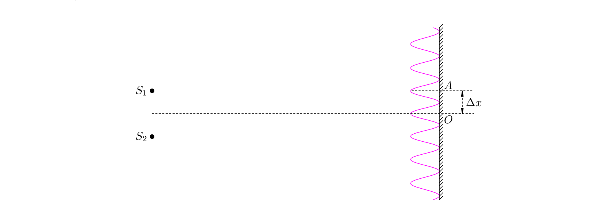

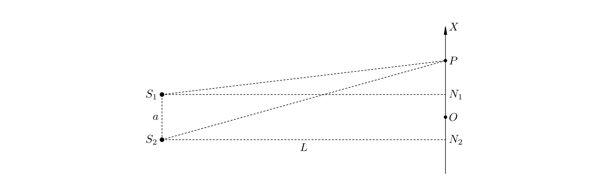

Два когерентных точечных источника на расстоянии `a` друг от друга; экран удалён на `L ≫ a`.
Разность хода волн, приходящих в точку с координатой `x`,

$$\Delta = \frac{ax}{L}$$

Максимумы отвечают `Δ = mλ`, откуда координаты максимумов `x_m = mλL/a`. Расстояние
между соседними полосами (ширина интерференционной полосы):

$$\Delta x = \frac{\lambda L}{a}$$

---

## 4.11. Интерференция света / Interference of light

### Усреднение интенсивности / Averaging of intensity

> **EN** The eye registers not the field strength but the intensity `I ∼ E²`, and
> because of its inertia it perceives only the intensity averaged over about 0.1 s.
>
> **RU** Глаз регистрирует не напряжённость поля, а интенсивность `I ∼ E²`, и в силу
> своей инерционности воспринимает лишь интенсивность, усреднённую за время порядка 0,1 с.

**Пояснение.** Частота видимого света `~10¹⁵ Гц`, поэтому мгновенные колебания глаз не
различает — остаётся усреднённое значение.

### Некогерентность независимых источников / Incoherence of independent sources

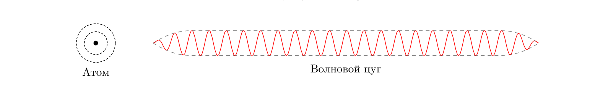

> **EN** Two independent light sources are always incoherent, even at equal wavelength
> (lasers are the exception). The reason is the random emission of wave trains by
> atoms.
>
> **RU** Два независимых источника света всегда некогерентны, даже при одинаковой длине
> волны (исключение — лазеры). Причина — случайное испускание атомами волновых цугов.

**Пояснение.** Возбуждённый атом возвращается в основное состояние в случайный момент,
испуская цуг конечной длительности (`τ ~ 10⁻⁸ с`, длина `~3 м`). Свет — поток таких цугов
с произвольными начальными фазами. Интерференционная картина от пары цугов живёт
`~10⁻⁸ с` и сменяется новой (с иным расположением полос) порядка ста миллионов раз в
секунду — глаз видит лишь равномерную освещённость.

### Зеркала Френеля / Fresnel mirrors

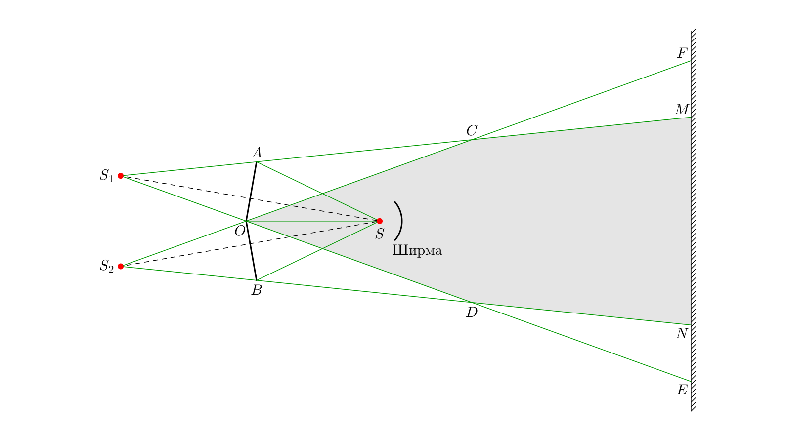

Чтобы получить когерентные пучки, свет одного источника делят на два пучка, сводимых на
экране. Два зеркала, образующие почти развёрнутый угол, создают два мнимых изображения
`S₁`, `S₂` источника `S`; отражённые пучки когерентны и дают устойчивую картину. Ширина
полос та же, что в схеме Юнга: `Δx = λL/a`.

- **Автор:** Огюстен Жан Френель (Augustin-Jean Fresnel).

### Интерференция в тонких плёнках / Interference in thin films

> **EN** In a thin film the incident ray splits into two coherent rays (reflected from
> the upper surface and passing through the film after a second reflection); their
> interference colours soap bubbles and oil films on water.
>
> **RU** В тонкой плёнке падающий луч расщепляется на два когерентных луча (отражённый
> от верхней поверхности и прошедший сквозь плёнку после вторичного отражения); их
> интерференция окрашивает мыльные пузыри и масляные пятна на воде.

**Пояснение.** В белом свете усиливается та компонента, для которой разность хода равна
целому числу её длин волн; при изменении толщины или угла взгляда усиливается другой
цвет — плёнка переливается.

### Кольца Ньютона / Newton's rings

Между плоско-выпуклой линзой и стеклянной пластиной остаётся тонкая воздушная прослойка;
интерференция лучей, отражённых от линзы и от пластины, даёт концентрические кольца.
Радиусы светлых колец:

$$r_m = \sqrt{\left(m - \frac{1}{2}\right)\lambda R} \quad (m = 1, 2, \ldots)$$

радиусы тёмных колец:

$$r_m = \sqrt{m\lambda R} \quad (m = 1, 2, \ldots)$$

**Пояснение.** Центральное пятно тёмное из-за «потери полуволны»: при отражении от
оптически более плотной среды фаза волны меняется на `π` (сдвиг на полволны), при
отражении от менее плотной — не меняется. Луч 2 и так проходит лишний путь `2y`, и
дополнительно сдвигается на полволны, поэтому в центре лучи гасятся. Кольца наблюдал
Ньютон (трактуя свет как частицы), волновое объяснение дал Томас Юнг.

### Просветление оптики / Anti-reflection coating (blooming of lenses)

> **EN** A thin interference film of suitable thickness is applied to a lens so that
> the two reflected waves cancel each other; reflection losses vanish and the image is
> brighter.
>
> **RU** На линзу наносят тонкую плёнку такой толщины, чтобы две отражённые волны
> гасили друг друга; потери на отражение исчезают, изображение становится ярче.

**Пояснение.** Толщина плёнки подбирается под одну длину волны; обычно гасят жёлто-зелёную
часть спектра (максимум солнечной яркости), поэтому объектив камеры отливает красно-
фиолетовым (сиреневым).

---

## 4.12. Дифракция света / Diffraction of light

> **EN** Diffraction is the deviation of a wave from rectilinear propagation on
> meeting an obstacle: the wave bends around its edge and enters the region of the
> geometric shadow. It is strongest when the obstacle size is comparable with the
> wavelength.
>
> **RU** Дифракция — отклонение волны от прямолинейного распространения при встрече с
> препятствием: волна огибает его край и заходит в область геометрической тени. Она
> выражена тем сильнее, чем мельче препятствие по сравнению с длиной волны.

Дифракция свойственна любым волнам; способность света к интерференции и дифракции
доказала его волновую природу.

### Принцип Гюйгенса–Френеля / Huygens–Fresnel principle

«Чистый» принцип Гюйгенса не объяснял ни дифракцию, ни отсутствие обратной волны.
Френель заменил вспомогательные сферы реальными волнами и предположил, что они
интерферируют.

> **EN** Huygens–Fresnel principle: every point of a wave surface is a source of
> coherent secondary spherical waves; the wave process in the surrounding space is the
> result of their interference.
>
> **RU** Принцип Гюйгенса–Френеля: каждая точка волновой поверхности служит источником
> когерентных вторичных сферических волн; волновой процесс в окружающем пространстве —
> результат их интерференции.

**Пояснение.** Вторичные волны усиливают друг друга «вперёд» и гасят «назад», поэтому
обратная волна не возникает. Отверстие «вырезает» из плоской волны светлый диск; поле за
ним — результат интерференции вторичных источников этого диска: волна изгибается, огибает
края и даёт чередование максимумов и минимумов. Френель разработал метод зон Френеля
(вне школьной программы).

- **Автор:** Огюстен Жан Френель (дополнил принцип Гюйгенса в 1815 г.).

### Опыт Юнга / Young's experiment

Для интерференции нужны два когерентных источника. Идея — два отверстия, освещённые
одним источником. Предшественник Юнга, Франческо Гримальди (открывший дифракцию),
продырявил картон и подставил солнечные лучи, но Солнце — протяжённый источник, и
картины от его точек «смазывают» друг друга. Юнг добавил предварительное малое отверстие,
создавшее точечный источник: теперь два отверстия стали когерентными, и на экране возникла
картина. По формуле `Δx = λL/a` Юнг выразил длину волны:

$$\lambda = \frac{a\Delta x}{L}$$

и впервые вычислил длины волн видимого света.

- **Автор:** Томас Юнг (Thomas Young), опыт 1801 г.

### Дифракционная решётка / Diffraction grating

Дифракционная решётка — много щелей ширины `a` с непрозрачными промежутками `b`;
период `d = a + b`. Падающая волна расщепляется на когерентные пучки, которые
интерферируют. Направления на максимумы:

$$d\sin\varphi = m\lambda \quad (m = 0, 1, 2, \ldots)$$

> **EN** Grating equation: the main maxima occur when `d sin φ = mλ`, where `m` is the
> order of the maximum. The central maximum (`m = 0`) is the brightest.
>
> **RU** Формула дифракционной решётки: главные максимумы отвечают условию
> `d sin φ = mλ`, где `m` — порядок максимума. Центральный максимум (`m = 0`) — самый
> яркий.

**Пояснение.** Так как `sin φ ≤ 1`, наибольший порядок `m ≤ d/λ`. Пример: при `λ = 0,65 мкм`
и `d = 10 мкм` (100 штрихов на миллиметр) первый максимум под углом `φ₁ = arcsin(0,65/10)
≈ 3,7°`, а всего `m ≤ 15,4`, то есть видны максимумы до 15-го порядка. По измеренному углу
находят длину волны: `λ = d sin φ`.

### Дифракционная решётка как спектральный прибор / Grating as a spectral device

Положение центрального максимума (`φ = 0`) не зависит от длины волны — в центре сходятся
все компоненты белого света (яркая белая полоса). Для `m ≥ 1` угол зависит от `λ`: чем
меньше длина волны, тем меньше угол, поэтому в каждом порядке белый свет разлагается в
спектр — от фиолетового края (ближе к центру) до красного. Дифракционная решётка позволяет
и наблюдать спектры (качественный анализ), и измерять длины волн (количественный).
Природные решётки — перья птиц, крылья бабочек, резкие ресницы; отражательная решётка —
компакт-диск.

---

## 4.13. Дисперсия света / Dispersion of light

> **EN** Dispersion is the dependence of the refractive index of a medium on the
> frequency (wavelength) of light.
>
> **RU** Дисперсия — зависимость показателя преломления среды от частоты (длины волны)
> света.

### Опыт Ньютона / Newton's experiment

Узкий луч солнечного света, проходя сквозь стеклянную призму, разлагался в спектр —
радужную полосу от красного до фиолетового. Выделенный луч одного цвета второй призмой
уже не разлагается; собрав компоненты снова, получают белый свет.

> **EN** White light is a mixture of rays of all colours filling the visible range from
> red to violet. Red light is refracted least and violet most, so the refractive index
> of glass increases with the frequency of light.
>
> **RU** Белый свет — смесь лучей всех цветов, непрерывно заполняющих видимый диапазон
> от красного до фиолетового. Красный свет преломляется слабее всех, фиолетовый — сильнее,
> поэтому показатель преломления стекла растёт с частотой света.

**Пояснение.** Из `n = c/v` следует: чем больше частота, тем меньше скорость света в
стекле — красный свет идёт в стекле быстрее, фиолетовый медленнее. В вакууме скорость не
зависит от частоты. Стеклянная призма — простейший спектральный прибор.

- **Автор:** Исаак Ньютон (Isaac Newton)
- **Труд:** «Оптика» (Opticks, 1704).

### Хроматическая аберрация / Chromatic aberration

Из-за дисперсии собирающая линза по-разному фокусирует разные цвета: красные лучи
собираются дальше всех от линзы, фиолетовые — ближе всех. Пучок белого света не сходится
в одной точке — качество изображения падает (снижается чёткость, появляются цветные
полосы). Борьба с этим — ахроматические линзы: к собирающей линзе добавляют рассеивающую,
частично компенсирующую расфокусировку.

---

## Авторы и труды (сводка) / Authors and works (summary)

| Закон / явление | Автор | Труд |
|---|---|---|
| Закон отражения | Евклид, Герон Александрийский | «Катоптрика» (античность) |
| Закон преломления | Виллеброрд Снеллиус | открытие 1621 г.; опубликован Декартом («Диоптрика», 1637) |
| Дисперсия света | Исаак Ньютон | «Оптика» (Opticks, 1704) |
| Кольца Ньютона | Ньютон (опыт), Томас Юнг (волновое объяснение) | — |
| Принцип Гюйгенса | Христиан Гюйгенс | «Трактат о свете» (Traité de la Lumière, 1690) |
| Принцип Гюйгенса–Френеля, зеркала Френеля | Огюстен Жан Френель | работы 1815–1818 гг. |
| Опыт Юнга, потеря полуволны | Томас Юнг | опыт 1801 г. |

> **Примечание.** Формулы, определения физических величин и законы природы не
> являются объектами авторского права и могут свободно излагаться. Текст выше
> пересказан по учебной литературе (пособие И. В. Яковлева, «Физика», MathUs.ru).

