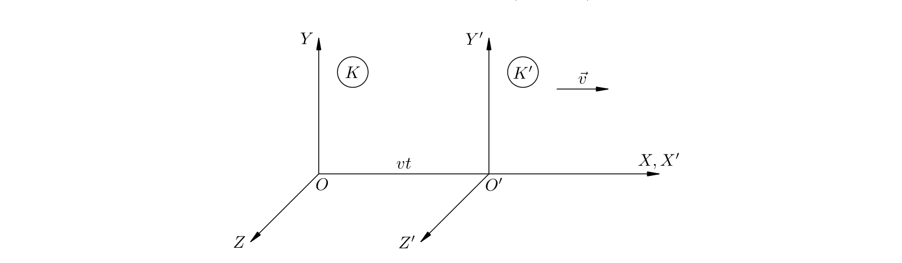
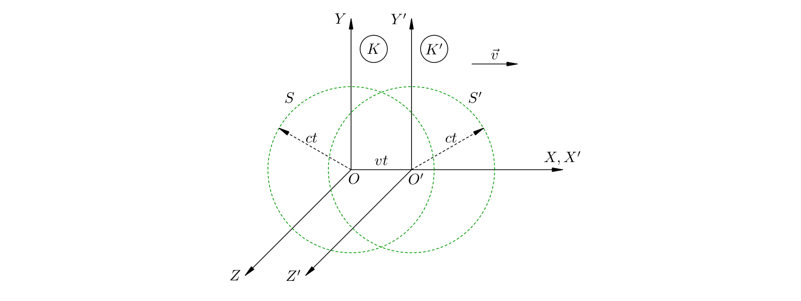
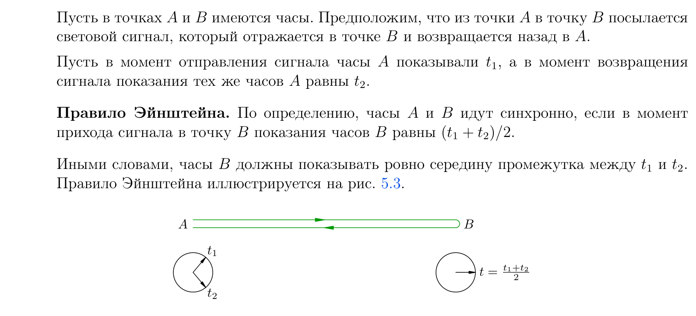
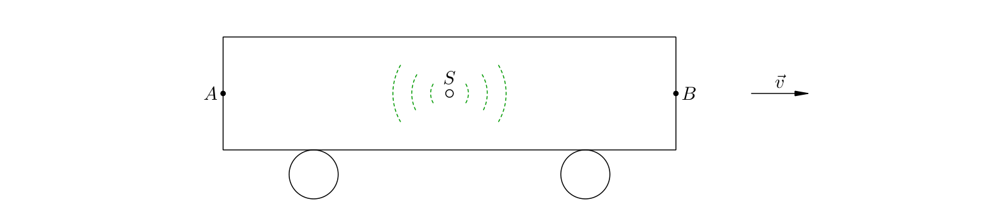
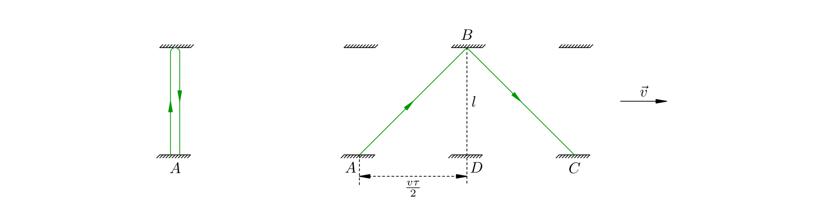
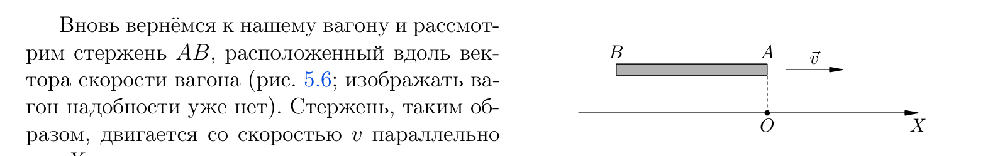
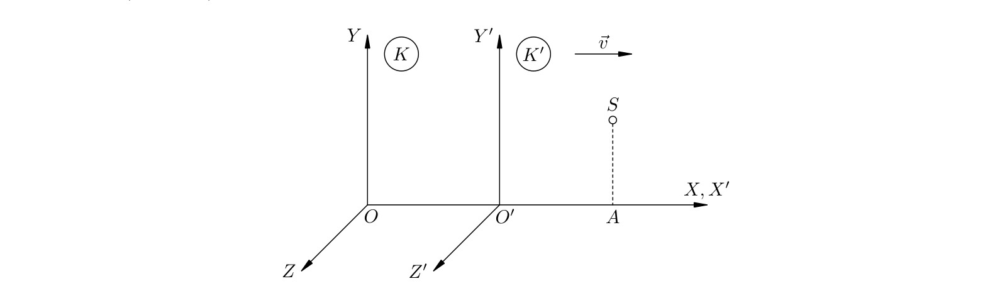
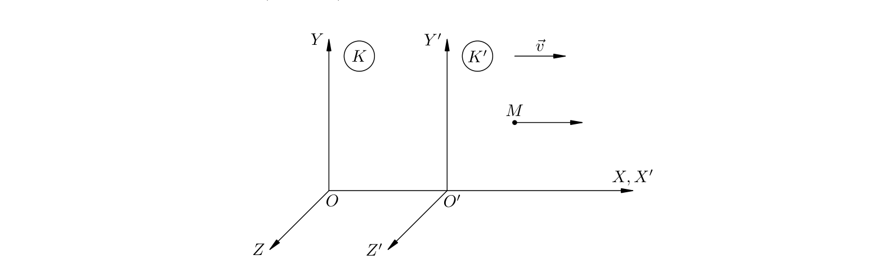
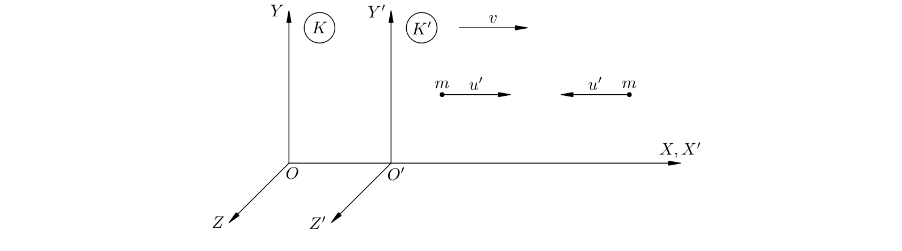

# Глава 5. Теория относительности / Theory of relativity

> Специальная теория относительности (СТО). Определения переформулированы
> (EN — по-английски в духе учебной литературы, RU — русский перевод), формулы
> соответствуют пособию, к каждому закону указан автор и его работа.
> Формулы и определения физики не охраняются авторским правом; текст пересказан.

Классическая механика Ньютона отлично работает, когда скорости тел малы по сравнению
со скоростью света. По мере приближения скорости к световой всё явственнее проявляются
релятивистские эффекты — сокращение длины, замедление времени и другие, которые классика
описать не может. Здесь нужна более общая теория — специальная теория относительности.
Справедливая и при малых скоростях, СТО даёт там исчезающе малые поправки и потому
переходит в классическую механику: классическая механика — предельный случай СТО.

---

## 5.1. Принцип относительности Галилея / Galileo's principle of relativity

Изучение теории относительности Эйнштейна начинают с более глубокого разбора принципа
относительности Галилея — именно из него вырастает предпосылка для новой теории.

### Наблюдатель на корабле / Observer on a ship

> **EN** In a ship's cabin no mechanical experiment (free fall, sliding down an incline,
> rotation, pendulum oscillations, sound propagation) can reveal whether the ship is at
> rest or moves uniformly in a straight line. All mechanical phenomena proceed identically
> in every inertial frame under the same initial conditions.
>
> **RU** В каюте корабля никакой механический эксперимент (свободное падение, соскальзывание
> с наклонной плоскости, вращение, колебания маятников, распространение звука) не позволяет
> установить, покоится ли корабль или движется равномерно и прямолинейно. Всякое механическое
> явление при одних и тех же начальных условиях протекает одинаково в любой инерциальной
> системе отсчёта.

**Пример.** Мяч, брошенный на палубе со скоростью 5 м/с под углом 60° к горизонту,
опишет в равномерно движущемся корабле ровно ту же траекторию, что и на берегу при тех же
начальных условиях. Равномерное движение судна никак не сказывается на механике в его каюте.

- **Автор:** Галилео Галилей (Galileo Galilei)
- **Труд:** «Диалог о двух главнейших системах мира» (Dialogo sopra i due massimi sistemi
  del mondo, 1632); «Беседы о двух новых науках» (Discorsi e dimostrazioni matematiche,
  1638).

### Инвариантность законов механики / Invariance of the laws of mechanics

Принцип относительности Галилея означает: **законы механики одинаковы во всех инерциальных
системах отсчёта**. Рассмотрим две системы `K` и `K′` с сонаправленными осями; `K` считаем
неподвижной, а `K′` движется вдоль общей оси `X` с постоянной скоростью `v`. В момент, когда
начала координат `O` и `O′` совпадали, часы обеих систем были выставлены на ноль. Связь
координат и времени одного и того же события задают **преобразования Галилея**:

$$x' = x - vt, \qquad y' = y, \qquad z' = z, \qquad t' = t$$

> **EN** The Galilean transformations connect the coordinates and time of one and the
> same event measured in two inertial frames moving uniformly with respect to each other;
> time is the same in both frames (`t′ = t`).
>
> **RU** Преобразования Галилея связывают координаты и время одного и того же события,
> измеренные в двух инерциальных системах отсчёта, движущихся друг относительно друга
> равномерно; время в обеих системах одно и то же (`t′ = t`).

Дифференцируя три первых равенства по времени, получаем закон сложения скоростей, а
дифференцируя ещё раз — равенство ускорений:

$$\vec{u} = \vec{u}' + \vec{v}, \qquad \vec{a}' = \vec{a}$$

Ускорение, масса и сила инвариантны относительно перехода между инерциальными системами,
поэтому **второй и третий законы Ньютона сохраняют свой вид** во всех таких системах.

$$m\vec{a} = \vec{F}$$

> **EN** Mass, acceleration and force are invariant under a change of inertial frame, so
> Newton's second and third laws keep the same mathematical form in every frame:
> the laws of mechanics are invariant under the Galilean transformations. This is an
> alternative formulation of Galileo's principle of relativity.
>
> **RU** Масса, ускорение и сила инвариантны относительно смены инерциальной системы
> отсчёта, поэтому второй и третий законы Ньютона имеют одинаковый вид во всех системах:
> законы механики инвариантны относительно преобразований Галилея. Это — альтернативная
> формулировка принципа относительности Галилея.

**Пояснение.** Речь идёт именно об инвариантности *математической формы* законов. Именно
благодаря ей одно и то же явление при одинаковых начальных условиях протекает одинаково
во всех инерциальных системах.

---

## 5.2. Принципы СТО / Principles of special relativity

Принцип Галилея ограничен механикой. Возникает вопрос: сохранится ли он для тепловых,
электромагнитных, атомных и ядерных явлений? Поначалу казалось, что нет: в отличие от
законов Ньютона, уравнения Максвелла оказались **не инвариантными** относительно
преобразований Галилея.

### Гипотеза о мировом эфире / The world ether hypothesis

Из уравнений Максвелла следует, что свет в вакууме распространяется со скоростью
`c = 300 000 км/с` во всех направлениях, и эта скорость не зависит от того, покоится
источник или движется. Свет рассматривали как колебания особой всепроникающей среды —
**неподвижного мирового эфира**, подобно тому как звук — колебания воздуха. Тогда, сидя в
звездолёте, летящем со скоростью `v = 50 000 км/с` навстречу свету лампочки, вы измерите
скорость света `c + v = 350 000 км/с` и сделаете вывод о своём движении. Получалось, что
электромагнитные явления позволяют отличить покой от равномерного движения и существует
**привилегированная система отсчёта**, связанная с неподвижным эфиром.

**Опыт Майкельсона (1881).** С помощью интерферометра пытались измерить скорость Земли
относительно эфира («эфирный ветер»), сравнивая два перпендикулярных пучка света. Сдвигов
интерференционной картины не обнаружилось — ни в одно время года, при любой ориентации
прибора. Отрицательный результат нельзя было списать на неточность.

Не сомневаясь в существовании эфира, **Лоренц** предположил, что размеры движущегося
предмета сокращаются в направлении движения:

$$l = l_0\sqrt{1 - \frac{v^2}{c^2}}$$

> **EN** If a rod of rest length `l₀` moves along its axis with speed `v`, its length
> becomes `l = l₀√(1 − v²/c²)`. This hypothesis — the Lorentz (FitzGerald) contraction —
> was introduced only to explain the null result of the Michelson experiment and was
> later fully justified by Einstein's theory.
>
> **RU** Если стержень собственной длины `l₀` движется вдоль своей оси со скоростью `v`,
> его длина становится равной `l = l₀√(1 − v²/c²)`. Эта гипотеза — лоренцево (Фицджеральда)
> сокращение — была введена лишь для объяснения нулевого результата опыта Майкельсона,
> а позднее получила объяснение в теории Эйнштейна.

- **Автор:** Хендрик Лоренц (Hendrik Lorentz), а также Джордж Фицджеральд (George
  FitzGerald).

### Постулаты Эйнштейна / Einstein's postulates

Для разрешения противоречий Эйнштейн отказался от самого эфира и обобщил принцип
относительности на **все** физические явления.

> **EN** Postulate 1 (principle of relativity). Every physical phenomenon proceeds
> identically in any inertial frame under the same initial conditions: no experiment —
> mechanical, thermal, electromagnetic, atomic or nuclear — can single out a preferred
> frame. Postulate 2 (invariance of the speed of light). In every inertial frame light
> travels in vacuum with the same speed `c`, independent of the motion of its source.
>
> **RU** Постулат 1 (принцип относительности). Всякое физическое явление при одних и тех
> же начальных условиях протекает одинаково в любой инерциальной системе отсчёта: никакой
> опыт — механический, тепловой, электромагнитный, атомный или ядерный — не может выделить
> привилегированную систему. Постулат 2 (инвариантность скорости света). В каждой
> инерциальной системе отсчёта свет движется в вакууме с одной и той же скоростью `c`,
> не зависящей от движения источника.

**Пояснение.** Никакого эфира не существует, все инерциальные системы полностью
равноправны. Оба постулата означают, что любые физические законы должны иметь одинаковую
математическую форму во всех инерциальных системах; в частности, неверны не уравнения
Максвелла, а преобразования Галилея. Слабый пункт классической механики — предположение
о *мгновенной* передаче взаимодействий. На деле возмущение поля бежит от тела к телу с
конечной скоростью, поэтому в природе существует **предельная скорость** распространения
взаимодействий — ею и оказывается скорость света `c`. Ничто материальное не может двигаться
быстрее света.

Механика, построенная на постулатах СТО, называется **релятивистской**. При малых
скоростях релятивистская механика переходит в ньютоновскую: её формулы получаются
предельным переходом `c → ∞`. Из постулатов СТО следуют неожиданные выводы: например,
фронт световой вспышки в один и тот же момент должен оказаться сразу на двух разных сферах.
Парадокс разрешается относительностью понятия **одновременности** (см. следующий раздел).

- **Автор:** Альберт Эйнштейн (Albert Einstein)
- **Труд:** «К электродинамике движущихся тел» (Zur Elektrodynamik bewegter Körper, 1905).

> **Примечание.** Позднее Эйнштейн построил общую теорию относительности (ОТО),
> описывающую пространство-время при наличии гравитации (искривление пространства-времени).
> В СТО влиянием гравитации пренебрегают.

---

## 5.3. Релятивистская кинематика / Relativistic kinematics

### Одновременность событий / Simultaneity of events

Прежде всего нужно строго определить, когда два события происходят «одновременно». По
Эйнштейну, каждое событие имеет **местное время** — показания часов, находящихся в той
точке, где событие происходит. Одновременность событий в *одной* точке вопросов не
вызывает; для пространственно разделённых событий нужны **синхронно идущие часы**,
расставленные во всех точках.

**Правило Эйнштейна (синхронизация часов).** Из точки `A` в точку `B` посылают световой
сигнал, он отражается и возвращается. Если часы `A` в момент отправления показывали `t₁`,
а в момент возвращения — `t₂`, то часы `B` идут синхронно с часами `A`, когда в момент
прихода сигнала показывают ровно середину:

$$t = \frac{t_1 + t_2}{2}$$

> **EN** Two spatially separated events are simultaneous in a given frame if the clocks
> located at the points of their occurrence read the same time; in short, if their local
> times coincide.
>
> **RU** Два пространственно разделённых события в данной системе отсчёта считаются
> одновременными, если показания часов, расположенных в тех точках, где события произошли,
> совпадают; короче — если их местные времена совпадают.

**Пояснение.** Правило Эйнштейна опирается на то, что скорость света не зависит от
направления распространения. Переносить часы из одной точки в другую бесполезно: движущиеся
часы отстают, и тем сильнее, чем быстрее их переносили. Итог ошеломляющий — одновременность,
промежутки времени и расстояния **теряют абсолютный характер** и становятся относительными,
зависящими от выбора системы отсчёта.

### Относительность одновременности / Relativity of simultaneity

> **EN** Two events that are simultaneous in one frame need not be simultaneous in
> another frame moving with respect to the first.
>
> **RU** Два события, одновременные в одной системе отсчёта, могут оказаться
> неодновременными в другой системе отсчёта.

**Пример.** В центре `S` движущегося вправо вагона вспыхивает свет. В системе вагона свет
приходит к задней `A` и передней `B` стенкам одновременно. В системе земли точка `A` движется
навстречу сигналу, а `B` удаляется, поэтому свету к `A` нужно пройти меньший путь; но скорость
света во всех направлениях одинакова — значит, по земным часам свет придёт к `A` раньше, чем
к `B`.

Таким же образом разрешается парадокс со световой вспышкой из раздела 5.2: свет достигает
сферы с центром в `O` одновременно только в системе `K`, а сферы с центром в `O′` — только в
системе `K′`.

### Относительность промежутков времени / Relativity of time intervals

Рассмотрим световой сигнал, бегающий вертикально между двумя горизонтальными зеркалами
вагона (расстояние между ними `l`). По часам вагона (система `K′`) сигнал идёт вверх и вниз за
**собственное время** `τ₀`:

$$2l = c\tau_0$$

В системе земли сигнал идёт по ломаной: путь света `cτ`, а вагон сдвигается на `vτ`. По
теореме Пифагора:

$$\left(\frac{c\tau}{2}\right)^2 = \left(\frac{v\tau}{2}\right)^2 + l^2$$

Отсюда с учётом `2l = cτ₀` получаем:

$$\tau = \frac{\tau_0}{\sqrt{1 - \frac{v^2}{c^2}}}$$

> **EN** Time dilation. If two events occur at the same point of a frame `K′` moving
> with speed `v` relative to `K`, the proper time `τ₀` between them is shortest; the time
> `τ` measured in `K` is longer by the factor `1/√(1 − v²/c²)`.
>
> **RU** Релятивистское замедление времени. Если два события происходят в одной точке
> системы `K′`, движущейся со скоростью `v` относительно `K`, то собственное время `τ₀`
> между ними — наименьшее; время `τ`, измеренное в `K`, больше в `1/√(1 − v²/c²)` раз.

Величину

$$\gamma = \frac{1}{\sqrt{1 - \frac{v^2}{c^2}}}$$

называют **лоренц-фактором** (релятивистским фактором); с его помощью `τ = γτ₀`.

**Пример.** Вагон летит со скоростью `v = 0,999c`; яблоко по часам пассажира летит `τ₀ = 1 с`.
По земным часам между броском и ловлей пройдёт `τ = 1/√(1 − 0,999²) ≈ 22,4 с`. Звездолёт,
мчащийся со скоростью `0,999c` и летящий 10 лет по часам астронавтов, вернётся на Землю,
когда по земным часам пройдёт 224 года.

### Относительность расстояний / Relativity of distances

**Поперечные размеры** тел одинаковы во всех системах отсчёта — это следует из принципа
относительности (иначе движущийся и покоящийся стержень по разным системам оказались бы
то короче, то длиннее друг друга). Продольные размеры, напротив, сокращаются.

$$l = l_0\sqrt{1 - \frac{v^2}{c^2}}$$

> **EN** Length contraction. The length `l` of a rod moving along its axis with speed `v`
> is smaller than its proper (rest) length `l₀` by the factor `√(1 − v²/c²)`. The effect
> reflects the measuring procedure, not a real compression of the rod.
>
> **RU** Лоренцево сокращение длины. Длина `l` стержня, движущегося вдоль своей оси со
> скоростью `v`, меньше его собственной длины `l₀` в `√(1 − v²/c²)` раз. Эффект связан лишь
> с особенностями измерительной процедуры, а не с реальным «сжатием» стержня.

Собственные величины `τ₀` и `l₀` измеряются в той системе, где часы (соответственно стержень)
покоятся.

### Преобразования Лоренца / Lorentz transformations

Связь координат и времени события в системах `K` и `K′` (движущейся относительно `K` вдоль
оси `X` со скоростью `v`; при `t = 0` начала `O` и `O′` совпадают) дают **преобразования
Лоренца**:

$$x' = \frac{x - vt}{\sqrt{1 - \frac{v^2}{c^2}}}, \qquad y' = y, \qquad z' = z, \qquad
t' = \frac{t - \frac{vx}{c^2}}{\sqrt{1 - \frac{v^2}{c^2}}}$$

Обратный переход (из `K′` в `K`):

$$x = \frac{x' + vt'}{\sqrt{1 - \frac{v^2}{c^2}}}, \qquad y = y', \qquad z = z', \qquad
t = \frac{t' + \frac{vx'}{c^2}}{\sqrt{1 - \frac{v^2}{c^2}}}$$

> **EN** The Lorentz transformations replace the Galilean transformations: they follow
> from the postulates of special relativity and become the Galilean ones in the limit
> `v ≪ c`.
>
> **RU** Преобразования Лоренца заменяют преобразования Галилея: они вытекают из
> постулатов СТО и при `v ≪ c` переходят в преобразования Галилея (`x′ = x − vt`, `t′ = t`).

**Пояснение.** При малых скоростях `v/c → 0`, корень стремится к единице, и формулы Лоренца
переходят в формулы Галилея — релятивистская механика плавно переходит в классическую.

- **Автор:** Хендрик Лоренц (Hendrik Lorentz)

### Релятивистский закон сложения скоростей / Relativistic law of addition of velocities

Пусть точка `M` движется вдоль оси `X` со скоростью `u′` в системе `K′` и со скоростью `u` в
системе `K`. Из преобразований Лоренца следует:

$$u = \frac{u' + v}{1 + \dfrac{vu'}{c^2}}$$

> **EN** The relativistic law of addition of velocities replaces the classical
> `u = u′ + v`. If `u′ = c` then `u = c`, as required by the invariance of the speed of
> light; for small velocities it reduces to the classical law.
>
> **RU** Релятивистский закон сложения скоростей приходит на смену классическому
> `u = u′ + v`. Если `u′ = c`, то `u = c`, как требует инвариантность скорости света; при
> малых скоростях он переходит в классический закон.

**Проверка.** При `u′ = c` получаем `u = (c + v)/(1 + v/c) = c`. Классический закон
`u = u′ + v` дал бы здесь `u = c + v > c`, что противоречит постулату о предельной скорости.

---

## 5.4. Релятивистская динамика / Relativistic dynamics

### Релятивистская энергия / Relativistic energy

Покоящееся тело массы `m` обладает **энергией покоя**:

$$E = mc^2$$

> **EN** A body at rest possesses rest energy `E = mc²`. Every body carries energy merely
> because it exists; changing the rest energy by `∆E` changes the mass by `∆m = ∆E/c²`.
>
> **RU** Покоящееся тело обладает энергией покоя `E = mc²`. Каждое тело несёт энергию
> просто потому, что существует; изменение энергии покоя на `∆E` меняет массу на
> `∆m = ∆E/c²`.

**Пример.** В одном килограмме любого вещества заключена энергия
`E = 1 · (3·10⁸)² = 9·10¹⁶ Дж` — столько дерева пришлось бы сжечь не меньше девяти
миллионов тонн. При нагреве 1 кг воды на 100 °C её масса возрастёт всего на
`∆m = Q/c² ≈ 4,7·10⁻¹² кг` — столь ничтожное изменение невозможно заметить.

**Энергетическая альтернативная запись / Alternative notation:**

$$E_0 = m_0 c^2$$

энергия покоя в обозначениях с массой покоя `m₀`; распространена в учебниках, где массу
покоя отличают от «релятивистской массы».

Энергия **движущегося** со скоростью `v` тела (полная энергия) равна:

$$E = \frac{mc^2}{\sqrt{1 - \frac{v^2}{c^2}}}$$

> **EN** The total energy of a body moving with speed `v` exceeds its rest energy and
> equals it only when `v = 0`. Since the denominator is real, a massive body always has
> `v < c`; a massless particle must move at the speed of light.
>
> **RU** Полная энергия тела, движущегося со скоростью `v`, больше энергии покоя и равна
> ей только при `v = 0`. Так как знаменатель вещественен, массивное тело всегда имеет
> `v < c`; безмассовая частица обязана двигаться со скоростью света.

При малых скоростях полная энергия распадается на энергию покоя и кинетическую:

$$E \approx mc^2 + \frac{mv^2}{2},$$

поэтому **кинетическую энергию** в СТО определяют так:

$$E_{\text{кин}} = \frac{mc^2}{\sqrt{1 - \frac{v^2}{c^2}}} - mc^2$$

При `v ≪ c` она переходит в обычную `Eкин = mv²/2`.

**Пример.** При распаде ядра урана-235 суммарная масса продуктов примерно на 0,1% меньше
массы исходного ядра; эта одна тысячная доля массы высвобождается в виде энергии — той, что
взрывает атомную бомбу. При неупругом столкновении двух тел массы `m`, летящих навстречу со
скоростью `3c/5`, образуется тело массы `M = (5/2)m > 2m`: избыток массы `m/2` возник из
кинетической энергии, перешедшей во внутреннюю.

### Релятивистский импульс / Relativistic momentum

Классическое выражение `p = mv` в СТО не сохраняется. Правильный импульс получается делением
на релятивистский корень:

$$\vec{p} = \frac{m\vec{v}}{\sqrt{1 - \frac{v^2}{c^2}}}$$

> **EN** The relativistic momentum of a body of mass `m` moving with velocity `v` is
> `p = mv/√(1 − v²/c²)`; it is this quantity, not `mv`, that is conserved in collisions.
>
> **RU** Релятивистский импульс тела массы `m`, движущегося со скоростью `v`, равен
> `p = mv/√(1 − v²/c²)`; при столкновениях сохраняется именно он, а не `mv`.

**Альтернативная запись / Alternative notation:**

$$\vec{p} = \frac{m_0\vec{v}}{\sqrt{1 - \frac{v^2}{c^2}}}$$

через массу покоя `m₀`; с лоренц-фактором — `p = γ m v`.

**Пояснение.** Классический импульс `p = mv` несовместим с релятивистским законом сложения
скоростей; проверка на встречном неупругом столкновении показывает, что закон сохранения
выполняется именно для релятивистского импульса (5.25).

### Связь энергии и импульса / Energy–momentum relation

Из выражений для полной энергии и импульса возведением в квадрат находим:

$$E^2 - p^2 c^2 = m^2 c^4$$

> **EN** The energy and momentum of a free particle are related by `E² − p²c² = m²c⁴`
> (equivalently `E² = p²c² + m₀²c⁴`); this relation is Lorentz-invariant.
>
> **RU** Энергия и импульс свободной частицы связаны соотношением `E² − p²c² = m²c⁴`
> (иначе `E² = p²c² + m₀²c⁴`); это соотношение лоренц-инвариантно.

**Фотон.** У фотона масса равна нулю и `v = c`; из (5.26) сразу следует:

$$E = pc$$

Энергия фотона устанавливается уже в квантовой физике, а импульс затем находится из этой
формулы.

### Релятивистское уравнение движения / Relativistic equation of motion

Второй закон Ньютона в СТО не работает. Правильное уравнение движения — то же «импульсное»
`dp/dt = F`, но с **релятивистским** импульсом:

$$\frac{d}{dt}\left(\frac{mv}{\sqrt{1 - \frac{v^2}{c^2}}}\right) = F$$

> **EN** The derivative of the relativistic momentum with respect to time equals the
> applied force; this relativistic equation of motion replaces Newton's second law and
> is invariant under the Lorentz transformations.
>
> **RU** Производная релятивистского импульса по времени равна приложенной к телу силе;
> это релятивистское уравнение движения заменяет второй закон Ньютона и инвариантно
> относительно преобразований Лоренца.

**Пример.** Под действием постоянной силы `F` тело разгоняется так, что его скорость

$$v = \frac{cFt}{\sqrt{F^2 t^2 + m^2 c^2}}$$

При малых временах `v ≈ Ft/m = at` — как в классике; при больших временах скорость
приближается к `c`, но никогда её не достигает.

---

## Авторы и труды (сводка) / Authors and works (summary)

| Закон / результат | Автор | Труд |
|---|---|---|
| Принцип относительности (механика) | Галилео Галилей | Dialogo (1632); Discorsi (1638) |
| Постулаты СТО | Альберт Эйнштейн | Zur Elektrodynamik bewegter Körper (1905) |
| Формула `E = mc²` | Альберт Эйнштейн | Ist die Trägheit eines Körpers von seinem Energieinhalt abhängig? (1905) |
| Лоренцево сокращение, преобразования Лоренца | Хендрик Лоренц | Electromagnetic phenomena... (1904) |
| Опыт Майкельсона (отрицательный) | Альберт Майкельсон | интерферометр, 1881 |

> **Примечание.** Формулы, определения физических величин и законы природы не
> являются объектами авторского права и могут свободно излагаться. Текст выше
> пересказан по учебной литературе; графики извлечены из пособия И. В. Яковлева
> (MathUs.ru) в ознакомительных целях.

