# Глава 6. Квантовая физика / Quantum physics

> Основные понятия и законы школьного курса физики. Определения переформулированы
> (EN — по-английски в духе учебной литературы, RU — русский перевод), формулы
> соответствуют пособию, к каждому закону указан автор и его работа.
> Формулы и определения физики не охраняются авторским правом; текст пересказан.

---

## 6.1. Фотоэффект / Photoelectric effect

Классическая электродинамика прекрасно описывает широкий круг электромагнитных
явлений, но «даёт сбой» в процессах взаимодействия света с веществом. Первым таким
сбоем стало явление фотоэффекта — выбивания электронов из вещества падающим светом.

> **EN** The photoelectric effect is the ejection of electrons from a material by
> incident light.
>
> **RU** Фотоэффект — выбивание электронов из вещества падающим светом.

Явление открыл Генрих Герц в 1887 году, а год спустя его независимо исследовал и
описал Александр Григорьевич Столетов.

- **Автор:** Генрих Герц (Heinrich Hertz); Александр Григорьевич Столетов (Aleksandr Stoletov)
- **Труд:** опыты по излучению электромагнитных волн (1887); систематические опыты по фотоэффекту (1888–1890).

### Опыты Столетова / Stoletov's experiments

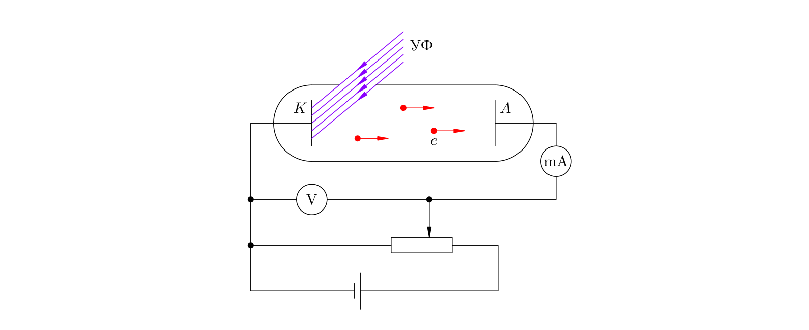

Столетов использовал фотоэлемент собственной конструкции: в стеклянную колбу, из
которой выкачан воздух, введены цинковый катод `K` и анод `A`. На электроды подаётся
напряжение `U`, величину и знак которого можно менять. Катод облучается
ультрафиолетовым светом через кварцевое окошко (кварц пропускает ультрафиолет, стекло —
нет). Ультрафиолет выбивает с катода электроны, которые летят к аноду и создают ток,
регистрируемый миллиамперметром.

> **EN** The current produced by light-ejected electrons is called the photocurrent;
> the ejected electrons are called photoelectrons.
>
> **RU** Ток, создаваемый выбитыми светом электронами, называется фототоком, а сами
> выбитые электроны — фотоэлектронами.

В опытах можно независимо менять три величины: анодное напряжение, интенсивность
света и его частоту.

### Зависимость фототока от напряжения / Photocurrent vs. voltage

Характеристика фотоэлемента (график зависимости фототока от напряжения) устроена
следующим образом. Электроны вылетают из катода с разными скоростями и в разных
направлениях. При большом по модулю отрицательном напряжении поле тормозит электроны,
и тока нет: максимальной кинетической энергии `mv²/2` не хватает, чтобы преодолеть
работу поля `eU`:

$$\frac{mv^2}{2} < eU.$$

При напряжении `U_з`, называемом **задерживающим напряжением**, самые быстрые
электроны долетают до анода с нулевой скоростью:

$$\frac{mv^2}{2} = eU_{\text{з}}. \tag{6.1}$$

Так измерение задерживающего напряжения позволяет найти максимальную кинетическую
энергию фотоэлектронов. При дальнейшем росте напряжения фототок увеличивается и,
наконец, достигает предельной величины — **тока насыщения** `I_н`, когда анод
захватывает вообще все выбитые электроны.

> **EN** The stopping potential `U_s` is the retarding voltage at which even the
> fastest photoelectrons just reach the anode with zero speed; `mv²/2 = eU_s`.
>
> **RU** Задерживающее напряжение `U_з` — такое тормозящее напряжение, при котором
> самые быстрые фотоэлектроны достигают анода с нулевой скоростью; `mv²/2 = eU_з`.

### Законы фотоэффекта / Laws of the photoelectric effect

Опыт даёт три закона.

> **EN** First law: the number of electrons ejected per second is proportional to the
> intensity of the incident radiation (at fixed frequency).
>
> **RU** Первый закон: число электронов, выбиваемых из катода за секунду,
> пропорционально интенсивности падающего излучения (при неизменной частоте).

> **EN** Second law: the maximum kinetic energy of photoelectrons grows linearly with
> the frequency of the light and does not depend on its intensity.
>
> **RU** Второй закон: максимальная кинетическая энергия фотоэлектронов линейно
> возрастает с частотой света и не зависит от его интенсивности.

> **EN** Third law: for every substance there is a red boundary — a minimum frequency
> `ν₀` below which the photoelectric effect does not occur at any intensity.
>
> **RU** Третий закон: для каждого вещества существует красная граница фотоэффекта —
> наименьшая частота света `ν₀`, при которой фотоэффект ещё возможен. При `ν < ν₀`
> фотоэффект не наблюдается ни при какой интенсивности света.

### Трудности классического объяснения фотоэффекта / Difficulties of the classical explanation

Чтобы вырвать электрон из вещества, нужно сообщить ему энергию `A` — **работу выхода**.
В волновой картине электрон в переменном поле световой волны колеблется, накапливает
энергию и вылетает, когда её достаточно. Такая модель не в силах объяснить второй и
третий законы фотоэффекта и его безынерционность.

**Пояснение.** По волновым представлениям большая интенсивность давала бы большую
энергию колебаний и, значит, бо́льшую скорость вылетающих электронов — но опыт
показывает независимость энергии от интенсивности. И непонятно, откуда берётся красная
граница: при малой интенсивности слабый свет должен был бы лишь дольше «раскачивать»
электрон, однако фотоэффект либо есть мгновенно, либо его нет вовсе.

Тупик разрешил Альберт Эйнштейн в 1905 году, отказавшись от волнового объяснения и
привлекши гипотезу о квантах, высказанную Максом Планком пятью годами ранее.

### Гипотеза Планка о квантах / Planck's quantum hypothesis

Классическая модель давала бессмысленный вывод и о тепловом излучении: нагретое тело,
непрерывно излучая, должно остыть до абсолютного нуля. Решая эту задачу, Планк высказал
гипотезу о квантах.

> **EN** Electromagnetic energy is emitted and absorbed not continuously but in
> indivisible portions — quanta. The energy of a quantum is proportional to the
> frequency of the radiation.
>
> **RU** Электромагнитная энергия излучается и поглощается не непрерывно, а отдельными
> неделимыми порциями — квантами. Энергия кванта пропорциональна частоте излучения.

$$E = h\nu. \tag{6.2}$$

Коэффициент `h` называется **постоянной Планка**:

$$h = 6{,}63\cdot 10^{-34}\ \text{Дж}\cdot\text{с}. \tag{6.3}$$

- **Автор:** Макс Планк (Max Planck)
- **Труд:** теория теплового излучения, гипотеза квантов (1900).

### Уравнение Эйнштейна для фотоэффекта / Einstein's equation for the photoelectric effect

Эйнштейн пошёл дальше Планка: он предположил, что не только излучение и поглощение,
но и само распространение света идёт отдельными порциями — квантами энергии `E = hν`,
которые позднее назвали фотонами. Поглощение света — это неупругое «столкновение»
фотона с электроном, при котором электрон мгновенно получает энергию. Этим объясняется
безынерционность фотоэффекта.

Уравнение Эйнштейна — это закон сохранения энергии при таком столкновении: энергия
фотона расходуется на работу выхода `A` и на сообщение электрону кинетической энергии:

$$h\nu = A + \frac{mv^2}{2}. \tag{6.4}$$

Слагаемое `mv²/2` — максимальная кинетическая энергия фотоэлектронов: она получается,
когда фотон попадает в свободный электрон в поверхностном слое металла.

Три закона фотоэффекта — следствия уравнения (6.4):

1. Число выбитых электронов пропорционально числу поглощённых фотонов, а значит —
   интенсивности света.
2. Из (6.4): `mv²/2 = hν − A` — кинетическая энергия линейно растёт с частотой и не
   зависит от интенсивности.
3. Фотоэффект возможен, лишь когда энергии фотона хватает на работу выхода: `hν ⩾ A`.
   Красная граница определяется равенством `hν₀ = A`, то есть `ν₀ = A/h` — она зависит
   только от вещества катода.

- **Автор:** Альберт Эйнштейн (Albert Einstein)
- **Труд:** «Об одной эвристической точке зрения, касающейся возникновения и превращения света» (1905).

---

## 6.2. Фотоны / Photons

Из исследования теплового излучения и фотоэффекта физики заключили, что свет состоит из
отдельных порций энергии — фотонов. Излучение, распространение и поглощение света
происходит строго этими порциями. Фотон обладает энергией и импульсом и может
обмениваться ими с частицами вещества — при упругом «столкновении» свет рассеивается,
при неупругом — поглощается. Поэтому фотон причислен к элементарным частицам.

### Энергия фотона / Photon energy

$$E = h\nu. \tag{6.5}$$

Часто удобнее циклическая частота `ω = 2πν` и «перечёркнутая» постоянная Планка
`ℏ = h/2π = 1{,}05·10⁻³⁴ Дж·с`. Тогда:

$$E = \hbar\omega.$$

Так как фотон движется со скоростью `c`, он — релятивистская частица. Релятивистская
энергия тела массы `m`, движущегося со скоростью `v`:

$$E = \frac{mc^2}{\sqrt{1 - v^2/c^2}}. \tag{6.6}$$

Если бы масса фотона была отлична от нуля, формула (6.6) давала бы бесконечную энергию.
Значит, масса фотона равна нулю; вообще, со скоростью света может двигаться только
безмассовая частица.

### Импульс фотона / Photon momentum

Связь энергии и импульса релятивистской частицы:

$$E^2 = p^2c^2 + m^2c^4. \tag{6.7}$$

Для безмассового фотона `E = pc`, откуда

$$p = \frac{E}{c} = \frac{h\nu}{c}. \tag{6.8}$$

Направление импульса фотона совпадает с направлением луча. Так как `c/ν = λ`, импульс
фотона удобно записать и через длину волны:

$$p = \frac{h}{\lambda}. \tag{6.9}$$

Наименьшей энергией и импульсом в видимом диапазоне обладают фотоны красного света
(малая частота, большая длина волны); к фиолетовому краю энергия и импульс фотона
линейно растут с частотой.

### Давление света / Light pressure

Свет оказывает давление на освещаемую поверхность. Этот вывод Максвелл сделал
теоретически, а экспериментально подтвердил П. Н. Лебедев. В фотонной картине давление
объясняется передачей импульса фотонов телу.

Пусть на поверхность площадью `S` перпендикулярно падает свет частоты `ν`, `n` —
концентрация фотонов. За время `t` на поверхность попадают фотоны из цилиндра высотой
`ct`: их число `N = nV = nSct`. Часть `r` фотонов отражается, часть `1 − r` поглощается.
Поглощённый фотон передаёт телу импульс `p`, отражённый — импульс `2p`. Суммарный
импульс, полученный телом:

$$P = 2p\cdot rN + p\cdot(1-r)N = (1+r)pN.$$

Сила давления `F = P/t`, а давление света `p_света = F/S`:

$$p_{\text{света}} = (1 + r)h\nu n. \tag{6.10}$$

Произведение `hνn` — энергия света в единице объёма, то есть объёмная плотность энергии
`w`. Поэтому формула Максвелла для давления света имеет вид:

$$p_{\text{света}} = (1 + r)w.$$

- **Автор:** Джеймс Клерк Максвелл (James Clerk Maxwell) — теоретический вывод;
  Пётр Николаевич Лебедев (Pyotr Lebedev) — опытное подтверждение.
- **Труд:** опыты Лебедева по давлению света (1900).

### Двойственная природа света / Dual nature of light

Всю совокупность оптических явлений объяснить нельзя ни волновой, ни корпускулярной
теорией по отдельности.

> **EN** Interference and diffraction show that light is a wave (an electromagnetic
> wave); the photoelectric effect shows that light behaves as a stream of particles —
> photons. Light thus has a dual, wave–particle (corpuscular) nature.
>
> **RU** Интерференция и дифракция показывают, что свет — волна (электромагнитная);
> фотоэффект показывает, что свет ведёт себя как поток частиц — фотонов. Таким
> образом, свет имеет двойственную, корпускулярно-волновую природу.

В одних явлениях (интерференция, дифракция) проявляется волновая природа, в других
(фотоэффект) — корпускулярная. Наше воображение, воспитанное на макроскопических
телах, не в силах наглядно представить микромир, но опыт — единственный критерий
истины в физике.

---

## 6.3. Корпускулярно-волновой дуализм / Wave–particle duality

> **EN** Wave–particle duality is the physical principle that any object of nature can
> behave both as a particle and as a wave.
>
> **RU** Корпускулярно-волновой дуализм — физический принцип, согласно которому любой
> объект природы может вести себя и как частица, и как волна.

### Гипотеза де Бройля / De Broglie's hypothesis

Идею универсальной двойственности свойств всех объектов высказал Луи де Бройль
в 1924 году. Свету с частотой `ν` и длиной волны `λ` отвечают фотоны с энергией
`E = hν` и импульсом `p = h/λ`. Де Бройль постулировал обратное.

> **EN** The motion of every particle corresponds to the propagation of a wave whose
> frequency and wavelength are determined by the particle's energy and momentum:
> `ν = E/h`, `λ = h/p`.
>
> **RU** Движению каждой частицы соответствует распространение некоторой волны. Её
> частота и длина определяются энергией и импульсом частицы: `ν = E/h`, `λ = h/p`.

$$\nu = \frac{E}{h}, \qquad \lambda = \frac{h}{p}. \tag{6.11}$$

По шкале электромагнитных волн видно, как связаны оба проявления: чем больше длина
волны, тем легче наблюдать волновые свойства (радиоволны), и наоборот — рентгеновское и
гамма-излучение ведут себя почти как чистый поток частиц. По аналогии и частица
проявляет волновые свойства тем лучше, чем больше её длина волны де Бройля.

**Пример.** У тела массой 1 кг, летящего со скоростью 1 м/с,
`λ = 6,63·10⁻³⁴/(1·1) = 6,63·10⁻³⁴ м` — на 25 порядков меньше размеров атома. Поэтому
волновые свойства обычных тел ненаблюдаемы.

### Дифракция электронов / Electron diffraction

Электрон лёгок (`m = 9,1·10⁻³¹ кг`), и его дебройлевская длина волны может быть заметной.
У электронов с энергией 100 эВ она порядка `0,1 нм` — как раз расстояния между атомами
в кристаллической решётке. Поэтому на кристалле можно наблюдать дифракцию электронов,
как и дифракцию рентгеновских лучей.

> **EN** Diffraction of electrons on crystals, observed first by Davisson and Germer
> (1927), confirmed the wave nature of particles.
>
> **RU** Дифракция электронов на кристаллах, впервые наблюдавшаяся Дэвиссоном и
> Джермером (1927), подтвердила волновую природу частиц.

Впоследствии волновые свойства обнаружили и у протонов, нейтронов, атомов и молекул.

- **Автор:** Луи де Бройль (Louis de Broglie); опыт — Клинтон Дэвиссон (Clinton Davisson) и Лестер Джермер (Lester Germer)
- **Труд:** гипотеза о волновых свойствах частиц (1924); опыт по дифракции электронов (1927).

### Соотношение неопределённостей / Uncertainty relation

Будучи частицей, электрон локализован в пространстве; будучи волной, он «размазан» по
некоторой области. Поэтому координату и импульс нельзя одновременно измерить сколь
угодно точно.

> **EN** The uncertainty of the coordinate `Δx` and the uncertainty of the
> corresponding momentum projection `Δpₓ` are related by Heisenberg's uncertainty
> relation.
>
> **RU** Неопределённость координаты `Δx` и неопределённость соответствующей проекции
> импульса `Δpₓ` связаны соотношением неопределённостей Гейзенберга.

$$\Delta x \cdot \Delta p_x \geqslant \hbar. \tag{6.12}$$

**Альтернативные записи / Alternative notations:**

$$\Delta x \cdot \Delta p_x \geqslant \frac{\hbar}{2} = \frac{h}{4\pi}$$

более точная форма соотношения неопределённостей; стандарт вузовских курсов квантовой
механики (значение в два раза меньше, чем в записи `⩾ ℏ` школьного пособия).

Согласно (6.12), чем точнее известно положение частицы, тем больше разброс её импульса.
Раз координату и скорость нельзя измерить одновременно точно, теряет смысл понятие
траектории: механика Ньютона уступает место квантовой механике.

- **Автор:** Вернер Гейзенберг (Werner Heisenberg)
- **Труд:** соотношение неопределённостей (1927).

---

## 6.4. Линейчатые спектры / Line spectra

Нагретые твёрдые и жидкие тела, а также плотные газы дают **непрерывный спектр** — в
нём присутствуют все длины волн видимого диапазона (сплошная разноцветная полоса).
У разреженного атомарного газа спектр иной: он состоит из отдельных тонких линий и
называется линейчатым.

### Спектр испускания / Emission spectrum

> **EN** The emission spectrum is the set of thin, isolated, brightly coloured lines
> produced when the light of a rarefied atomic gas is decomposed into a spectrum.
>
> **RU** Спектр испускания — набор тонких изолированных разноцветных линий, получаемый
> при разложении в спектр излучения разреженного атомарного газа.

Каждый химический элемент имеет уникальный спектр испускания — своего рода
«удостоверение личности», по которому элемент можно однозначно определить. Так как в
разреженном газе атомы почти не взаимодействуют, свет излучают сами атомы; значит, атом
характеризуется дискретным набором длин волн, своим для каждого элемента.

### Спектр поглощения / Absorption spectrum

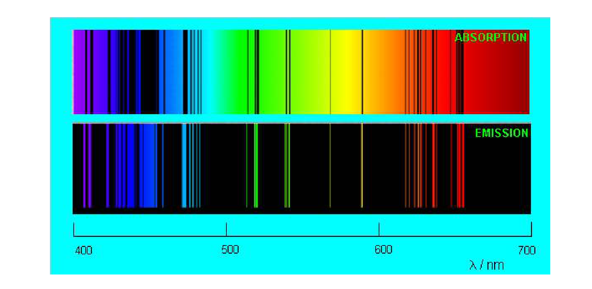

Если сквозь холодный разреженный газ пропустить свет с непрерывным спектром, то на его
фоне появятся тёмные линии — спектр поглощения.

> **EN** An atom can absorb light only of strictly definite wavelengths, exactly those
> which it emits itself; hence the dark lines of the absorption spectrum coincide with
> the bright lines of the emission spectrum.
>
> **RU** Атом может поглощать свет лишь строго определённых длин волн — ровно тех,
> которые сам излучает; поэтому тёмные линии спектра поглощения совпадают с яркими
> линиями спектра испускания.

Совпадение линий испускания и поглощения говорит о том, что атом не является неделимой
частицей: внутри него есть механизм излучения и поглощения света, различный у разных
элементов.

### Спектральный анализ / Spectral analysis

> **EN** Spectral analysis is a method of determining the chemical composition of a
> substance by comparing its spectrum with the reference spectra of chemical elements.
>
> **RU** Спектральный анализ — метод определения химического состава вещества путём
> сопоставления его спектра с эталонными спектрами химических элементов.

Спектры служат «паспортами» элементов: по линиям устанавливают не только наличие
элемента (качественный анализ), но при определённых условиях и его количество. Так были
открыты цезий и рубидий (названные по цвету линий спектра) и в 1868 году — гелий
(от греч. «гелиос» — солнце), впервые найденный в спектре Солнца. Спектральный анализ
показал, что звёзды состоят из тех же элементов, что и Земля.

---

## 6.5. Строение атома / Structure of the atom

### Модель Томсона / Thomson's model

Первую модель атома предложил Джозеф Джон Томсон (Нобелевская премия за открытие
электрона); физики шутливо называли её «пудинг с изюмом».

> **EN** Thomson's model represents the atom as a ball of size ~10⁻⁸ cm with a positive
> charge distributed over its volume, in which electrons are embedded like raisins,
> leaving the atom electrically neutral.
>
> **RU** Модель Томсона: атом — шар размером порядка 10⁻⁸ см, по объёму которого
> распределён положительный заряд, а внутри, подобно изюминкам, находятся электроны;
> атом в целом электрически нейтрален.

Излучение атомов в этой модели объяснялось колебаниями электронов около положений
равновесия, но экспериментальные данные по спектрам модель не объясняла.

- **Автор:** Джозеф Джон Томсон (Joseph John Thomson)
- **Труд:** модель атома («пудинг с изюмом»), конец XIX — начало XX в.

### Опыты Резерфорда / Rutherford's experiments

Ученик Томсона Эрнест Резерфорд для проверки модели предложил бомбардировать атом
высокоэнергетичными α-частицами (ядрами гелия: заряд `+2e`, масса примерно в 8000 раз
больше массы электрона) и наблюдать их рассеяние. Пучок α-частиц направляли на тонкую
золотую фольгу.

Подавляющая часть частиц проходила почти не отклоняясь, но примерно одна из нескольких
тысяч отклонялась на угол более 90°. По словам Резерфорда, это было столь же невероятно,
как если бы артиллерийский снаряд отскочил назад от листа бумаги. Расчёты показали: поле
положительного заряда, «размазанного» по всему атому (модель Томсона), слишком слабо,
чтобы отбросить частицу назад. Модель Томсона была опровергнута.

### Планетарная модель атома / Planetary model of the atom

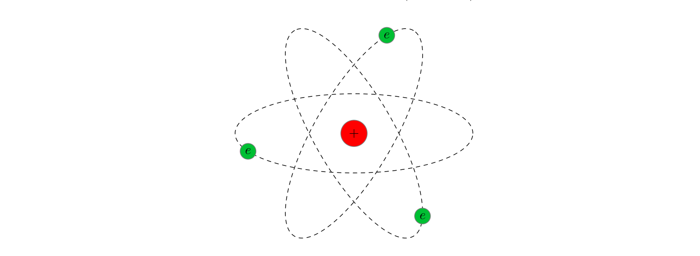

Чтобы отбросить α-частицу, положительный заряд должен быть сосредоточен в области,
гораздо меньшей атома. Оценка Резерфорда дала размер этой области `r ~ 10⁻¹³ см` — на
пять порядков меньше атома. Так возникла планетарная модель.

> **EN** In the planetary model a tiny positively charged nucleus sits at the centre of
> the atom, with electrons moving around it like planets around the Sun; Coulomb
> attraction keeps them, but motion prevents them from falling onto the nucleus.
>
> **RU** В планетарной модели в центре атома находится крошечное положительно
> заряженное ядро, вокруг которого, как планеты вокруг Солнца, движутся электроны;
> кулоновское притяжение их удерживает, а движение не даёт упасть на ядро.

Заряд ядра по модулю равен суммарному заряду электронов — атом нейтрален. Почти вся
масса атома сосредоточена в ядре: у водорода масса электрона в 1836 раз меньше массы
ядра. Масштаб: если атом увеличить до размеров телебашни (500 м), ядро окажется
горошиной 5 мм.

- **Автор:** Эрнест Резерфорд (Ernest Rutherford)
- **Труд:** опыты по рассеянию α-частиц (1911); планетарная модель атома.

---

## 6.6. Атом Бора / Bohr's atom

Планетарная модель столкнулась с противоречием: движущийся с ускорением электрон должен
непрерывно излучать, терять энергию и за время порядка `10⁻⁸` с упасть на ядро. Но атомы
устойчивы. Значит, внутри атома классические законы не действуют.

### Постулаты Бора / Bohr's postulates

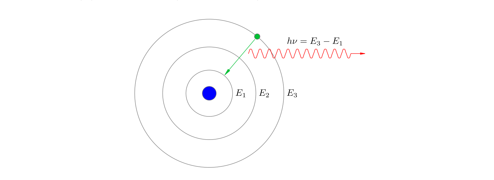

Нильс Бор предложил три постулата, резко расходящиеся с классической физикой.

> **EN** First postulate: an atom can exist only in a discrete set of stationary
> states with definite energies `E₁, E₂, …, Eₙ, …`; in a stationary state the atom does
> not radiate electromagnetic waves.
>
> **RU** Первый постулат: атом может находиться лишь в дискретном наборе стационарных
> состояний с определёнными энергиями `E₁, E₂, …, Eₙ, …`; находясь в стационарном
> состоянии, атом не излучает электромагнитных волн.

> **EN** Second postulate: when an atom passes from a state with higher energy `Eₙ` to
> a state with lower energy `E_k`, it emits a photon of energy `hν = Eₙ − E_k`; the same
> formula works for absorption.
>
> **RU** Второй постулат: при переходе атома из состояния с большей энергией `Eₙ` в
> состояние с меньшей энергией `E_k` излучается фотон с энергией `hν = Eₙ − E_k`; та же
> формула работает и при поглощении.

$$h\nu = E_n - E_k. \tag{6.13}$$

Существование стационарных состояний подтвердил опыт Франка и Герца (1913). Значения
`E₁, E₂, …` называют уровнями энергии атома. Из (6.13) понятно, почему спектры
линейчаты: атом излучает и поглощает лишь фотоны определённых частот — разностей
уровней энергии. Поэтому тёмные линии поглощения холодного газа совпадают с яркими
линиями испускания нагретого.

**Третий постулат (правило квантования)** формулируется при построении теории атома
водорода (см. ниже).

- **Автор:** Нильс Бор (Niels Bohr)
- **Труд:** постулаты и теория атома водорода (1913).

### Атом водорода / The hydrogen atom

Атом водорода — ядро (протон, заряд `+e`) и один электрон (`−e`). Для его описания Бор
принял три дополнительных предположения.

1. Рассматриваются только круговые орбиты электрона.
2. **Правило квантования:** момент импульса электрона `mvr` принимает лишь дискретные
   значения, кратные `ℏ`:

$$mvr = n\hbar \qquad (n = 1, 2, 3, \ldots). \tag{6.14}$$

3. Движение электрона описывается законом Кулона и вторым законом Ньютона:

$$\frac{mv^2}{r} = k\frac{e^2}{r^2}. \tag{6.15}$$

Перепишем (6.15) как `mv² = ke²/r` и подставим скорость из (6.14): `v = nℏ/(mr)`.
Получаем допустимые радиусы орбит:

$$r_n = \frac{\hbar^2 n^2}{kme^2}. \tag{6.17}$$

Потенциальная энергия кулоновского взаимодействия `W = −ke²/r` (отсчитывается от
бесконечности), кинетическая — `mv²/2`. Полная энергия электрона:

$$E = \frac{mv^2}{2} - \frac{ke^2}{r} = -\frac{ke^2}{2r}. \tag{6.18}$$

Подставляя дискретные значения радиуса (6.17), получаем уровни энергии:

$$E_n = -\frac{ke^2}{2r_n} = -\frac{k^2 m e^4}{2\hbar^2 n^2} \qquad (n = 1, 2, 3, \ldots). \tag{6.19}$$

Основное состояние (наименьшая энергия): `E₁ = −13,6 эВ`. Энергия ионизации водорода,
то есть минимальная энергия для вырывания электрона, равна `13,6 эВ`. Радиус первой
орбиты `r₁ = 5·10⁻⁹ см` — теория Бора впервые объяснила размер атома.

Из второго постулата и (6.19) выводится частота излучения:

$$\nu = \frac{E_n - E_k}{h} = \frac{k^2 m e^4}{4\pi\hbar^3}\left(\frac{1}{k^2} - \frac{1}{n^2}\right). \tag{6.20}$$

Через длину волны (`ν = c/λ`):

$$\frac{1}{\lambda} = R\left(\frac{1}{k^2} - \frac{1}{n^2}\right), \qquad R = 1{,}1\cdot 10^{7}\ \text{м}^{-1}. \tag{6.21}$$

Константа `R` — постоянная Ридберга; теория Бора даёт её значение в хорошем согласии
с опытом. Длины волн образуют серии при фиксированном `k`:

- **Серия Лаймана** (переходы в `E₁`, `k = 1`): ультрафиолет.
- **Серия Бальмера** (`k = 2`): первые четыре линии в видимой области.
- **Серия Пашена** (`k = 3`): инфракрасная область.
- Серии Брэккета (`k = 4`), Пфунда (`k = 5`), Хэмпфри (`k = 6`): далёкий инфракрасный
  диапазон.

### Достоинства и недостатки теории Бора / Merits and drawbacks of Bohr's theory

**Достоинства.** Теория Бора показала, что классической физики недостаточно для описания
микромира: там царит квантование (дискретность), мерой которого служит постоянная
Планка `ℏ`. Бор установил наличие стационарных состояний и впервые вычислил частоты
спектра водорода и размер атома.

**Недостатки.** Теория непоследовательна: с одной стороны, она вводит квантовые
постулаты, с другой — использует классические законы (Кулона и Ньютона) для движения
электрона. Она не справилась даже с атомом гелия, не объясняла интенсивности линий и
механизм образования молекулы H₂. Тем не менее теория Бора стала промежуточным звеном
между классической физикой и квантовой механикой 1920-х годов.

---

## 6.7. Лазер / Laser

Лазер (оптический квантовый генератор) — выдающееся достижение физики XX века. Слово
«лазер» — аббревиатура от *Light Amplification by Stimulated Emission of Radiation*:
«усиление света с помощью вынужденного (индуцированного) излучения».

### Индуцированное излучение / Stimulated emission

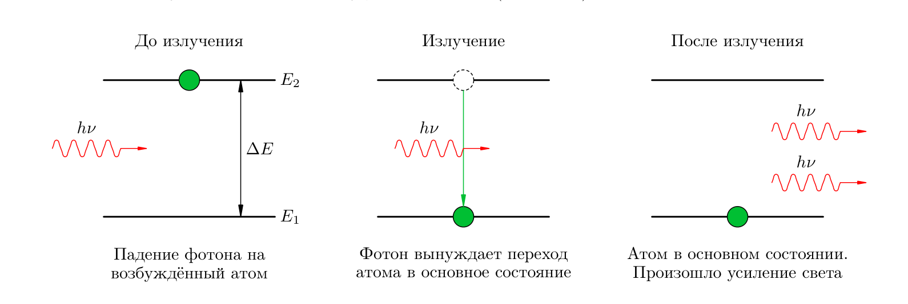

Возбуждённый атом, предоставленный сам себе, переходит в основное состояние
самопроизвольно; такое излучение называется спонтанным и некогерентно. Но атом можно
заставить излучить фотон внешним электромагнитным полем подходящей частоты.

> **EN** Radiation of an atom caused by an external electromagnetic field of the
> transition frequency is called stimulated (induced) emission; the emitted photon is
> identical to the incident one.
>
> **RU** Излучение атома, вызванное внешним электромагнитным полем с частотой
> перехода, называется вынужденным (индуцированным); испущенный фотон тождествен
> падающему.

Под действием падающего фотона `hν = E₂ − E₁` электрон соскакивает с верхнего уровня на
нижний, и вместо одного фотона «на входе» возникают два фотона-близнеца — совпадающие
по частоте и фазе. Их волны, интерферируя, усиливают друг друга. Возможность
индуцированного излучения предсказал А. Эйнштейн (1916).

### Инверсная населённость / Population inversion

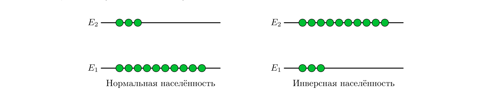

При прохождении света через вещество идут два противоположных процесса: поглощение
атомами в основном состоянии и усиление за счёт индуцированного излучения возбуждённых
атомов.

> **EN** In normal population most atoms are in the ground state, so absorption
> dominates and the light is weakened. Population inversion is a state with most atoms
> excited; then stimulated emission prevails and the light is amplified.
>
> **RU** При нормальной населённости большинство атомов в основном состоянии, поэтому
> поглощение преобладает и свет ослабляется. Инверсная населённость — состояние, когда
> большинство атомов возбуждено; тогда индуцированное излучение преобладает и свет
> усиливается.

Двумя уровнями инверсную населённость не создать: те же фотоны, что возбуждают атомы,
вызывают и обратные переходы. Нужны три уровня.

### Трёхуровневая система рубина / Three-level ruby system

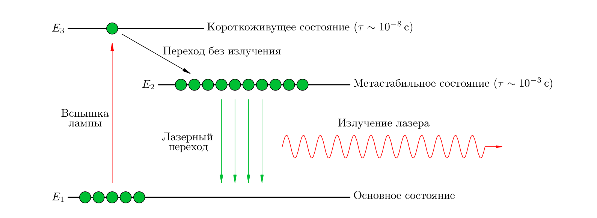

Классическая схема — три уровня `E₁` (основной), `E₃` (короткоживущий) и `E₂`
(долгоживущий, метастабильный); такие уровни есть в кристалле рубина.

Мощная вспышка лампы переводит большинство атомов из `E₁` в `E₃`. Уровень `E₃` живёт
очень мало (`τ ~ 10⁻⁸` с), и электроны соскакивают с него вниз — но не на `E₁`, а на
промежуточный уровень `E₂`, причём без излучения (энергия уходит в тепловые колебания
решётки). Время жизни `E₂` огромно — порядка `10⁻³` с (в 100 000 раз больше), поэтому
атомы накапливаются на нём и возникает инверсная населённость.

Затем достаточно немногих спонтанных переходов `E₂ → E₁`, чтобы вызванные ими фотоны
породили лавину индуцированных переходов: атомы излучают синхронно, «в такт», и
излучение получается когерентным — в отличие от некогерентного света лампы накаливания.

### Устройство лазера / Structure of the laser

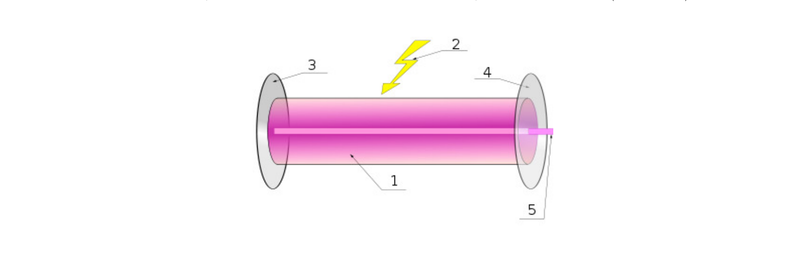

Основные части лазера: активная среда (например, кристалл рубина), в которой вспышкой
создаётся инверсная населённость, и два зеркала на её торцах — непрозрачное и
полупрозрачное.

Зеркала обеспечивают обратную связь: световой импульс, идущий вдоль оси, многократно
отражается и проходит сквозь активную среду, вынуждая светиться всё больше атомов и всё
сильнее усиливаясь; полупрозрачное зеркало частично выпускает луч наружу. Лучи, идущие
под углом к оси, рано или поздно выходят через боковую поверхность и не усиливаются —
поэтому лазерный луч имеет очень малую расходимость и даёт маленькое пятно даже на
далёких предметах.

---

## 6.8. Строение ядра / Structure of the nucleus

После опытов Резерфорда встал вопрос: из чего состоит ядро? Ответ дало открытие нейтрона
(Джеймс Чедвик, 1932). Протон имеет заряд `e = 1,6·10⁻¹⁹ Кл` и массу
`m_p = 1,6726·10⁻²⁷ кг` (в 1836 раз больше массы электрона); нейтрон почти такой же по
массе (`m_n = 1,6749·10⁻²⁷ кг`), но не имеет заряда.

### Нуклонная модель ядра / Nucleon model of the nucleus

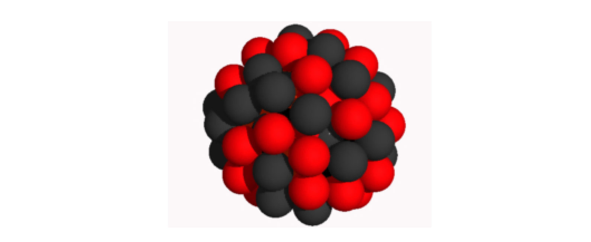

> **EN** According to the nucleon (proton–neutron) model the nucleus consists of
> protons and neutrons, collectively called nucleons.
>
> **RU** Согласно нуклонной (протонно-нейтронной) модели ядро состоит из протонов и
> нейтронов, называемых общим именем нуклоны.

Число протонов в ядре называют **зарядовым числом** `Z` (заряд ядра `Ze`); так как атом
нейтрален, `Z` совпадает с числом электронов, то есть с порядковым номером элемента
в таблице Менделеева. Общее число нуклонов — **массовое число** `A`; число нейтронов —
`A − Z`. Ядро обозначают `ᴬ_ZᵢX`: например, алюминий `²⁷₁₃Al` — 13 протонов и 14
нейтронов; ядро гелия `⁴₂He` (α-частица) — 2 протона и 2 нейтрона.

### Изотопы / Isotopes

Если изменить число нейтронов в ядре, плотность и некоторые свойства изменятся, но
химические свойства останутся прежними: они определяются зарядовым числом `Z`.

> **EN** Isotopes are varieties of the same chemical element differing in the number of
> neutrons in the nucleus.
>
> **RU** Изотопы — разновидности одного и того же химического элемента, различающиеся
> числом нейтронов в ядре.

**Пример.** У водорода три изотопа: обычный `¹₁H`, дейтерий `²₁H` и тритий `³₁H`.
Уран имеет 26 изотопов; в природе преобладает `²³⁸₉₂U`, а в энергетике используется
`²³⁵₉₂U`. Изотопы химически неразделимы, поэтому атомные массы элементов не целые
(например, хлор 35,5). Изотопы могут различаться и радиоактивностью: углерод `¹²₆C`
стабилен, а `¹⁴₆C` радиоактивен.

- **Автор:** Джеймс Чедвик (James Chadwick)
- **Труд:** открытие нейтрона (1932).

---

## 6.9. Радиоактивность / Radioactivity

Радиоактивность случайно открыл Анри Беккерель в 1896 году: соль урана, пролежавшая в
ящике стола поверх завёрнутой в чёрную бумагу фотопластинки, засветила её — без всякого
солнечного света. Выяснилось, что уран сам испускает проникающее излучение. Позже Мария
Склодовская-Кюри обнаружила радиоактивность тория, вместе с Пьером Кюри открыла
полоний и выделила из руды радий, излучающий в три миллиона раз интенсивнее урана.

- **Автор:** Анри Беккерель (Henri Becquerel); Мария Склодовская-Кюри (Marie Skłodowska-Curie) и Пьер Кюри (Pierre Curie)
- **Труд:** открытие радиоактивности (1896); открытие полония и радия (1898).

### Виды радиоактивных излучений / Kinds of radioactive radiation

В магнитном поле радиоактивное излучение распадается на три компоненты, что указывает на
три типа лучей.

> **EN** α-radiation is a stream of helium nuclei; β-radiation is a stream of electrons
> flying at speeds close to that of light; γ-radiation is electromagnetic waves of very
> high frequency (higher than X-rays).
>
> **RU** α-излучение — поток ядер гелия; β-излучение — поток электронов, мчащихся со
> скоростями, близкими к скорости света; γ-излучение — электромагнитные волны очень
> высокой частоты (выше, чем у рентгеновского излучения).

Проникающая способность наибольшая у γ-лучей (пробивают слой свинца в несколько
сантиметров); β-лучи поглощаются миллиметрами свинца; α-частицы не проходят даже лист
бумаги.

### Радиоактивные превращения / Radioactive transformations

Радиоактивность сопровождается превращением одних элементов в другие; при этом
сохраняются суммарное массовое число и суммарный заряд. Пример — начало радиоактивного
семейства урана:

$${}^{238}_{92}\mathrm{U} \to {}^{234}_{90}\mathrm{Th} + {}^{4}_{2}\mathrm{He}, \tag{6.22}$$

$${}^{234}_{90}\mathrm{Th} \to {}^{234}_{91}\mathrm{Pa} + {}^{0}_{-1}e. \tag{6.23}$$

Электрону приписывают зарядовое число `−1` и массовое число `0`. Общее правило:

> **EN** Displacement rule: after an α-decay the element shifts two places towards the
> beginning of the periodic table; after a β-decay — one place towards its end.
>
> **RU** Правило смещения: после α-распада элемент смещается на две клетки к началу
> периодической системы, после β-распада — на одну клетку к её концу.

$${}^{A}_{Z}\mathrm{X} \to {}^{A-4}_{Z-2}\mathrm{Y} + {}^{4}_{2}\mathrm{He}, \qquad {}^{A}_{Z}\mathrm{X} \to {}^{A}_{Z+1}\mathrm{Y} + {}^{0}_{-1}e.$$

В семействе урана происходит восемь α-распадов и шесть β-распадов, пока цепочка не
заканчивается стабильным ядром свинца `²⁰⁶₈₂Pb`.

### Закон радиоактивного распада / Law of radioactive decay

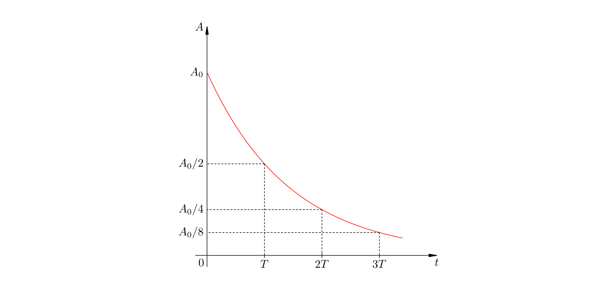

Нестабильное ядро распадается самопроизвольно в случайный момент; но у каждого элемента
— строго определённая скорость распада, характеризуемая периодом полураспада.

> **EN** The half-life `T` is the time in which half of the given radioactive atoms
> decay.
>
> **RU** Период полураспада `T` — время, в течение которого распадается половина
> имеющихся радиоактивных атомов.

Период полураспада сильно различается: у `²³⁸U` он 4,5 млрд лет, у `²²⁶Ra` — 1600 лет,
у `²²²Rn` — всего 3,8 суток. Пусть начальное число атомов `N₀`. Спустя время `T` остаётся
`N₀/2`, спустя `2T` — `N₀/4`, спустя `kT` — `N₀·2⁻ᵏ`. Отсюда закон радиоактивного
распада:

$$N = N_0 \cdot 2^{-t/T}. \tag{6.24}$$

Число нераспавшихся атомов — показательная функция, убывающая со временем. Другая
характеристика — **активность** (число распадов в единицу времени):

$$A = A_0 \cdot 2^{-t/T}.$$

Активность убывает тем быстрее, чем меньше период полураспада.

---

## 6.10. Энергия связи ядра / Nuclear binding energy

Что удерживает нуклоны в ядре? Электрическое отталкивание двух протонов в `10³⁶` раз
превосходит их гравитационное притяжение — значит, тяготение ни при чём. Существует
особый вид взаимодействия — ядерные силы.

### Ядерные силы / Nuclear forces

Ядерные силы — проявление **сильного взаимодействия**, третьего типа взаимодействий
в природе (после гравитационного и электромагнитного).

> **EN** Nuclear forces act between any two nucleons, are ~100 times stronger than the
> electric repulsion of protons, and are short-range: their radius of action is about
> 10⁻¹⁵ m (the size of the nucleus); at distances below 10⁻¹⁵ m they become repulsive.
>
> **RU** Ядерные силы действуют между любыми двумя нуклонами, примерно в 100 раз
> превосходят электрическое отталкивание протонов и короткодействующи: радиус их
> действия около 10⁻¹⁵ м (размер ядра); на расстояниях меньше 10⁻¹⁵ м они становятся
> силами отталкивания.

Сильное взаимодействие фундаментально и не сводится к другим; частицы, способные к
нему (протоны, нейтроны и др.), называют адронами. Электроны и фотоны адронами не
являются.

### Атомная единица массы / Atomic mass unit

Массы атомов малы, поэтому в ядерной физике используют атомную единицу массы (а. е. м.) —
`1/12` массы атома углерода `¹²₆C`:

$$1\ \text{а. е. м.} = 1{,}66054\cdot 10^{-27}\ \text{кг}.$$

Энергия покоя массы `m` даётся формулой Эйнштейна:

$$E = mc^2. \tag{6.25}$$

Малая единица энергии — электронвольт:

$$1\ \text{эВ} = 1{,}60218\cdot 10^{-19}\ \text{Дж}. \tag{6.27}$$

Отсюда энергетический эквивалент атомной единицы массы:

$$1\ \text{а. е. м.} \leftrightarrow 931{,}5\ \text{МэВ}. \tag{6.28}$$

Массы частиц: протон `m_p = 1{,}00728` а. е. м. (938,3 МэВ), нейтрон
`m_n = 1{,}00867` а. е. м. (939,6 МэВ), электрон `m_e = 5{,}486·10⁻⁴` а. е. м.
(0,511 МэВ).

**Дефект массы и энергия связи.** Сумма масс нуклонов ядра больше массы самого ядра.
Разность

$$\Delta m = Z m_p + N m_n - M$$

называется **дефектом массы**. Ему отвечает энергия

$$E_{\text{св}} = \Delta m\, c^2 = (Z m_p + N m_n - M)c^2. \tag{6.25'}$$

> **EN** The binding energy of a nucleus is the minimum work needed to split the
> nucleus into its constituent nucleons.
>
> **RU** Энергия связи ядра — минимальная работа, которую нужно совершить для
> расщепления ядра на составляющие его нуклоны.

**Пример.** Для ядра гелия `⁴₂He`: масса ядра `4,00150` а. е. м., сумма масс двух
протонов и двух нейтронов `4,03190` а. е. м., дефект массы `Δm = 0,0304` а. е. м. и
энергия связи `E_св = 0,0304 · 931,5 ≈ 28 МэВ`.

### Удельная энергия связи / Specific binding energy

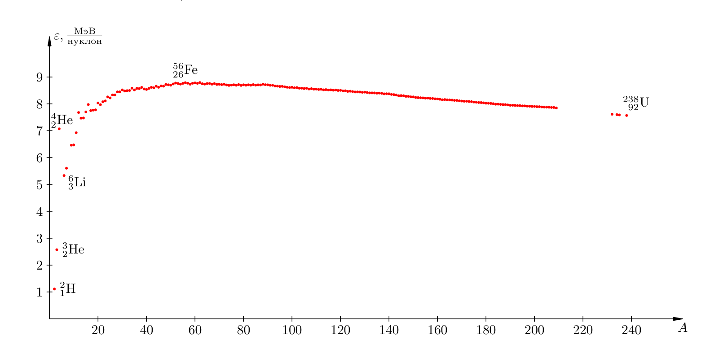

Прочность ядра характеризуется удельной энергией связи — энергией связи, приходящейся
на один нуклон:

$$\varepsilon = \frac{E_{\text{св}}}{A}.$$

У лёгких элементов `ε` растёт с `A`, достигая максимума `8,8 МэВ/нуклон` в окрестности
железа `⁵⁶₂₆Fe` (`50 ⩽ A ⩽ 65`), затем плавно убывает до `7,6 МэВ/нуклон` у `²³⁸₉₂U`.
Такой ход объясняется конкуренцией двух факторов: у малых ядер много «поверхностных»
нуклонов, связанных с малым числом соседей (с ростом `A` доля внутренних нуклонов
растёт, и `ε` увеличивается), а у больших ядер растёт кулоновское отталкивание протонов,
ослабляющее ядро (`ε` убывает). Максимум `ε` — область самых прочных ядер.

### Насыщение ядерных сил / Saturation of nuclear forces

Перевес кулоновского фактора у тяжёлых ядер указывает на важное свойство ядерных сил —
их насыщение.

> **EN** Saturation of nuclear forces means that each nucleon interacts strongly only
> with a small number of neighbours, and this number does not depend on the size of the
> nucleus.
>
> **RU** Насыщение ядерных сил означает, что каждый нуклон связан сильным
> взаимодействием лишь с небольшим числом соседей, и это число не зависит от размеров
> ядра.

Если бы насыщения не было, каждый нуклон скреплялся бы со всё большим числом нуклонов
и удельная энергия связи неограниченно росла бы с ростом `A`.

---

## 6.11. Ядерные реакции / Nuclear reactions

Скорость радиоактивного распада не зависит от давления, температуры и полей; для
превращения элементов нужны «снаряды» больших энергий. В 1919 году Резерфорд,
бомбардируя азот α-частицами, осуществил первую ядерную реакцию:

$${}^{14}_{7}\mathrm{N} + {}^{4}_{2}\mathrm{He} \to {}^{17}_{8}\mathrm{O} + {}^{1}_{1}\mathrm{H}. \tag{6.29}$$

Высокие энергии дают ускорители: они разгоняют любые заряженные частицы (особенно
протоны, испытывающие наименьшее отталкивание) до энергий на порядки выше, чем у
α-частиц. Протонами из ускорителя в 1932 году разбили литий:

$${}^{7}_{3}\mathrm{Li} + {}^{1}_{1}\mathrm{H} \to {}^{4}_{2}\mathrm{He} + {}^{4}_{2}\mathrm{He}. \tag{6.30}$$

При облучении бериллия α-частицами был открыт нейтрон; из-за отсутствия заряда нейтроны
беспрепятственно проникают в ядра. В опытах с реакциями открыли и искусственную
радиоактивность — изотопы, не встречающиеся в природе.

### Энергетический выход ядерной реакции / Energy yield of a nuclear reaction

Полная энергия частицы массы `m` есть сумма её энергии покоя и кинетической энергии:
`E = mc² + K`. В реакции `A + B → X + Y` полная энергия сохраняется, а кинетическая —
нет. Энергетический выход реакции `Q` — разность кинетических энергий продуктов и
исходных частиц:

$$Q = (K_X + K_Y) - (K_A + K_B) = (m_A + m_B - m_X - m_Y)c^2. \tag{6.33}$$

> **EN** If `Q > 0` the reaction releases energy (the total mass of the products is
> less than that of the initial particles); if `Q < 0` it absorbs energy.
>
> **RU** Если `Q > 0`, реакция идёт с выделением энергии (суммарная масса продуктов
> меньше массы исходных частиц); если `Q < 0` — с поглощением.

**Пример.** Для реакции (6.30) `Q = 17,4 МэВ` (выделение энергии). Для реакции
`⁷₃Li + ⁴₂He → ¹⁰₅B + ¹₀n` разность масс отрицательна, `Q = −2,8 МэВ` — энергия
поглощается, и реакция возможна лишь при достаточной энергии исходных частиц.

Алгоритм расчёта `Q`: найти массы частиц в а. е. м. (вычтя массы электронов из масс
нейтральных атомов), вычислить разность масс `Δm` и умножить её на `931,5` (получаем
`Q` в МэВ).

### Деление ядер / Nuclear fission

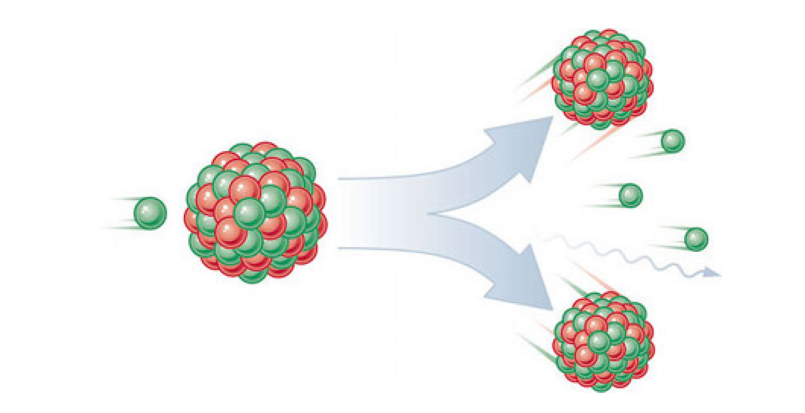

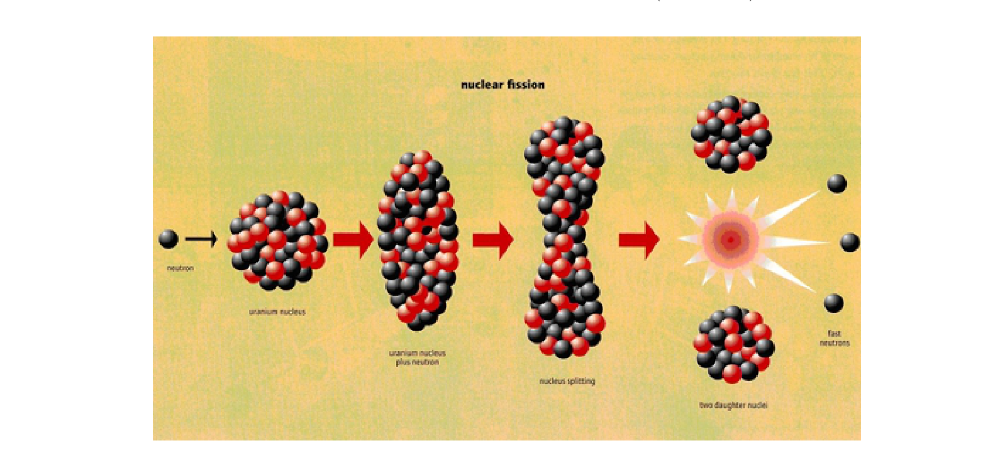

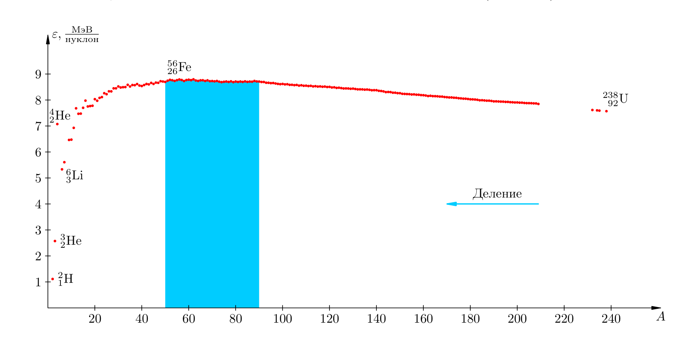

Бомбардируя уран медленными нейтронами, Ган и Штрассман обнаружили появление элементов
середины периодической системы: бария, криптона, стронция, рубидия, цезия. Так было
открыто деление ядер урана. Захватив нейтрон, ядро урана делится на два осколка, издавая
при этом два-три нейтрона. Например:

$${}^{235}_{92}\mathrm{U} + {}^{1}_{0}n \to {}^{144}_{56}\mathrm{Ba} + {}^{89}_{36}\mathrm{Kr} + 3\,{}^{1}_{0}n.$$

При каждом делении выделяется порядка 200 МэВ. Причина: из-за 92 протонов кулоновское
отталкивание в ядре урана огромно; захваченный нейтрон вызывает деформацию, колебания
и, наконец, разрыв ядра на осколки, разлетающиеся со скоростью около `c/30`. С точки
зрения графика удельной энергии связи деление тяжёлых ядер выгодно: ε растёт примерно
на `1 МэВ/нуклон`.

- **Автор:** Отто Ган (Otto Hahn) и Фриц Штрассман (Fritz Strassmann)
- **Труд:** открытие деления ядер урана (1938).

### Цепная ядерная реакция / Chain nuclear reaction

Высвобождающиеся при делении нейтроны могут попадать в новые ядра и вызывать их
деление, порождая новые поколения нейтронов. Так идёт цепная ядерная реакция.
Характеристика процесса — коэффициент размножения нейтронов:

$$k = \frac{N_i}{N_{i-1}}.$$

> **EN** A chain reaction proceeds when the multiplication factor `k ⩾ 1`; if `k > 1`
> the number of neutrons grows like an avalanche (uncontrolled reaction, an atomic-bomb
> explosion); in a reactor a controlled reaction with `k = 1` is maintained.
>
> **RU** Цепная реакция идёт при коэффициенте размножения `k ⩾ 1`; при `k > 1` число
> нейтронов лавинно растёт (неуправляемая реакция, взрыв атомной бомбы); в реакторе
> поддерживается управляемая реакция с `k = 1`.

Управление в реакторе обеспечивают стержни, поглощающие нейтроны: при полностью
введённых стержнях `k < 1` и реакция не идёт; при запуске их постепенно выводят.

### Термоядерная реакция / Thermonuclear reaction

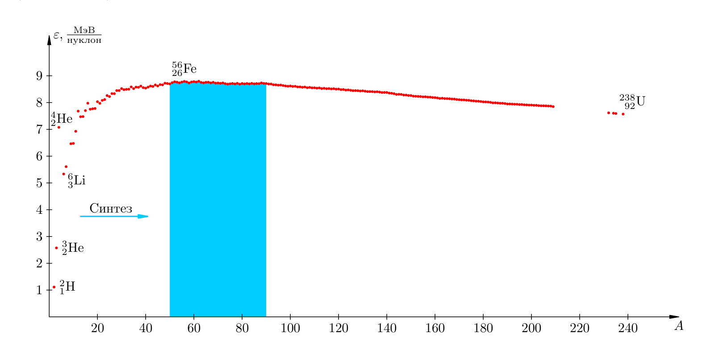

Энергетически выгоден и обратный процесс — синтез лёгких ядер. Чтобы ядра слились, их
нужно сблизить вплотную, преодолев кулоновское отталкивание, — это требует огромной
кинетической энергии ядер, то есть температур в десятки и сотни миллионов градусов.
Поэтому синтез называют термоядерной реакцией.

$${}^{2}_{1}\mathrm{H} + {}^{3}_{1}\mathrm{H} \to {}^{4}_{2}\mathrm{He} + {}^{1}_{0}n. \tag{6.35}$$

Реакция дейтерий + тритий выделяет 17,6 МэВ — примерно 3,5 МэВ на нуклон (при делении
урана — лишь 1 МэВ/нуклон). При делении высвобождается энергия электрического
взаимодействия, при синтезе — более мощного сильного взаимодействия.

Термоядерные реакции — источник энергии Солнца и звёзд (образование гелия из водорода и
более тяжёлых элементов). Неуправляемый синтез осуществляется при взрыве водородной
бомбы (атомная бомба создаёт нужные температуру и давление); управляемый термоядерный
синтез — пока нерешённая задача, решение которой дало бы человечеству практически
неограниченный источник энергии.

---

## Авторы и труды (сводка) / Authors and works (summary)

| Закон / явление | Автор | Труд |
|---|---|---|
| Открытие фотоэффекта | Генрих Герц | опыты 1887 г. |
| Законы фотоэффекта | А. Г. Столетов | опыты 1888–1890 гг. |
| Гипотеза квантов, формула Планка | Макс Планк | теория теплового излучения (1900) |
| Уравнение фотоэффекта | Альберт Эйнштейн | статья о световых квантах (1905) |
| Давление света (теория) | Джеймс Клерк Максвелл | электродинамика |
| Давление света (опыт) | П. Н. Лебедев | опыты 1900 г. |
| Гипотеза о волнах материи | Луи де Бройль | гипотеза 1924 г. |
| Дифракция электронов | Дэвиссон и Джермер | опыт 1927 г. |
| Соотношение неопределённостей | Вернер Гейзенберг | 1927 г. |
| Модель атома («пудинг с изюмом») | Дж. Дж. Томсон | конец XIX — начало XX в. |
| Планетарная модель атома | Эрнест Резерфорд | опыты по рассеянию α-частиц (1911) |
| Постулаты и теория атома водорода | Нильс Бор | 1913 г. |
| Открытие нейтрона | Джеймс Чедвик | 1932 г. |
| Открытие радиоактивности | Анри Беккерель | 1896 г. |
| Полоний и радий | Мария Склодовская-Кюри, Пьер Кюри | 1898 г. |
| Деление ядер урана | Отто Ган, Фриц Штрассман | 1938 г. |

> **Примечание.** Формулы, определения физических величин и законы природы не
> являются объектами авторского права и могут свободно излагаться. Текст выше
> пересказан по учебной литературе; графики извлечены из пособия И. В. Яковлева
> (MathUs.ru) в ознакомительных целях.

