# Приложение. Векторы в физике / Vectors in physics

> Векторы — математический язык, на котором формулируются основные законы механики
> и электродинамики. Приложение излагает векторную алгебру: скалярные и векторные
> величины, сложение, умножение на скаляр, угол, проекцию, координаты и скалярное
> произведение. Определения даны EN+RU, формулы соответствуют пособию; текст
> пересказан, формулы и определения не охраняются авторским правом.

---

## П.1. Скалярные и векторные величины / Scalar and vector quantities

В физике встречаются два типа величин — скалярные и векторные.

> **EN** A scalar (scalar quantity) is a physical quantity that is completely specified
> by a single number together with its unit of measurement.
>
> **RU** Скалярная величина, или скаляр — физическая величина, для задания которой
> (в подходящих единицах измерения) достаточно одного числа.

Скаляров в физике много: масса `m = 3 кг`, температура `−10 °C`, напряжение `220 В`.
Каждая из таких величин задаётся одним числом. Но скаляр в физике — не просто число,
а число, снабжённое размерностью: сложить `3 кг` и `220 В` нельзя — складывать можно
лишь скаляры одинаковой размерности (массу с массой, напряжение с напряжением).

> **EN** A vector (vector quantity) is a physical quantity characterised by a
> non-negative scalar (its magnitude, or absolute value) together with a direction in
> space.
>
> **RU** Векторная величина, или вектор — физическая величина, характеризуемая
> неотрицательным скаляром (модулем вектора) и направлением в пространстве.

Скорость — вектор: мало знать, что автомобиль едет `60 км/ч`, нужно указать, куда.
Сила — тоже вектор: кирпич сдвинется или нет, зависит не только от величины силы
`100 Н`, но и от её направления (вверх, вбок или вниз — вжимая кирпич в пол).
Размерность вектора — это размерность его модуля.

Векторы обозначают буквами со стрелкой: `\vec{v}` (скорость), `\vec{F}` (сила).
Графически вектор — направленный отрезок (стрелка): её направление задаёт направление
вектора, а длина в выбранном масштабе — его модуль. Начало стрелки — начало вектора,
остриё — конец; вектор с началом в `A` и концом в `B` обозначают также `\overrightarrow{AB}`.

- **Нулевой вектор** — вектор, у которого начало и конец совпадают; это просто точка,
  он не имеет направления, а его длина (модуль) равна нулю.
- Модуль вектора обозначают той же буквой без стрелки: `v`, `F` (в математике — `|\vec{v}|`).
- **Коллинеарные** векторы лежат на одной прямой или на параллельных прямых; если их
  направления совпадают, они **сонаправлены**, если противоположны — **противоположно
  направлены**.
- **Равные** векторы — сонаправленные и равные по модулю; их начала и концы могут
  не совпадать, вектор можно переносить параллельно самому себе.

---

## П.2. Сложение векторов / Addition of vectors

Складывать в физике можно только векторы одинаковой размерности: скорость со скоростью,
силу с силой, но не скорость с силой.

### Правило треугольника / Triangle rule

Итог двух последовательных перемещений `\vec{s}_1` (из `A` в `B`) и `\vec{s}_2` (из `B` в `C`)
есть перемещение `\vec{s}`, соединяющее `A` с `C`; естественно считать его суммой:
`\vec{s} = \vec{s}_1 + \vec{s}_2`.

> **EN** Triangle rule: place the beginning of `\vec{b}` at the end of `\vec{a}`; the
> vector `\vec{a} + \vec{b}` joins the beginning of `\vec{a}` to the end of `\vec{b}`.
>
> **RU** Правило треугольника: поместим начало вектора `\vec{b}` в конец вектора
> `\vec{a}`; тогда сумма `\vec{a} + \vec{b}` соединяет начало `\vec{a}` с концом `\vec{b}`.

### Правило параллелограмма / Parallelogram rule

Совместное действие двух сил `\vec{F}_1` и `\vec{F}_2`, приложенных в одной точке `O`,
равноценно одной силе `\vec{F}` — диагонали параллелограмма, построенного на этих
векторах. Такая сила называется **равнодействующей** (результирующей) и считается их
суммой.

> **EN** Parallelogram rule: place the beginnings of `\vec{a}` and `\vec{b}` at one
> point; then `\vec{a} + \vec{b}` is the diagonal of the parallelogram built on them.
>
> **RU** Правило параллелограмма: поместим начала векторов `\vec{a}` и `\vec{b}` в одну
> точку; тогда сумма `\vec{a} + \vec{b}` — диагональ параллелограмма, построенного на них.

Оба правила дают один и тот же результат: перенеся `\vec{b}` параллельно так, чтобы его
начало попало в конец `\vec{a}`, мы приходим от параллелограмма к треугольнику. В физике
чаще пользуются правилом параллелограмма, ведь складываемые векторы (силы, скорости)
обычно приложены в одной точке. Правило треугольника работает и для коллинеарных
векторов, когда ни треугольника, ни параллелограмма не образуется.

### Свойства сложения векторов / Properties of vector addition

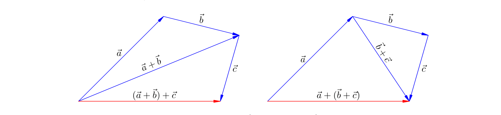

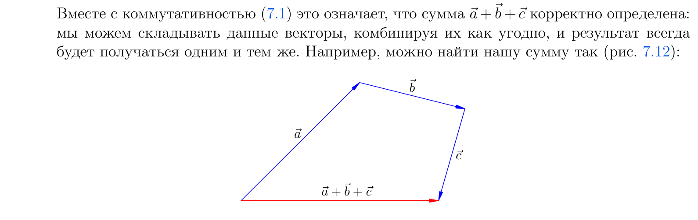

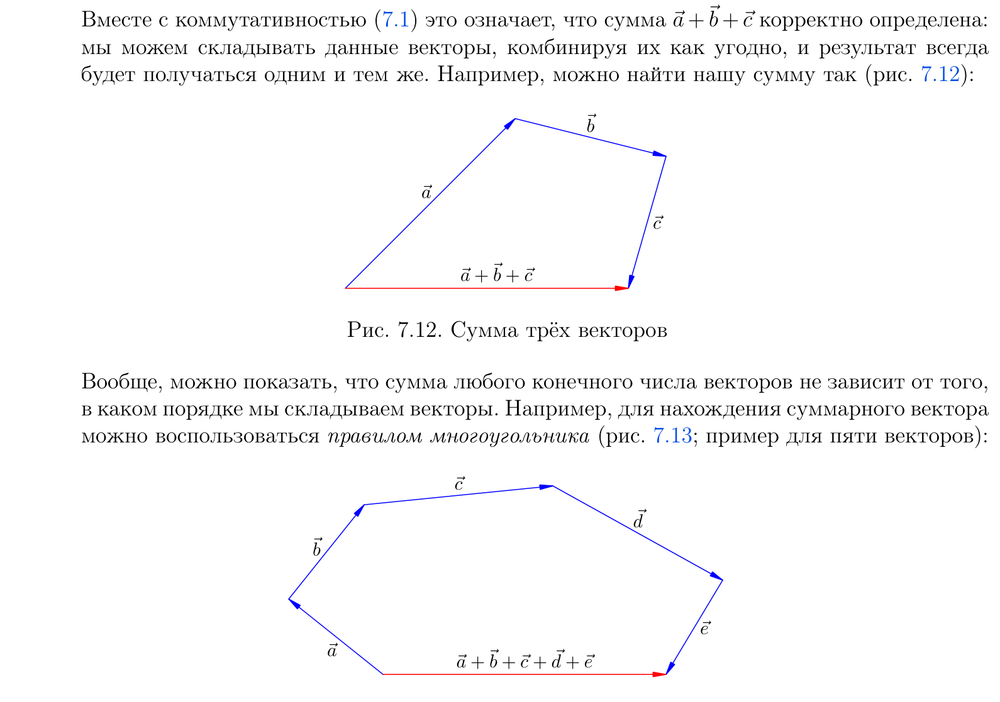

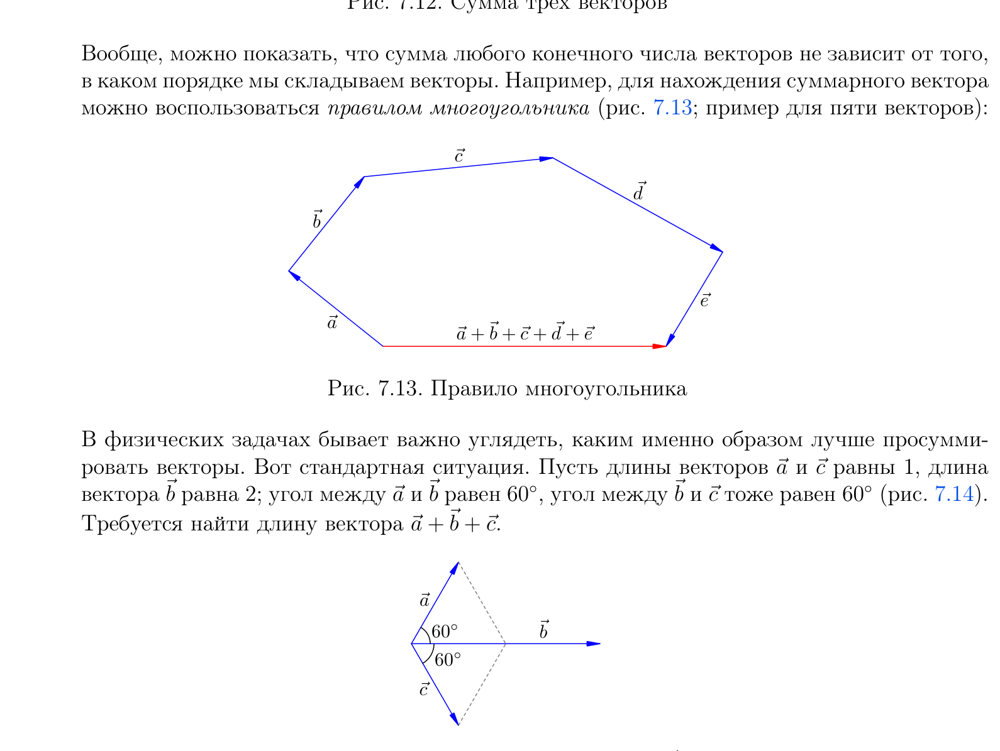

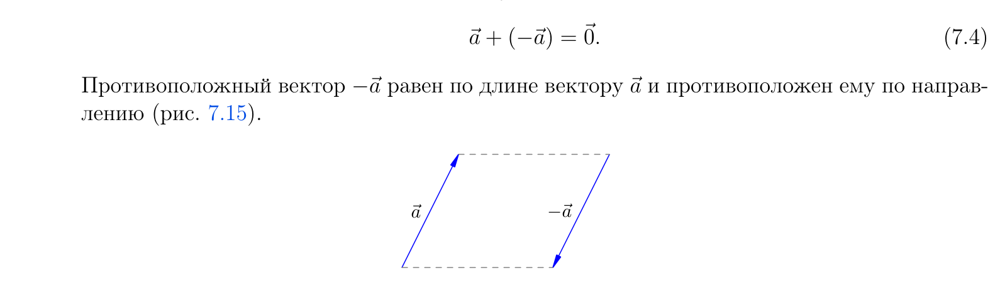

1. **Коммутативность.** От перестановки слагаемых сумма не меняется:

$$\vec{a} + \vec{b} = \vec{b} + \vec{a}$$

2. **Ассоциативность.** Сумма трёх и более векторов не зависит от порядка сложения:

$$(\vec{a} + \vec{b}) + \vec{c} = \vec{a} + (\vec{b} + \vec{c})$$

   Для любого конечного числа слагаемых работает **правило многоугольника**: приложив
   начало каждого следующего вектора к концу предыдущего, суммарный вектор соединяет
   начало первого с концом последнего.

3. **Нулевой вектор** не меняет сумму:

$$\vec{a} + \vec{0} = \vec{a}$$

4. **Противоположный вектор** `-\vec{a}` равен `\vec{a}` по длине и противоположен
   по направлению; сумма вектора и противоположного равна нулю:

$$\vec{a} + (-\vec{a}) = \vec{0}$$

### Вычитание векторов / Subtraction of vectors

Вычитание — это прибавление противоположного вектора: разность `\vec{a} - \vec{b}` есть
сумма `\vec{a} + (-\vec{b})`.

> **EN** To find `\vec{a} - \vec{b}`, bring the vectors to a common beginning and join
> the ends, pointing the arrow toward the vector from which subtraction is made
> (toward `\vec{a}`).
>
> **RU** Чтобы найти разность `\vec{a} - \vec{b}`, приведём векторы к общему началу и
> соединим их концы, направив стрелку к вектору, из которого вычитают (к `\vec{a}`).

Разность векторов постоянно встречается в механике. Так, ускорение — это изменение
скорости, делённое на время:

$$\vec{a} = \frac{\vec{v} - \vec{v}_0}{t}$$

где `\Delta\vec{v} = \vec{v} - \vec{v}_0` — изменение скорости.

**Пример.** Тело движется по окружности со скоростью `v`; за четверть периода оно
поворачивает на четверть окружности. Векторы `\vec{v}_1` и `\vec{v}_2` перпендикулярны,
и модуль изменения скорости `|\Delta\vec{v}| = v\sqrt{2}` (по теореме Пифагора).

---

## П.3. Умножение скаляра на вектор / Multiplication of a vector by a scalar

При умножении скаляра на вектор получается вектор; размерность произведения равна
произведению размерностей скаляра и вектора. В физике это повсюду:

$$\vec{s} = \vec{v}t \qquad \vec{p} = m\vec{v} \qquad m\vec{a} = \vec{F} \qquad \vec{F} = q\vec{E}$$

Скаляр не обязан быть положительным (заряд `q` в `\vec{F} = q\vec{E}` может быть и
отрицательным).

### Что такое умножение скаляра на вектор? / Definition

Пусть `\lambda` — скаляр. Запись `\vec{b} = \lambda\vec{a}` означает:

- `|\vec{b}| = |\lambda|\,|\vec{a}|`;
- при `\lambda > 0` вектор `\vec{b}` сонаправлен с `\vec{a}`, при `\lambda < 0` —
  противоположен ему (при `\lambda = 0` получаем нулевой вектор).

> **EN** Multiplying a vector by `\lambda` scales its length by `|\lambda|`; the
> direction stays the same for `\lambda > 0` and reverses for `\lambda < 0`.
>
> **RU** Умножение вектора на скаляр `\lambda` меняет его длину в `|\lambda|` раз:
> направление сохраняется при `\lambda > 0` и становится противоположным при `\lambda < 0`.

Разделить вектор на скаляр `\lambda \neq 0` — значит умножить его на `1/\lambda`.

### Свойства умножения скаляра на вектор / Properties

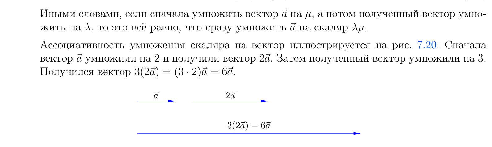

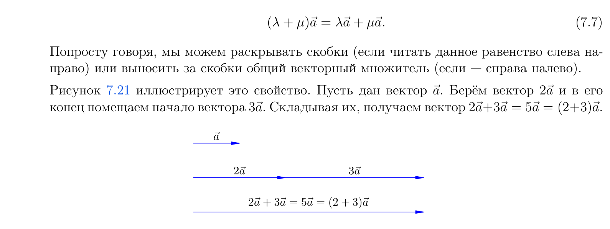

1. Умножение на единицу не меняет вектор: `1\cdot\vec{a} = \vec{a}`.
2. **Ассоциативность:**

$$\lambda(\mu\vec{a}) = (\lambda\mu)\vec{a}$$

3. **Дистрибутивность относительно сложения скаляров:**

$$(\lambda + \mu)\vec{a} = \lambda\vec{a} + \mu\vec{a}$$

4. **Дистрибутивность относительно сложения векторов:**

$$\lambda(\vec{a} + \vec{b}) = \lambda\vec{a} + \lambda\vec{b}$$

**Примеры.** Импульс системы двух тел одинаковой скорости `\vec{v}`:
`\vec{p} = m_1\vec{v} + m_2\vec{v} = (m_1 + m_2)\vec{v}`. Сила, действующая на заряд `q`
со стороны двух полей: `\vec{F} = q\vec{E}_1 + q\vec{E}_2 = q(\vec{E}_1 + \vec{E}_2)`.

Эти свойства позволяют обращаться с векторными выражениями по обычным алгебраическим
правилам: раскрывать скобки, приводить подобные, переносить слагаемые со сменой знака.

---

## П.4. Угол между векторами / The angle between vectors

Понятие угла между векторами позволяет ввести новые операции — проекцию и скалярное
произведение.

### Что такое угол между векторами? / Definition

> **EN** The angle between two vectors is the angle between their directions: the angle
> formed by the rays drawn along the vectors from a common origin.
>
> **RU** Угол между векторами — угол между их направлениями: угол, образованный лучами,
> идущими вдоль векторов из общего начала.

Угол между векторами принимает значения от `0°` до `180°`.

### Угол между вектором и осью / Angle between a vector and an axis

**Ось** — это прямая, снабжённая направлением (например, координатная ось). Угол между
вектором и осью — угол между их направлениями; он также лежит в пределах от `0°` до
`180°`. Вектор `\vec{a}` на рисунке образует с осью `X` острый угол `\alpha`, а вектор
`\vec{b}` — тупой угол `\beta`.

---

## П.5. Проекция вектора на ось / Projection of a vector onto an axis

Проекция вектора на ось постоянно используется при решении физических задач.

### Что такое проекция вектора на ось? / Definition

Опустим из начала и конца вектора `\vec{a}` перпендикуляры на ось `X`; пусть `A` и `B` —
их основания, а длина отрезка `AB` равна `|AB|`.

> **EN** The projection `a_x` of `\vec{a}` onto the axis `X` is the length `|AB|` taken
> with a plus sign if the angle `\varphi` between `\vec{a}` and the axis is acute, with
> a minus sign if it is obtuse, and zero if it is right.
>
> **RU** Проекция `a_x` вектора `\vec{a}` на ось `X` равна длине отрезка `AB`, взятой со
> знаком плюс, если угол `\varphi` между вектором и осью острый, со знаком минус — если
> тупой, и нулю — если прямой.

Все три случая охватываются одной простой формулой. Если угол между вектором и осью
равен `\varphi`, а `a = |\vec{a}|` — модуль вектора, то

$$a_x = a\cos\varphi$$

Знак косинуса автоматически учитывает направление: острый угол даёт плюс, тупой —
минус, прямой — нуль.

Если на оси задано начало отсчёта, то есть она стала координатной осью, проекция равна
разности координат конца и начала вектора:

$$a_x = x_2 - x_1$$

### Свойства проектирования вектора на ось / Properties of projection

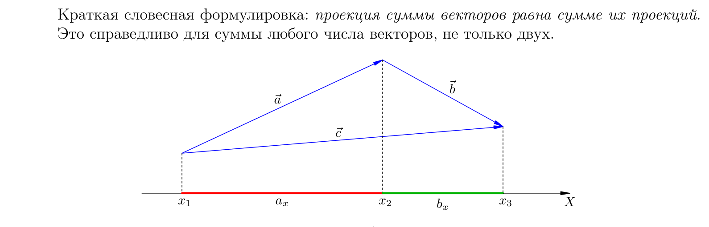

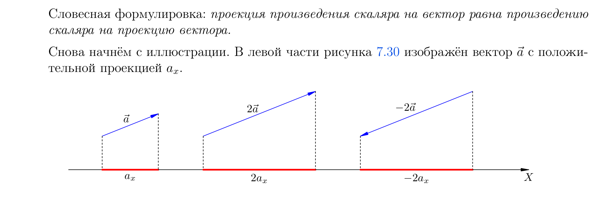

1. **Проекция суммы равна сумме проекций** — для любого числа слагаемых:

$$(a + b)_x = a_x + b_x$$

2. **Проекция произведения скаляра на вектор равна произведению скаляра на проекцию:**

$$(\lambda a)_x = \lambda a_x$$

### Операция проектирования в физике / Projection in physics

Оба свойства позволяют формально переходить от векторных равенств к скалярным: отбрасываем
стрелки в обозначениях векторов и ставим вместо них индексы проекций. Например, второй
закон Ньютона для маятника

$$m\vec{a} = m\vec{g} + \vec{T} + \vec{f}$$

(где `\vec{T}` — сила упругости нити, `\vec{f}` — сопротивление воздуха) при
проектировании на ось `X` превращается в скалярное равенство

$$ma_x = mg_x + T_x + f_x$$

---

## П.6. Векторы и координаты на плоскости / Vectors and coordinates in the plane

### Разложение вектора по базису / Decomposition with respect to a basis

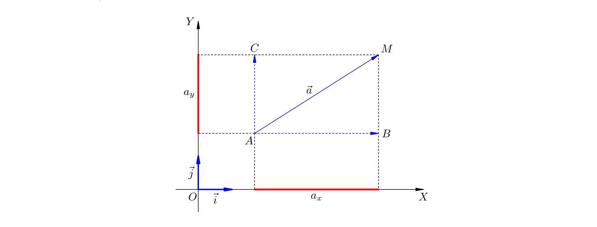

В системе координат `OXY` оси снабжаем единичными векторами `\vec{i}` и `\vec{j}` —
их длина равна безразмерной единице. Векторы `\vec{i}`, `\vec{j}` образуют **базис**
системы координат на плоскости. Любой вектор `\vec{a}` однозначно раскладывается по ним:

$$\vec{a} = a_x\vec{i} + a_y\vec{j}$$

Проекции `a_x` и `a_y` называются также координатами вектора `\vec{a}` в базисе
`\vec{i}`, `\vec{j}`.

### Нахождение модуля вектора по его проекциям / Finding the magnitude

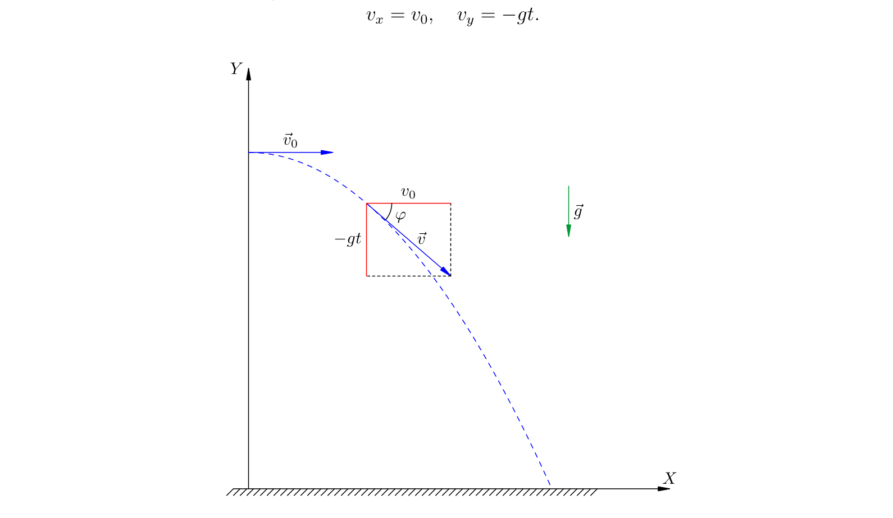

Из прямоугольного треугольника по теореме Пифагора (при любых знаках проекций
`AB^2 = a_x^2`, `BM^2 = a_y^2`):

$$a = \sqrt{a_x^2 + a_y^2}$$

**Пример.** Тело брошено горизонтально: `\vec{v} = \vec{v}_0 + \vec{g}t`. При осях `X`
горизонтально и `Y` вертикально вверх: `v_x = v_0`, `v_y = -gt`. Модуль скорости
спустя время `t`:

$$v = \sqrt{v_0^2 + g^2t^2}$$

а угол с горизонтом `\operatorname{tg}\varphi = gt/v_0`.

---

## П.7. Векторы и координаты в пространстве / Vectors and coordinates in space

### Разложение вектора по базису / Decomposition with respect to a basis

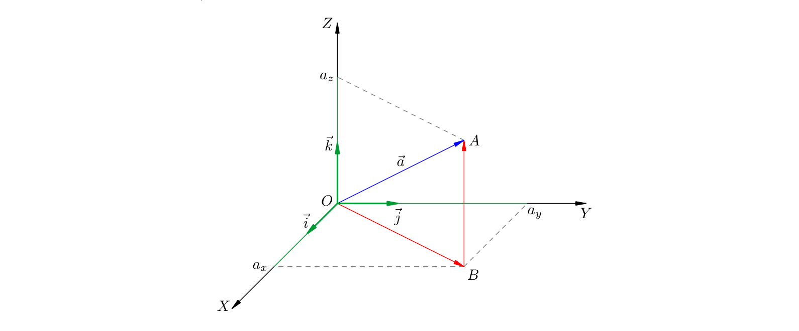

В системе координат `OXYZ` базис составляют единичные векторы `\vec{i}`, `\vec{j}`,
`\vec{k}`. Любой вектор раскладывается по трём осям:

$$\vec{a} = a_x\vec{i} + a_y\vec{j} + a_z\vec{k}$$

Числа `a_x`, `a_y`, `a_z` — координаты вектора в этом базисе.

### Нахождение модуля вектора по его проекциям / Finding the magnitude

Дважды применяя теорему Пифагора (сначала в плоскости `OXY`, затем в пространстве),
получаем пространственный аналог формулы модуля:

$$a = \sqrt{a_x^2 + a_y^2 + a_z^2}$$

---

## П.8. Скалярное произведение векторов / The scalar product of vectors

Работа силы `\vec{F}`, действующей под углом `\alpha` к перемещению `\vec{s}`, — это
произведение модуля параллельной составляющей силы на перемещение:

$$A = Fs\cos\alpha$$

где `F\cos\alpha = F_s` — проекция силы на ось перемещения, так что `A = F_s\,s`.
Это подводит нас к общему понятию скалярного произведения.

### Что такое скалярное произведение? / Definition

> **EN** The scalar (dot) product of vectors `\vec{a}` and `\vec{b}` is the scalar equal
> to the product of their magnitudes and the cosine of the angle between them:
> `\vec{a}\cdot\vec{b} = ab\cos\varphi`.
>
> **RU** Скалярное произведение векторов `\vec{a}` и `\vec{b}` — скаляр, равный
> произведению модулей векторов на косинус угла между ними: `\vec{a}\cdot\vec{b} = ab\cos\varphi`.

$$\vec{a}\cdot\vec{b} = ab\cos\varphi$$

Так как `a\cos\varphi` есть проекция `a_b` вектора `\vec{a}` на ось вектора `\vec{b}`,
имеем также `\vec{a}\cdot\vec{b} = a_b\,b`.

### Свойства скалярного произведения / Properties

1. **Коммутативность:**

$$\vec{a}\cdot\vec{b} = \vec{b}\cdot\vec{a}$$

2. **Скалярный квадрат.** Произведение вектора на себя равно квадрату его модуля
   (`\vec{a}^2` — скалярный квадрат):

$$\vec{a}\cdot\vec{a} = a^2$$

3. Произведение ненулевых векторов равно нулю **тогда и только тогда**, когда угол
   между ними прямой.

4. **Ассоциативность при умножении на скаляр:**

$$(\lambda\vec{a})\cdot\vec{b} = \lambda(\vec{a}\cdot\vec{b})$$

   Полной ассоциативности нет: `(\vec{a}\cdot\vec{b})\cdot\vec{c} \neq \vec{a}\cdot(\vec{b}\cdot\vec{c})`,
   поэтому выражение `\vec{a}\cdot\vec{b}\cdot\vec{c}` некорректно.

5. **Дистрибутивность:**

$$(\vec{a} + \vec{b})\cdot\vec{c} = \vec{a}\cdot\vec{c} + \vec{b}\cdot\vec{c}$$

### Скалярное произведение в физике / Scalar product in physics

Скалярное произведение — это скаляр, то есть число с размерностью; его размерность равна
произведению размерностей сомножителей. Из определения работы видно:

$$A = \vec{F}\cdot\vec{s}$$

При равномерном прямолинейном движении `\vec{s} = \vec{v}t`, и, поделив на `t`, получаем
мощность:

$$P = \frac{A}{t} = \vec{F}\cdot\vec{v}$$

Также благодаря дистрибутивности: если на тело действуют силы `\vec{F}_1` и `\vec{F}_2`,
то работа равнодействующей равна сумме работ каждой силы:

$$A = (\vec{F}_1 + \vec{F}_2)\cdot\vec{s} = \vec{F}_1\cdot\vec{s} + \vec{F}_2\cdot\vec{s} = A_1 + A_2$$

Силы складываются векторно, а их работы — алгебраически.

### Вычисление скалярного произведения в координатах / Scalar product in coordinates

**На плоскости** (базис `\vec{i}`, `\vec{j}`, где `\vec{i}\cdot\vec{i} = \vec{j}\cdot\vec{j} = 1`,
`\vec{i}\cdot\vec{j} = 0`):

$$\vec{a}\cdot\vec{b} = a_xb_x + a_yb_y$$

**В пространстве** (базис `\vec{i}`, `\vec{j}`, `\vec{k}`):

$$\vec{a}\cdot\vec{b} = a_xb_x + a_yb_y + a_zb_z$$

Подставив `\vec{b} = \vec{a}`, вновь получаем формулы модуля (7.15) и (7.17) — на этот
раз со стороны скалярного произведения:

$$a^2 = a_x^2 + a_y^2, \qquad a^2 = a_x^2 + a_y^2 + a_z^2$$

---

> **Примечание.** Формулы, определения физических величин и законы природы не являются
> объектами авторского права и могут свободно излагаться. Текст выше пересказан по
> учебной литературе; приложение излагает векторную алгебру как инструмент физики
> (по пособию И. В. Яковлева «Физика», MathUs.ru).

